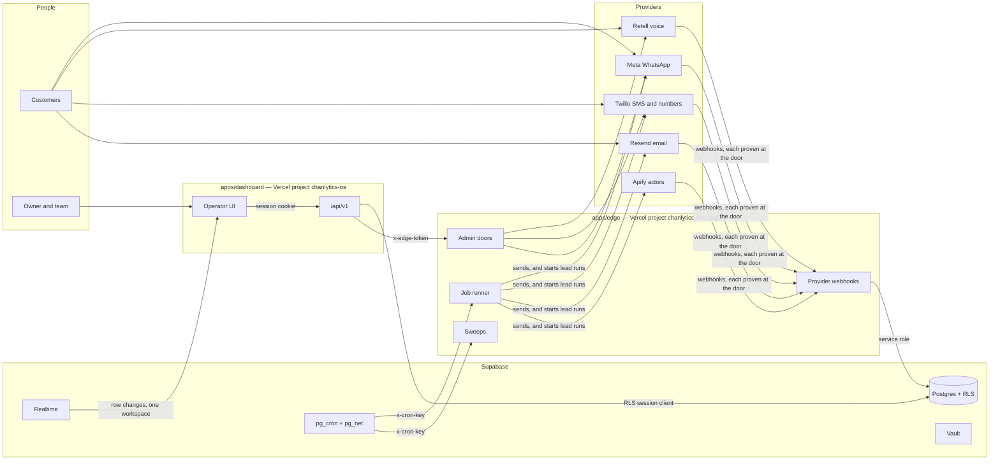

# Architecture

How Chanlytics OS is put together, for someone reading the repository for the
first time. `docs/glossary.md` has the words; `docs/runbook.md` says what to
type to run, deploy and roll back; `docs/system-prd.md` is the as-built
reference, sheet by sheet; `docs/decisions/` holds the designs that are
decided, built or not, and says which; `docs/takeover.md` scores the codebase against the
properties a takeover needs. Where this page and the code disagree, the code
is right and this page is stale.

## What it is

An omnichannel AI receptionist and lead engine for any business that turns a
conversation into a booked appointment. A customer writes on WhatsApp, texts
the business's number, phones its line or emails it; the receptionist answers
within seconds from the business's own facts, offers the times that are open,
sends the booking link, and hands over anything it should not decide. A team
watches it from a dashboard, takes a thread over, whispers into a live call,
and hands it back. The finder searches for new leads on the owner's behalf and
judges each one against what they asked for. Sequences send the routine
messages around an appointment, to people who said yes.

Three things it never does, enforced in code rather than in a prompt: it never
decides money, it never quotes a price where the workspace forbids it, and it
never books. `docs/system-prd.md` S-01 is the charter.

## The deployables



| Path             | What it is                                                                                                                                                                      | Deployed as                                          |
| ---------------- | ------------------------------------------------------------------------------------------------------------------------------------------------------------------------------- | ---------------------------------------------------- |
| `apps/edge`      | The webhooks, the sweeps, the job runner, the key-guarded admin doors, diagnostics. Vanilla Vercel Node functions, no framework. Holds every provider key and the service role. | Vercel project `chanlytics-messaging`                |
| `apps/dashboard` | Next.js: auth, the public pages, the operator UI, and the `/api/v1` app plane. Holds no provider key.                                                                           | Vercel project `chanlytics-os`, `app.chanlytics.com` |
| `packages/*`     | `contracts`, `core`, `db`, `channels`, `jobs`. Bundled into both apps.                                                                                                          | with each app                                        |
| `supabase/`      | The schema, replayed from zero in CI. RLS on every table, `events` partitioned monthly, pg_cron as the clock, Vault for credentials.                                            | Supabase project                                     |

The two apps deploy independently from `main`. A change both must agree on
ships in a shape that works whichever deploys first.

The edge's functions are built by `tooling/scripts/edge-functions.mjs`
(esbuild, every function in seconds) in the Build Output API's shape, and
Vercel deploys that output as it is: `apps/edge/vercel.json` has one static
build, which runs it, and holds each function's time limit. Its types are CI's
typecheck's to check.

The packages ship as their sources (decision 0074): the edge's modules reach
each through `apps/edge/lib/packages/<p>.ts`, which names it, and esbuild
bundles its sources into every function that imports it. The dashboard
compiles them with the app (`transpilePackages`), and the typecheck reads each
through its project reference.

**Where a module lives on the edge.** `apps/edge/api` is the doors, one file
per URL, grouped as the URLs are (`admin/`, `cron/`). A door authenticates,
reads its body and calls one verb, and answers what the verb answers; the
dashboard's routes do the same with a verb in `apps/dashboard/src/server`
(the `route-doors` measure holds it at none: no route file imports a
repository or a provider client). `apps/edge/lib` is everything the doors
call, grouped by domain: `receptionist/` (what it decides
and says), `whatsapp/`, `sms/`, `email/`, `voice/`, `lines/`, `leads/`,
`calendar/`, `google/`, `ops/` (who gets told). A domain earns a directory at
its second module; a domain that is one module sits at the root (`notes.ts`,
the note sweep), beside the edge's own plumbing: the environment, the logger,
the HTTP shapes, the Postgres handle, pagination, the two door guards, the
control-plane door, and the erasure check. The same rule holds in every tree
the code is grouped by domain in (each package's `src`,
`apps/dashboard/src/server`, `tooling/scripts`, `apps/mobile/src`), and not in
the URL trees, where a folder is a path (`apps/edge/api`, `apps/dashboard/app`,
`apps/mobile/src/app`); `tooling/scripts/tests/repo/contracts-barrels.test.mjs`
holds it.

## The five doors

Every request proves who is knocking before anything is read, but for the open doors and the handshakes named at the end of this section.

1. **Provider to edge.** HMAC over the raw body (Meta), Retell's signature (or, until `RETELL_DOORS_SIGNED` is set, the shared `RETELL_FN_SECRET` on the inbound, tool and availability doors: `apps/edge/lib/voice/voice-door-auth.ts`), Twilio's signature with the line's own token, Svix headers (Resend), ElevenLabs' signature over its post-call webhook, the token Google signs on a Gmail push, the client state a Graph subscription echoes, Stripe's signature. Apify signs nothing, so each run is started with a per-run token in its webhook URL, kept only as a hash and compared in constant time. A webhook whose write the database did not accept is not acknowledged, so the provider retries.
2. **Browser to dashboard.** A Supabase session cookie, its token's signature verified (`getClaims()`) by the proxy for every page, move and prefetch, and again by `withRoute` for every read; same origin required for every write. The signed-in frame reads nothing of the request, so it is one prerender for everyone (decision 0053, step 5).
3. **Dashboard to edge.** A token minted for one door, one workspace, one person, one minute (`x-edge-token`). The dashboard proves who the person is; the edge spends the provider key. The platform's shared key (`x-diag-key`) opens only the diagnostic (`/api/diag`) and the pager (`/api/admin/page`) on an edge that holds the secret, the doors nothing mints a token for (`PLATFORM_KEY` in `tooling/scripts/tests/edge/doors/door-policy.test.mjs`), and every key-only knock there is logged (`admin_door_key_only`).
4. **Database to edge.** `x-cron-key` on `/api/cron/*` and `/api/jobs/tick`, read from Vault on both sides.
5. **Provider to dashboard.** The ElevenLabs agent's custom-LLM requests to `/api/ask/voice/llm`, one per spoken turn of a voice conversation with Ask (`docs/decisions/0026-a-provider-calls-the-dashboard.md`). Two credentials, neither enough alone: the agent's static secret in its own header, compared in constant time, and the session's id the browser gave the agent at the start, found as a row the member wrote (`ask_voice_sessions`). The row carries the member's access token sealed with a secret the database does not hold; opened and verified as a bearer request is, it runs the turn as the member under RLS. The proxy exempts the door's three exact paths and nothing else under `/api/ask`. (Reading aloud is not this door: Today's Listen and an answer's Read aloud are a one-way clip the dashboard asks the edge for, door 3, `/api/admin/voice/speech`, in the same voice; nobody speaks back, so no agent and no session row.)

Who may knock on each edge door is pinned. `tooling/scripts/tests/edge/door-policy.json` holds, for each method of each file under `apps/edge/api`, its wrapper, the checks it reaches and the function that calls each, and what the door hands them (an admin door's audience, the platform's key). `tooling/scripts/tests/edge/doors/door-policy.test.mjs` reads them from the syntax tree, fails when they differ from the file, and rewrites it under `UPDATE_DOOR_POLICY=1`: a change there is a change to who may knock. Whether every path through a door passes its check is each door's own tests'.

The doors with no key: `GET /api/health` answers 200 or 503 so a pinger outside the failure domain can page a person, and `GET /api/version` names the commit the deployment was built from. The handshakes answer before a signature is checked: `GET /api/whatsapp` echoes Meta's challenge only for the verify token, and `POST /api/mailbox/graph` echoes Graph's `validationToken` when a subscription is made.

## What happened, and to which request

Three records answer it, and one name joins them.

- **The log.** One logger for every runtime, `packages/channels/src/log/`, which the edge (`apps/edge/lib/log.ts`) and the
  dashboard's server (`apps/dashboard/src/server/log.ts`) re-export with their own closed set of event names
  (`LOG_EVENTS`, `DASHBOARD_LOG_EVENTS`), and core, jobs, db and channels write through directly (db through a port an app
  hands it). One JSON object per line on stdout: `level`, `event`, `request_id`, `tenant_id`, then the line's own fields,
  each redacted where it is written, by the key it sits under and by what it looks like: a number keeps four digits, an
  address its domain, words their length, a credential nothing. `no-console` holds every tree, Ask's included. What a
  line holds is `docs/runbook.md`, "Read the logs".
- **The request's name.** Minted once where a request enters: `withRoute` for a route, `door()` for an edge door (the
  platform's id for the invocation, or a fresh one; an admin door takes the dashboard's, signed into the token the
  dashboard minted for the call, so a header cannot rename it). It is held by an `AsyncLocalStorage` for what the request awaits and no longer, answered as `x-request-id`,
  carried on every call the dashboard makes to the edge, written into the payload of every job the request schedules
  (the tick runs the job as that request, or as its own row for a clock's), sent to the database on every call so the
  ledger's rows say it (`events.request_id`), and read by the logger on every line.
- **The ledgers.** `events` says what happened and `decisions` who decided, as before; a team change is one transaction
  with its decision, and playing a call's recording is a decision too (`open_recording`). Beside them, one row per
  workspace per day is counted (`platform_metrics`, rolled up nightly): messages, answers, held and handed over, latency,
  failed sends by outcome, tokens; a workspace whose customers wrote all day and got no answer pages the platform.

What the browser hits is told to the same log: each error boundary sends its report once to
`POST /api/v1/client-errors`, logged as `client_error`. A provider's breaker that opens says so (`breaker_open`, and
`breaker_closed`), and `/api/diag` reads each provider's state.

## A message in

Each channel has a door on the edge whose verb (in `lib/<domain>/`) verifies
the wire, and a plan function that decides what to do with what arrived, run
over a database in memory by a test.

| Channel  | Door                                                                                             | Decides                                | Then                                                                                                                                                                   |
| -------- | ------------------------------------------------------------------------------------------------ | -------------------------------------- | ---------------------------------------------------------------------------------------------------------------------------------------------------------------------- |
| WhatsApp | `apps/edge/api/whatsapp.ts`                                                                      | `packages/core/src/inbound/steps.ts`   | `packages/core/src/inbound/answer.ts`'s phases: persist, read the posture, ask the brain, deliver or hold (the edge adapts it in `apps/edge/lib/whatsapp/inbound.ts`)  |
| SMS      | `apps/edge/api/inbound-sms.ts`                                                                   | `apps/edge/lib/sms/sms-ingress.ts`     | The door records the text and answers Twilio; an `inbound_answer` job runs the same handler, with the carrier's consent words and the texting rules (00347)            |
| Voice    | `apps/edge/api/retell-inbound.ts`, `retell-fn.ts`, `retell-availability.ts`, `retell-webhook.ts` | `apps/edge/lib/voice/call-start.ts`    | The call runs at the provider from the same business facts; the webhook writes the call into the thread                                                                |
| Email    | `apps/edge/api/resend-webhook.ts`                                                                | `apps/edge/lib/email/email-ingress.ts` | An `email_ingest` job fetches the message and `packages/core/src/messages/email-ingest.ts` takes it into the thread. The receptionist drafts only on a reach-out reply |

The receptionist itself: `apps/edge/lib/tenant-runtime.ts` reads the
workspace's config through one door; `packages/contracts/src/config/workspace-config/compose.ts`
composes the system prompt from the business's facts; `apps/edge/lib/receptionist/brain.ts`
asks the model and reads a structured answer (`packages/contracts/src/config/brain.ts`);
`packages/core/src/inbound/reply-posture.ts` is the truth table of whether it may speak at
all; the Autonomy matrix and the confidence dial decide whether the answer goes
now, waits in a veto window, or waits for a person.

The inbound path is WhatsApp-shaped today and SMS rides it by conversion. The
channel-neutral pipeline that replaces it is `docs/decisions/0001-channel-neutral-inbound.md`.

**A reply to a reach-out** (Reach out Part 5, 00222) is read before anyone
answers it, in a job of its own. The `email_ingest` job keeps the email as it
keeps any, then asks `reach_out_reply_of`: does it answer or cite one of the
workspace's reach-out emails of the last 30 days, or is its person a lead's a
reach-out wrote to? For such a reply the intake schedules one `reply_read`
job through `ctx.scheduleOnce` (one live job per message and stage, held by
the `jobs_reply_read_once` index), flags a person's reply (not an automatic
one) for a person, and tells nobody itself. The job's adapter
(`packages/jobs/src/reply-read.ts`) builds
ports over the edge's reader (`apps/edge/lib/reach-out/reply-read.ts`) and
runs core's `readReply` (`packages/core/src/messages/reply-read.ts`): it asks
Haiku through `lib/model.ts` for the reply's intent, under the workspace's
day of reads; hands contracts' `readingPlan` to one service-role door,
`reach_out_reply_apply`, which applies it in one transaction (the lead
Talking, a no through the consent door, a dated step, the reading kept in
`sequence_replies`); asks the receptionist's brain for a draft, kept on the
reading and never as a message row (`apps/edge/lib/reach-out/reply-draft.ts`,
decision 0017); and tells the workspace once, a claim then the mark only once
`notifyOnce` answered. A reply that could not be read is scheduled again
under a stage of its own (`reread-<n>`). The reading stops and labels; it
never sends.

## A message out

Everything leaves through one door: `packages/core/src/deliver.ts`. It names
the send's purpose (conversational or marketing) and kind (reply, draft,
broadcast, system, answer), re-reads the person's consent, the thread's pause
and the workspace's status at the wire, and refuses rather than guesses when a
wire is missing. A workspace's wires are bound by the edge from that
workspace's own credentials; the environment's keys never send for another
business.

A cold email (the `outreach` purpose, Reach out) is always a broadcast, and
asks more of the door. One call, `outreach_mailbox_facts` (00424), answers
whether the business is a lead still being written to, whether its address is
on the never-again list, whether the person ever wrote back or phoned (00181),
and which of the workspace's connected mailboxes its From is, with that
mailbox's day (`mailbox_capacity`); the refusals are words in contracts
(`PURPOSE_REFUSALS`). Email leaves by one of three lanes (`emailSender`,
`packages/core/src/wire-senders.ts`): the hosted lane, the workspace's address
on the platform's mail account, for everything a person or the receptionist
answers; the campaigns lane, for the offers a customer asked for; and the own
lane, a mailbox the business connected (decision 0056), for outreach, and for a
person's reply to a reach-out that can go from it. The own lane's route is not
a key: it is a closure over the mailbox's row (`ownRoutesFor`,
`apps/edge/lib/email/mailbox/mailbox-wire.ts`) that takes its token from Vault,
writes the frozen request as MIME (`packages/channels/src/mailbox/`) and sends
it through Gmail's or Graph's own send. What the send learns about the mailbox
is applied at once: a provider's day used up rests it until the next UTC
midnight, and a grant gone sets it to reconnect and tells its owner once; the
send itself comes back as a wait. A sent email is stamped with the Message-ID
and thread the mailbox kept (00424 `stamp_email_from_mailbox`), which no
receipt brings later. A cold send never moves its thread, and a failure is
recorded on its row rather than flagged.

A person's reply to a business a reach-out wrote to leaves from the mailbox
the reach-out wrote from, and as the hosted address whenever that mailbox
cannot carry it (Reach out Part 5, C15, N5). The dashboard freezes the reply
twice (`replyIdentityOf`, `apps/dashboard/src/server/connections/email.ts`):
the hosted address's request, as every reply before, as `meta.email.request`,
and, when the reach-out email it answers left one of the workspace's
mailboxes that still sends, a twin from that mailbox as
`meta.email.own_request`. The door marks only a person's own reply (`kindOf`
is `reply`), and the wire's `emailSender` sends the twin by the own route
whose address is its From; otherwise it sends the hosted request, which every
edge can send, so either deploy order and a rollback are safe. Which one left
is stamped on the row (`meta.email.left_as`, `own` or `mailbox`, with the
reason; 00226 `stamp_email_left_as`), and the thread says so when it was the
hosted address.

A connected mailbox is read back, never forwarded (decision 0056). The
mailboxes clock (`/api/cron/mailboxes`, every five minutes,
`lib/email/mailbox/mailbox-sweep.ts`) keeps each one's watch (Gmail's
`users.watch` on a Pub/Sub topic, Graph's subscription), reads what arrived
since its cursor (Gmail's history, Graph's delta) and fetches only messages in
a thread a reach-out started (`mailbox_threads_known`), and a delivery report
however it is threaded: a report becomes the bounce it reports
(`applyEmailReceipt`), a reply an `email_ingest` job whose payload says
`source: mailbox`, read by the same intake verb over the mailbox's own fetch.
The providers' pushes (`/api/mailbox/gmail`, a Pub/Sub OIDC token;
`/api/mailbox/graph`, its clientState) only make a sync happen sooner, under
the same lease. The clock also judges each mailbox's own mail once an hour
(`mailbox_connection_counts`, contracts `mailboxHoldOf`: any complaint, or
hard bounces and refusals, or unsubscribes, past 3% of at least 150 sent;
never a reply's no) and holds it until its owner's
Resume, keeps its ramp's days (10, 20, 30, 40 a day at 0, 7, 14 and 21 days
sent, 20 at most on the business's customer domain, never past its owner's
cap) and reads its DNS daily.

A reach-out (Part 3) is a chain of `sequence_steps` rows over a lead search, and
each lead in a step's run is a send (`sequence_sends`). The run is planned
whole in SQL (00185); the reach-out clock (`/api/cron/reach-out`, every
minute) reads what became of the emails it wrote, then claims what is due
under each mailbox's lock (`reach_out_claim_from`, within its day) and writes
each email rows first: the email row under an id derived from the send, its
`outbound_send` job, then the send queued. A lead keeps the mailbox its first
email left from for the whole chain, so a nudge answers in the same thread;
one whose mailbox was removed is not written to again. It leaves through the
one door, which asks `outreach_mailbox_facts` about that send's own lead. The reads that choose each step's work are bounded SQL
functions (00186, 00187), and any list of ids the clock still sends goes a
hundred at a time: a list of ids in a URL breaks past about two hundred, and
a page cut at a thousand rows would have finished a run with a send open.

Every reach-out email is checked before the claim may take it (Part 4,
00197). The check is a clock of its own (`/api/cron/reach-out-check`, every
minute, `lib/reach-out/check.ts`), not a phase of the reach-out clock, so a
slow model never takes the claim's minute. It leases a few unchecked sends
of each workspace, asks each workspace's gates before any call (may it
spend, room in its month, its model attempts for the day), and for words
that name `{{opening}}` asks Haiku twice through `lib/model.ts`: a writer
over the business's record, then a reader. Code reads both answers
(contracts `checkOpening`, `openingVerdict`); a broken rule asks one
rewrite, then the send is held with its reason for its owner. Each send is
stamped with the words it was checked against, and the sender sends it back
to be checked when they changed. The model is injected (`AskModel`), so the
tests script it.

A reach-out is made from the sheet, through one route and one database door.
The Leads door opens the sheet (`pages/reach-out/`, fed by
`legacy-bridge/reach-out/reach-outs.ts`); `POST /api/v1/reach-outs`
validates the chain in contracts, and `reach_out_save` (00211, the service
role's, called with the member's id after the route's role check) writes its
email templates and playbook rows in one transaction. Start asks the edge's
run-now door, which runs the chain's root through `lib/reach-out/run-step.ts`,
the playbooks sweep's own loop body, so the first run waits for its owner at
once. What the owner then answers (Approve, a held email's four doors) goes
through the session's own doors, and Broadcasts reads the run from its sends
(`server/campaigns/reach-outs.ts`, `reachOutRunOf`).

A send that happens later is a job: `packages/jobs` is the ledger (`claim_due_jobs`, a lease, a heartbeat, `settle`), `apps/edge/api/jobs/tick.ts` runs it, and `packages/jobs/src/handlers.ts` maps each kind to a core verb. Every clock is a timestamp on a row that a sweep acts on, and every sweep is registered in `sweep_status` and judged by `/api/cron/health`.

## The model layer

Every model the platform pays for is asked one way, and the decisions about it are written once (scorecard move 10; the AI
lane's plan is `docs/plans/2026-09-29-s10-ai.md`).

- **A registry by purpose** (`packages/contracts/src/ai/models.ts`): the receptionist's answer, a draft of it, Ask's round,
  the small JSON drafts, a review's reply, the lead judge, the note sweep, the reach-out check and the reply reader each
  have one route: the model, its fallback, the bound of a try, its retries and its cap. Nothing else names a model. A
  purpose whose answer is a closed set may name a shadow port beside it.
- **The primary port** (`packages/channels/src/models/anthropic.ts`, over `providerFetch`): the request, the answer read and
  one outcome (`ok`, `rejected`, `unreachable`), a "not now" asked again on the same model, an answer that never came
  (a 529, a 5xx, a timeout) asked once of the purpose's fallback. The edge binds it to the key in `apps/edge/lib/model.ts`,
  which first asks whether the workspace may use the model for what a person asks for (`mayUseModels`: not paused, not
  ended, not unbilled) and writes every call to the ledger.
- **The ledger in dollars** (`ai_usage`, 00273; `packages/db/src/ai-usage.ts`): one row a call with the model asked, the
  model that answered, four kinds of tokens and the price at list (`contracts/ai/usage.ts`), kept 400 days. A member
  reads their workspace's (`GET usage` rolls the month up for an owner), the health sweep pages on its failures
  (`apps/edge/lib/ops/model-watch.ts`), and a new workspace starts with a day's budget (00274).
- **A turn, kept as the model read it** (`model_turns` and `model_prompts`, 00401; decision 0039): where the
  receptionist's door is told the conversation it answers, it keeps what the model read beside its prompt (the clock,
  who the person is, an owner's steer, the thread) and what it answered before layer two, for thirty days, and the
  prompt's text once under its hash; the reply's record names the turn (`meta.turn_id`). Keeping it is the door's last
  act and never costs the answer (`apps/edge/lib/model.ts` `keepTurn`). No session reads either table; an operator
  reads a turn with `tooling/scripts/ops/turn-read.mjs`. An erasure takes a person's turns with their conversation and
  any other turn that names them (`model_turns_scrub`), and both keeps are the database's own nightly clock
  (`purge_model_turns` in `sweep_status`).
- **The settings, at each version** (`tenant_config_versions`, 00402; decision 0039): a trigger on `tenant_config`
  keeps the settings as they stand under every version, in the save's own transaction, and holds the version to the
  database (a changed config takes the next number, and a number never goes back), so the `config_version` a reply is
  stamped with opens the settings it was written under. Kept while in force and 400 days after; read by no session.
- **One injection policy** (`contracts/ai/fence.ts`): someone else's words reach a model only inside a fence they cannot
  close, and every system prompt shown such words carries one rule line. Ask fences where data becomes something the
  model reads: a tool's result (`server/ask/round.ts`), a read made ahead of the question
  (`server/ask/cross-page.ts`) and the page's own rows (`server/ask/context.ts`); the tools themselves answer plain
  JSON.
- **A second port, in shadow** (`packages/channels/src/models/typesafe.ts`; decision 0023): TypeSafe's Jev is asked the
  receptionist's, the reply reader's and the lead judge's closed-set questions beside the primary while
  `TYPESAFE_SHADOW=1` and its key are set. Its answers are compared with the primary's and kept in the same ledger
  (`shadow` rows, 00275), read a week at a time by `ai_shadow_agreement`, and never used; a failure of it is logged and
  never reaches a customer. `apps/edge/lib/shadow.ts` runs it.
- **The switches** are listed once, with an owner and a day (`contracts/ai/flags.ts`), and the receptionist's regression
  cases run nightly against a sandbox key when the repository holds one (`.github/workflows/nightly-evals.yml`).

## The packages, and the direction of dependency

```
contracts            pure: types, schemas, view models, the composer
   ^     ^
   |     |
  db   channels      repositories; provider adapters
   ^     ^
   \     /
    core             verbs over ports, and the one send door
     ^
     |
   jobs              the ledger and the handlers that call core
```

Arrows point at what a package depends on, read upward: `jobs` depends on
`core`, `db`, `channels` and `contracts`; `core` on `db`, `channels` and
`contracts`; `db` and `channels` on `contracts` alone; `contracts` on nothing.

| Package     | Holds                                                                                                                                                                                                                                                                                                                                            | Rule                                                                                                                                                                                                                  |
| ----------- | ------------------------------------------------------------------------------------------------------------------------------------------------------------------------------------------------------------------------------------------------------------------------------------------------------------------------------------------------ | --------------------------------------------------------------------------------------------------------------------------------------------------------------------------------------------------------------------- |
| `contracts` | Types, zod schemas, the closed sets generated from the database (`schema-sets.generated.ts`), the view models every page reads, the prompt composer, the words the UI says                                                                                                                                                                       | Pure. No client, no framework, no environment. It is larger than its name: view models and prompt composition live here today                                                                                         |
| `core`      | The use cases as verbs over ports: `conversations` (reply, take over, hand back, snooze, wake, resolve, archive), `campaigns` (assemble a run, create a broadcast, run a playbook, approve, cancel), `messages` (send, broadcast batch, email intake, line provisioning), `leads` (the finder's runner, judge, cleaning, endings), and `deliver` | A verb takes a `ports` object and a command and returns an outcome. No database client, framework, provider or environment inside a verb. The adapters live at the doors                                              |
| `db`        | Supabase repositories, the generated database types, realtime                                                                                                                                                                                                                                                                                    | The one place a table name is typed. The names still typed outside it, and the SQL functions called there by name, are counted by the `tables` measure, which may only fall (`docs/debt.md`) |
| `channels`  | Provider adapters: Meta (WhatsApp, templates, Embedded Signup), Retell (calls, agents, the prompt shell), Twilio (lines, SMS, A2P), Resend (email), Google (Places, Business Profile, OAuth), Apify (actors), the lead judge, the edge token, and the platform's one logger and its request store                                                | Owns each provider's wire format. Knows nothing about threads                                                                                                                                                         |
| `jobs`      | The ledger, the tick, the handlers, escalation on failure                                                                                                                                                                                                                                                                                        | Handlers build ports from the job's context and call core                                                                                                                                                             |

## The app plane

`apps/dashboard/app/api/v1`: every handler is declared with `route()`
(`apps/dashboard/src/server/route.ts`) and says five things: which workspace
it acts on, who may call it, which rate bucket it spends, whether it may spend
the platform's money, and the schema its input must pass. One pipeline
enforces them in a fixed order, so a viewer is refused before a token is spent.
`route-policy.json` pins every route's declaration; a change there is a change
to who may do what. `apps/dashboard/src/client/routes.generated.ts` is the
typed client, and `docs/api.md` the reference of what each route takes, both regenerated from the same declarations.

## Tenancy

Row Level Security is the floor: it stops cross-tenant access on every table.
The role check in the route is the door: it decides which member may do a
thing. Both are needed, because the job that delivers a message runs as
service role and RLS is not in that path. Privileged writes go through
`SECURITY DEFINER` functions with a pinned search path, each the one audited
place its privilege exists. The exceptions still standing are counted, each by
a measure that may only fall (`docs/debt.md`): a table written by more than
one door (the `writers` measure), and a reach of the
service role in the dashboard (the `service-role` measure).
A forbidden UPDATE does not raise under RLS; it matches zero rows and reports
success, so every permission-sensitive update selects and counts.

## The shell

The operator UI is TSX. Each page is a surface, a folder under `apps/dashboard/src/surfaces/` beside the kit and the
frame, drawn on an App Router page under `apps/dashboard/app/(os)/w/[workspace]/` that reads no request, so each is one
prerender for every person and workspace (decision 0053, step 5). The address is a path, `/w/<slug>/<route>`; a
`#/<route>` address, which emails, bookmarks and the phone app still carry, is moved to its path as the frame loads. The
frame (the route table, the sidebar, the top bar, the strip of views) is TSX in `apps/dashboard/src/surfaces/frame/`,
drawn by the workspace's layout (`apps/dashboard/app/(os)/w/[workspace]/layout.tsx`, through
`apps/dashboard/src/legacy-bridge/LegacyHost.tsx` and `apps/dashboard/src/legacy-bridge/LegacyApp.tsx`), so it stays
mounted across a move. Every page reads its data through one seam, in `apps/dashboard/src/legacy-bridge/`:
`surface-data.ts` (what an override is, and its reads), `surface-registry.ts` (what each route is, draws and hears) and
`surface-runner.ts` (when each surface is read).

It began as a design mockup, a single-page shell of classic scripts imported in a fixed order and talking through
`window`, and was made real one surface at a time; then each surface left it in the order decision 0015 gives, and the
frame after them. `apps/dashboard/src/legacy` keeps what has not left: Ask's Line, its five pages
(`apps/dashboard/src/legacy/pages/ask-*.jsx`, a chunk of their own that
`apps/dashboard/src/legacy-bridge/ask/line-code.ts` loads) and its face
(`apps/dashboard/src/legacy/components/ask-face.jsx`, which `apps/dashboard/src/legacy-bridge/manifest.ts` loads); the
stylesheets (`apps/dashboard/src/legacy/styles/*.css`, `apps/dashboard/src/legacy/styles/tokens.css` among them); the
standalone mockup (`apps/dashboard/src/legacy/Chanlytics.html`) and its stand-ins for what the bridge publishes
(`apps/dashboard/src/legacy/data/bridge-stubs.jsx`); and the tree's own conventions
(`apps/dashboard/src/legacy/CLAUDE.md`). Ask's pages and its face still read names that the bridge, the frame
(`apps/dashboard/src/surfaces/frame/frame-globals.ts`) and the overrides publish on `window`,
`apps/dashboard/src/legacy-bridge/seed-globals.ts` and `apps/dashboard/src/legacy-bridge/ask/line-globals.ts` among
them. Nothing new goes in the tree, whose files the `legacy-files` measure counts; every
`window.__*` name still read or written is counted by the `window-globals` measure, and every
site that publishes on `window` (`window.x =`, `Object.assign(window, …)`) by
the `window-publishers` measure. Each of the three may only fall (`docs/debt.md`). Two things
keep the surfaces honest:

- `apps/dashboard/src/legacy-bridge/surface-registry.ts` classifies every route as `real` or `demo`. A demo surface
  renders the "not in this release" card outside a declared demo session, and a test fails CI if the shell declares a
  route the table does not classify.
- `apps/dashboard/src/legacy-bridge/surface-data.ts` is the seam that feeds a real surface from `/api/v1`: an override
  reads, maps the rows through a contracts view model and publishes what the page draws. An override lives beside the
  page it feeds, under `apps/dashboard/src/surfaces/<surface>/`, and publishes the surface's typed value, which a page
  reads with `useSurface("<key>")` (`apps/dashboard/src/surfaces/use-surface.ts`, over
  `apps/dashboard/src/surfaces/surface-values.ts`), mirrored under a `window` name only while a reader that has not
  moved remains (`declareSurfaceValue`). The ones several pages read stay in `apps/dashboard/src/legacy-bridge/` and
  `apps/dashboard/src/legacy-bridge/surfaces/`: Google's publishes a typed value alone; the settings read publishes one and still writes
  `window.__*` globals of its own beside it; the workspace, the bell's notifications and a reach-out's replies write
  `window.__*` globals alone, which the `window-globals` measure counts. Nothing a real
  surface draws may state a fact the database cannot support. A zero is a measurement and is shown; an invented number
  is not.

The unbuilt surfaces (agent fleet, store, studio, tasks, content) are parked by decision: each address draws the "Not
in this release" card, a demo session's too (`apps/dashboard/src/surfaces/frame/route-table.tsx`). The shared report
viewer draws the card outside a demo session, and opens only in one
(`apps/dashboard/src/surfaces/frame/app-shell.tsx`). The retired deal board's address, `pipeline`, lands on People
outside a demo session (`SURFACE_RETIRED` in `apps/dashboard/src/legacy-bridge/surface-registry.ts`) and draws the card
in one. Their mockups, the seeded Lists and Ask palette and the seed data only they read lived in the legacy tree's
demo folder until #1695 (17 October 2026, the closed-loop audit's S2): git keeps them. The shell's route names and the
API's nouns do not all agree yet; `docs/glossary.md` lists them.

**Where the shell's state lives.** Three kinds, each with one owner:

- _The workspace's rows_ are read through the seam into each surface's typed value (and its `window` mirror, while one
  is declared), never by a page. A read made outside a surface (a link, a search, the boot's own, a sheet or a pane as
  it opens) is listed, with how it stays fresh and why that is enough, in
  `tooling/scripts/tests/baselines/on-demand-reads.json`, which may only fall (`docs/debt.md`). One read is out at a
  time for each surface, so the newest read lands last (`surface-data.ts` `activateOverride`); the workspace's own
  topic says what changed (decision 0019) and each tab
  re-reads only the surface that changed. A surface that hears a record only on its page hears it where its page's row
  in `PAGE_HEARS` (`apps/dashboard/src/legacy-bridge/hearing/page-hears.ts`, read through `surface-registry.ts`, one row
  per family of addresses) names it, and keeps it for its page elsewhere; the goldens under
  `tooling/scripts/tests/baselines/hearing/` say what every page reads, and at what cost, for each notice (decision 0058).
  A write re-reads what it may have made stale, from one table (`refresh-map.ts`), which holds every write
  to a list of surfaces or to a reason it needs none (`refresh-coverage.test.mjs`). The browser keeps the last reads in
  `localStorage`, one slot per workspace, so a reload, a new tab and the next visit paint at once (`surface-cache.ts`);
  a sign-in clears it before anything is read, a sign-out, a refused session or a switch of workspace or person seals
  it, and a snapshot older than a day is never drawn.
- _A device's_ preferences (the theme, the look, the rail) live in `localStorage` and nowhere else
  (`device-prefs.ts`); _a tab's own_ (a view's place, a half-written draft) in `sessionStorage` through the one store
  (`tab-memory.ts`); and what only one component cares about, in that component.
- _Who is acting_ is one answer, `identity.ts` (`roleOf`): the member's role from the workspace's read, lowered by an owner's View-as,
  failing closed. Every gate asks the role store it completes (`ST_STORE.myRole()`, `mayAtLeast`); the one gate that
  still reads `__ME.role` is Ask's palette's, for what it offers (`apps/dashboard/src/legacy-bridge/ask/palette.ts`).

A component draws again when a surface it draws from lands or changes status, and by nothing else. A page names its
surface by key, `useSurface("people")` (`apps/dashboard/src/surfaces/use-surface.ts`), and the frame names a surface, a
list or a route (`surfaceHook` in `surface-status.ts`; a route's surfaces are `surface-registry.ts` `routeSurfaces`),
which the shell names for the page on screen. The counts live in `surface-status.ts`, bumped by each surface's own
events before React draws. A surface's status changing is news; a read that changed nothing is not, so a message no
longer draws the whole shell seven times. The hand-written `surface:*` listeners that remain either do something a
redraw does not (reseed a list and keep a thread open, say what a re-read did to it) or wait to be folded into
`useSurface`; a new page names its surfaces.

**How a page opens.** Six things decide how soon a page has its rows, each with one owner, and a new page takes all
six. Measured on production, 9 October 2026: the Inbox had its rows 350 ms into a load and the Calendar its weeks at
900, with the same page code drawing in 30 ms once the rows were in; the difference was when each was asked for.

- _Its first reads leave from the document's head._ `packages/contracts/src/shell/route-prefetch.ts` (`PREFETCH_READS`)
  names what each page opens on, spelled as the client spells it; the head starts them before a script has loaded, and the
  page's own read takes the answer in place of a fetch (`apps/dashboard/src/client/api.ts`). A read that needs something
  only the server knows is made sayable by its route, never left out: the Calendar asks for `around=today` and the route
  works out the weeks by the business's clock. `tooling/scripts/tests/shell/surfaces/route-prefetch.test.mjs` runs each
  page's surfaces against the list, and fails a page that has no entry. A page that also names what it draws beside its
  own (`PREFETCH_BESIDE`: Today and the Inbox) asks for its whole first screen as one streamed read instead
  (`apps/dashboard/app/api/v1/open/route.ts` over `apps/dashboard/src/server/workspace/page-open.ts`): its own reads,
  then the rest, each answered by its own route past one session check, one membership read and one readers' turn, and
  parked for the page under the URL it reads it by (decision 0053, step 2). A record the address names rides with them:
  a person's page reads the person, and the thread an Inbox address names has its person read in the stream's first tier
  (`THREAD_PERSON_READ`).
- _The boot reads the page's own first._ Who is looking, the page's surface and what it draws beside it
  (`ROUTE_DRAWS`, `apps/dashboard/src/legacy-bridge/hearing/route-draws.ts`, read through
  `apps/dashboard/src/legacy-bridge/surface-registry.ts`), then everyone else's
  (`apps/dashboard/src/legacy-bridge/surface-runner.ts`). What waits for the boot (a warm, Ask's follow-ups, a list's
  people ahead) waits for this one (`workspace.ts` `afterBoot`; the shell says a boot is coming before anything asks).
- _Nothing lands over what is drawn._ What stands above a page's own content or in it is waited for by its first draw
  (`ROUTE_WAITS` beside `ROUTE_DRAWS`, the code of such a part too, and a read the page can name only once its own is in,
  as the Inbox's opening thread's person: `surface-status.ts` `firstDrawWaitsFor`), is read in
  the first tier of its stream (`PREFETCH_READS`), and comes first in `ROUTE_DRAWS`; the second tier (`PREFETCH_BESIDE`)
  lands after the first draw, so only what stands below the fold reads there. Measured on Today before it held (27 October
  2026): the Setup card, Going today, a run's seat, a review's row and the drafts' words each landed after the queue and
  moved it; and on the Inbox (28 October 2026) a template thread's reply box and the head's deal and visit chips each landed
  after the thread, the box pushing the conversation up 145 to 162 px. A page of panes says each pane's (Settings:
  `PREFETCH_READS` and `ROUTE_DRAWS` under `admin/<pane>`), and holds a load's first draw for them alone
  (`apps/dashboard/src/surfaces/settings/frame/pane-reads.ts`), never a move between its panes, since the gate swaps the
  whole page for "Reading…"; what a pane reads that is no surface is kept in the tab and begun as its row is reached for. A
  page of views asks its view's row before its own, as `ROUTE_DRAWS` is asked (`surface-registry.ts` `routeWaitsFor`): a
  sequence's steps wait for the settings read their words are in, New for the playbooks read its starts are made of, and
  Messages for the number it sends from, and none for another view's (the Campaigns load review, 28 October 2026). A part
  that is still being read draws nothing, never the word for none.
- _What is read only where it is drawn is read as its page is reached for._ A surface marked `onDemand` (Reports among
  them) is on no other page's boot; a pointer at its row in the sidebar, or the phone's drawer opening, starts its reads
  (`surface-registry.ts` `warmWhatItDraws`), so the press finds them in or on their way.
- _The browser keeps what it read._ The last read of every surface paints before React draws (`surface-cache.ts`), and a
  view the tab has held paints at once and is read again behind (`apps/dashboard/src/legacy-bridge/held-views.ts`). A
  snapshot outlives a deploy that left its value's type alone (`apps/dashboard/src/legacy-bridge/surfaces/shapes.generated.ts`, written by
  `tooling/scripts/gen/surface-shapes.mjs` and checked by the dashboard's typecheck), and over its size the slot sheds
  first what the page on screen does not draw.
- _Its page is the build's, and a press on it asks for nothing._ Every page under `apps/dashboard/app/(os)` reads no
  request, so it is prerendered once for every person and workspace (decision 0053, step 5): a document is the build's
  file, and a warm (`apps/dashboard/src/legacy-bridge/workspace.ts` `warmRoute`) is the build's segment files, which
  serve every address of the page's route. A page that read the request would be a render per request again;
  `check:static-shell` fails the build that makes one.
- _Round trips that need nothing of each other go together._ A reader asks for them at once and waits for all
  (`apps/dashboard/src/server/readers/`): one after the other, the Calendar's read spent 180 ms on the server for a
  workspace with no calendar.

**How long it took** is said by the page itself (decision 0053). Each part a person waits for calls
`usePartShown(page, part, ready, key)` (`apps/dashboard/src/surfaces/use-surface.ts`), the value it draws from as
`ready`, and `PRIMARY_PART` (`packages/contracts/src/shell/vitals.ts`) names the part whose READY is its page's; a page
with none is READY when its route's gate opens and the frame paints. The timer (`apps/dashboard/src/client/page-speed-rules.ts`, installed by `page-speed.ts` beside it)
times it from the press or the document's start and says what the time went on, from the resources the browser fetched
and the `Server-Timing` each route's answer carries: `auth`, `app`, `db` and each reader
(`apps/dashboard/src/server/server-timing.ts`). `docs/runbook.md`, "See how fast the pages are", reads them.

## The interface

The plan (`docs/plans/2026-09-28-the-interface-kit-and-its-looks.md`) puts
what a page looks like in two places: the tokens hold every value, and the
kit draws every primitive from them. A new look is then an edit to the
tokens, and a new kind of button an edit to the kit. Phases 1 and 2 built
both. The pages still write values and primitives of their own, which leave
as each surface moves onto the kit (the plan's Phase 4).

```text
apps/dashboard/src/legacy/styles/tokens.css   the scales, each theme's colours, the roles, the looks
apps/dashboard/src/surfaces/kit/kit.css       the kit's own rules, reading the tokens
apps/dashboard/src/surfaces/kit/*/*.tsx       its components, a folder each, for a surface written in TSX
a page's own stylesheet                       its layout; until Phase 4, its own primitives and values too
```

**The tokens, in tiers.** The scales sit on `:root`: type, space, radii,
motion, the tones and the accent, and the lengths every page shares (the
measures, the rails, a list row on a phone). Each theme, light or dark, sets
its own grounds, lines, inks and shadows under `[data-theme]`. The roles say
what a value is for: a pane's fill, edge and radius, what pops over the page
and its depth, a control's height, the primary action's fill and ink. They
hold Glass's values, the one look since Classic retired (#1367), and the dark
side's are set again in the `[data-theme="dark"]` block after them. They are set on `:root, [data-theme]`,
every element that stamps a theme, because a custom property is made where it
is set. One made on the root alone would keep the root's colours inside a
root that stamps the other theme. A kit rule reads a role where a look sets
the value (a surface, a control, an action), and otherwise the scale or the
theme's colour. A role arrives with its first reader. A component's own
values, the third tier, are declared on its class in `kit.css`
(`--sheet-in`), and no look sets them.

**The kit** is `apps/dashboard/src/surfaces/kit/`. `kit.css` holds the kit's
own rules, on classes of its own: the buttons, the badges, the fields and the
record kit's controls, the menu, Confirm, the empty states, the toast, the
tooltip, the tab strip, the panel, the face, the list row, the meter and the
sheet, with one phone breakpoint, 900px. Four primitives stand in it twice by
design until Phase 4 takes the house's out: `.avatar` beside `.face`,
`.rec-sheet` beside `.sheet`, and the surfaces of `.rec-card-tip` and
`.confirm-block` beside `.panel-pop` and `.panel-inset`. `classes.json` is its
registry: the house's own names, with no prefix, which the measures read, so
a listed class declared in any other stylesheet is a primitive outside the
kit. Each component is a folder of its own, the module that renders those
classes and its type test, named in `index.ts` (`Button`, `LinkButton`,
`Panel`, `Face`, `ListRow`, `Meter`), its props mapped to classes by
`variants.ts`, so a legacy page that writes the classes and a surface that
draws the component draw the same markup. The
shell reaches the kit through its classes, since
`apps/dashboard/src/legacy-bridge/legacy.css` imports `kit.css` right after
the tokens. A surface in TSX cannot import the house's JSX components, so
each one a surface needed moved into the kit as TSX, drawing what it drew
(the plan's Phase 3): `StatePill` (`apps/dashboard/src/surfaces/kit/pill/`),
`Confirm` (`apps/dashboard/src/surfaces/kit/confirm/`) and the record kit's
fields (`apps/dashboard/src/surfaces/kit/record/`) among them. The components with behaviour of their own are
built in the kit on Base UI's unstyled parts (`@base-ui/react`, one exact
version, each part imported alone, which the lint holds): `Sheet` (a modal
dialog), `Menu`, `Popover`, `Select`, `Combobox`, `Tooltip`, `useToast`,
`Switch`, `Segmented` (a radio group) and `Field` (the plan's decision 15 and
step 2.5). Base UI brings focus held inside, Escape, the keyboard, the page
held still behind a sheet and what a screen reader is told, and portals each
popup to the body; the kit's classes draw them, a state Base UI marks drawn
by the kit's own where it has one. A glyph such a part draws is handed in by
the page, most often drawn by the kit's own Icon
(`apps/dashboard/src/surfaces/kit/icon/icon.tsx`). A
surface swaps the house's for one at its kit step, as a listed difference,
and deletes the hand-written behaviour there. The lint's refusals of a raw
control name the kit's Button, Field, Switch, Select, Combobox and Sheet by
their folders, and Confirm.

**The gallery** draws every class of the registry in every state its rules
name, in both themes and the one look, at a desk and a phone width:
`tooling/scripts/e2e-harness/kit-gallery.mjs`, the local e2e harness's `kit`
record, never served in production. `e2e/kit/kit.spec.ts` checks in a
browser that every class and every selector of `kit.css` is drawn and reads
its tokens, and `tooling/scripts/tests/styles/` holds the registry, the
gallery's classes and the components' markup in `corepack pnpm test`. The
same harness runs the Base UI components on a page of their own
(`/behaves`), where `e2e/kit/kit-behaves.spec.ts` drives each with a
keyboard and a pointer and holds what it draws, state by state, to its
family in the gallery (`docs/runbook.md`, "See the kit").

**Surfaces.** `apps/dashboard/src/surfaces/` is where a page goes when it
leaves the shell (decision 0015), a folder per surface beside `kit/`. It is
browser code, under the layers' rules and the function limits from its first
file, and in it a raw `<button>`, `<input>`, `<select>`, `<textarea>` or
`<dialog>` outside the kit is a lint error that names the kit's component to
take instead. A surface moved before its kit step waits in `KIT_PENDING`
(`eslint.config.mjs`), which lifts that one rule for its folder.

**The looks.** A look is a set of token values, chosen beside the theme.
Glass, the canvases' finish, is the one look since Classic retired (2 October
2026, the plan's step 5.7, #1367): it is the roles block itself and the
`[data-theme="dark"]` block after it. A second look is two blocks after
those, `[data-look="<name>"]` and its dark side second. They set the roles,
and the theme's own colours where the look's differ, since many kit rules
read a colour such as `--ink` directly. The
look travels as the theme does (`packages/contracts/src/shell/chrome.ts`). It
is kept on the device in the same stored object, and only once chosen, so a
device that never chose follows the default. The head's script stamps it as
`data-look` on `<html>` before first paint, and `.app-root`, `.shared-root`
and `.fr-shell` stamp it beside their `data-theme`, so a look's dark side
matches wherever a theme's rules do. Two constants roll a look out:
`LOOK_OFFERED` puts it in the account menu, where a member then chooses it
(off while there is one look), and `DEFAULT_LOOK_PREF` makes it the look of
every device that never chose (Glass).
Like the theme, the look is the browser's, not the member's, so no table
holds it. The theme's other readers (the browser's bars, the phone app, the
lead map, the mascot, the charts' palette) follow `data-theme` alone.
`docs/runbook.md`, "Add a look".

**The holds.** Three measures may only fall, and a new entry in any of them
fails check:debt unless its pull request says why: the type sizes, radii, shadows, colours and blurs a
stylesheet writes as literals (the `style-values` measure), a primitive's class
declared, or a kit class named, in a stylesheet other than the kit's
(the `kit-primitives` measure), and the `style` props in the shell's markup
(the `inline-styles` measure). The first two read the stylesheets as CSS
(`tooling/scripts/tests/_css.mjs`), the third the markup's syntax tree
(`tooling/scripts/tests/_ast.mjs`). None counts a duration, a row or a
page's layout: a page stylesheet with its layout alone is Phase 4's target.
A change that must move nothing on screen is recorded before and after and
compared (`docs/runbook.md`, "Prove a style change").

## What is where

Each code tree and the folders its modules are grouped in, by name, and last the schema's migrations, are drawn in
`docs/tree.md`. A command writes it (`node tooling/scripts/gen/docs-tree.mjs`), `land` writes it again after a merge,
and `tooling/scripts/tests/docs/docs-tree.test.mjs` fails when it and the tree disagree: it is redrawn when a folder
appears or disappears. It lived here until 28 October 2026, and its redrawing was most of this page's changes
(decision 0074).

## Where to look

Every path is from the repository's root, and
`tooling/scripts/tests/docs/docs-paths.test.mjs` fails one that opens nothing.

| To change                              | Look in                                                                                                                                                                                                                                                         |
| -------------------------------------- | --------------------------------------------------------------------------------------------------------------------------------------------------------------------------------------------------------------------------------------------------------------- |
| What the receptionist says             | `packages/contracts/src/config/workspace-config/compose.ts` (the composer), `apps/edge/lib/receptionist/brain.ts`, the Business tab in Settings                                                                                                                 |
| Whether it speaks at all               | `packages/core/src/inbound/reply-posture.ts`, `policies` and `packages/contracts/src/config/policy.ts`                                                                                                                                                          |
| Who may be messaged                    | `packages/contracts/src/consent/consent.ts` (`mayMessageFor`), `packages/core/src/deliver.ts`                                                                                                                                                                   |
| A new channel                          | An adapter in `packages/channels`, a door under `apps/edge/api`, a `tenant_channels.kind`, a wire in `packages/core/src/deliver.ts`                                                                                                                             |
| A new operator verb                    | A core verb in `packages/core/src/conversations`, a route under `apps/dashboard/app/api/v1/conversations/[id]/`, a row in `tooling/scripts/tests/route-policy.json`, the shell's `apps/dashboard/src/legacy-bridge/inbox-verbs.ts`                              |
| A new job kind                         | `JOB_KINDS` in contracts, a handler in `packages/jobs`, its caller, and the `jobs.kind` CHECK, in one change                                                                                                                                                    |
| A new sweep                            | A cron door, a `sweep_status` registration, the pg_cron schedule                                                                                                                                                                                                |
| A log line, a request's name           | `packages/channels/src/log/` (the logger, its redaction and the request store), `apps/edge/lib/log.ts` (`door`, `LOG_EVENTS`), `apps/dashboard/src/server/log.ts` (`DASHBOARD_LOG_EVENTS`)                                                                      |
| A webhook replayed after a fix         | `apps/edge/lib/intake/` (what each door keeps before its verdict, and the replay), `apps/edge/api/admin/intake/replay.ts`, `supabase/migrations/00336_every_verified_delivery_is_kept_seven_days_under_the_provider_s_own_id.sql`                               |
| A write sent twice                     | `apps/dashboard/src/server/route.ts` (`onceForKey`: the key, its hash, the kept answer), `apps/dashboard/src/client/api.ts` (`once`, one key per intent), `supabase/migrations/00340_a_write_s_answer_is_kept_a_day.sql`; decision 0035                         |
| What an erasure reaches                | `packages/db/src/erasure-registry.ts` (each personal column's strategy and the legs), `apps/dashboard/src/server/people/erase-contact.ts` (the legs in order), `supabase/migrations/00341_a_note_keeps_nothing_of_a_person_erased_elsewhere.sql`; decision 0036 |
| Billing                                | `apps/edge/lib/billing/`, `apps/edge/api/stripe-webhook.ts`                                                                                                                                                                                                     |
| The lead finder                        | `packages/core/src/leads`, `apps/edge/lib/leads/`, `apps/dashboard/src/server/leads/leads.ts`, `supabase/migrations/00140_the_lead_finder_engine.sql`                                                                                                           |
| Ask                                    | `apps/dashboard/src/server/ask/*`, `packages/contracts/src/ask/{ask,ask-answer}.ts`                                                                                                                                                                             |
| The calendar                           | `apps/dashboard/src/server/calendar/`, `packages/contracts/src/calendar/{feed,availability}.ts`, `apps/edge/api/cron/calendar.ts`                                                                                                                               |
| Phone numbers and carrier registration | `packages/channels/src/lines/` (the A2P wire under `packages/channels/src/lines/a2p/`), `apps/edge/lib/lines/`                                                                                                                                                  |
| Email                                  | `packages/channels/src/email/`, `apps/edge/lib/email/email-ingress.ts`, `packages/core/src/messages/email-ingest.ts`                                                                                                                                            |
| Voice                                  | `packages/channels/src/voice/`, the four doors `apps/edge/api/retell-*.ts`                                                                                                                                                                                      |
| How a page looks                       | `apps/dashboard/src/legacy/styles/tokens.css` (a value, a look), `apps/dashboard/src/surfaces/kit/` (a primitive, a variant), `tooling/scripts/e2e-harness/kit-gallery.mjs` (the gallery)                                                                       |

## Tests

`corepack pnpm test` runs the node suite under `tsx`, so a test imports the
app's own TypeScript and executes it: route handlers against a database in
memory, edge doors over a ports object, core verbs over fakes. Database and
integration tests skip without credentials, and `REQUIRE_SERVICE_CREDENTIALS=1`
turns a skip into a failure where a run is meant to be signed in. A share of
the suite still asserts on source text rather than behaviour;
the `source-scan` measure may only fall, keyed by each file's path relative
to the tests directory. The files are
grouped by domain under `tooling/scripts/tests/<domain>/`, the shared worlds
and helpers at the root, and the runner globs every depth. Playwright specs run
nightly against production in the suite's own workspace. A browser spec goes in
`e2e/<domain>/`, as `e2e/people/people.spec.ts` is; the helpers stay at the
root, and so does a domain's only spec until its second.

## What is decided and not yet built

`docs/decisions/` holds the designs, and its README says which are built. Four
change the shape of the system and are not built whole. A channel-neutral
inbound pipeline (0001): its step 1, the extraction into
`packages/core/src/inbound/`, is built, and steps 2 to 8 are to come. An
appointment as a first-class record (0002): built in part, the record with its
writers, the board, a member's word on a visit and the readers beside the
calendar feed, and the receptionist's request (0061); a row linked to a person
by `contact_id` alone is found by that person, as the board finds it. Assignment for a team (0003): decided, not built.
The shell leaving surface by surface (0015): every surface but Ask has left it,
and the frame after them (#1748); Ask's Line (step 12) and the rest of the tree
(step 13: the manifest, `apps/dashboard/src/legacy-bridge/seed-globals.ts`, the
mockup) are to come. A deal as a
record (0004) is built, steps 1 to 4; step 5's items are notes of their own.
Smaller and known: the shell's own route names and the API's old nouns
(`docs/glossary.md` lists them), and `contracts` carrying view models that
belong to the dashboard.
