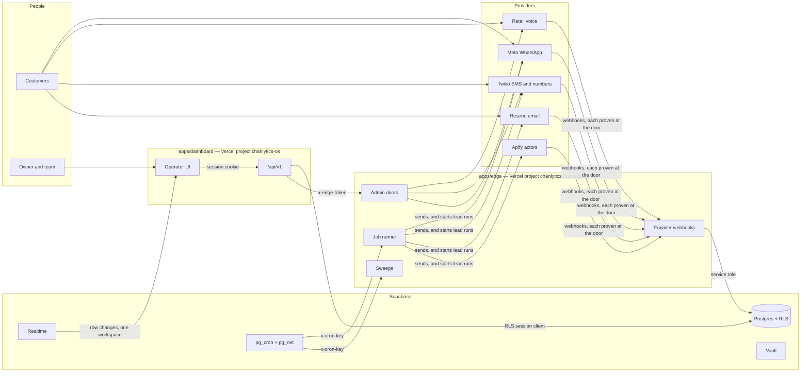

# Architecture

How Chanlytics OS is put together, for someone reading the repository for the
first time. `docs/glossary.md` has the words; `docs/runbook.md` says what to
type to run, deploy and roll back; `docs/system-prd.md` is the as-built
reference, sheet by sheet; `docs/decisions/` holds the designs that are
decided and not yet built; `docs/takeover.md` scores the codebase against the
properties a takeover needs. Where this page and the code disagree, the code
is right and this page is stale.

## What it is

An omnichannel AI receptionist and lead engine for any business that turns a
conversation into a booked appointment. A customer writes on WhatsApp, texts
the business's number, phones its line or emails it; the receptionist answers
within seconds from the business's own facts, offers the times that are open,
sends the booking link, and hands over anything it should not decide. A team
watches it from a dashboard, takes a thread over, whispers into a live call,
and hands it back. The finder searches for new leads on the owner's behalf and
judges each one against what they asked for. Playbooks and broadcasts send the
routine messages around an appointment, to people who said yes.

Three things it never does, enforced in code rather than in a prompt: it never
decides money, it never quotes a price where the workspace forbids it, and it
never books. `docs/system-prd.md` S-01 is the charter.

## The deployables



| Path             | What it is                                                                                                                                                                      | Deployed as                                          |
| ---------------- | ------------------------------------------------------------------------------------------------------------------------------------------------------------------------------- | ---------------------------------------------------- |
| `apps/edge`      | The webhooks, the sweeps, the job runner, the key-guarded admin doors, diagnostics. Vanilla Vercel Node functions, no framework. Holds every provider key and the service role. | Vercel project `chanlytics-messaging`                |
| `apps/dashboard` | Next.js: auth, the public pages, the operator UI, and the `/api/v1` app plane. Holds no provider key.                                                                           | Vercel project `chanlytics-os`, `app.chanlytics.com` |
| `packages/*`     | `contracts`, `core`, `db`, `channels`, `jobs`. Bundled into both apps.                                                                                                          | with each app                                        |
| `supabase/`      | The schema, replayed from zero in CI. RLS on every table, `events` partitioned monthly, pg_cron as the clock, Vault for credentials.                                            | Supabase project                                     |

The two apps deploy independently from `main`. A change both must agree on
ships in a shape that works whichever deploys first.

`packages/*/dist` is committed and the edge imports it by relative path through
`apps/edge/lib/packages/*.ts`, because Vercel's function bundler does not
follow pnpm workspace symlinks. Rebuild `dist` whenever a package changes; CI
fails on drift.

**Where a module lives on the edge.** `apps/edge/api` is the doors, one file
per URL, grouped as the URLs are (`admin/`, `cron/`). `apps/edge/lib` is
everything the doors call, grouped by domain: `receptionist/` (what it decides
and says), `whatsapp/`, `sms/`, `email/`, `voice/`, `lines/`, `leads/`,
`calendar/`, `google/`, `ops/` (who gets told). A domain earns a directory at
its second module; a domain that is one module sits at the root (`notes.ts`,
the note sweep), beside the edge's own plumbing: the environment, the logger,
the HTTP shapes, the Postgres handle, pagination, the two door guards, the
control-plane door, and the erasure check. The same rule holds in every tree
the code is grouped by domain in (each package's `src`,
`apps/dashboard/src/server`, `tooling/scripts`, `apps/mobile/src`), and not in
the URL trees, where a folder is a path (`apps/edge/api`, `apps/dashboard/app`,
`apps/mobile/src/app`); `tooling/scripts/tests/repo/contracts-barrels.test.mjs`
holds it.

## The four doors

Every request proves who is knocking before anything is read.

1. **Provider to edge.** HMAC over the raw body (Meta), Retell's signature, Twilio's signature with the line's own token, Svix headers (Resend), Stripe's signature. Apify signs nothing, so each run is started with a per-run token in its webhook URL, kept only as a hash and compared in constant time. A webhook whose write the database did not accept is not acknowledged, so the provider retries.
2. **Browser to dashboard.** A Supabase session cookie verified with `getUser()` on every request; same origin required for every write.
3. **Dashboard to edge.** A token minted for one door, one workspace, one person, one minute (`x-edge-token`). The dashboard proves who the person is; the edge spends the provider key. The platform's shared key (`x-diag-key`) opens only the diagnostic and the sending-domains lift of a domain held twice on an edge that holds the secret, and every key-only knock there is logged (`admin_door_key_only`).
4. **Database to edge.** `x-cron-key` on `/api/cron/*` and `/api/jobs/tick`, read from Vault on both sides.

And one door with no key: `GET /api/health` answers 200 or 503 so a pinger outside the failure domain can page a person.

## A message in

Each channel has a door on the edge that verifies the wire, and a plan
function that decides what to do with what arrived, run over a database in
memory by a test.

| Channel  | Door                                                                                             | Decides                                | Then                                                                                                                                                                   |
| -------- | ------------------------------------------------------------------------------------------------ | -------------------------------------- | ---------------------------------------------------------------------------------------------------------------------------------------------------------------------- |
| WhatsApp | `apps/edge/api/whatsapp.ts`                                                                      | `packages/core/src/inbound/steps.ts`   | `packages/core/src/inbound/answer.ts`'s phases: persist, read the posture, ask the brain, deliver or hold (the edge adapts it in `apps/edge/lib/whatsapp/inbound.ts`)  |
| SMS      | `apps/edge/api/inbound-sms.ts`                                                                   | `apps/edge/lib/sms/sms-ingress.ts`     | The same handler, with the carrier's consent words and the texting rules                                                                                               |
| Voice    | `apps/edge/api/retell-inbound.ts`, `retell-fn.ts`, `retell-availability.ts`, `retell-webhook.ts` | `apps/edge/lib/voice/call-start.ts`    | The call runs at the provider from the same business facts; the webhook writes the call into the thread                                                                |
| Email    | `apps/edge/api/resend-webhook.ts`                                                                | `apps/edge/lib/email/email-ingress.ts` | An `email_ingest` job fetches the message and `packages/core/src/messages/email-ingest.ts` takes it into the thread. The receptionist drafts only on a reach-out reply |

The receptionist itself: `apps/edge/lib/tenant-runtime.ts` reads the
workspace's config through one door; `packages/contracts/src/config/workspace-config/compose.ts`
composes the system prompt from the business's facts; `apps/edge/lib/receptionist/brain.ts`
asks the model and reads a structured answer (`packages/contracts/src/config/brain.ts`);
`packages/core/src/inbound/reply-posture.ts` is the truth table of whether it may speak at
all; the Autonomy matrix and the confidence dial decide whether the answer goes
now, waits in a veto window, or waits for a person.

The inbound path is WhatsApp-shaped today and SMS rides it by conversion. The
channel-neutral pipeline that replaces it is `docs/decisions/0001-channel-neutral-inbound.md`.

**A reply to a reach-out** (Reach out Part 5, 00222) is read before anyone
answers it, in a job of its own. The `email_ingest` job keeps the email as it
keeps any, then asks `reach_out_reply_of`: does it answer or cite one of the
workspace's reach-out emails of the last 30 days, or is its person a lead's a
reach-out wrote to? For such a reply the intake schedules one `reply_read`
job through `ctx.scheduleOnce` (one live job per message and stage, held by
the `jobs_reply_read_once` index), flags a person's reply (not an automatic
one) for a person, and tells nobody itself. The job's adapter
(`packages/jobs/src/reply-read.ts`) builds
ports over the edge's reader (`apps/edge/lib/reach-out/reply-read.ts`) and
runs core's `readReply` (`packages/core/src/messages/reply-read.ts`): it asks
Haiku through `lib/model.ts` for the reply's intent, under the workspace's
day of reads; hands contracts' `readingPlan` to one service-role door,
`reach_out_reply_apply`, which applies it in one transaction (the lead
Talking, a no through the consent door, a dated step, the reading kept in
`reach_out_replies`); asks the receptionist's brain for a draft, kept on the
reading and never as a message row (`apps/edge/lib/reach-out/reply-draft.ts`,
decision 0017); and tells the workspace once, a claim then the mark only once
`notifyOnce` answered. A reply that could not be read is scheduled again
under a stage of its own (`reread-<n>`). The reading stops and labels; it
never sends.

## A message out

Everything leaves through one door: `packages/core/src/deliver.ts`. It names
the send's purpose (conversational or marketing) and kind (reply, draft,
broadcast, system, answer), re-reads the person's consent, the thread's pause
and the workspace's status at the wire, and refuses rather than guesses when a
wire is missing. A workspace's wires are bound by the edge from that
workspace's own credentials; the environment's keys never send for another
business.

A cold email (the `outreach` purpose, Reach out) is always a broadcast, and
asks more of the door. One call, `outreach_facts` (00177), answers whether the
business is a lead still being written to, whether its address is on the
never-again list, whether the person ever wrote back or phoned (00181), and
what its From domain is and has sent in the last day;
the refusals are words in contracts (`PURPOSE_REFUSALS`). Email leaves by one
of two lanes (`emailSender`, `packages/core/src/wire-senders.ts`): the hosted
lane, the workspace's mailbox on the platform's mail account, for everything
else; the own lane, a verified sending domain on the cold account, for
outreach, and for a person's reply to a reach-out that can go from it. A cold
send never moves its thread, and a failure is recorded on its row rather than
flagged.

A person's reply to a business a reach-out wrote to leaves from the domain
the reach-out wrote from, and from the mailbox whenever that domain cannot
carry it (Reach out Part 5, C15, N5). The dashboard freezes the reply twice
(`replyIdentityOf`, `apps/dashboard/src/server/connections/email.ts`): the
mailbox's request, as every reply before, as `meta.email.request`, and, when
the reach-out email it answers left one of the workspace's domains that is
verified now, a twin from that domain as `meta.email.own_request`. The door
marks only a person's own reply (`kindOf` is `reply`), and the wire's
`emailSender` sends the twin by the own route whose address is its From when
that route holds its Reply-To; otherwise it sends the mailbox's request, which
every edge can send, so either deploy order and a rollback are safe. Which
one left is stamped on the row (`meta.email.left_as`, `own` or `mailbox`, with
the reason; 00226 `stamp_email_left_as`), and the thread says so when it was
the mailbox.

A reach-out (Part 3) is a chain of `playbooks` rows over a lead search, and
each lead in a step's run is a send (`reach_out_sends`). The run is planned
whole in SQL (00185); the reach-out clock (`/api/cron/reach-out`, every
minute) reads what became of the emails it wrote, then claims what is due
under each domain's lock and writes each email rows first: the email row
under an id derived from the send, its `outbound_send` job, then the send
queued. It leaves through the one door, which asks `outreach_facts` about
that send's own lead. The reads that choose each step's work are bounded SQL
functions (00186, 00187), and any list of ids the clock still sends goes a
hundred at a time: a list of ids in a URL breaks past about two hundred, and
a page cut at a thousand rows would have finished a run with a send open.

Every reach-out email is checked before the claim may take it (Part 4,
00197). The check is a clock of its own (`/api/cron/reach-out-check`, every
minute, `lib/reach-out/check.ts`), not a phase of the reach-out clock, so a
slow model never takes the claim's minute. It leases a few unchecked sends
of each workspace, asks each workspace's gates before any call (may it
spend, room in its month, its model attempts for the day), and for words
that name `{{opening}}` asks Haiku twice through `lib/model.ts`: a writer
over the business's record, then a reader. Code reads both answers
(contracts `checkOpening`, `openingVerdict`); a broken rule asks one
rewrite, then the send is held with its reason for its owner. Each send is
stamped with the words it was checked against, and the sender sends it back
to be checked when they changed. The model is injected (`AskModel`), so the
tests script it.

A reach-out is made from the sheet, through one route and one database door.
The Leads door opens the sheet (`pages/reach-out/`, fed by
`legacy-bridge/reach-out/reach-outs.ts`); `POST /api/v1/reach-outs`
validates the chain in contracts, and `reach_out_save` (00211, the service
role's, called with the member's id after the route's role check) writes its
email templates and playbook rows in one transaction. Start asks the edge's
run-now door, which runs the chain's root through `lib/reach-out/run-step.ts`,
the playbooks sweep's own loop body, so the first run waits for its owner at
once. What the owner then answers (Approve, a held email's four doors) goes
through the session's own doors, and Broadcasts reads the run from its sends
(`server/campaigns/reach-outs.ts`, `reachOutRunOf`).

A send that happens later is a job: `packages/jobs` is the ledger (`claim_due_jobs`, a lease, a heartbeat, `settle`), `apps/edge/api/jobs/tick.ts` runs it, and `packages/jobs/src/handlers.ts` maps each kind to a core verb. Every clock is a timestamp on a row that a sweep acts on, and every sweep is registered in `sweep_status` and judged by `/api/cron/health`.

## The packages, and the direction of dependency

```
contracts            pure: types, schemas, view models, the composer
   ^     ^
   |     |
  db   channels      repositories; provider adapters
   ^     ^
   \     /
    core             verbs over ports, and the one send door
     ^
     |
   jobs              the ledger and the handlers that call core
```

Arrows point at what a package depends on, read upward: `jobs` depends on
`core`, `db`, `channels` and `contracts`; `core` on `db`, `channels` and
`contracts`; `db` and `channels` on `contracts` alone; `contracts` on nothing.

| Package     | Holds                                                                                                                                                                                                                                                                                                                                            | Rule                                                                                                                                                                     |
| ----------- | ------------------------------------------------------------------------------------------------------------------------------------------------------------------------------------------------------------------------------------------------------------------------------------------------------------------------------------------------ | ------------------------------------------------------------------------------------------------------------------------------------------------------------------------ |
| `contracts` | Types, zod schemas, the closed sets generated from the database (`schema-sets.generated.ts`), the view models every page reads, the prompt composer, the words the UI says                                                                                                                                                                       | Pure. No client, no framework, no environment. It is larger than its name: view models and prompt composition live here today                                            |
| `core`      | The use cases as verbs over ports: `conversations` (reply, take over, hand back, snooze, wake, resolve, archive), `campaigns` (assemble a run, create a broadcast, run a playbook, approve, cancel), `messages` (send, broadcast batch, email intake, line provisioning), `leads` (the finder's runner, judge, cleaning, endings), and `deliver` | A verb takes a `ports` object and a command and returns an outcome. No database client, framework, provider or environment inside a verb. The adapters live at the doors |
| `db`        | Supabase repositories, the generated database types, realtime                                                                                                                                                                                                                                                                                    | The one place a table name is typed                                                                                                                                      |
| `channels`  | Provider adapters: Meta (WhatsApp, templates, Embedded Signup), Retell (calls, agents, the prompt shell), Twilio (lines, SMS, A2P), Resend (email), Google (Places, Business Profile, OAuth), Apify (actors), the lead judge, the edge token                                                                                                     | Owns each provider's wire format. Knows nothing about threads                                                                                                            |
| `jobs`      | The ledger, the tick, the handlers, escalation on failure                                                                                                                                                                                                                                                                                        | Handlers build ports from the job's context and call core                                                                                                                |

## The app plane

`apps/dashboard/app/api/v1`: every handler is declared with `route()`
(`apps/dashboard/src/server/route.ts`) and says five things: which workspace
it acts on, who may call it, which rate bucket it spends, whether it may spend
the platform's money, and the schema its input must pass. One pipeline
enforces them in a fixed order, so a viewer is refused before a token is spent.
`route-policy.json` pins every route's declaration; a change there is a change
to who may do what. `apps/dashboard/src/client/routes.generated.ts` is the
typed client, regenerated from the same declarations.

## Tenancy

Row Level Security is the floor: it stops cross-tenant access on every table.
The role check in the route is the door: it decides which member may do a
thing. Both are needed, because the job that delivers a message runs as
service role and RLS is not in that path. Privileged writes go through
`SECURITY DEFINER` functions with a pinned search path, each the one audited
place its privilege exists. A forbidden UPDATE does not raise under RLS; it
matches zero rows and reports success, so every permission-sensitive update
selects and counts.

## The shell

`apps/dashboard/src/legacy` is the operator UI: a single-page React shell,
hash-routed under `/w/<slug>`, its files imported in a fixed order by
`src/legacy-bridge/manifest.ts`, talking through `window` globals. It began as
a design mockup and was made real one surface at a time. Two things keep that
honest:

- `src/legacy-bridge/surface-registry.ts` classifies every route as `real` or
  `demo`. A demo surface renders the "not in this release" card outside a
  declared demo session, and a test fails CI if the shell declares a route the
  table does not classify.
- `src/legacy-bridge/surface-data.ts` is the seam that feeds a real surface
  from `/api/v1`, with one module per surface in `src/legacy-bridge/surfaces/`, and nothing a real surface draws may state a fact the
  database cannot support. A zero is a measurement and is shown; an invented
  number is not.

The unbuilt surfaces (agent fleet, store, studio, tasks, content, the retired
deal board) stay in the tree, hidden from every real workspace, by decision.
They live under `src/legacy/demo/`, with the seeded twin of each real page
(`demo/pages/calendar.jsx` beside `pages/calendar.jsx`, and so on), the seeded
Lists and the seed data only they read, and a real workspace never downloads
them: `src/legacy-bridge/manifest-demo.ts` lists them, and `manifest.ts` asks
for it, after its own files, only in a declared demo session. The shell's route names
and the API's nouns do not all agree yet; `docs/glossary.md` lists them.

**Where the shell's state lives.** Three kinds, each with one owner:

- _The workspace's rows_ are read through the seam into a surface's globals (`window.__PEOPLE`, and so on), never by a
  page. One read is out at a time for each surface, so the newest read lands last (`surface-data.ts`
  `activateOverride`); the workspace's own topic says what changed (decision 0019) and each tab re-reads only the surface
  that changed; a write re-reads what it may have made stale, from one table (`refresh-map.ts`), which holds every write
  to a list of surfaces or to a reason it needs none (`refresh-coverage.test.mjs`). A tab keeps its last read in
  `sessionStorage` so a reload paints at once (`surface-cache.ts`), and a sign-out closes that cache before it clears it.
- _A device's_ preferences (the theme, the look, the rail) live in `localStorage` and nowhere else
  (`device-prefs.ts`); _a tab's own_ (a view's place, a half-written draft) in `sessionStorage` through the one store
  (`tab-memory.ts`); and what only one component cares about, in that component.
- _Who is acting_ is one answer, `roles.ts`: the member's role from the workspace's read, lowered by an owner's View-as,
  failing closed. Every gate asks the role store it completes (`ST_STORE.myRole()`, `mayAtLeast`), never `__ME.role`.

A component draws again when a surface it draws from lands or changes status, and by nothing else. It names them:
`useSurface("people")`, a list, or a route (`surface-registry.ts` `routeSurfaces`), which the shell names for the page on
screen. The counts live in `surface-status.ts`, bumped by each surface's own events before React draws. A surface's
status changing is news; a read that changed nothing is not, so a message no longer draws the whole shell seven times.
Today, the Inbox and People are on it. The hand-written `surface:*` listeners that remain (31 direct
`addEventListener("surface:…")` sites in 22 of the shell's files on 29 September 2026, and the few that loop over a list of
names) either do something a redraw does not (reseed a list and keep a thread open, say what a re-read did to it) or wait
for their page to move to `useSurface`; a new page names its surfaces.

## The interface

The plan (`docs/plans/2026-09-28-the-interface-kit-and-its-looks.md`) puts
what a page looks like in two places: the tokens hold every value, and the
kit draws every primitive from them. A new look is then an edit to the
tokens, and a new kind of button an edit to the kit. Phases 1 and 2 built
both. The pages still write values and primitives of their own, which leave
as each surface moves onto the kit (the plan's Phase 4).

```text
apps/dashboard/src/legacy/styles/tokens.css   the scales, each theme's colours, the roles, the looks
apps/dashboard/src/surfaces/kit/kit.css       the kit's own rules, reading the tokens
apps/dashboard/src/surfaces/kit/*.tsx         its components, for a surface written in TSX
a page's own stylesheet                       its layout; until Phase 4, its own primitives and values too
```

**The tokens, in tiers.** The scales sit on `:root`: type, space, radii,
motion, the tones and the accent, and the lengths every page shares (the
measures, the rails, a list row on a phone). Each theme, light or dark, sets
its own grounds, lines, inks and shadows under `[data-theme]`. The roles say
what a value is for: a pane's fill, edge and radius, what pops over the page
and its depth, a control's height, the primary action's fill and ink. In
Classic they are made from the scales and the theme's colours, so Classic
draws what the pages drew before them. They are set on `:root, [data-theme]`,
every element that stamps a theme, because a custom property is made where it
is set. One made on the root alone would keep the root's colours inside a
root that stamps the other theme. A kit rule reads a role where a look sets
the value (a surface, a control, an action), and otherwise the scale or the
theme's colour. A role arrives with its first reader. A component's own
values, the third tier, are declared on its class in `kit.css`
(`--sheet-in`), and no look sets them.

**The kit** is `apps/dashboard/src/surfaces/kit/`. `kit.css` holds the kit's
own rules, on classes of its own: the buttons, the badges, the fields and the
record kit's controls, the menu, Confirm, the empty states, the toast, the
tooltip, the tab strip, the panel, the face, the list row, the meter and the
sheet, with one phone breakpoint, 900px. Four primitives stand in it twice by
design until Phase 4 takes the house's out: `.avatar` beside `.face`,
`.rec-sheet` beside `.sheet`, and the surfaces of `.rec-card-tip` and
`.confirm-block` beside `.panel-pop` and `.panel-inset`. `classes.json` is its
registry: the house's own names, with no prefix, which the measures read, so
a listed class declared in any other stylesheet is a primitive outside the
kit. Each component is a module that renders those classes, typed and named
in `index.ts` (`Button`, `LinkButton`, `Panel`, `Face`, `ListRow`, `Meter`),
its props mapped to classes by `variants.ts`, so a legacy page that writes
the classes and a surface that draws the component draw the same markup. The
shell reaches the kit through its classes, since
`apps/dashboard/src/legacy-bridge/legacy.css` imports `kit.css` right after
the tokens. A surface in TSX cannot import the house's JSX components over
the kit's classes (`StatePill`, `Confirm`, the record kit's fields): the
first surface that needs one moves it into the kit as TSX, drawing what it
drew (the plan's Phase 3). A component with behaviour of its own (a sheet,
a menu, a picker, a tooltip, a toast, a switch, tabs, a field) is built in
the kit on Base UI's unstyled parts (`@base-ui/react`, one pinned version,
each part imported alone), which bring focus, Escape, the keyboard and the
page held still behind a sheet, while the kit's classes draw them (the
plan's decision 15 and step 2.5). A surface swaps the house's for it at its
kit step, as a listed difference, and deletes the hand-written behaviour
there. The lint's messages name the kit's Field, Switch, Select, Sheet and
Confirm, which arrive by one of these two roads.

**The gallery** draws every class of the registry in every state its rules
name, in both themes and both looks, at a desk and a phone width:
`tooling/scripts/e2e-harness/kit-gallery.mjs`, the local e2e harness's `kit`
record, never served in production. `e2e/kit/kit.spec.ts` checks in a
browser that every class and every selector of `kit.css` is drawn and reads
its tokens, and `tooling/scripts/tests/styles/` holds the registry, the
gallery's classes and the components' markup in `corepack pnpm test`
(`docs/runbook.md`, "See the kit").

**Surfaces.** `apps/dashboard/src/surfaces/` is where a page goes when it
leaves the shell (decision 0015), a folder per surface beside `kit/`. It is
browser code, under the layers' rules and the function limits from its first
file, and in it a raw `<button>`, `<input>`, `<select>`, `<textarea>` or
`<dialog>` outside the kit is a lint error that names the kit's component to
take instead. A surface moved before its kit step waits in `KIT_PENDING`
(`eslint.config.mjs`), which lifts that one rule for its folder.

**The looks.** A look is a set of token values, chosen beside the theme.
Classic, what members see, is the roles block itself. Glass, the canvases'
finish, is drawn, and not yet offered: two blocks after the roles,
`[data-look="glass"]` and `[data-look="glass"][data-theme="dark"]` for its
dark side. They set the roles, and the theme's own colours where Glass's
differ, since many kit rules read a colour such as `--ink` directly. The
look travels as the theme does (`packages/contracts/src/shell/chrome.ts`). It
is kept on the device in the same stored object, and only once chosen, so a
device that never chose follows the default. The head's script stamps it as
`data-look` on `<html>` before first paint, and `.app-root`, `.shared-root`
and `.fr-shell` stamp it beside their `data-theme`, so a look's dark side
matches wherever a theme's rules do. Two constants roll a look out:
`LOOK_OFFERED` puts it in the account menu, where a member then chooses it,
and `DEFAULT_LOOK_PREF` makes it the look of every device that never chose.
Like the theme, the look is the browser's, not the member's, so no table
holds it. The theme's other readers (the browser's bars, the phone app, the
lead map, the mascot, the charts' palette) follow `data-theme` alone.
`docs/runbook.md`, "Add a look".

**The holds.** Three measures may only fall, and a new entry in any of them
is a red build: the type sizes, radii, shadows, colours and blurs a
stylesheet writes as literals (`style-values.json`), a primitive's class
declared, or a kit class named, in a stylesheet other than the kit's
(`kit-primitives.json`), and the `style` props in the shell's markup
(`inline-styles.json`). The first two read the stylesheets as CSS
(`tooling/scripts/tests/_css.mjs`), the third the markup's syntax tree
(`tooling/scripts/tests/_ast.mjs`). None counts a duration, a row or a
page's layout: a page stylesheet with its layout alone is Phase 4's target.
A change that must move nothing on screen is recorded before and after and
compared (`docs/runbook.md`, "Prove a style change").

## What is where

Each code tree and the folders its modules are grouped in, by name, and last
the schema's migrations. A folder is drawn when it holds a TypeScript or
JavaScript file the repository tracks, less the built, generated and public
ones. The block is drawn by `UPDATE_BASELINES=1 corepack pnpm test`, and
`tooling/scripts/tests/docs/docs-tree.test.mjs` fails when it and the tree
disagree: it is redrawn when a folder appears or disappears.

<!-- tree:start -->

```text
apps/edge/api/
  admin/
  cron/
  jobs/
apps/edge/lib/
  billing/
  calendar/
  email/
  google/
  leads/
  lines/
  ops/
  packages/
  partners/
  reach-out/
  receptionist/
  sms/
  voice/
  whatsapp/
apps/dashboard/app/
  (os)/
  api/
  auth/
  b/
  data-deletion/
  login/
  p/
  privacy/
  reset-password/
  signup/
  terms/
  u/
  verify/
  yes/
apps/dashboard/src/
  auth/
  client/
  legacy/
  legacy-bridge/
  lib/
  server/
  surfaces/
  yes/
apps/dashboard/src/server/
  ask/
  auth/
  calendar/
  campaigns/
  connections/
  conversations/
  export/
  leads/
  metrics/
  people/
  platform/
  ports/
  public/
  readers/
  receptionist/
  workspace/
apps/dashboard/src/legacy-bridge/
  ask/
  mascot/
  reach-out/
  surfaces/
  today-sample/
apps/dashboard/src/legacy/
  components/
  data/
  demo/
  pages/
apps/mobile/src/
  app/
  shell/
  widgets/
packages/channels/src/
  email/
  google/
  leads/
  lines/
  tokens/
  voice/
packages/contracts/src/
  ask/
  ask-proposals/
  broadcasts/
  calendar/
  config/
  consent/
  conversations/
  deals/
  email/
  google/
  leads/
  lines/
  mobile/
  notes/
  people/
  playbooks/
  reach-out/
  reports/
  setup/
  shared/
  shell/
  templates/
  today/
  voice/
  workspace/
packages/core/src/
  campaigns/
  conversations/
  inbound/
  leads/
  messages/
packages/db/src/
  repositories/
packages/jobs/src/
tooling/scripts/
  checks/
  e2e-harness/
  evals/
  gen/
  mobile/
  ops/
  tests/
e2e/
  auth/
  campaigns/
  conversations/
  kit/
  people/
  settings/
  shell/
  today/
supabase/migrations/
```

<!-- tree:end -->

## Where to look

Every path is from the repository's root, and
`tooling/scripts/tests/docs/docs-paths.test.mjs` fails one that opens nothing.

| To change                              | Look in                                                                                                                                                                                                                            |
| -------------------------------------- | ---------------------------------------------------------------------------------------------------------------------------------------------------------------------------------------------------------------------------------- |
| What the receptionist says             | `packages/contracts/src/config/workspace-config/compose.ts` (the composer), `apps/edge/lib/receptionist/brain.ts`, the Business tab in Settings                                                                                    |
| Whether it speaks at all               | `packages/core/src/inbound/reply-posture.ts`, `policies` and `packages/contracts/src/config/policy.ts`                                                                                                                             |
| Who may be messaged                    | `packages/contracts/src/consent/consent.ts` (`mayMessageFor`), `packages/core/src/deliver.ts`                                                                                                                                      |
| A new channel                          | An adapter in `packages/channels`, a door under `apps/edge/api`, a `tenant_channels.kind`, a wire in `packages/core/src/deliver.ts`                                                                                                |
| A new operator verb                    | A core verb in `packages/core/src/conversations`, a route under `apps/dashboard/app/api/v1/conversations/[id]/`, a row in `tooling/scripts/tests/route-policy.json`, the shell's `apps/dashboard/src/legacy-bridge/inbox-verbs.ts` |
| A new job kind                         | `JOB_KINDS` in contracts, a handler in `packages/jobs`, its caller, and the `jobs.kind` CHECK, in one change                                                                                                                       |
| A new sweep                            | A cron door, a `sweep_status` registration, the pg_cron schedule                                                                                                                                                                   |
| Billing                                | `apps/edge/lib/billing/`, `apps/edge/api/stripe-webhook.ts`                                                                                                                                                                        |
| The lead finder                        | `packages/core/src/leads`, `apps/edge/lib/leads/`, `apps/dashboard/src/server/leads/leads.ts`, `supabase/migrations/00140_the_lead_finder_engine.sql`                                                                              |
| Ask                                    | `apps/dashboard/src/server/ask/*`, `packages/contracts/src/ask/{ask,ask-answer}.ts`                                                                                                                                                |
| The calendar                           | `apps/dashboard/src/server/calendar/`, `packages/contracts/src/calendar/{feed,availability}.ts`, `apps/edge/api/cron/calendar.ts`                                                                                                  |
| Phone numbers and carrier registration | `packages/channels/src/lines/` (the A2P wire under `packages/channels/src/lines/a2p/`), `apps/edge/lib/lines/`                                                                                                                     |
| Email                                  | `packages/channels/src/email/`, `apps/edge/lib/email/email-ingress.ts`, `packages/core/src/messages/email-ingest.ts`                                                                                                               |
| Voice                                  | `packages/channels/src/voice/`, the four doors `apps/edge/api/retell-*.ts`                                                                                                                                                         |
| How a page looks                       | `apps/dashboard/src/legacy/styles/tokens.css` (a value, a look), `apps/dashboard/src/surfaces/kit/` (a primitive, a variant), `tooling/scripts/e2e-harness/kit-gallery.mjs` (the gallery)                                          |

## Tests

`corepack pnpm test` runs the node suite under `tsx`, so a test imports the
app's own TypeScript and executes it: route handlers against a database in
memory, edge doors over a ports object, core verbs over fakes. Database and
integration tests skip without credentials, and `REQUIRE_SERVICE_CREDENTIALS=1`
turns a skip into a failure where a run is meant to be signed in. A share of
the suite still asserts on source text rather than behaviour;
`tooling/scripts/tests/source-scan-baseline.json` is the ratchet that may only
fall, keyed by each file's path relative to the tests directory. The files are
grouped by domain under `tooling/scripts/tests/<domain>/`, the shared worlds
and helpers at the root, and the runner globs every depth. Playwright specs run
nightly against production in the suite's own workspace. A browser spec goes in
`e2e/<domain>/`, as `e2e/people/people.spec.ts` is; the helpers stay at the
root, and so does a domain's only spec until its second.

## What is decided and not yet built

`docs/decisions/` holds the designs, and its README says which are built. The
four not built that change the shape of the system: a channel-neutral inbound
pipeline (0001), an appointment as a first-class record (0002), assignment for
a team (0003), and the shell leaving surface by surface (0015, decided). A deal
as a record (0004) is built. Smaller and known: the shell's hash routes and the
API's old nouns (`docs/glossary.md` lists them), and `contracts` carrying view
models that belong to the dashboard.
