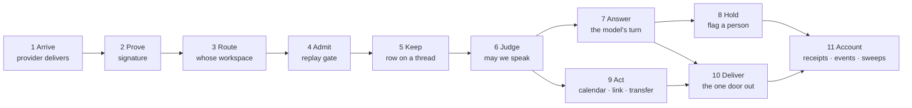

# A conversation, end to end

**What this is.** One customer conversation, followed from the moment it arrives to the moment it is accounted for, across all four channels the product answers on — a phone call through Retell, WhatsApp through Meta, a text through Twilio, an email through Resend. At every stage it says which channel uses the shared mechanism, which re-implements the same decision in its own words, and which does not do that stage at all.

It is a **conformance** map. `docs/system-prd.md` is the component catalogue — what each part is and where it lives — and `docs/system-map.md` scores the layers. Neither answers the question this one exists for: *when the same thing happens on two channels, does the same code decide it?*

Every claim names a file and a line. Where this document and the code disagree, the code is right and this is stale. It is written against `main` at `0e463030`; work in flight on other branches is out of scope and is not counted as either a strength or a hole.

**In one sentence:** every message a customer receives leaves through one shared door, and that door is the best thing in the repository; the way *in* is four doors that agree on what matters and differ on the rest; and the differences that cost a customer something are listed in §6, ranked.

One qualification, because it changes what is worth centralising. `deliver()` is the **message-send** door, not the door for everything a customer experiences. The voice agent speaks live without passing through it, and reading open times aloud, transferring a call and ending one are customer-facing actions it never sees. Improving `deliver()` alone cannot make the voice experience obey the same rules — G4 below is exactly that gap, and it is why the unit worth sharing is an *action*, not a channel handler.

---

## 1. What a conversation is made of

A conversation is not one table. It is five, and knowing which one owns which fact explains most of what follows.

| Row | Owns | The rule that matters |
|---|---|---|
| `contacts` | the person: number, address, consent, erasure | one per workspace per identity; `contacts_tenant_phone_uq` is **partial**, on `where phone_e164 is not null` |
| `conversations` | the thread: its state, who holds it, until when | `unique (tenant_id, contact_id)` — **one thread per person per workspace, for ever, across every channel** |
| `messages` | what was said, both directions | `(tenant_id, external_id)` is the replay gate; `meta.processed_at` is the "we finished with this" stamp |
| `escalations` | the hold: a thread waiting for a person, and why | `escalations_one_open` — **one open row per thread**; a second reason overwrites the first |
| `jobs` | the outbox: everything that happens later | one insert, a lease, a heartbeat; a kind arrives with its handler, its caller and its CHECK together |

Two ledgers sit beside them: `events` (what happened) and `decisions` (who decided it). A path that writes neither is invisible to Activity and to the owner's audit, and that absence is a finding below.

The model's memory used to be a sixth store — Vercel Blob threads. It is retired: `apps/edge/lib/store.ts:1-11` refuses reads and writes while still honouring deletes, so erasure keeps reaching what is left, and `BLOB_SHADOW` is set in production. **Postgres is the receptionist's only memory**, and `readLeadContext` (`packages/db/src/repositories/thread.ts:226`) is the one function both agents read it through — "the WhatsApp receptionist and the voice agent are meant to be the same receptionist."

---

## 2. The eleven stages

Every inbound conversation passes through the same eleven stages, whatever it arrives on. The names are this document's; the mechanisms are the repository's.

Stages 1–5 are the *way in*, and each channel built its own. Stage 10 is the *way out*, and every channel shares it. Stages 6–9 are where the two meet, and where the divergences that cost something live.

---

## 3. The conformance matrix

`shared` — uses the common mechanism. `parallel` — does the stage, in its own code. `none` — does not do it.

| Stage | WhatsApp | SMS | Voice | Email |
|---|---|---|---|---|
| **1 Arrive** | `api/whatsapp.ts:70` | `api/inbound-sms.ts:40` | `api/retell-inbound.ts:36` + `api/retell-webhook.ts:134` | `api/resend-webhook.ts:36` |
| **2 Prove** | HMAC-SHA256 over raw body, `whatsapp.ts:79-85` | HMAC-SHA1, key = **the line's own subaccount token** from the vault, `sms.ts:202-218` | call start: **shared secret in `?key=`**, `retell-inbound.ts:40`; events: HMAC, `retell-webhook.ts:152` | Svix HMAC-SHA256 **with a ±300 s replay window**, `channels/src/email.ts:229-239` |
| *judgement split* | **none** — 170 lines of inline branching | `lib/sms-ingress.ts:71` | `lib/call-start.ts:100` | `lib/email-ingress.ts:45` |
| **3 Route** | `phone_number_id` → `resolveChannelDetailed` | `To` → `lineByNumber` → same resolver | `agent_id` → same resolver | recipient address → `mailboxFor`; **only addresses on our own mail domain** |
| **4 Admit** | `ingest_inbound.is_new` | same | `ingest_call`, forward-only by status rank | **three gates**: `jobs_email_ingest_uq`, then `is_new`, then `processed` |
| **5 Keep** | `ingest_inbound` | `ingest_inbound`, `channel:"sms"` | **parallel** — `ingest_call` re-implements identity; the call lands on the thread as one `call_summary` message | `ingest_inbound`, `channel:"email"`, wrapped by an identity pre-step and an address backfill |
| **6 Judge** | 21 ordered gates in `lib/whatsapp/inbound.ts` | the same 21, plus the carrier hold | `lib/outbound-gate.ts:77` — **a second policy engine**, its own five rules | `messages/email-ingest.ts:90` — a verb over ten ports, eight named outcomes |
| **7 Answer** | brain + `steps.ts` layer two + hold plan | identical, plus the A2P footer | the Retell agent, live on the call | **never** — by design, until the drafting slice |
| **8 Hold** | `upsertEscalation` | same | same (`callback`, `policy_block`) | same (`email_review`), and it **throws** if the flag fails so the job retries |
| **9 Act** | none — the model pastes the booking URL into its words | same | four tools: `check_availability`, `send_booking_link`, `transfer_to_staff`, `end_call` | none |
| **10 Deliver** | `deliver()` | `deliver()` | `deliver()`, after the second gate | typed for it; **no caller constructs an email `Delivery`** |
| **11 Account** | receipts inline, 200 always | own signed door, **503** so Twilio redelivers | cron sweeps re-ingest and re-fetch | **nothing** — only `email.received` is recognised |

Three things fall out of that table.

**The one door out is real.** `sendText`, `sendTemplate` and `sendEmail` are imported by exactly one file, `packages/core/src/deliver.ts:29`. Nothing in the dashboard calls `deliver` at all: it queues a row and a job and lets `outbound_send` reach the door, which is the only thing that makes the 15-second undo honest.

**The way in was built four times.** Three of the four now have the door/judgement split — a route that is only the wire, and a pure function that decides. WhatsApp, the oldest and busiest, is the one that never got it.

**Email is the best-designed channel and the least finished.** Its intake is a correct rewrite of everything SMS learned the hard way. Its outbound half is architecture with no caller: on `main`, `buildEmailRequest` and `hostedIdentity` are written, tested, and reached by nothing.

---

## 4. Ownership: who holds a thread, and what that holds back

Three columns on `conversations` carry ownership, and one function decides what each of them stops.

`takeOver` (`packages/core/src/conversations/take-over.ts:8`) pauses the receptionist, claims the thread, and **withdraws the drafts already written** — a held reply landing after a person arrives is exactly what the veto window exists to prevent. `handBack` (`hand-back.ts:7`) releases it and resolves the open escalation. Both compensate on failure: a claim that changed no row puts the pause back before throwing.

At the wire, `refusalFor` (`packages/core/src/deliver.ts:216`) decides which pause holds which kind of send. This matrix is the product's manners:

| Send kind | Workspace paused (billing) | A person holds the thread | A person spoke since it was written |
|---|---|---|---|
| `reply` — a person's own words | **goes** | **goes** | **goes** |
| `draft` — the receptionist's held reply | held | held only if somebody *claimed* it | **retired** (`superseded_by_human`) |
| `answer` — the receptionist answering now | held | held | n/a |
| `broadcast` | held | held | n/a |
| `system` — opt-in confirmation, HELP, STOP | held | **goes** | n/a |

The subtlety worth keeping: a queued draft is deliberately **not** held by the thread's pause, because the receptionist's own escalation pauses the thread and queues its holding message in the same breath. For a draft the real question is "did a person speak since?", which `overtakenByHuman` (`deliver.ts:277`) answers by reading the thread — ignoring a broadcast's row, because a broadcast is a person's words but not a person speaking *on this thread*.

`SendKind` being a separate axis from `sender` is the reason all of this works: who wrote the words is a fact recorded on the row, and what policy the send goes under is a different question. Copy it anywhere a fifth channel is added.

**Three facts share two columns, and that is the root of G3 and G5 together.** `assignee_user_id` and `paused_until` are asked to carry *who is responsible for this customer*, *who is controlling the response right now*, and *may the machine act*. They are different facts with different lifetimes. Responsibility can outlive an interaction and should survive a handover; control of the current exchange must be claimed and released and must expire; permission for the machine to act is a policy answer, not something to infer from whether a row happens to name somebody. Collapsing them is why a departed teammate holds a thread for ever (G3) and why nothing can say "a call is in progress, do not start a second conversation" (G5) — there is no place to write it. Anything built on top of the present two columns is a patch; the durable fix is to separate the three and give the middle one an atomic claim with an expiry, because a read-then-decide loses the race it exists to settle.

**One hold per thread.** `upsertEscalation` (`packages/jobs/src/escalate.ts:14`) inserts or refreshes, and **the refresh overwrites the reason**. Nineteen reasons exist (`packages/contracts/src/enums.ts:269`) and they are the whole vocabulary for "a person is needed". Two of them — `deadman` and `manual` — have no emitter anywhere.

---

## 5. The three flows you asked about

### 5.1 A lead arrives and is answered

Four front doors, and a shorter shared road than it looks: **only WhatsApp and SMS run the receptionist**. `inbound-sms.ts:76` calls the same `handleInbound` the Meta webhook calls, having reshaped the text into a WhatsApp-shaped message whose `from` is bare digits — "so one person is one thread across both channels."

Voice never joins that road. A call is answered live by the Retell agent and *deposited* on the thread afterwards as a single `call_summary` message keyed `call:<retell_call_id>`. Email steps off the road deliberately, before the receptionist's turn.

The 21 gates on the text road are asked in a fixed order — allowlist, dedupe, per-person mode, consent, carrier hold, message kind, staleness, opt-in confirmation, thread pause, daily cap, token budget, workspace paused, reply mode, then the model, then layer two. Opening hours are enforced where they decide a *time*: `freeWindows` builds every offered window out of that day's own intervals, so a closed day offers nothing. They are enforced nowhere else — nothing stops the receptionist answering at three in the morning, and nothing stops a transfer being offered to a line nobody is standing beside. Whether either is a defect is a product question asked per action, not a missing gate.

### 5.2 Handing a conversation to a person

Take over → claimed, drafts withdrawn, receptionist paused. Reply → a queued row, a 15-second cancel window (`SEND_GRACE_MS`) that **is** the undo, then `outbound_send`. Hand back → released, escalation resolved. Every step writes a `decisions` row; every step is re-read at the wire.

One piece of it is now vestigial. `mirrorBlobPause` (`apps/dashboard/src/server/service.ts:172`) makes an HTTP round trip from the dashboard to the edge on every take-over, hand-back and reply, to mirror the pause into the receptionist's old Blob memory. That memory is retired — `apps/edge/api/admin/pause.ts:25` answers "ok, nothing to do" — so the call, and the careful compensation ordering built around it, now guard nothing.

### 5.3 Texting while talking, and WhatsApp during a call

The voice agent holds exactly four tools (`packages/channels/src/voice-shell.ts:114`):

| Tool | What it does | What it may not do |
|---|---|---|
| `check_availability` | reads the open windows | **"Never confirm a slot yourself"** — it offers, it does not book |
| `send_booking_link` | texts the caller the booking link on WhatsApp | one template, one link, to the number they are calling from |
| `transfer_to_staff` | warm transfer to the business's own line | only the number the workspace configured, filled per call |
| `end_call` | ends it | — |

`send_booking_link` reaches `apps/edge/api/retell-fn.ts`, and that file is the model for how a second sender should be built: it routes by `agent_id`, normalizes the number the caller *said* (ten digits) against the number we *store* (fifteen), refuses a number that is not the caller's unless that person is already a contact, and then asks two gates in order — `outboundGate`, whose answer becomes **a sentence the agent speaks** and which never names our internal state to a caller, and then `deliver()`, which re-reads everything at the wire and adds what the gate cannot see: erasure, and a human who spoke since.

Two gates is not an accident: one exists to produce words for a caller who is waiting, the other exists to be right. Where the door refuses for a reason the gate has no script for, `retell-fn.ts:255` maps it onto one that does.

**What nothing does:** no inbound text path reads the `calls` table. A customer on the phone who also sends a WhatsApp message is answered by the text receptionist independently, with no knowledge that a call is in progress — two agents, one person, the same minute. The memory is unified *after* the fact and not during: the voice agent is handed twelve turns of recent history at call start, and the finished call becomes a message the text side can read, but neither knows what the other is doing right now.

---

## 6. The gap ledger

Ranked by what it costs a real customer conversation. Each names the evidence, what someone actually experiences, and the shape of the fix. **✅ marks one that has since been closed.**

### Severity 1 — a customer is failed today

**G1. The voice booking link works on one workspace.** `booking_link_v1` is inserted by `supabase/migrations/00004_inbox.sql:63` for `where slug = 'melanys-beauty-salon'` and nowhere else. It is not in the starter library (`packages/contracts/src/template-library.ts` ships seven templates; this is not one) and `00017_provision_tenant.sql` does not create it. `retell-fn.ts` sends that template name regardless, and `deliver()` on this path never checks `templates.meta_status`.
*What happens:* on every workspace but the salon's, a caller asks for the booking link, Meta rejects an unregistered template, and the agent says **"that number may not have WhatsApp"** — naming the wrong cause to a customer who is on the phone. The core promise of the phone receptionist does not work for a new customer.
*Fix:* add it to the starter library and seed it in `provision_tenant`, or make `send_booking_link` refuse with an honest sentence when the template is not approved for this workspace.

**G2. ✅ Email arrives, the owner is told to reply from the Inbox, and the Inbox cannot.** *Closed by the reply slice: `replyToConversation` now carries `channel: "whatsapp" | "sms" | "email"` and takes its recipient from the contact's stored address.* `email-ingest.ts:86` says "read it and reply from here"; `apps/edge/lib/email.ts:59` says "Reply from the Inbox." `packages/core/src/conversations/reply.ts:82` refuses any contact with no phone number, and `QueuedReply.channel` is typed `"whatsapp" | "sms"` (`reply.ts:38`, `:50`; `verbs.ts:171`).
*What happens:* an `email_review` hold on an email-only person is unanswerable from the product. Its only exits are Resolve or Archive, both of which record a decision claiming the thread was handled.
*Fix:* this is the reply slice, in flight now. Until it lands the notification copy is ahead of the code — the honest interim wording is "read it and reply from your own mail."

**G3. A thread taken over and never handed back is stuck for ever.** `takeOver` deliberately leaves the escalation open (`take-over.ts:7`). `expire_stale_pauses()` (`00006_expire_stale_pauses.sql:17-22`) refuses any row that still has one. So the pause time passes, `answer` and `broadcast` resume, and every `draft` is refused for ever on a stale `assignee_user_id` (`deliver.ts:255`) — the workspace's veto window silently stops working on that thread, with no event and no expiry.
*And it is reachable by an HR event:* nothing anywhere clears `assignee_user_id` when a membership is deleted (`service.ts:555`), so the thread reads as "theirs" to every remaining member, for ever.
*Fix:* clear the assignee when a membership is removed; give the sweeper a second limb for a pause long past its time whose escalation is older than some ceiling; or stop treating a stale assignee as a live claim at the wire.

**G4. ✅ The Booking autonomy dial is not honoured on the phone.** On text it is enforced twice — in the prompt, and in `layerTwo` (`apps/edge/lib/whatsapp/steps.ts:100-112`), which *strips the booking link out of the reply* and escalates. On voice, `retell-fn.ts:173` reads `rt.policy?.reply?.mode` — the **reply** class, not `booking` — and `retell-availability.ts` reads no policy at all.
*What happens:* a workspace that set "Ask me first" on bookings still has its phone agent reading open times aloud and texting the booking link, while its WhatsApp receptionist is being muzzled for the same request.
*Fix:* read `policy.booking` in both voice endpoints, the way `policyAskClass` does on text.

### Severity 2 — correctness holes that will bite

**G5. Two AI agents can talk to one person at once.** No inbound text path reads `calls`. *Fix:* one read of "is a call live on this contact" in the text road's gate list, holding the reply the way a pause does.

**G6. ✅ The runaway guard opens exactly when it is needed.** `retell-fn.ts:210-214` — `countSentToday(...).catch(() => 0)`. A failed count reads as "nothing sent today", so the three-per-day cap that exists because "a voice agent that called its own tool in a loop sent thirty billable templates to one person" stops binding during the database trouble most likely to cause the loop. The same file's door, `deliver.ts:199`, throws on an unreadable read on principle.

**G7. ✅ "We could not check" is read as "nobody" on the voice erasure gate.** `retell-webhook.ts:243` — `erasedBeforeCall(...).catch(() => false)`, against `apps/edge/lib/erased.ts:18`, which states the opposite rule in its own header.

**G8. Zero rows updated is read as success in the call path.** `linkCallMessage` and `setCallRecording` (`packages/db/src/repositories/calls.ts:97-124`) update without `.select()`. The second matters: the audio is already in the bucket, the row still says `pending`, so the cron re-downloads and re-uploads it three times and then marks it failed — leaving an orphan object that the purge (which selects `fetch_state = 'stored'`) will never remove. This is the trap the repo names by name elsewhere and avoids everywhere else.

**G9. A replayed `call_analyzed` extends the customer's pause by another full window.** `retell-webhook.ts:322` re-evaluates `Date.now() + pause_hours` outside the notification claim taken at `:365`. Retell retries three times.

**G10. ✅ A refused booking link leaves no trace.** `retell-fn.ts:220` logs to stdout. Every other refusal in the system lands somewhere durable — `message.send_blocked`, a recipient's reason, a `send_failed` escalation. "She said she never got the link" has no answer.

**G11. The deadman sweep can steal an email in flight.** `sweepUnfinished` (`apps/edge/lib/unfinished.ts:90-140`) claims any inbound customer message with no `processed_at` after three minutes, raises `brain_error` — *"The receptionist never answered this"* — and stamps the row processed. An `email_ingest` job still retrying then finds `processed` true and returns `already_handled` (`email-ingest.ts:121`), so `email_review` is never raised, the owner's email is the wrong one, and `mailboxes.last_received_at` is never stamped. *Fix:* exclude `channel = 'email'` from the sweep, or give it the email words.

**G12. An email can arrive and nobody is told.** `email-ingest.ts:129` tells the workspace only when the escalation came back `"opened"`. Because there is one open escalation per thread *regardless of reason*, a thread already holding `carriers` or `opt_out` gets its reason rewritten to `email_review`, returns `"refreshed"`, and the bell stays silent.

**G13. WhatsApp is the one door with no judgement split.** The 503-vs-200 decision at `whatsapp.ts:240` decides whether a customer's message survives, and it is held by nothing but reading 170 lines. Three later doors each wrote a pure `plan*` function and each cited the last one as precedent.

**G14. Repeated deliveries have effects that are not idempotent.** *(Rewritten: the first version of this finding asked for a fix that would have lost customer messages.)* Neither older provider gives us a freshness check to make — Twilio signs the URL and its parameters, Meta signs the raw body, and **neither carries a timestamp**, so email's five-minute window has nothing to copy across. And Meta redelivers a failed webhook for up to seven days, so an age check on the event would discard precisely the retries the 503 contract exists to earn.

The real finding is narrower and fixable. `ingest_inbound` already makes a replayed *message* harmless; nothing else on those doors is idempotent. The owner-echo branch slides `paused_until` forward by a fresh pause window on every redelivery, `sms-status.ts` re-applies a status, and `ingest.unroutable` is emitted once per change with no throttle where the email door holds it to one a minute. Make those three harmless on the provider's own event identity; do not add a clock the provider never sent.

**G15. ~~`lineByNumber` is not tenant-scoped.~~** *(Withdrawn on checking.)* A lookup that takes a number and no tenant reads like an isolation hole — but `lines_e164_live_idx` (`00066_lines.sql:39`) is a unique index on `(e164) where e164 is not null and voice_state <> 'failed'`, and the lookup filters on exactly that predicate. One live line per number is enforced by the database, so the row cannot be ambiguous and there is nothing for an `order by` to stabilise. Discovering the tenant from the destination number is also what the door must do *before* it can choose the credentials that verify the signature. Kept here rather than deleted, because the lesson is worth the line: looking something up without a tenant is safe exactly when a constraint says it is, and a real hole when none does.

**G16. A day can be skipped or doubled around a daylight-saving change.** `packages/contracts/src/availability.ts:519-521` steps the horizon by adding 86 400 000 ms and then asking which local day that lands on. Every other day-stepper in the codebase uses calendar arithmetic. Reading availability late in the evening before a spring-forward drops the whole next day from the offered windows; the autumn edge emits one day twice and loses one off the far end. Narrow — it needs the read to happen within an hour of local midnight — but it is twice a year, in the one number a customer is told out loud.

**G17. Every workspace's clock is New York until somebody changes it.** `tenants.timezone` has defaulted to `America/New_York` since `00001` and had no write path until `00084`, whose own header records that every workspace on the database was still sitting on the default. The fallbacks reinforce it. Nothing on any page says the zone was never chosen.

### Severity 3 — drift and dead weight

- **G18.** `mirrorBlobPause` is a network round trip that does nothing (§5.2), and four verbs carry compensation logic for it.
- **G19.** Six independently written channel unions; three include `email`, three do not (`persist.ts:100,132,187`, `draft-queue.ts:34` against `deliver.ts:36`, `ingest.ts:15,132`). Email cannot use the sink, the draft queue or the veto window even if it wanted to, because of a type.
- **G20.** `README.md:4` and `docs/system-map.md:26` say the product "books and reschedules". It does neither: there is no appointments table, no booking tool, no reschedule path, and the voice tool description says "Never confirm a slot yourself." The 10DLC filing (`apps/edge/lib/a2p.ts:167`) tells the carriers we send appointment confirmations; we do not send any. `docs/system-prd.md:43` is the one that is accurate.
- **G21.** Dead declarations: escalation reasons `deadman` and `manual` have no emitter; `REASON_SHORT` is missing `budget` and `paused`, so People renders the raw token; `field === "history"` logs and discards; `p_public_log_url` is computed, passed, and inserted as `null`.
- **G22.** The legacy mockup surfaces still shipping (`apps/dashboard/src/legacy/**`) depict an agent that auto-reschedules and sends fifteen-minute pre-call reminders. Any surface not yet flipped to real data is making a promise the backend cannot keep.

---

## 7. What is genuinely right, and should be copied

1. **The door re-reads the facts at the wire, in one query, and throws when it cannot.** "The moment before the send is the one place a stale answer cannot be taken back" is the best sentence in the codebase, and the fail-closed discipline built around it is rigorous.
2. **`SendKind` apart from `sender`.** Who wrote the words and what policy the send goes under are different questions, asked separately.
3. **The three-valued `Wire`.** `undefined` = no such channel here; `null` = no credentials for this workspace; a function = send. It is the clean fix for one business's message leaving on another's line.
4. **`SPEAKS_TO_A_PERSON` plus claim-one-job-at-a-time.** Naming the class of work whose retry is unrecoverable, then restructuring the loop so "claimed" reliably means "started", is real distributed-systems honesty. Sends are at-most-once on purpose.
5. **Claim the recipient before the wire.** A broadcast writes `failed / OUTCOME_UNKNOWN` first and overwrites it with the truth a moment later: it risks one person not being sent to, in order to close a gap the width of a call to Meta. "Never twice wins."
6. **Guards in the database.** `messages_guard` (content immutable, status monotone, sent never becomes canceled) and `jobs_guard` (the state machine itself) live where every writer passes.
7. **Fail-open and fail-closed as a stated asymmetry.** A missing consent column must never silence a reply, and must never authorise a promotion. Two opposite defaults, each argued in place.
8. **Judgement separated from transport, five times over** — `judgeHealth`, `callbackPlan`, `replyPosture`, `planSmsIngress`, `planResendEvent`. Each returns a verdict the route executes, so the decision can be proved against a database in memory.
9. **The tenancy floor is proved, not asserted.** The suite enumerates tenant tables from PostgREST's own schema, so a new table with no proof fails by name, and it distinguishes "empty list" from "privilege refused".
10. **Email's intake is the state of the art here**: a pure judgement with no module state, pointer-then-job so the work happens under a lease, resume-not-skip, a claim that decides how *little* is done, and a verb over named ports with named outcomes. And it is careful to say which of those lessons must **not** travel back to WhatsApp: there, a missed auto-reply beats a double text.

---

## 8. Convergence, in the order worth doing it

Ordered by what each batch stops costing somebody, not by how much code it tidies. The two that ship today ship today; nothing here holds a small fix hostage to a large one.

**Batch 1 — stop the unsafe failure modes, and stop saying untrue things.** G6 (a failed count reads as zero), G7 (a failed erasure read reads as nobody), G8 (zero rows read as success), G10 (a refusal that is only a log line), G14 (make the three repeated effects idempotent). Alongside them, the copy fixes from G20 and G2 — an interface that claims a capability the journey cannot deliver is a defect that costs nothing to correct. The test for this batch: uncertainty never authorises an action, and an unknown outcome is visible to somebody.

**Batch 2 — repair the voice and human-control journeys.** G1 and G4 first, because a paying workspace's phone receptionist under-delivers silently today and both are small. Then G3 and G5 together, as one change rather than two patches, along the seam named in §4: separate responsibility, live control and automation permission, and give control an atomic claim with an expiry. G9 rides with it. G16 and G17 belong here too, because a wrong day and a wrong clock are wrong in the one number a customer is told out loud.

**Batch 3 — finish email end to end.** G2, G11 and G12, plus as much of G19 as the reply path actually needs. The acceptance test is an **email-only** contact: received, shown, composed, queued with its undo, sent from the right identity, outcome recorded, thread continued. A contact who also has a phone number does not prove it.

**Batch 4 — consolidate, and remove what is superseded.** G13 (lift `whatsapp.ts`'s judgement into `planWhatsappDelivery`, the fourth of its kind — no behaviour change, and the 503 decision becomes testable), G18 (retire the Blob mirror and the compensations built around it), the rest of G19, G21, G22. This batch is last on purpose: it is the one whose value is entirely in the next change, not this one.

**One thing to extend rather than invent.** `capabilityStatus` (`packages/contracts/src/capabilities.ts`, table `capability_activations`, 00108) already answers "is this workspace actually ready for this channel" for `voice`, `whatsapp` and `sms`, off real prerequisites. G1 and G2 are both the same shape of bug — a capability that exists in types, seeds and interface copy but not in the journey — so they belong in that model as two more kinds, `booking_link` and `email_reply`, with `ready` meaning the whole path was checked and not merely that a row exists.
