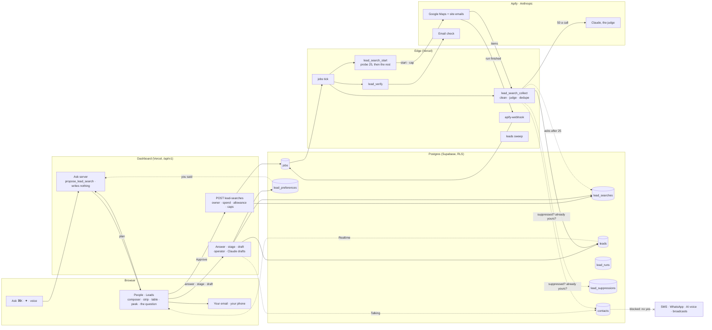
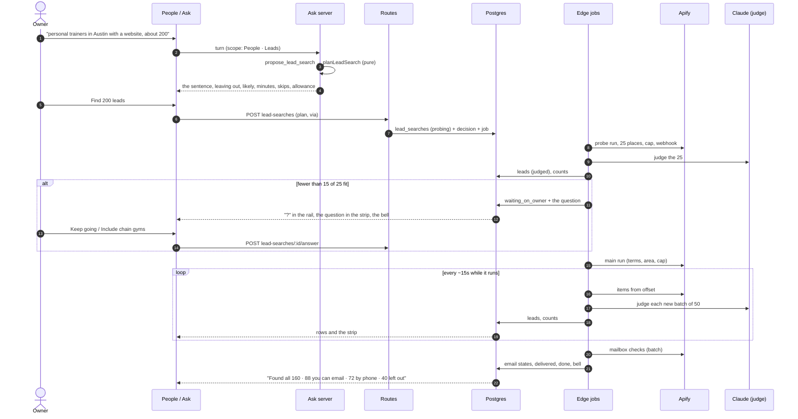

# People: a real table, and leads Claude finds for you

Status: proposal v2.2, decisions recorded 18 September 2026; v3 folds in the external review (`docs/plans/2026-09-18-lead-finder-review.md`). Nothing here is built. Written against origin/main `98d37a57`; every seam is named by file and line from that tree. The design canvas it describes is https://claude.ai/artifact/NnY2jZEtx5LBmopmHR2QDj (21 artboards in four rows; the first is live). v1 (17 September) assumed its yields; v2 replaces every assumption with the calibration Ruben approved on 18 September: ten Google Maps runs across nine niches, 140 email checks and one deeper crawl, about $2.10 of the $5 approved (Appendix C). The calibration changed the design, and those changes are marked **Changed after calibration**.

**This revisits a recorded decision, and Ruben lifted it on 18 September.** `apps/dashboard/src/legacy/CLAUDE.md:3-7` keeps Leads and Pipeline hidden "until the product is at 100%". Ruben lifted that for this slice and asked for the table first, since it improves People as it is today. Phase 1 records the lift in that file, in the surface registry's comment and in `docs/system-prd.md` before any Leads code lands.

## 0. What this plan decides

- **Phase 0 makes People a better table, for everyone, with no leads in it.** A keyboard that works one way everywhere, sticky headers and a sticky first column, columns each member can show and hide, a "Came from" column computed once in SQL, and a bulk bar that acts on what is shown. It stays a `<table>`, so every e2e selector and test pin holds; server paging waits until a workspace has 5,000 people, because none does.
- **Claude searches on the owner's behalf, and judges every result.** The calibration showed a plain scrape is not good enough to hand an owner: 3–45% of what Google Maps returns is the wrong kind of business, a fifth of the emails on a page belong to someone else, and the same business appears two or three times. So the owner says who they want; Claude writes the plan as one sentence whose words are controls, including who to leave out; the server runs it; Claude judges each place with a one-line reason; and after the first 25, if fewer than 60% fit, the search stops and asks one question before spending more.
- **A lead counts when Claude judges it a fit and it can be reached.** **Changed after calibration**: v1 counted only a checked email or a phone confirmed twice; the measured phone agreement (33–62%) and email yield (20–67%) made that rule count half of good matches as misses. A match with a phone or an email counts; what Claude leaves out never does.
- **Emails leave from the owner's own inbox; calls from their own phone.** Claude drafts an email (**Open in your email** opens it in their mail app, with the address and opt-out line US law asks for), and Chanlytics asks "Did you send it?". Calls are a `tel:` link, then "How did the call go?". Chanlytics sends nothing to a lead, so there is no cold-email reputation to protect and no consent rule to bend.
- **A lead is not a person yet.** Found businesses live in their own `leads` table. A lead becomes a `contacts` row when the owner marks them Talking or they write in, so the receptionist's prompt, the voice agent's caller context, Win-back and `metrics_summary` never meet a scraped row.
- **Leads is a scope of People, not a page**, with stages (Ready, Contacted, Talking, Said no, Not a fit), searches kept as lists, and a peek with the evidence behind each lead.
- **Not a fit teaches the next search.** The owner says why in one tap; the next plan shows it as a "Leaving out … (you said)" chip they can remove.
- **The model proposes and judges; code and the owner decide.** The model never spends, never picks a scraper, never sees the Apify token, never writes a consent record, never sends anything to a lead.

## 1. The ask

**17 September.** Analyse the People page and table against the best current tables and component craft, and redesign it so new workspaces can load potential leads quickly through Apify: local businesses by niche from Google Maps for B2B sellers like Chanlytics itself, and Amazon sellers the way the June pipeline found them (sellers that meet listing criteria, their websites, found and checked emails). AI-native, not a filter form: ask in Ask, or press an AI button on the table and type or speak; the AI confirms before it searches and finds as many as asked. Assume Pro includes it for now; consider charging per lead. Deliver a redesign to review and a PRD with a system map, end to end.

**18 September.** Approved the $5 calibration. Lifted "Leads stays hidden until 100%" for this, with the table first. Confirmed Claude searching on the owner's behalf over a traditional filter setup, unless something more AI-native exists. Asked for the best implementation logic, and then for a second, slower pass on the redesign with the calibration data: what was assumed too quickly, which screens and scenarios were missing, the first day included.

## 2. People today, measured

**The page** (`apps/dashboard/src/legacy/pages/clients-a.jsx`, 1,776 lines) is a 220px rail of smart and saved lists beside a main column: the standing line (`PeopleStanding`, 948-980), one control row, a section head, the table (`PeopleTable`, 1043-1146) and a bulk bar (`PeopleBulkBar`, 1165-1342).

**The table** has five columns (`plCols`, 990-997): Person, State, Last contact, Visits or Receptionist, Offers, plus hover actions. The header is sticky; no column is. Sort keys are `last`, `name`, `state`, `visits`, `offers` (`:998`).

**The data** comes from `peopleOverride` (`legacy-bridge/surface-data.ts:714-745`), which walks `GET contacts` up to 50 pages of 1,000 through `everyPerson` (`:689-700`) before it publishes, and re-walks them on every message, conversation or escalation change (`refreshOnMessageInserts`, `surface-realtime.ts:14`). `people_list` (`00127:46-236`) orders by latest contact; every other sort and filter runs on the page over the rows it holds.

| Gap | Evidence | What the redesign does | Phase |
|---|---|---|---|
| The keyboard listener is rebound on every render | `clients-a.jsx:1601-1624`, no deps | One listener reading a keys ref, as the Calendar does (`calendar-real.jsx:387-403`) | 0 |
| The bulk bar acts on loaded rows, not shown rows | `PeopleBulkBar` gets `rows` (`:1745`), computes `picked` from them (`:1170`) | It gets what is shown | 0 |
| Fixed columns | `plCols`; `e2e/people.spec.ts:52` pins the headers | Show and hide per member, stored with the view | 0 |
| A view remembers only its sort | `views.people` holds `{sortBy, sortDir}` (the page stopped saving `attentionTab` with the attention strip, `clients-a.jsx:1459-1461`) | It also holds `columns`; every save sends every key, since `member_view_set` replaces the page's object (`00113`) | 0 |
| No provenance on a row | `people_list` returns no source; `contact.added` is read only by the profile (`contacts/[id]/route.ts:263`) | "Came from", computed once in SQL | 0 |
| A wide table is cut off, and nothing pins | `.cl-table-wrap { overflow: clip }` (`clients.css:778-784`). Today at 1280px with a calendar the table is 921px wide in a 746px box: 176px are clipped, so Visits is half hidden and Offers and the row actions cannot be reached | On a desktop the table scrolls in its own box, the header sticks to its top, Person to its left, with a hairline once it scrolls sideways | 0 |
| Selected row nearly invisible in light | `.selected` is `--bg-raised` on `--bg` (`clients.css:1683`) | An ink tint; the accent stays for live agent state | 0 |
| Loads everything before the first row | `everyPerson`, 50 × 1,000 | **Not now.** No workspace is near 1,000 people; the trigger is 5,000, measured | later |
| Sort and filter only on the page | `:1516-1565` | **Not now**, with paging | later |
| Filters from plain words | none | Chips written from the owner's words, through Ask's read path, free | 1 |

## 3. What the best tables do, and what we take

| Pattern | Where it is done well | Here |
|---|---|---|
| Views that remember columns and sort | Attio, Notion, Airtable | **Take.** Per member, in `views.people` and `views.leads` |
| Sticky header and first column | every serious grid | **Take.** |
| Side peek | Linear, Notion, Attio | **Take for leads**, where the evidence matters. People keep their full page one tap away |
| Cell-level enrichment states | Clay | **Take, in words.** Five email words, never a color alone (section 10.4) |
| A reason per row from a model | Clay's AI columns | **Take one**, written by the judge from listing facts. No free-form AI columns: per-column prompts invite prompt injection from scraped pages and unbounded spend |
| Filters from plain words | Clay, Notion AI | **Take**, Phase 1 |
| Server paging and windowed rows | Linear, TanStack Virtual | **Later**, at 5,000 people or 2,000 leads in a view |
| Undo instead of confirm | Superhuman, Gmail | **Take.** Every stage change and bulk change toasts with Undo |
| Group by, density toggle, inline editing | Airtable, Linear | **Not now** |

## 4. Design brief

**Who.** Three people use this table. The salon owner opens People on a phone between clients, for seconds, to see who needs them. The B2B seller (Chanlytics itself, an agency, a cleaning company) sits at a desk and builds a list of businesses to reach. The local owner who needs partners (a trainer wanting physical therapists who refer clients, a salon wanting wedding planners) does a little of both. The first job must never get slower for the other two.

**The jobs.** See who needs you. Find a person. Act on many at once. Find businesses worth reaching, trust what was found, reach them lawfully, and remember how it went.

**Principles**, from `.impeccable.md` and the 15–17 September passes, plus four for the finder:
1. The work first: the table is the first thing on every screen size.
2. Say it once: a count lives in one place.
3. Numbers as a sentence; the plan as a sentence.
4. Progressive disclosure: sources, checks and costs one tap away, never in the way.
5. **Evidence over scores.** Fit is a word with a reason, backed by checks the owner can read.
6. **Claude proposes and judges; the owner approves; the server decides what runs.**
7. **Consent is a fact, not a setting.** Nothing the owner clicks makes a found lead textable.
8. **Say what could not be done.** A search that ran out, left places out or stopped says so, with what was kept.

**Anti-goals.** A separate Leads page. A filter wizard before a search. Stat cards. A credits meter on every screen. Any word naming the vendor.

**The one thing to remember.** The plan is a sentence, every word in it is a button, and Claude checks its own work before spending your leads.

## 5. Who uses it, and when

The first pass designed one path: a B2B seller's search that goes well. These are the paths the second pass designed, each with its artboard.

| # | Scenario | What happens | Artboard |
|---|---|---|---|
| 1 | A brand-new owner, no people yet | The page explains how people arrive by themselves, offers the calendar and a list, and suggests searches written for *their* business, each with how reachable that kind of business is | FirstRun |
| 2 | A seller asks for 200 trainers | Plan → approve → rows stream in, judged | Main, Plan |
| 3 | Half the first results are the wrong kind | The search stops after 25 and asks one question; nothing is spent while it waits | Question, PhoneQuestion |
| 4 | The area runs out before the count | "Found all 160 personal trainers in Austin", and **Find 40 more nearby**; never padded with poor matches | Done |
| 5 | The owner doubts what was left out | The left-out count opens the places Claude left out, each with its reason, and **Put back** | LeftOut |
| 6 | Working the list at a desk | Peek, **Draft** an email, **Open in your email**, "Did you send it?" | Peek, Draft |
| 7 | Calling between clients | Call from the row or the phone; "How did the call go?" in one tap | Call, PhoneLead |
| 8 | A lead is wrong in a way Claude should learn | **Not a fit** asks why in one tap; the next plan remembers | NotFit, Plan |
| 9 | A question about what was found | "Which have a checked email and 4.8 or better?" answered in Ask, free | AskResults |
| 10 | Coming back a month later | The search keeps what was asked and what was left out; **Find new ones** counts only new places | Searches |
| 11 | A lead writes back or says yes on a call | They become a person, and People says where they came from | People |
| 12 | Every way a search can end badly | Nothing matched, all already yours, outside the US, people not businesses, near the monthly limit, stopped, the source failed, the question unanswered, paused for everyone | States |
| 13 | Bringing the clients you already have | A spreadsheet, columns matched by Claude, no yes carried over (Phase 2) | Import |
| 14 | A teammate, not the owner | Operators work leads (stages, calls, drafts); only the owner starts a search, because it spends | section 12.6 |

## 6. The table, specified

### 6.1 Scopes, lists and views
- **The rail** starts with `People | Leads` (a segmented control, `role="tablist"`). Under People: the existing smart lists and saved lists, unchanged. Under Leads: All leads, Ready, Contacted, Talking, Said no (only when there are any), Not a fit, then **Searches**, each with its count. A running search carries the live dot; a search waiting on the owner carries a "?" in the accent, and the standing line says "1 search needs you".
- **The standing line** speaks for the scope: `87 people · 2 need you · 11 reached this week`, or `322 leads · 272 ready · 3 searches`.
- **A view** is `{ sortBy, sortDir, columns }` for People and `{ list, sortBy, sortDir, columns }` for Leads, per member, through `PUT views/people` and `PUT views/leads` (2,000 characters). Every save sends every key the page owns.

### 6.2 Columns

| Scope | Column | Shows | Default |
|---|---|---|---|
| People | Person (pinned) | avatar, name, their last words | on |
| People | State | the pill and its detail | on |
| People | Last contact | "They wrote · 2h ago" | on |
| People | Next visit | with a calendar | on |
| People | Offers | Yes / No / Not asked | on |
| People | Came from | WhatsApp, Text, Email, Phone call, Your calendar, Added by you, Imported history, A lead you found; not sortable, not in the CSV | new, on |
| People | Receptionist | the receptionist's mode for them | on without a calendar (as today, pinned by `e2e/people.spec.ts:56`), off with one |
| People | Email, Lists | | off |
| Leads | Business (pinned) | a rounded-square mark, name, "2 locations" when so, category · area; Call and Copy on hover | on |
| Leads | Fit | Strong fit / Worth a look / Long shot; left-out rows show their reason instead ("Chain", "Not a trainer") | on |
| Leads | Email | the address and its state in words (10.4); left-out rows say "Not checked" | on |
| Leads | Phone | the number; a double tick when Maps and the website agree | on |
| Leads | Why it fits | the judge's reason, one line | on |
| Leads | Rating | 4.9 and the review count | on |
| Leads | Stage | Ready, Contacted, Talking, Said no, Not a fit | on |
| Leads | Found | "now", "6m", "3d" | on |
| Leads | Source, Website, Search | | off |

"Added" (v1) is dropped: the Person cell already says "since Jul 14", and a test pins the old "First contact" column out. People stays a `<table class="cl-table">`, drawn from column definitions by one table component with a generic shape (rows, columns, selection, cursor, open) that Leads reuses in Phase 1. On a desktop (901px and wider) the table is its own scroller, so the header sticks to its top and Person to its left while the page above it holds still; phones and tablets keep their cards.

### 6.3 Reading
- **People** keeps `people_list` and `everyPerson` in Phase 0. `people_list` gains one returned column, `came_from` (section 12.4). Paging moves to SQL when a workspace passes 5,000 people; the surface logs its row count so the trigger is measured, not guessed.
- **Leads** reads `GET leads` keyset-paged by `(found_at, id)` with the list, the search, the sort and the chips in SQL, because searches add rows in the hundreds. Pages of 500; the table asks for the next page as the owner nears the end.
- **Words to chips** (Phase 1): the search box takes a name or a sentence. A sentence ("ready to email in 78704", "asked about balayage but never booked") goes to Ask's read path and comes back as chips marked "From your words", with **Save as a list**. Free: no search, no count.

### 6.4 Acting
- **Selection:** click, Shift-click for a range, `x` on the cursor row, the header checkbox for what is shown.
- **People bulk actions** stay as they are and act on what is shown.
- **Leads bulk actions:** Copy emails (says how many have none), Mark contacted, Export (owner, on the ledger like `contacts/export`), Not a fit. Each toasts with Undo.

### 6.5 Keys

| Key | Does |
|---|---|
| `/` | search, or describe who you mean |
| `F` | Find leads (Leads scope) |
| `J` `K` or `↑` `↓` | move the row cursor |
| `Enter` | open the person, or peek the lead |
| `x` / `Space` | select the cursor row; `Shift` extends |
| `C` | call the cursor lead |
| `Esc` | close the peek, then clear the selection |
| `⌘K` | Ask, scoped to what is selected |

One listener, registered once, reading a keys ref. Row actions show on hover and on the keyboard cursor. Phase 0 ships `/`, J/K and the arrows, `x`/Space, Enter and Esc; Shift-extend, `F`, `C` and `⌘K` scoping arrive with Leads in Phase 1.

### 6.6 Phone (≤ 720px)
One slim bar holds the `People | Leads` switch, search and Find (✦); the work starts under it. A running search is a two-line card; the question after 25 is a card with two 44px answers; rows are cards with a 44px Call button; a lead opens full screen with Call and Email, and after a call the six outcomes as a 2 × 3 grid. Find opens a bottom sheet whose first control is hold-to-talk.

### 6.7 Accessibility
Real buttons for names, headers, chips and tokens; `aria-sort` on the sorted header; `aria-selected` on rows; the focus ring token on the row cursor; states in words and shapes; the question strip is `role="alert"`; 44px targets on coarse pointers.

## 7. The finder: Claude searches on your behalf

A plain scrape is not good enough to hand an owner (Appendix C). Filters cannot fix that; judgement can. So Claude does not just translate words into a query. It does the research an assistant would do, inside rails the server holds:

1. **Understands the ask.** Who, where, how many, what they must have, and — the part a filter form never captures — **who they are not** ("independent trainers, not big gyms"; "firms, not referral networks").
2. **Writes the plan as a sentence** the owner can correct by tapping a word or saying it again, with **Leaving out** chips they can remove. At most one question, only when the answer changes who is found by a lot.
3. **Searches wider than the words.** It expands the terms ("personal trainer", "strength coach", "fitness coach"), because one Maps search tops out around 120 places, and names two or three nearby areas for later.
4. **Judges every result** against the owner's intent: the right kind of business or not, one location or a chain, which of the addresses on the page is really theirs. It says why in one line.
5. **Checks its own work early.** After the first 25 places, if fewer than 60% fit, it stops and asks one question before spending more.
6. **Tops up instead of padding.** Fewer good matches than asked for: it says so and offers the nearby areas. It never fills the count with poor matches.
7. **Answers questions about what it found**, in Ask, without spending.
8. **Learns from Not a fit.** The owner's reasons become the next plan's leaving-out chips.

What Claude never does: spend without the owner's approval, pick a scraper, see the Apify token, write a consent record, or send anything to a lead.

### 7.1 The model calls

| Call | Where | Model | Input | Output | Cost |
|---|---|---|---|---|---|
| **Plan** (steps 1–3) | Ask's loop, the `propose_lead_search` tool | `claude-sonnet-5`, as Ask uses today | the owner's words; the business line; what Not a fit taught; counts of people and leads (never rows) | a `LeadSearchPlan` and its sentence | inside Ask's 1.5M-tokens-a-day budget |
| **Judge** (steps 4–5) | edge job `lead_search_collect`, one call per batch of up to 50 new places | one constant, `LEAD_JUDGE_MODEL`; default `claude-opus-5` at low effort | the plan's rubric; per place only listing facts: name, category, city and state, website host, rating, review count, the candidate emails with their domains, whether the phone matched the site | per place: `match` · `unsure` · `no`, a fit band, the best email or none, a left-out reason, a reason of 12 words or fewer | about 0.23¢ a place at Opus 5; 0.09¢ at Sonnet 5; 0.05¢ at Haiku 4.5 |
| **Draft** | `POST leads/[id]/draft` through the edge gateway, purpose `lead_draft` | `LEAD_DRAFT_MODEL`, recommended `claude-sonnet-5` for speed | the business line and offer; the lead's facts; a tone | subject and body | about 0.5¢ a draft; counted in Ask's daily budget |
| **First-day suggestions** | `GET lead-suggestions`, cached 7 days per workspace | `claude-sonnet-5` | the business line | three or four searches, each with who it is for | once a week |

The judge is one structured-output call with a hand-written JSON schema, sent the way `apps/edge/lib/brain.ts:153` already sends one in production (`output_config.format`, effort `low`), and its answer validated with the channels package's own zod; no tools, no web access. Page text never reaches it: only listing facts and address strings, each capped at 120 characters, stripped of control characters and passed as quoted data. At Opus 5 the judge adds about 0.3¢ per delivered lead to about 0.7–1.1¢ of data (section 13). Which model judges is Ruben's call (section 16); the code keeps it one constant.

### 7.2 What is deterministic, and stays that way
The model judges; code decides everything with a right answer.
- **Before the judge:** drop closed places; drop places outside the plan's state; drop junk addresses (platform domains such as `vagaro.com`, `square.site`, `glossgenius.com`, `godaddy.com`; placeholders such as `filler@`, `yourdomain@`, `example@`, `email@domain`; corporate roles `careers@`, `recruiting@`, `media@`, `press@`, `privacy@`); normalise `www.` in domains; drop placeholder phones (`1234567890`) and mis-prefixed ones; group places that share a website host or a phone into one business with a location count.
- **After the judge:** the mailbox check, the phone comparison (E.164 equality), "already yours" and "never again" (database lookups), the counting rule, the counts, the caps.
- **The question after 25:** `matched / judged < 0.6` over the first 25 places moves the search to `waiting_on_owner`. The question is a template filled from the most common left-out reason and the plan's own leaving-out phrase ("Half of the first 25 are chain gyms and other kinds of places, which I'm leaving out. Keep going this way?"), with two answers: **Keep going**, and **Include chain gyms**, which removes that exclusion from the rubric. No answer in 24 hours stops the search; what was found is kept.

## 8. The search, screen by screen

### 8.1 Doors
One engine, five doors, all Ask underneath: **Find leads** and `F` on the Leads scope; **Ask** (`⌘K`, the topbar, the phone's ✦); the **first day**; the phone sheet; and in Phase 2, **More like these** on a selection (Ask reads the selected leads' category, area and rating and proposes a lookalike search). The composer posts the same turn Ask does, with People · Leads as its scope, and renders the plan inline.

### 8.2 The composer
The input with a mic (hold to talk: the browser speech Ask already uses, `ask-hooks.jsx:10-62`) and three suggestions "for Chanlytics, from what your business does", each with how reachable that kind of business is ("about 6 in 10 have an email"). The suggestions are the first-day suggestions (8.9).

### 8.3 The plan
"Find **200** **personal trainers** **in Austin, TX** that have **a website**, then find **their email** and check it." Every bold word opens a small picker; the count picker shows minutes per option. Under it:
- **Leaving out** chips, each removable: Claude's reading of the ask ("Chain gyms", "Physical therapists and chiropractors") and what Not a fit taught, marked "you said, Sep 12".
- **Likely**: a two-part bar and "About 116 will have an email; the rest you call · from past searches for trainers", from the niche priors (12.4). A kind of business never searched says "checked after the first 25".
- **Facts**: "About 8 minutes — leave the page if you like · Skips the 14 already yours · Counts only matches you can reach · 486 left this month".
- **Find 200 leads** and **Change what I asked**; the foot says "You can email and call leads. Texts and offers wait for their yes."

The planner refuses in words, with no card: places outside the US, people rather than businesses (with businesses whose clients need the owner as suggestions), categories no recipe carries (section 5, row 12).

### 8.4 The run
Approve → `POST lead-searches`. The composer folds into a one-line strip above the table: a live dot, "Finding personal trainers in Austin · 86 of 200 · 41 emails checked · about 4 min left", **Stop**, and a 2px progress line in the accent. The first 25 places come from a small probe run; the rest follow once the probe passes. Rows arrive in the order found, judged: left-out places show dimmed with their reason and "Not checked" (no mailbox check is spent on them); leads show "checking" until their mailbox check lands.

### 8.5 The question after 25
When fewer than 15 of the first 25 fit, the strip becomes the question, in the accent tint with `role="alert"`: the sentence, "Nothing is spent while this waits. Answer and it carries on.", **Keep going**, **Include chain gyms**, **Stop here**. The rail marks the search with a "?" and the standing line says "1 search needs you"; the bell and Today say it too, so the owner can leave. The 25 rows stay visible under the question, so the evidence is right there.

### 8.6 Done
The table re-sorts strongest fit first and the strip says what happened once: "Found all 160 personal trainers in Austin · 88 you can email · 72 by phone · 40 left out", where **40 left out** opens the left-out view. When the area ran out before the count, **Find 40 more nearby** (the areas in its tooltip) opens the plan with Claude's nearby areas as the "where" word. **Undo** removes every lead the owner has not touched and gives the leads back, within 24 hours. The bell says "Your search for personal trainers in Austin is done".

### 8.7 Left out
The places Claude left out, with chips by reason ("Chains 26 · Not a personal trainer 14"), each row's reason in the Fit column, and **Put back** on the row (hover or cursor) and in its peek. Put back makes it a lead and counts it; the left-out places themselves never count.

### 8.8 Stop, and every other ending
Designed once on the States artboard, each saying what happened, what was kept, what was counted and one next step:

| Ending | The owner reads |
|---|---|
| Nothing matched | "There are 3 personal trainers in Marfa, TX, and all three are part of chains, which you asked me to leave out. Nothing was counted." **Look in Alpine and Fort Davis** · **Include chains** |
| Everyone already yours | "All 64 chiropractors in Austin are already yours. Look further out, in Round Rock and Pflugerville?" |
| Outside the US | "I can only find businesses in the US for now…" (the planner, no card) |
| People, not businesses | "I find businesses, not people at home. People who want a trainer find you…" with two suggestions |
| Near the monthly limit | "You have 36 leads left this month. Find 36 now, or all 200 when your leads renew on Oct 1?" |
| Stopped by you | "Stopped at 61 personal trainers · the 61 found are yours · nothing else was counted" · **Carry on** |
| The source stopped answering | "Stopped at 86: Google Maps stopped answering · the 61 found are yours · nothing more was counted" · **Try again** |
| The question went unanswered | "Stopped after a day without your answer · the 12 found before it asked are yours" · **Answer now** |
| Paused for everyone | "Lead searches are paused for now · your leads are all here · nothing is being counted" |

### 8.9 The first day
**Changed after review.** v1's first day offered three suggestions copied from Ruben's own examples. v2's page is about people first: "Your people gather here", then three ways people arrive (they reach you — the number is live, Connect WhatsApp; your calendar — Connect; clients you already have — Add someone, and Import a list when Phase 2 ships), then "Or have Claude find businesses worth reaching": the composer and three or four suggestions **written by Claude from the workspace's business line** ("For a personal training studio in Denver · Not right? Change it"), each saying who it is for (Partners · their patients often need a trainer next) and how reachable that kind of business is. The foot says what the finder does not do: "Claude finds businesses, not people at home." A salon sees wedding planners, photographers and bridal shops; a law firm sees chiropractors, body shops and towing companies.

### 8.10 A search, kept
Each search in the rail has a menu: what was asked and left out, in the owner's words and the date; **Rename**; **Find new ones** (the same plan; only places not already in leads count); **Search again, changed** (opens the plan); **Export these 160**; **Remove this search** (keeps the ones contacted or talking). A month later the owner can see exactly what they asked for.

## 9. Working the leads

### 9.1 Stages
Ready (found and reachable) → Contacted → Talking; or Said no, or Not a fit. Stored in the canonical lead stages (`legacy/CLAUDE.md`, "Lead stage"): `ready`, `nurture` (Contacted), `converted` (Talking), `archived` with a reason (`said_no`, `not_a_fit`, `customer`, `stale`, `search_removed`). Words live in contracts (`LEAD_STAGE_WORDS`); stored values are never shown. The peek has a segmented control for the three open stages and a **Not a fit** button.

### 9.2 The peek
408px beside the table: the business and its sub-line; the stage control; the fit as a sentence ("Strong fit. Independent coaching · 5.0 from 16 reviews · email checked."); **How you can reach them** (the phone with its sources and **Call**; the email with its state, **Copy** and **Draft**; texts and WhatsApp shown locked: "Wait for their yes. Once they write back, they're in People and your yes page works for them."); **Checked** (six checks, each with where it came from); **2 other addresses on their site**, folded, with why Claude picked this one; **Found** (three timestamps); the website and Instagram.

### 9.3 Draft an email
**Draft** turns the peek into a draft: To, Subject, the body Claude wrote from what it found about the business and what the workspace offers, **Shorter** and **Warmer** rewrites, and a note that the address and opt-out line are added "as US law asks". **Open in your email** opens it in the owner's own mail app (`mailto:`); **Copy** copies it. The footer uses the business address from Settings; with none set, the draft asks for it first. When the owner comes back to the tab, the peek asks **Did you send it?** — Yes moves the lead to Contacted and records `lead.emailed`.

### 9.4 Calls
**Call** on the row, in the peek, or `C` dials with `tel:`. When the owner comes back, the peek asks **How did the call go?**: Interested, Call back later, Not interested, Left a voicemail, No answer, Wrong number, with a note. Interested moves the lead to Talking and makes them a person with the call and the note on their page; Not interested is Said no; Call back later, voicemail and no answer are Contacted; Wrong number marks the phone wrong and keeps the stage.

### 9.5 Not a fit
One tap asks why: A chain or franchise · The wrong kind of business · Too far away · Already a customer · Something else. The first three become a `lead_preferences` row that the next plan shows as a leaving-out chip marked "you said"; "Already a customer" suppresses that business from every future search; "Something else" teaches nothing. The toast says what was learned, with Undo.

### 9.6 Talking: a lead becomes a person
Marking Talking, or an Interested call, creates the person through `create_person` with source `lead` and links `leads.contact_id`. `create_person` needs a phone, which nearly every Maps listing has; a lead with only an email converts the way the email intake creates an email-only person (00126–00127), and 00125's `set_person_email` adds the lead's email to a person created by phone. People's "Came from" says "A lead you found", with the search and the dates in its title. Their consent starts unknown, and for 90 days a yes is accepted only from their own message or form (section 11). A lead who writes in first is linked the same way by the intake, matched on phone or email.

### 9.7 Ask about what was found
"Which trainers have a checked email and 4.8 stars or better?" → "18 of the 160. The five with the most reviews:" and a small table, with **Show all 18 in the table** (chips), **Draft an email to the first one**, and "Questions about leads you have are free. Nothing was searched or counted."

## 10. How a place becomes a lead

The owner never sees an actor or a vendor. They see where each fact came from: "Google Maps listing", "their website", "a mailbox check". A recipe is a vetted pipeline the server owns; the model fills its parameters and the server turns them into actor input.

### 10.1 Recipe A: local businesses (the launch recipe)

| Step | Actor | Adds | Bronze price (18 Sep 2026) |
|---|---|---|---|
| 1. Probe | `compass/crawler-google-places`, 25 places, `scrapeContacts: true` | the first 25, judged before anything else is spent | about $0.13 |
| 2. Find | the same actor, the plan's terms and area, `maxCrawledPlacesPerSearch` = the remaining count × 1.3 | name, category, address, phone, website, rating, reviews, place id, open or closed | $0.003 per place; a filter (has a website, a minimum rating) +$0.001 |
| 3. Contacts | same run | emails and social profiles from the business's own site | +$0.002 per place |
| 4. Judge | Claude (7.1) | match or not, fit, reason, the best email | 0.05–0.23¢ per place |
| 5. Check the email | `bounceverify/bounceverify-email-verifier` (fallback `michael.g/email-verifier-validator`) | the mailbox state (10.4) | $0.00089 per email |

**Changed after calibration**, and dropped from the recipe:
- **The deeper crawl** of contact and about pages (`vdrmota/contact-info-scraper`): 25 sites, 101 pages, **0 emails**. A site that hides its address behind a form does not give it up to a deeper crawl.
- **Review signals** ("reviews mention slow replies"): 5 of 20 places had one, and 4 of the 5 were chain gyms. Independents have too few reviews.
- **The named person** stays optional and moves to Phase 2: 70% of law firms returned one, but only about half were decision makers. If used, `leadsEnrichmentDepartments: ["c_suite"]`.

Every start sets `maxTotalChargeUsd` (this actor refuses a cap under $0.50), `scrapeReviewsPersonalData: false`, and an ad-hoc webhook.

### 10.2 Recipe B: Amazon sellers (Phase 4)
The June pipeline, productised: `junglee/Amazon-crawler` with `scrapeSellers: true` (never `countryCode` or `zipCode`, a $0.05 event per result); brand to website through `apify/google-search-scraper`; contacts from the site; the same judge and mailbox check. US sellers only; skip Amazon-sold and CN addresses. The June grade carries over as the judge's rubric (no A+ content, fewer than seven images, no video).

### 10.3 The checks a lead passes
Each is stored with its source and listed in the peek.

| Check | Passes when | Source |
|---|---|---|
| Open for business | not `permanentlyClosed` or `temporarilyClosed` | Google Maps |
| In the area asked for | the state and postal code fall inside the plan's area | Google Maps |
| The right kind, not a chain | the judge says match, with its reason | Claude |
| Phone matches on two sources | the Maps phone equals a phone on the website, as E.164 | Maps · website |
| The email is theirs | the judge picked it among the candidates the cleaner kept | Claude · website |
| Mailbox state | 10.4 | mailbox check |
| Not already yours | no lead or person shares the email, phone, place id or website host | your workspace |
| Not suppressed | the email, phone or place id is not on the never-again list | your workspace |

### 10.4 Email, in five words
**Changed after calibration.** Of 140 checked addresses, 49% existed, 31% sat on servers that accept every address (catch-all), 14% would not answer (security gateways, mostly law firms), 6% bounced. Two words (valid, risky) would call a third of good addresses risky. So:

| Stored | The owner reads | Shape |
|---|---|---|
| `ok` | Checked | a check |
| `catch_all` | Probably reaches them | a dashed ring |
| `unknown` | Couldn't check | a question mark |
| `invalid` | Bounces | struck through, a cross |
| `none` | No email on their site · shown as "Call only" | — |

### 10.5 The counting rule
A lead is **delivered**, and counts toward the allowance, when the judge says `match` or `unsure` (or the owner put it back) **and** it has a phone or an email that does not bounce. Left-out places never count. Across the calibration that is 55–97% of places, by niche.

## 11. What a found lead may receive

A found lead has never said yes to anything, and the product already treats "no yes" as a hard stop for offers (`mayMessageFor`, `contracts/src/consent.ts:75-88`; `refusalFor`, `core/src/deliver.ts:230-262`).

| Channel | May a found lead get it? | Why |
|---|---|---|
| An email the owner sends from their own inbox | **Yes**, US businesses | CAN-SPAM permits B2B email with a truthful sender and subject, a postal address and an opt-out honoured within ten business days; the draft carries both, and Chanlytics sends nothing |
| A call the owner dials | **Yes** | A person dialling a business line by hand is not an autodialled or artificial-voice call |
| A call from the AI receptionist | **No** | The FCC's 8 February 2024 ruling makes an AI voice "artificial" under the TCPA: prior express consent, $500–1,500 per call |
| Text or WhatsApp | **No**, until they say yes | TCPA written consent for marketing texts; A2P 10DLC and WhatsApp require opt-in, and one bad campaign can suspend the registration for every workspace |
| Broadcasts and playbooks | **No** | Gated on a marketing yes and a thread (`people.ts:574-587`, `broadcast.ts:127-128, 169`) |

**What the product enforces, not just says:**
- **Leads live outside `contacts`**, so no existing reader reaches them: not the receptionist's context (`thread.ts:286-307`), not the voice agent's caller context (`call-start.ts:162`), not the quiet list that feeds Win-back (`playbooks.ts:30`), not `metrics_summary` (`00037:213-229`).
- **A converted lead's yes comes only from them.** For 90 days after a lead becomes a person, `set_contact_consent` and `set_marketing_consent` accept only `customer_message` or `form` for them; the operator's "Record a yes" (`00043:41`) is refused with a sentence.
- **Tests** give every consent path a converted-lead case: broadcasts, playbooks, the SMS and WhatsApp send path, outbound voice, the bulk yes.
- **Never again.** An opt-out, a hard bounce, an erasure or "Already a customer" writes hashed email, phone and place id to `lead_suppressions`, keyed like `erased_email_hash` (`contracts/src/erasure.ts:12-25`); the finder drops a match before insert and checks the erasure tombstones (`apps/edge/lib/erased.ts:19-36, 58-69`).
- **US only at launch.** CASL and GDPR need their own work first. California's CPRA covers business contact data; erasure and suppression are the deletion path.
- **Take the least.** No reviewer data; employee mobile numbers dropped on arrival; raw actor items never stored; an untouched lead is archived after 90 days and blanked after 180; left-out places are blanked after 30.
- **No vendor names** in the product.
- **Google's terms** prohibit scraping Maps; the scraping is done by a third party under its own terms, and we keep facts, not Google's content. A real risk, not a blocker; the fallback is the Places API at a higher price per row.

## 12. The system, end to end

### 12.1 The map

<!-- fig:system-map -->


### 12.2 One search



### 12.3 A search's states
`queued → probing → running → verifying → done`, with `waiting_on_owner` between probing and running when the question fires, `stopped` from any open state (Stop, the question unanswered for 24 hours; the Apify run is aborted), and `failed` from any (a run failed or timed out twice). A trigger on `lead_searches`, like `jobs_guard` (`00098:95-121`), owns the transitions; terminal is final. A top-up and **Find new ones** add runs to a done search and walk it `running → verifying → done` again.

### 12.4 Data
Phase 0 takes the next free migration number: **00136**, because open PR #673 already holds 00135 (re-check right before pushing; two sessions have taken the same number before). `people_list` is dropped and recreated, as 00127 did, with one more returned column and an order that ends on the id, so equal rows page the same way every time:

```sql
-- came_from: where this person first came from, once, in SQL.
--   'lead'      a contact.added event with source 'lead'
--   'calendar'  a contact.added event with source 'calendar'
--   'manual'    a contact.added event with source 'manual'
--   'import'    has_backfill (the only history is an import)
--   'call'      their first spoken event was a call
--   'whatsapp' | 'sms' | 'email'  the channel of their first spoken message
--   null        nothing to say
```

Phase 1 takes the next two free numbers, **00137** (data and contracts) and **00138** (the pipeline, with the sweep's schedule, so pushing 00137 never points pg_cron at a route not yet deployed), re-checked the same way. The execution plan adds bookkeeping columns this sketch leaves out (which ending a search reached, a run's round and lease, the month a lead counted in, when it converted) and two small tables: `lead_platform` (the kill switch, one row) and `lead_suggestions` (the first day's seven-day cache):

```sql
create table public.lead_searches (
  id uuid primary key default gen_random_uuid(),
  tenant_id uuid not null references public.tenants(id) on delete cascade,
  created_by uuid not null,
  via text not null check (via in ('people','ask')),
  recipe text not null check (recipe in ('local_businesses')),
  name text not null check (char_length(name) between 1 and 80),
  asked text not null check (char_length(asked) <= 400),
  plan jsonb not null,
  target int not null check (target between 1 and 1000),
  state text not null default 'queued'
    check (state in ('queued','probing','waiting_on_owner','running','verifying','done','stopped','failed')),
  question jsonb, answered text check (answered in ('keep','include')), waiting_since timestamptz,
  judged int not null default 0, matched int not null default 0, delivered int not null default 0,
  left_out int not null default 0, already_yours int not null default 0, suppressed int not null default 0,
  exhausted boolean not null default false,
  cap_usd numeric(8,2) not null, spent_usd numeric(10,4) not null default 0, judge_tokens int not null default 0,
  error text, created_at timestamptz not null default now(), started_at timestamptz, finished_at timestamptz
);

create table public.lead_runs (
  id uuid primary key default gen_random_uuid(),
  tenant_id uuid not null, search_id uuid not null references public.lead_searches(id) on delete cascade,
  purpose text not null check (purpose in ('probe','main','topup','renew','verify')),
  area text, actor text not null, apify_run_id text unique, dataset_id text,
  state text not null default 'starting'
    check (state in ('starting','running','succeeded','failed','aborted','timed_out')),
  read_offset int not null default 0, usage_usd numeric(10,4) not null default 0,
  webhook_token_hash text not null,
  created_at timestamptz not null default now(), finished_at timestamptz
);

create table public.leads (
  id uuid primary key default gen_random_uuid(),
  tenant_id uuid not null references public.tenants(id) on delete cascade,
  search_id uuid references public.lead_searches(id) on delete set null,
  run_id uuid references public.lead_runs(id) on delete set null,
  business_name text not null check (char_length(business_name) <= 120),
  category text, area text, city text, region text, postal_code text,
  country text not null default 'US' check (country = 'US'),
  website_host text, place_id text, locations smallint not null default 1,
  phone_e164 text check (phone_e164 ~ '^\+[1-9][0-9]{7,14}$'),
  phone_sources smallint not null default 0 check (phone_sources between 0 and 2),
  phone_wrong boolean not null default false,
  email text check (email = lower(btrim(email))), email_alternates jsonb not null default '[]',
  email_state text not null default 'none'
    check (email_state in ('none','checking','ok','catch_all','unknown','invalid')),
  email_checked_at timestamptz,
  rating numeric(2,1), reviews int,
  verdict text not null check (verdict in ('match','unsure','no')),
  fit text check (fit in ('strong','look','long')),
  why text not null check (char_length(why) <= 120),
  left_out text check (left_out in ('chain','other_kind','out_of_area','closed','duplicate')),
  put_back boolean not null default false,
  delivered boolean not null default false,
  stage text not null default 'ready' check (stage in ('ready','nurture','converted','archived')),
  closed_reason text check (closed_reason in ('left_out','said_no','not_a_fit','customer','stale','search_removed')),
  last_outcome text check (last_outcome in ('interested','later','no','voicemail','no_answer','wrong_number','emailed')),
  contacted_at timestamptz,
  contact_id uuid references public.contacts(id) on delete set null,
  found_at timestamptz not null default now(), erased_at timestamptz
);
create unique index leads_place_uq on public.leads (tenant_id, place_id) where place_id is not null and erased_at is null;
create unique index leads_email_uq on public.leads (tenant_id, email) where email is not null and erased_at is null;
create unique index leads_phone_uq on public.leads (tenant_id, phone_e164) where phone_e164 is not null and erased_at is null;
create index leads_page_idx on public.leads (tenant_id, found_at, id);
create index leads_search_idx on public.leads (tenant_id, search_id, found_at, id);

create table public.lead_preferences (
  id uuid primary key default gen_random_uuid(),
  tenant_id uuid not null references public.tenants(id) on delete cascade,
  kind text not null check (kind in ('chain','wrong_kind','too_far')),
  example_category text, example_area text,
  from_lead_id uuid references public.leads(id) on delete set null,
  created_by uuid not null, created_at timestamptz not null default now(),
  active boolean not null default true
);

create table public.lead_suppressions (
  tenant_id uuid not null, kind text not null check (kind in ('email','phone','place')),
  hash text not null, reason text not null check (reason in ('opt_out','bounce','erased','customer')),
  created_at timestamptz not null default now(),
  primary key (tenant_id, kind, hash)
);

-- Platform-wide and aggregate: counts by kind of business, never rows. Seeded from Appendix C.
create table public.lead_niche_priors (
  category_key text primary key, places int not null, matched int not null, with_email int not null,
  updated_at timestamptz not null default now()
);
```

- **RLS:** members read their workspace's rows (the `00002:227-229` shape). No write policy for a signed-in session: the edge writes with the service role; stage, answer, put back, rename, remove and erase go through `SECURITY DEFINER` doors that check `is_acting_member()` (`00014:24-37`) and the role. `lead_niche_priors` is readable by any signed-in member.
- **Erasure:** a trigger on `leads.erased_at` blanks every personal column and writes the suppression hashes; erasing a contact erases its linked lead.
- **Jobs:** `jobs_kind_check` gains `lead_search_start`, `lead_search_collect`, `lead_verify` (with `JOB_KINDS`, `enums.ts:48-72`, and the regenerated schema sets); a partial unique index on `(payload->>'run_id', payload->>'seq')` makes the webhook's "schedule once" safe.
- **Events:** `lead.stage`, `lead.emailed`, `lead.call`, `lead.converted`, `lead.not_a_fit` join the event kinds (the event-kinds lint reads literals: bind payloads above `emitEvent`).
- **Realtime:** `leads` and `lead_searches` join the publication.
- **Notifications:** `notifications_kind_check` gains `leads_ready` and `leads_question` (the 00134 shape, with `SERVER_NOTIFICATION_KINDS`).

### 12.5 The jobs
All three follow the ledger's rules (one claim per run, yield at `ctx.deadline`): **a handler catches every Apify and model error and schedules its own retry** (a throw is a permanent failure and an owner alert, `tick.ts:85-91`).
- **`lead_search_start`** `{ search_id, purpose }` builds actor input from the recipe (never from model output), starts the run with `maxTotalChargeUsd`, a timeout and an ad-hoc webhook whose URL carries the run row id and a 32-byte token (stored hashed), writes `lead_runs`, moves the search to `probing` or `running`, and schedules the first collect 20 seconds out.
- **`lead_search_collect`** reads the run, then dataset items from `read_offset` in pages of 100 with a field projection; cleans (7.2); drops suppressed and erased; marks "already yours"; judges each new batch of up to 50 in one model call; inserts; updates counts; queues emails for checking; after a probe, decides the question; schedules the next collect 15 seconds out while the run runs. When a main run ends short of the target with no more pages, it marks the search `exhausted`.
- **`lead_verify`** starts one verifier run per batch of up to 500 emails, collected the same way; results set `email_state`; when the last batch lands the search is `done` and the bell rings.

### 12.6 Doors and routes
- **`apps/edge/api/apify-webhook.ts`** + `lib/apify-ingress.ts` (a pure `plan*` function, tested against the in-memory database as `resend-webhook.ts` is). Apify signs nothing, so the door proves the token in constant time, treats the body as a pointer, ignores a run it did not record, re-reads the run from Apify by id, and schedules the final collect once; 200 quickly, 503 when its write fails so Apify retries (up to 11 times over about 32 hours).
- **`apps/edge/api/cron/leads.ts`**, every 5 minutes: a running run with no collect scheduled is re-read and scheduled; one running past 45 minutes is aborted and failed; a question unanswered for 24 hours stops its search. It registers a `sweep_status` clock and a row in `sweep_health()`'s expectation list.
- **Dashboard routes**, each declaring its policy (then `UPDATE_ROUTE_POLICY=1` and the route-types generator):

| Route | Policy |
|---|---|
| `POST lead-searches` | `write({ scope: workspace, role: "owner", rate: "lead_search", spend: true, input: LeadSearchPlan })`, plus the allowance, the caps, the kill switch |
| `GET lead-searches`, `GET lead-searches/[id]` | `read` |
| `POST lead-searches/[id]/answer` | owner (it changes what is spent) |
| `POST lead-searches/[id]/more` | owner, spend: a top-up or Find new ones |
| `POST lead-searches/[id]/stop` | operator |
| `POST lead-searches/[id]/undo` | owner, within 24 hours |
| `PATCH lead-searches/[id]` | operator: rename |
| `DELETE lead-searches/[id]` | owner: remove, keeping contacted and talking leads |
| `GET leads` | `read`, keyset paged, filters and sort in SQL |
| `POST leads/[id]/stage` | operator: `{ stage, reason?, outcome?, note? }`; Talking converts |
| `POST leads/[id]/put-back` | operator |
| `POST leads/[id]/draft` | operator, rate `lead_draft` |
| `POST leads/bulk` | operator, rate `lead_bulk`: contacted, not a fit (up to 500 ids) |
| `DELETE leads/[id]` | owner: erase and suppress |
| `GET leads/export` | owner, on the ledger like `contacts/export` |
| `GET lead-suggestions` | `read`: the first day's suggestions |

Beyond this table the plan adds `POST chips` (words to chips: one structured call, counted in Ask's daily budget, no search and no count) and a route to change the business line the first day's suggestions are written from. Ask's gate needs a permission name, so an owner-only permission `find` is added and `PROPOSAL_GATE.lead_search = "find"`. The shared spend refusal says "buying a number" today; its verb becomes a parameter. The gateway admits the purposes `lead_draft`, `lead_suggest` and `chips` and passes their output format through. `refresh-map.ts` gains the lead routes → the Leads surface.

### 12.7 Ask
Three tools: `propose_lead_search` (act: a proposal of kind `lead_search`, `PROPOSAL_GATE.lead_search = "owner"`, committed to `POST lead-searches` with `via: "ask"`), `search_leads` (read: filters leads from words, returns rows and chips) and `list_lead_searches` (read). The tool count goes from 24 to 27, under the cap `ask.test.mjs:599-607` enforces; `proposals.ts` stays write-free (`ask.test.mjs:382`); the card's `KIND`, `ICON` and `openRoute` maps (`ask-turn.jsx:122-124`) gain the kind. Lead fields reach the model only as quoted tool results, capped at 120 characters.

### 12.8 Where the code goes

| Layer | Files |
|---|---|
| Contracts | `lead-search.ts` (plan, `planLeadSearch`, recipes, prices, the question template, the counting rule, words), `leads.ts` (row VM, stage, fit and email words), `people.ts` (`cameFrom` words), `enums.ts` |
| Provider | `packages/channels/src/apify.ts` (start, get run, list items, abort; `fetch`, no SDK) and `packages/channels/src/lead-judge.ts` (the one structured call), injected through `JobContext` (`apps/edge/api/jobs/tick.ts:70-95`) |
| Use cases | `packages/core/src/leads/` (clean, judge, dedupe, question, verify, finish) behind ports |
| Jobs | three handlers in `packages/jobs/src/handlers.ts`, cleanup in `settle.ts` |
| Edge | `api/apify-webhook.ts`, `lib/apify-ingress.ts`, `api/cron/leads.ts`, `vercel.json`, `.env.example` (`APIFY_TOKEN`, `LEAD_JUDGE_MODEL`) |
| Dashboard | the routes above, `server/leads.ts`, the Ask tools, `legacy-bridge` reads for the Leads scope |
| Legacy UI | the shared table (Phase 0), `clients-a.jsx` (scope switch, composer, strip, question, peek, draft, outcome), `clients.css`; the seeded `leads.jsx` retired |
| Database | the two migrations, regenerated types and schema sets |

## 13. What it costs, and what to charge

### 13.1 Our cost per delivered lead (measured, Bronze)

| Part | Per place | Per delivered lead (55–97% of places deliver) |
|---|---|---|
| Places and site emails | about 0.5¢ (+0.1¢ with a filter) | 0.5–1.1¢ |
| Mailbox checks | about 0.05¢ | under 0.1¢ |
| The judge | 0.23¢ at Opus 5 · 0.09¢ at Sonnet 5 | 0.24–0.42¢ · 0.1–0.17¢ |
| The probe's repeats | about $0.13 a search | under 0.1¢ at 200 |
| **Total** | | **about 1–1.5¢ at Opus 5; 0.8–1.3¢ at Sonnet 5** |

Measured on 18 September: data cost per delivered lead 0.9–1.2¢ under v1's stricter rule. Under the new counting rule more matches count, so data cost per lead falls; the judge adds it back.

### 13.2 Recommendation
- **Now (one plan):** Pro includes **500 delivered leads a month**: at most about $7.50 of cost per workspace at the ceiling; most will use a fraction. Left-out places are free; so is every question about leads already found.
- **Next (when plans have tiers):** sell **lead packs**, charged only for delivered leads: 500 for $49, 2,000 for $149. Gross margin stays above 80%.
- **Why per delivered lead:** it is the unit the owner values, a search that finds 500 closed businesses cannot bill, and the judge's leaving-out is visibly free.

### 13.3 Guardrails, all server-side

| Guard | Where | Default |
|---|---|---|
| Per-run spend cap | `maxTotalChargeUsd` on every start | estimate × 1.3, floor $0.50 |
| The question after 25 | `lead_search_collect` | under 60% fit stops the search |
| Places per search | the recipe's input | 1,000 |
| Delivered leads per month | `requireLeadAllowance`, beside `requireSpend` | 500 |
| Workspace spend per day | today's `lead_runs.usage_usd` | $10 |
| Platform spend per day | the same, across workspaces | $50, pages `LEAD_TO` |
| Searches running at once | platform-wide | 5; a sixth waits for a slot and its strip says it is starting (the jobs queue is shared with customer replies) |
| Judge tokens per search | `judge_tokens` | 400k, then the search stops with what it has |
| Kill switch | `lead_platform.searches_on`, read before every start | ships **off**: the first production search is Ruben's flip |
| Paying workspaces only | `spend: true` → `requireSpend` (402) | — |
| Actor drift | builds pinned per recipe; a weekly check of each actor's prices | alert on any change |

Billing reads `lead_searches` and `lead_runs`, never `usage.*` events, which are purged after 30 days (`contracts/src/retention.ts:35-38`).

## 14. Phases

Each phase ships on its own and leaves nothing half-wired.

**Phase 0 — the People table.** One keyboard listener (J/K, arrows, `x`, Enter, `/`, Esc) with row actions on the cursor; the bulk bar acting on what is shown; on a desktop the table scrolls in its own box under a sticky header and a pinned Person column, which also fixes today's clipped Offers column; the Columns menu (show and hide, stays open, saved per member with the sort); "Came from" from `people_list` (00136); the table built once as a component Leads will reuse, still a `<table class="cl-table">`. The execution plan is `docs/plans/2026-09-18-people-table.md`. *Done when:* the People tests, the source-scan ratchet and the People e2e specs pass unchanged apart from the new column; a view saves columns without losing its sort; the listener registers once; the migration's DB test proves `came_from` for each source.

**Phase 1 — the finder.** The execution plan is `docs/plans/2026-09-18-lead-finder.md`. Recorded decision lifted in `legacy/CLAUDE.md`; the migration; recipe A with the probe, the judge, the question after 25 and top-ups; the Leads scope, composer, plan, strip, question, left out, peek; stages, Draft (mailto), call outcomes, Not a fit that teaches, Talking that converts; kept searches; the first day's suggestions; words to chips; the three Ask tools; every ending on the States artboard; allowance, caps, kill switch, US only, suppression, erasure; the phone. Starts by turning the calibration's real dataset items into fixtures (a live read gives real values; the fixture must keep the real shape). *Done when:* a search runs end to end on production with a recorded fixture replaying it in CI; the question fires on a fixture with 12 of 25 fitting and nothing more is started until it is answered; Stop aborts the Apify run; a wrong webhook token and a replayed run id are refused; a suppressed business is not found again; the 501st delivered lead is refused in a sentence; every consent path refuses a converted lead in a test.

**Phase 2 — more ways in.** Import a list (Claude matches columns; no yes carried over; the Import artboard); the named person for B2B, with the `c_suite` filter; "More like these".

**Phase 3 — sending, only if owners use what they find.** A prospecting sender separate from customer mail: the workspace's own domain or a per-workspace subdomain, the CAN-SPAM kit with one-click unsubscribe, caps and a warm-up, replies into the Inbox. Until then, the owner's own inbox does the sending.

**Phase 4 — more recipes, and packs.** Amazon sellers; plan tiers and lead packs through Stripe.

## 15. Risks

| Risk | Mitigation |
|---|---|
| A scraped number reaches a text or AI call | Leads outside `contacts`; converted leads' yes only from them for 90 days; tests on every path |
| The judge is wrong | The question after 25; every reason visible; Left out with Put back; Not a fit that teaches; the model is one constant to change |
| The judge's cost grows | Batches of 50; facts only; a token cap per search; Sonnet 5 as the cheaper constant |
| A business name carries a prompt injection | Capped, stripped, quoted as data; the judge has no tools; never in a system prompt; never copied into `display_name` without the owner |
| An owner's cold email is unlawful or spammy | Drafts carry the address and opt-out; Chanlytics sends nothing; the owner's own inbox and reputation |
| An actor changes behaviour or price | Pinned builds; a weekly price check; a second actor per step named |
| Google tightens Maps scraping | Places API fallback, costed before it is needed |
| Lead jobs slow customer replies | Short chained jobs, 15s cadence, five searches platform-wide, the `jobs_backlog` watch |
| Spend runs away | Five caps, the question after 25 and a kill switch; none of them in the model |
| Scope creep against "one thing to 100%" | Phase 0 improves what exists; Phase 1 is one recipe; later phases wait for use |

## 16. Decisions for Ruben

**Decided 18 September.** Ruben agreed to every recommendation below (1–17) and to the external review's verdict, recorded with its fixes in `docs/plans/2026-09-18-lead-finder-review.md`, which PRD v3 folds in. He also decided 18–21.

1. **Lift the Leads decision for this slice.** Decided 18 September: yes, table first.
2. **The $5 calibration.** Decided 18 September: approved; about $2.10 used (Appendix C).
3. **The judge's model.** Recommended: `claude-opus-5` at low effort (about 0.3¢ per delivered lead); `claude-sonnet-5` is about 60% cheaper. One constant either way.
4. **The counting rule.** Recommended: a lead counts when it is a fit (match or unsure) and has a phone or an email that does not bounce (section 10.5).
5. **The question's threshold.** Recommended: under 60% of the first 25; a constant.
6. **Who may start a search?** Recommended: owners only (it spends). Operators work leads.
7. **The allowance in the one plan?** Recommended: 500 delivered leads a month.
8. **US only at launch?** Recommended: yes.
9. **A separate `leads` table?** Recommended: yes (section 0).
10. **Drafts sent from the owner's own inbox, with Chanlytics sending nothing, until Phase 3 proves demand?** Recommended: yes.
11. **Never name the vendor in the product?** Recommended: yes.
12. **Pricing later: packs or metered per lead?** Recommended: packs.
13. **The platform switch ships off**, so the first production search waits for your flip (and `APIFY_TOKEN` is yours to set on the edge). Recommended: yes.
14. **The judge's server-side fallback**: when the chosen model is busy, the API may answer with another; the answer is validated the same way and the model is recorded. Recommended: on, so a search never stalls on one busy model.
15. **The monthly allowance renews on the workspace's own calendar month, in its time zone.** Recommended: yes, as every other date on the page is said.
16. **Two small tables and three routes beyond this sketch** (`lead_platform`, `lead_suggestions`; undo, words to chips, the business line). Recommended: yes; each backs a screen on the canvas.
17. **After Stop, still check the emails of leads already found** (about a cent). Recommended: yes; a found lead the owner keeps is only usable with its email checked.
18. **Only Qualified leads count toward the monthly allowance.** Decided: yes. Unsure verdicts and contacts below the plan's standard are Needs review, free until the owner keeps them; left-out places never count.
19. **A converted lead's yes comes only from them, permanently** (their own message through the edge, or the yes page; never a signed-in caller). Decided: yes; it replaces the 90-day window.
20. **At the desk, "in their own message" requires picking the actual message** when the conversation is in Chanlytics; "form" stays for paper slips. Decided: yes, product-wide (the doors are older than this feature).
21. **A review of Google Maps' terms gates the first paying workspace.** Decided: yes; the launch switch stays off until then. Ruben then asked Claude to do the review itself (18 Sep): `docs/plans/2026-09-18-lead-finder-source-rights.md` (not legal advice). It found that scraping consumer Google Maps for a paid lead product breaks the Maps terms (§2(c), mass download, including through someone acting for you), and that the Places API's terms forbid storing and exporting names and addresses too.
22. **Where leads come from.** Decided by Ruben, 18 Sep:
   - Leads come only through actors on Apify, and the Google Maps actor is the default for local businesses. He has read the terms review and accepts its risk; it is not re-opened.
   - **Claude picks the source for each ask** from a catalog of Apify sources that grows. It starts with Google Maps places; Amazon sellers come next, and others follow as owners ask.
     - Each catalog entry is an actor with a pinned build, an input builder, an output mapper, a price, and a line that tells Claude what it is good for.
     - When no source fits, Claude says so in plain words ("I can't search Etsy shops yet").
     - First-day suggestions draw on the owner's type of business and on what the catalog can search.
   - **Apify's own limits apply:** concurrent runs and memory for the account's plan, per-run charge caps, and 60 requests a second per resource.
   - The Overture-backed actors stay in the catalog as a fallback.
   - The product never names Apify or any actor: the owner sees Claude finding businesses.

## Appendix A: actors and Apify facts used

| Actor | Used for | Bronze price (18 Sep 2026) |
|---|---|---|
| `compass/crawler-google-places` | probe, find, site emails, named person (Phase 2) | $0.003/place; filters +$0.001; contacts +$0.002; person +$0.005; cap floor $0.50 |
| `bounceverify/bounceverify-email-verifier` | mailbox checks | $0.00089/email |
| `michael.g/email-verifier-validator` | fallback checks | $0.001/email |
| `vdrmota/contact-info-scraper` | **dropped**: 0 emails from 101 pages | $0.002/page |
| `junglee/Amazon-crawler` | Amazon listings and sellers (Phase 4) | $0.004/result; seller +$0.002; delivery location +$0.05 |
| `apify/google-search-scraper` | brand to website (Phase 4) | $0.0025/page |

Platform facts: ad-hoc webhooks are passed as a base64 JSON array in the run-start `webhooks` parameter, fire on `ACTOR.RUN.SUCCEEDED`, `FAILED`, `ABORTED` and `TIMED_OUT`, carry no signature (a secret in the URL or a headers template is the documented protection), time out after 2 minutes, retry with back-off up to 11 times over about 32 hours, and may arrive more than once. `maxTotalChargeUsd` caps a pay-per-event run. The API allows 60 requests a second per resource. Unnamed storage expires after 7 days.

## Appendix B: from an actor's item to a lead

| Lead column | Google Maps item field |
|---|---|
| `business_name` | `title` |
| `category` | `categoryName` |
| `area`, `city`, `region`, `postal_code` | `neighborhood`, `city`, `state` (the full name, "Texas", mapped to its code), `postalCode` |
| `phone_e164` | `phoneUnformatted` → `normalizePhone` (placeholders and mis-prefixed numbers dropped) |
| `website_host` | `website` → registrable host, `www.` removed (the item's `domain` agrees) |
| `instagram_url` | `instagrams[0]` only: the first is the business's account; later ones can be staff members' personal accounts |
| `place_id` | `placeId` |
| `rating`, `reviews` | `totalScore`, `reviewsCount` |
| checks: open | `permanentlyClosed`, `temporarilyClosed` |
| `email`, `email_alternates` | `emails[]` → the cleaner (7.2) → the judge's pick; the rest kept as alternates with why |
| `email_state` | the checker's `status` with `is_catch_all` (read from the calibration's 141 items): `valid` → ok; `risky` (always catch-all there) → catch_all; `unknown` → unknown; `invalid` → invalid. Its input key is `emails` |

## Appendix C: the calibration, 18 September 2026

Ten `compass/crawler-google-places` runs with `scrapeContacts: true` (no filters, closed places kept), one `bounceverify` run over the best email per business, and one `vdrmota/contact-info-scraper` run over 25 own-domain sites the Maps add-on found no email on. Approved $5; used about $2.10. The run ids and the aggregate results are kept in the session's scratch notes; no business's details are published here.

| Niche, city | Places | Wrong kind | Own site | Usable email | Phone on Maps = on site |
|---|---|---|---|---|---|
| Hair salons, Houston | 40 | about 0 | 22 (55%); 9 on Vagaro, Square, GlossGenius or social | 9 (23%) | 13 (33%) |
| Personal trainers, Austin | 40 | 9 (22%): 6 chains, 3 other kinds | 34 | 23 (58%) | 22 (55%) |
| Personal injury firms, Miami | 40 | 1 (a referral network) | 40 | 24 (60%) | 25 (62%) |
| Med spas, San Antonio | 30 | about 5 (17%) | 27 | 11 (37%) | 17 (57%) |
| Chiropractors, Austin | 30 | about 5 (17%) | 28 | 13 (43%) | 14 (47%) |
| Wedding planners, Austin | 30 | about 8 (27%) | 29 | 18 (60%) | 11 (37%) |
| Dentists, Phoenix | 30 | about 7 (23%), 3 of them out-of-area listings | 26 | 13 (43%) | 12 (40%) |
| Plumbers, Dallas | 30 | about 9 (30%) | 23 | 6 (20%) | 10 (33%) |
| Pilates studios, Denver | 30 | about 8 (27%) if independents only | 29 | 20 (67%) | 10 (33%) |
| Personal trainers, Round Rock | 20 | 9 (45%): a dog trainer, gymnastics, 7 chain gyms | — | — | — |

- **Email checks (140):** 68 exist (49%) · 44 catch-all (31%) · 19 unknown (14%, security gateways, mostly law firms) · 9 bounce (6%). Free-mail addresses check well; small-business domains are often catch-all.
- **Junk the cleaner must drop**, all seen in this sample: platform addresses, website-builder placeholders, third-party brands listed on a page (eight cruise-line addresses on one maritime-injury site), PR and referral agencies, corporate roles, malformed domains, placeholder and mis-prefixed phones, case duplicates, and one site listing 23 staff addresses.
- **Deeper crawl:** 25 sites, 101 pages, 0 emails. Dropped.
- **Named person (law firms):** 28 of 40 returned one, 23 with a work email, no mobile numbers; about half were decision makers.
- **Review signal:** 5 of 20 places; 4 of the 5 were chain gyms. Dropped.
- **Timing:** 30–40 places with site emails took 108–160 seconds a run; the checker did 140 emails in 49 seconds.
- **Shapes kept, values not.** Apify deletes these datasets about seven days after the runs. On 18 September the real keys and types of a Maps item and a checker item were read for free and written down (no values); the fixtures invent every value in that shape.
- **Not measured:** the judge's accuracy. Before launch, Phase 1 labels a fresh sample by hand and scores the judge on it (one small run, about $0.50, Ruben's to approve); the calibration's own items will have expired. Also the tablet band (721–900px), specified here and not drawn.
