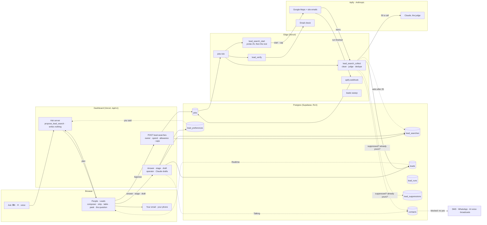
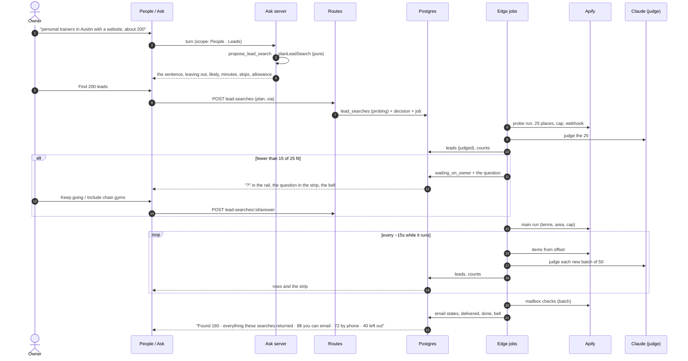

# People: a real table, and leads Claude finds for you

Status: **v3, 19 September 2026.** Every decision is recorded in §16 (1–32) and the two external reviews are folded in (`docs/plans/2026-09-18-lead-finder-review.md`); the five contracts in §0 are stated once and every later section refers to them. Phase 0 is built (#677, #679, 00138 in production, reviewed 19 September); Phase 1 is not. Written against origin/main `fbc5d871`. The design canvas it describes is https://claude.ai/artifact/NnY2jZEtx5LBmopmHR2QDj (21 artboards in four rows; the first is live). v1 (17 September) assumed its yields; v2 replaced every assumption with the calibration Ruben approved on 18 September: ten Google Maps runs across nine niches, 140 email checks and one deeper crawl, about $2.10 of the $5 approved (Appendix C); those changes are still marked **Changed after calibration**. v3 (19 September) restructures Phase 1 into releases A, B and C (decision 24), rewrites the data model around rounds, places and reservations (§12), and adds decisions 30–32.

**What v3 changed, in one paragraph.** §0 is now the five contracts (qualification, counting and money, sources, consent, a search's life) that S1 asked for; the lines they override in v2 are gone. The judge answers per criterion and code decides the class (26); a lead is a place (25); only Qualified leads count and a searching budget bounds cost (18, 27); a converted lead's yes comes only from them (19); leads come only through Apify actors and Claude picks a card (22, 23, 28); rounds are immutable with plan versions (S5, S15); the runner claims, leases and commits (E1–E4); undo is a server record (E9); the endings are one closed set (S7); suppression is by what happened (S8); every copy line claims only what was seen (P2, P3, S12). §12.3–12.6 hold the new shape; §14 the three releases; §16 the three new decisions.

**This revisits a recorded decision, and Ruben lifted it on 18 September.** `apps/dashboard/src/legacy/CLAUDE.md:3-7` keeps Leads and Pipeline hidden "until the product is at 100%". Ruben lifted that for this slice and asked for the table first, since it improves People as it is today. Phase 1 records the lift in that file, in the surface registry's comment and in `docs/system-prd.md` before any Leads code lands.

## 0. The five contracts

**In one screen.** Phase 0 made People a better table for everyone, with no leads in it (built, §2 and §14). Phase 1 lets an owner describe the businesses they want in words; Claude picks a proven source card and writes the plan as a sentence whose words are controls; the server runs it in rounds under hard caps; Claude judges every place criterion by criterion and code decides which ones qualify; the search stops to ask after 25 when the results miss what the owner meant; and People gains a Leads scope where the owner works what was found, with emails from their own inbox and calls from their own phone. Leads live outside `contacts`, and a found lead never receives a text, a WhatsApp or an AI call until they say yes. The model proposes and judges; the owner approves; the server decides what runs and what counts.

Everything below refers to these five; nothing restates them. Each was decided in §16 (the number in brackets) or accepted from the reviews (`docs/plans/2026-09-18-lead-finder-review.md`, the E, P and S items). A SQL function, a handler, a test or a screen that disagrees with a contract is wrong, not the contract.

### 0.1 Qualification (26, 18, P1, P2, E5, E7)

- **The plan lists its criteria, and the owner's words set each one's standard.** "Stores that could sell our products" asks for a likely buyer, so Claude's read is enough (*likely*). "Stores that already sell OTC medicine" asks for a fact, so it must be seen (*seen*). The sentence says which. When the chosen card cannot see a must-be-seen fact, the planner says so before anything is spent and offers the likely version; the owner chooses. Claude never weakens a fact into a likely to reach a count.
- **The judge answers each criterion** `pass`, `fail` or `unknown`, and cites the fact keys it used, validated against the place's own facts. It also picks the business's own email among the cleaned candidates (by index), and writes one reason of twelve words or fewer. It never returns one verdict for the place.
- **Code decides the class.** A required criterion that fails → **Excluded**, with that criterion as the reason. Any criterion `unknown`, a *seen* criterion answered only from inference, no location or a location outside the plan's area, or a contact standard not met (the plan asked for an email and there is none checked) → **Needs review**. Everything else → **Qualified**. A fit band (strong · worth a look · long shot) is derived for ordering only, never for counting.
- **Class is not stage.** Class says whether a place meets the plan (Qualified · Needs review · Excluded). Stage says where the relationship is (Ready · Contacted · Talking · Said no · Not a fit). A place has one class per search it was found by, and one stage.
- **The owner moves a place out of Needs review** by keeping it (it counts, as Qualified) or excluding it (free). **Put back** is the owner's override of an exclusion, through the same door. Neither revives a suppression or an out-of-area place. **Include** (the answer to the question after 25) re-judges the places that criterion excluded under the amended plan; it never flips them by rule.
- **Seen versus read.** Every check the peek lists says whether it was seen (open on Maps, the phone on two sources, the mailbox's answer, the area by coordinates) or read by Claude (independent, the right kind, the business's own address), each read with its reason and its `unknown` state. Nothing read wears a plain check mark.

### 0.2 Counting, and money (18, 27, 7, 15, E2, E9, S10, S11, S13)

- **Only Qualified leads count** toward the monthly allowance (500 in the one plan, by the workspace's calendar month in its time zone). Needs review is free until kept. Excluded never counts. Five asked and twenty qualified count five.
- **A monthly searching budget** per workspace bounds what searching costs: scraping, judging and mailbox checks, retries and failed runs included. Its amount comes from §13's ranges by contact standard, set once, one constant.
- **Reserve, settle, release.** Approving a round reserves its target from the month's allowance and its estimated cost from the month's budget and from the workspace's and the platform's day caps, in the same transaction as the round row. Delivery settles a lead against the reservation; a run's usage settles against the cost reservation; the round's ending releases what is left. Keep-from-review, Put back, Include, a top-up and Find new ones all reserve through the same door. Counters are locked in one fixed order, and no transaction is held across a provider or model call.
- **Undo** returns a lead to the allowance of the month it counted in, never its searching cost. A lead exported or copied (recorded when it happens) keeps its charge. A refund after that month has ended credits that month; nothing reaches the new one.
- **The owner sees one unit: leads.** Before approval the plan says how many leads like these this month still covers, with every limit folded in. When the budget binds, the sentence says why and offers a smaller search or a phone standard. There is no dollar meter.
- **Bulk actions act on what is selected.** The header box selects the loaded rows that match; "Select all 1,240 that match" hands the view's filters to the server, which acts on the whole set.

### 0.3 Sources (22, 23, 28, 14, 11, E10)

- **Leads come only through actors on Apify**, never from Google Maps or any source directly. The Google Maps actor is the first card.
- **Claude chooses a card for every ask; nothing is hard-wired.** A card is a recipe (discovery, contacts, checks) with two halves. The half Claude reads: what it is good for and not, the settings it takes, what it costs, how many it can return, a few worked asks. The half code holds: the actors and their pinned builds, the input builder (from the validated plan, never from Claude's words), the output mapper, the price, the permission level. Cards live in code, in the planner's cached prompt; the catalog's eval set (real asks, each with the right card and settings) runs on every change to the cards or the prompt.
- **An unapproved card never runs for an owner.** A card is approved when a person merges it. The scout (release C) drafts cards and probes them on the platform's own account under a $0.25 cap. No card fits → Claude says so in plain words, and the ask is logged as demand.
- **Only actors that run unattended and safely:** limited permissions, priced per result or per event so `maxTotalChargeUsd` bounds every run, maintained and used. Rental actors are out. Builds are pinned and prices checked weekly; the checker's build too.
- **Claude never starts a paid run.** Its choice is data. Every run goes through the runner (§0.5).
- **The judge is one constant** (`LEAD_JUDGE_MODEL`), with the API's server-side fallback on and the model that answered recorded. The probe judges the first 25 places spread across every term.
- **The product never names a vendor.** The owner sees Claude finding businesses, and where each fact came from: "Google Maps listing", "their website", "a mailbox check".

### 0.4 Consent (19, 20, 11, 25, S8)

- **What a found lead may receive:** an email the owner sends from their own inbox (CAN-SPAM in full: a truthful sender and subject, the ad identified, the postal address, an opt-out honoured within ten business days), and a call the owner dials. Never, until they say yes: a text, WhatsApp, a call from the receptionist, a broadcast, a playbook. Chanlytics sends nothing to a lead.
- **A converted lead's yes comes only from them, permanently:** their own message through the edge, with its evidence, or the yes page. No signed-in caller records one, ever. (Product-wide since #675: at the desk, "in their own message" picks the actual inbound message; "form" stays for paper slips.)
- **Leads live outside `contacts`.** No existing reader reaches them: not the receptionist's context, not the voice agent's caller context, not Win-back, not `metrics_summary`. A lead becomes a person only on a real conversation: they wrote or called in, or the owner marked a call Interested. Never on a stage click alone. A place whose phone belongs to someone in People converts into that person; nothing makes a second one.
- **Suppress by what happened.** A bounce marks that address invalid. An email opt-out stops email to that business; calls stay. "Already a customer" hides the business from every future search. Erasure removes everything and writes the tombstones the rest of the product reads. Four signals, never one list.
- **Take the least.** No reviewer data; staff mobiles dropped on arrival; raw actor items never stored; an untouched lead is archived after 90 days and blanked after 180; Excluded places are blanked after 30. US only at launch.

### 0.5 A search's life (S5, S15, S6, S7, E1–E4, E8, P4)

- **The search is the saved object:** its name, the owner's words, its current plan. **A round is the unit of execution and of money:** the probe, the main run, each top-up and each Find new ones. A round carries the plan version it ran (a change to the area, count, contact standard, criteria or spend makes a new version the owner approves), its reservation, its spend and one ending, and is final once ended. The search's state reads from its latest round.
- **Open states:** queued · probing · waiting on the owner · running · checking emails. **Endings, one closed set:** target reached · searched everything the plan covers · the month's leads used · the searching budget used · few new matches · stopped by you · the source failed · question unanswered · paused for everyone. "Searched everything" only when every term returned fewer places than it was asked for; otherwise the round ended at its limit and the next step is another round in the same area.
- **Size from yield.** The probe's yield of new Qualified places sizes the main round, clamped between 1.2× and 4× the remainder and kept inside the reserved spend; later rounds use the running yield by term and area.
- **The runner.** An atomic dispatch claim on the run row (owner token, claimed at) is committed before any provider call; only the claimer dispatches or records the answer. One webhook token per run row, made at creation, never rewritten; a webhook naming a provider run the row does not hold aborts that run. An ambiguous start stays unknown and is reconciled, never blindly retried. A lease carries an owner token and a generation; renew and release are conditional on both; Stop moves the generation. Each page of results is one commit: insert, settle, tally, advance the offset (compare-and-set), the next job, the events. The judge's answer for a batch is kept by operation id, so a replay never pays twice. A handler never throws on a provider's or the model's error.
- **The question after 25 is an intent check.** It asks whether the search matches what the owner meant, from the most common exclusion; it never nudges the owner to relax a real requirement. Low yield first changes the search (a term that returns mostly the wrong kind is dropped). No answer in 24 hours ends the round "question unanswered"; what was found is kept. After Stop, the emails of leads already found are still checked, and the strip says so.
- **The page reads by view.** A read is keyed by workspace, search, list, chips and sort; a superseded answer is ignored; a refresh patches changed rows and keeps loaded pages, selection and cursor; new results are offered ("12 new"), never re-sorted under the owner.

## 1. The ask

**17 September.** Analyse the People page and table against the best current tables and component craft, and redesign it so new workspaces can load potential leads quickly through Apify: local businesses by niche from Google Maps for B2B sellers like Chanlytics itself, and Amazon sellers the way the June pipeline found them (sellers that meet listing criteria, their websites, found and checked emails). AI-native, not a filter form: ask in Ask, or press an AI button on the table and type or speak; the AI confirms before it searches and finds as many as asked. Assume Pro includes it for now; consider charging per lead. Deliver a redesign to review and a PRD with a system map, end to end.

**18 September.** Approved the $5 calibration. Lifted "Leads stays hidden until 100%" for this, with the table first. Confirmed Claude searching on the owner's behalf over a traditional filter setup, unless something more AI-native exists. Asked for the best implementation logic, and then for a second, slower pass on the redesign with the calibration data: what was assumed too quickly, which screens and scenarios were missing, the first day included.

## 2. People today, measured

**The page** (`apps/dashboard/src/legacy/pages/clients-a.jsx`, 1,776 lines) is a 220px rail of smart and saved lists beside a main column: the standing line (`PeopleStanding`, 948-980), one control row, a section head, the table (`PeopleTable`, 1043-1146) and a bulk bar (`PeopleBulkBar`, 1165-1342).

**The table** has five columns (`plCols`, 990-997): Person, State, Last contact, Visits or Receptionist, Offers, plus hover actions. The header is sticky; no column is. Sort keys are `last`, `name`, `state`, `visits`, `offers` (`:998`).

**The data** comes from `peopleOverride` (`legacy-bridge/surface-data.ts:714-745`), which walks `GET contacts` up to 50 pages of 1,000 through `everyPerson` (`:689-700`) before it publishes, and re-walks them on every message, conversation or escalation change (`refreshOnMessageInserts`, `surface-realtime.ts:14`). `people_list` (`00127:46-236`) orders by latest contact; every other sort and filter runs on the page over the rows it holds.

| Gap | Evidence | What the redesign does | Phase |
|---|---|---|---|
| The keyboard listener is rebound on every render | `clients-a.jsx:1601-1624`, no deps | One listener reading a keys ref, as the Calendar does (`calendar-real.jsx:387-403`) | 0 |
| The bulk bar acts on loaded rows, not shown rows | `PeopleBulkBar` gets `rows` (`:1745`), computes `picked` from them (`:1170`) | It gets what is shown | 0 |
| Fixed columns | `plCols`; `e2e/people.spec.ts:52` pins the headers | Show and hide per member, stored with the view | 0 |
| A view remembers only its sort | `views.people` holds `{sortBy, sortDir}` (the page stopped saving `attentionTab` with the attention strip, `clients-a.jsx:1459-1461`) | It also holds `columns`; every save sends every key, since `member_view_set` replaces the page's object (`00113`) | 0 |
| No provenance on a row | `people_list` returns no source; `contact.added` is read only by the profile (`contacts/[id]/route.ts:263`) | "Came from", computed once in SQL | 0 |
| A wide table is cut off, and nothing pins | `.cl-table-wrap { overflow: clip }` (`clients.css:778-784`). Today at 1280px with a calendar the table is 921px wide in a 746px box: 176px are clipped, so Visits is half hidden and Offers and the row actions cannot be reached | On a desktop the table scrolls in its own box, the header sticks to its top, Person to its left, with a hairline once it scrolls sideways | 0 |
| Selected row nearly invisible in light | `.selected` is `--bg-raised` on `--bg` (`clients.css:1683`) | An ink tint; the accent stays for live agent state | 0 |
| Loads everything before the first row | `everyPerson`, 50 × 1,000 | **Not now.** No workspace is near 1,000 people; the trigger is 5,000, measured | later |
| Sort and filter only on the page | `:1516-1565` | **Not now**, with paging | later |
| Filters from plain words | none | Chips written from the owner's words, through Ask's read path, free | 1 |

## 3. What the best tables do, and what we take

| Pattern | Where it is done well | Here |
|---|---|---|
| Views that remember columns and sort | Attio, Notion, Airtable | **Take.** Per member, in `views.people` and `views.leads` |
| Sticky header and first column | every serious grid | **Take.** |
| Side peek | Linear, Notion, Attio | **Take for leads**, where the evidence matters. People keep their full page one tap away |
| Cell-level enrichment states | Clay | **Take, in words.** Five email words, never a color alone (section 10.4) |
| A reason per row from a model | Clay's AI columns | **Take one**, written by the judge from listing facts. No free-form AI columns: per-column prompts invite prompt injection from scraped pages and unbounded spend |
| Filters from plain words | Clay, Notion AI | **Take**, Phase 1 |
| Server paging and windowed rows | Linear, TanStack Virtual | **Later**, at 5,000 people or 2,000 leads in a view |
| Undo instead of confirm | Superhuman, Gmail | **Take.** Every stage change and bulk change toasts with Undo |
| Group by, density toggle, inline editing | Airtable, Linear | **Not now** |

## 4. Design brief

**Who.** Three people use this table. The salon owner opens People on a phone between clients, for seconds, to see who needs them. The B2B seller (Chanlytics itself, an agency, a cleaning company) sits at a desk and builds a list of businesses to reach. The local owner who needs partners (a trainer wanting physical therapists who refer clients, a salon wanting wedding planners) does a little of both. The first job must never get slower for the other two.

**The jobs.** See who needs you. Find a person. Act on many at once. Find businesses worth reaching, trust what was found, reach them lawfully, and remember how it went.

**Principles**, from `.impeccable.md` and the 15–17 September passes, plus four for the finder:
1. The work first: the table is the first thing on every screen size.
2. Say it once: a count lives in one place.
3. Numbers as a sentence; the plan as a sentence.
4. Progressive disclosure: sources, checks and costs one tap away, never in the way.
5. **Evidence over scores.** Fit is a word with a reason, backed by checks the owner can read.
6. **Claude proposes and judges; the owner approves; the server decides what runs.**
7. **Consent is a fact, not a setting.** Nothing the owner clicks makes a found lead textable.
8. **Say what could not be done.** A search that ran out, left places out or stopped says so, with what was kept.

**Anti-goals.** A separate Leads page. A filter wizard before a search. Stat cards. A credits meter on every screen. Any word naming the vendor.

**The one thing to remember.** The plan is a sentence, every word in it is a button, and Claude checks its own work before spending your leads.

## 5. Who uses it, and when

The first pass designed one path: a B2B seller's search that goes well. These are the paths the second pass designed, each with its artboard.

| # | Scenario | What happens | Artboard |
|---|---|---|---|
| 1 | A brand-new owner, no people yet | The page explains how people arrive by themselves, offers the calendar and a list, and suggests searches written for *their* business, each with how reachable that kind of business is | FirstRun |
| 2 | A seller asks for 200 trainers | Plan → approve → rows stream in, judged | Main, Plan |
| 3 | Half the first results are the wrong kind | The search stops after 25 and asks one question; nothing is spent while it waits | Question, PhoneQuestion |
| 4 | The area runs out before the count | "Found 160 personal trainers · everything these searches returned in Austin", and **Find 40 more nearby**; never padded with poor matches | Done |
| 5 | The owner doubts what was left out | The left-out count opens the places Claude left out, each with its reason, and **Put back** | LeftOut |
| 6 | Working the list at a desk | Peek, **Draft** an email, **Open in your email**, "Did you send it?" | Peek, Draft |
| 7 | Calling between clients | Call from the row or the phone; "How did the call go?" in one tap | Call, PhoneLead |
| 8 | A lead is wrong in a way Claude should learn | **Not a fit** asks why in one tap; the next plan remembers | NotFit, Plan |
| 9 | A question about what was found | "Which have a checked email and 4.8 or better?" answered in Ask, free | AskResults |
| 10 | Coming back a month later | The search keeps what was asked and what was left out; **Find new ones** counts only new places | Searches |
| 11 | A lead writes back or says yes on a call | They become a person, and People says where they came from | People |
| 12 | Every way a search can end badly | Nothing matched, all already yours, outside the US, people not businesses, near the monthly limit, stopped, the source failed, the question unanswered, paused for everyone | States |
| 13 | Bringing the clients you already have | A spreadsheet, columns matched by Claude, no yes carried over (Phase 2) | Import |
| 14 | A teammate, not the owner | Operators work leads (stages, calls, drafts); only the owner starts a search, because it spends | section 12.6 |

## 6. The table, specified

### 6.1 Scopes, lists and views
- **The rail** starts with `People | Leads` (a segmented control, `role="tablist"`). Under People: the existing smart lists and saved lists, unchanged. Under Leads: All leads, Ready, Contacted, Talking, Said no (only when there are any), Not a fit, then **Searches**, each with its count. A running search carries the live dot; a search waiting on the owner carries a "?" in the accent, and the standing line says "1 search needs you".
- **The standing line** speaks for the scope: `87 people · 2 need you · 11 reached this week`, or `322 leads · 272 ready · 3 searches`.
- **A view** is `{ sortBy, sortDir, columns }` for People and `{ list, sortBy, sortDir, columns }` for Leads, per member, through `PUT views/people` and `PUT views/leads` (2,000 characters). Every save sends every key the page owns.

### 6.2 Columns

| Scope | Column | Shows | Default |
|---|---|---|---|
| People | Person (pinned) | avatar, name, their last words | on |
| People | State | the pill and its detail | on |
| People | Last contact | "They wrote · 2h ago" | on |
| People | Next visit | with a calendar | on |
| People | Offers | Yes / No / Not asked | on |
| People | Came from | WhatsApp, Text, Email, Phone call, Your calendar, Added by you, Imported history, A lead you found; not sortable, not in the CSV | new, on |
| People | Receptionist | the receptionist's mode for them | on without a calendar (as today, pinned by `e2e/people.spec.ts:56`), off with one |
| People | Email, Lists | | off |
| Leads | Business (pinned) | a rounded-square mark, name, "2 locations" when so, category · area; Call and Copy on hover | on |
| Leads | Fit | Strong fit / Worth a look / Long shot for Qualified rows; Needs review rows say why ("Couldn't check the email", "No location"); Excluded rows say the criterion ("Chain", "Not a trainer"). The class itself is the rail's list (§0.1) | on |
| Leads | Email | the address and its state in words (10.4); left-out rows say "Not checked" | on |
| Leads | Phone | the number; a double tick when Maps and the website agree | on |
| Leads | Why it fits | the judge's reason, one line | on |
| Leads | Rating | 4.9 and the review count | on |
| Leads | Stage | Ready, Contacted, Talking, Said no, Not a fit | on |
| Leads | Found | "now", "6m", "3d" | on |
| Leads | Distance | from the search's center, for searches with one (S4) | on with a center |
| Leads | Source, Website, Search | | off |

"Added" (v1) is dropped: the Person cell already says "since Jul 14", and a test pins the old "First contact" column out. People stays a `<table class="cl-table">`, drawn from column definitions by one table component with a generic shape (rows, columns, selection, cursor, open) that Leads reuses in Phase 1. On a desktop (901px and wider) the table is its own scroller, so the header sticks to its top and Person to its left while the page above it holds still; phones and tablets keep their cards.

### 6.3 Reading
- **People** keeps `people_list` and `everyPerson` in Phase 0. `people_list` gains one returned column, `came_from` (section 12.4). Paging moves to SQL when a workspace passes 5,000 people; the dashboard's request logs already show every walk (its `GET contacts` pages), so the trigger is measured, not guessed.
- **Leads** reads `GET leads` keyset-paged by `(found_at, id)` with the list, the search, the sort and the chips in SQL, because searches add rows in the hundreds. Pages of 500; the table asks for the next page as the owner nears the end.
- **Words to chips** (Phase 1): the search box takes a name or a sentence. A sentence ("ready to email in 78704", "asked about balayage but never booked") goes to Ask's read path and comes back as chips marked "From your words", with **Save as a list**. Free: no search, no count.

### 6.4 Acting
- **Selection:** click, Shift-click for a range, `x` on the cursor row, the header checkbox for what is shown.
- **People bulk actions** stay as they are and act on what is shown.
- **Leads bulk actions:** Copy emails (says how many have none), Mark contacted, Export (owner, on the ledger like `contacts/export`), Not a fit. Each toasts with Undo.

### 6.5 Keys

| Key | Does |
|---|---|
| `/` | search, or describe who you mean |
| `F` | Find leads (Leads scope) |
| `J` `K` or `↑` `↓` | move the row cursor |
| `Enter` | open the person, or peek the lead |
| `x` / `Space` | select the cursor row; `Shift` extends |
| `C` | call the cursor lead |
| `Esc` | close the peek, then clear the selection |
| `⌘K` | Ask, scoped to what is selected |

One listener, registered once, reading a keys ref. Row actions show on hover and on the keyboard cursor. Phase 0 ships `/`, J/K and the arrows, `x`/Space, Enter and Esc; Shift-extend, `F`, `C` and `⌘K` scoping arrive with Leads in Phase 1.

### 6.6 Phone and tablet (≤ 900px cards; the slim bar under 720px)
Cards, not columns, at 900px and under (Phase 0's breakpoint, which the Columns menu and the keyboard listener share; the design's 720px is the phone's slim bar, not the card rule). One slim bar holds the `People | Leads` switch, search and Find (✦); the work starts under it. A running search is a two-line card; the question after 25 is a card with two 44px answers; rows are cards with a 44px Call button; a lead opens full screen with Call and Email, and after a call the six outcomes as a 2 × 3 grid. Find opens a bottom sheet whose first control is hold-to-talk.

### 6.7 Accessibility
Real buttons for names, headers, chips and tokens; `aria-sort` on the sorted header; `aria-selected` on rows; the focus ring token on the row cursor; states in words and shapes; the question strip is `role="alert"`; 44px targets on coarse pointers.

## 7. The finder: Claude searches on your behalf

A plain scrape is not good enough to hand an owner (Appendix C). Filters cannot fix that; judgement can. So Claude does not just translate words into a query. It does the research an assistant would do, inside rails the server holds:

1. **Understands the ask.** Who, where, how many, what they must have, and — the part a filter form never captures — **who they are not** ("independent trainers, not big gyms"; "firms, not referral networks").
2. **Writes the plan as a sentence** the owner can correct by tapping a word or saying it again, with **Leaving out** chips they can remove. At most one question, only when the answer changes who is found by a lot.
3. **Searches wider than the words.** It expands the terms ("personal trainer", "strength coach", "fitness coach"), because one Maps search tops out around 120 places, and names two or three nearby areas for later.
4. **Judges every result** against the owner's intent: the right kind of business or not, one location or a chain, which of the addresses on the page is really theirs. It says why in one line.
5. **Checks its own work early.** After the first 25 places, if fewer than 60% fit, it stops and asks one question before spending more.
6. **Tops up instead of padding.** Fewer good matches than asked for: it says so and offers the nearby areas. It never fills the count with poor matches.
7. **Answers questions about what it found**, in Ask, without spending.
8. **Learns from Not a fit.** The owner's reasons become the next plan's leaving-out chips.

What Claude never does: spend, start a run, see the Apify token, write a consent record, or send anything to a lead. It chooses a source card for the ask (§0.3); code builds every input from the validated plan.

### 7.1 The model calls

| Call | Where | Model | Input | Output | Cost |
|---|---|---|---|---|---|
| **Plan** (steps 1–3, and the card) | Ask's loop, the `propose_lead_search` tool | `claude-sonnet-5`, as Ask uses today | the owner's words; the business line; the source catalog's briefs (cached); what Not a fit taught (release C); counts of people and leads (never rows) | a `LeadSearchPlan` (the card, the terms, the area with its center, the count, the contact standard, the criteria each with its standard, the exclusions) and its sentence | inside Ask's 1.5M-tokens-a-day budget |
| **Judge** (steps 4–5) | edge job `lead_collect`, one call per batch of up to 25 new places, kept by operation id | one constant, `LEAD_JUDGE_MODEL`; default `claude-opus-5` at low effort, with the API's server-side fallback on and the answering model recorded on the round | the plan's criteria with their standards; per place only listing facts as quoted data, each capped at 120 characters: name, category, city and state, website host, rating, review count, the candidate emails with their domains, whether the phone matched the site | per place: each criterion `pass` · `fail` · `unknown` with the fact keys it used, the index of the business's own email or none, a reason of 12 words or fewer (§0.1) | about 0.23¢ a place at Opus 5; 0.09¢ at Sonnet 5; 0.05¢ at Haiku 4.5 |
| **Draft** (release B) | `POST leads/[id]/draft` through the edge gateway, purpose `lead_draft` | `LEAD_DRAFT_MODEL`, recommended `claude-sonnet-5` for speed | the business line and offer; the lead's facts; a tone | subject and body | about 0.5¢ a draft; counted in Ask's daily budget |
| **First-day suggestions** (release B) | `GET lead-suggestions`, cached 7 days per workspace | `claude-sonnet-5` | the business line, and what the cards can search | three or four searches, each with who it is for | once a week |

The judge is one structured-output call with a hand-written JSON schema, sent the way `apps/edge/lib/brain.ts` sends one in production (`output_config.format`, effort `low`, no tools, no web access), and its answer validated with contracts' own zod parser, the way the brain keeps its schema and parser in contracts and its call in the channels package. Page text never reaches it: only listing facts and address strings, each capped, stripped of control characters and passed as quoted data. An answer that names a criterion the plan does not have, a fact key the place does not have, or an email index out of range is rejected and the batch judged again once; a batch refused twice is Needs review with the reason "the judge could not read these". A `max_tokens` stop is an error, never a split that pays again. The answering model and the tokens are recorded on the round. Which model judges is Ruben's call (§16, 3); the code keeps it one constant.

### 7.2 What is deterministic, and stays that way
The model reads; code decides everything with a right answer.
- **Before the judge:** drop closed places; drop places with no location or one outside the plan's area (the distance from the center, §12.5); drop junk addresses (platform domains such as `vagaro.com`, `square.site`, `glossgenius.com`, `godaddy.com`; placeholders such as `filler@`, `yourdomain@`, `example@`, `email@domain`; corporate roles `careers@`, `recruiting@`, `media@`, `press@`, `privacy@`); normalise `www.` in domains; drop placeholder phones (`1234567890`) and mis-prefixed ones; fold a duplicate listing (the same name, address and phone) into the place already held; look up a shared phone, email or website host and mark it, never merge on it (§0.4, 25).
- **After the judge:** the class from the criteria (§0.1), the mailbox check, the phone comparison (E.164 equality), "already yours" by place id, "never again" (the suppressions, by what happened), the counting (§0.2), the tallies, the caps.
- **The question after 25** is an intent check (§0.5): over the probe's places, when fewer than 60% pass the plan's criteria, the round waits and asks whether the search matches what the owner meant, from the most common exclusion ("Half of the first 25 are chain gyms and other kinds of places, which I'm leaving out. Is that what you meant?"). Its answers: **Yes, keep going**; **Include chain gyms**, which amends the plan (a new version) and re-judges the places that criterion excluded; **Stop here**. When the low yield comes from one term returning mostly the wrong kind, the round drops that term first and says so. It never asks the owner to relax a fact they asked for. No answer in 24 hours ends the round "question unanswered"; what was found is kept.

## 8. The search, screen by screen

### 8.1 Doors
One engine, five doors, all Ask underneath: **Find leads** and `F` on the Leads scope; **Ask** (`⌘K`, the topbar, the phone's ✦); the **first day**; the phone sheet; and in Phase 2, **More like these** on a selection (Ask reads the selected leads' category, area and rating and proposes a lookalike search). The composer posts the same turn Ask does, with People · Leads as its scope, and renders the plan inline.

### 8.2 The composer
The input with a mic (hold to talk: the browser speech Ask already uses, `ask-hooks.jsx:10-62`) and three suggestions "for Chanlytics, from what your business does", each with how reachable that kind of business is ("about 6 in 10 have an email"). The suggestions are the first-day suggestions (8.9).

### 8.3 The plan
"Find **200** **personal trainers** **in Austin, TX** that have **a website**, then find **their email** and check it." Every bold word opens a small picker; the count picker shows minutes per option. Under it:
- **Leaving out** chips, each removable: Claude's reading of the ask ("Chain gyms", "Physical therapists and chiropractors") and what Not a fit taught, marked "you said, Sep 12".
- **Likely**: a two-part bar and "About 116 will have an email; the rest you call · from past searches for trainers", from the niche priors (12.4). A kind of business never searched says "checked after the first 25".
- **Facts**: "About 8 minutes — leave the page if you like · Skips the 14 already yours · Counts only matches you can reach · 486 left this month".
- **Find 200 leads** and **Change what I asked**; the foot says "You can email and call leads. Texts and offers wait for their yes."

The planner refuses in words, with no card: places outside the US, people rather than businesses (with businesses whose clients need the owner as suggestions), categories no recipe carries (section 5, row 12).

### 8.4 The run
Approve → `POST lead-searches` (a round is reserved and started, §0.5). The composer folds into a one-line strip above the table: a live dot, "Finding personal trainers in Austin · 86 of 200 · 41 emails checked · about 4 min left · estimates update after the first 25", **Stop**, and a 2px progress line in the accent. The first 25 places come from a small probe run across every term; the rest follow once the probe passes. Rows arrive in the order found, judged: Excluded places show dimmed with the criterion that excluded them and "Not checked" (no mailbox check is spent on them); Needs review rows say why; Qualified leads show "checking" until their mailbox check lands.

### 8.5 The question after 25
When fewer than 15 of the first 25 pass, the strip becomes the question, in the accent tint with `role="alert"`: the sentence, "Nothing is spent while this waits. Answer and it carries on.", **Yes, keep going**, **Include chain gyms**, **Stop here**. The rail marks the search with a "?" and the standing line says "1 search needs you"; the bell and Today say it too, so the owner can leave. The 25 rows stay visible under the question, so the evidence is right there. It is a check on what the owner meant, never on the judge's accuracy (§7.2).

### 8.6 Done
The table re-sorts strongest fit first and the strip says what happened once, claiming only what was seen: "Found 160 personal trainers · everything these searches returned in Austin · 88 you can email · 72 by phone · 40 left out", where **40 left out** opens the Excluded view and the Needs review count opens that list. When the round ended at its limit rather than the area's, the strip offers **Find more in Austin**; when every term ran short, **Find 40 more nearby** (the areas in its tooltip) opens the plan with Claude's nearby areas as the "where" word. **Undo** removes every lead the owner has not touched (a server-side record, §0.2) and gives the leads back to the month they counted in, within 24 hours. The bell says "Your search for personal trainers in Austin is done".

### 8.7 Excluded, and Needs review
Two lists in the rail. **Excluded**: the places Claude's criteria left out, with chips by criterion ("Chains 26 · Not a personal trainer 14"), each row's criterion in the Fit column, and **Put back** on the row (hover or cursor) and in its peek: the owner's override, through the same door that counts (permission `find`). **Needs review**: places that met no rule for exclusion but did not qualify (an unknown criterion, a fact read where it must be seen, no location, an unchecked or unconfirmed email where the plan asked for one), each with why, and **Keep** (counts) or **Exclude** (free) on the row and in the peek. Excluded places never count; a kept place counts the month it is kept.

### 8.8 Stop, and every other ending
A round has one ending from a closed set (§0.5), designed once on the States artboard, each saying what happened, what was kept, what was counted and one next step. Every next step makes a new round; nothing reopens an ended one.

| Ending | The owner reads |
|---|---|
| Target reached | "Found 200 personal trainers · 88 you can email · 72 by phone · 40 left out" |
| Searched everything the plan covers | "Found 160 personal trainers · everything these searches returned in Austin" · **Find 40 more nearby** (every term ran short); when nothing matched at all: "There are 3 personal trainers in Marfa, TX, and all three are chains, which you asked me to leave out. Nothing was counted." **Look in Alpine and Fort Davis** · **Include chains** |
| The month's leads used | "You have 36 leads left this month. Find 36 now, or all 200 when your leads renew on Oct 1?" (asked before the round starts, when the plan is written) |
| The searching budget used | "Emails for law firms are hard to find, so this month covers about 60 more. Find 60 now?" (asked before; when it binds mid-round: "Stopped at 61 · this month's searching is used up · the 61 found are yours") |
| Few new matches | "All 64 chiropractors in Austin are already yours. Look further out, in Round Rock and Pflugerville?" |
| Stopped by you | "Stopping · checking the emails of the 61 found · nothing else was counted" · then **Carry on** (a new round) |
| The source failed | "Stopped at 86: the source stopped answering · the 61 found are yours · nothing more was counted" · **Try again** (a new round) |
| Question unanswered | "Stopped after a day without your answer · the 12 found before it asked are yours" · **Answer now** (a new round with the answer) |
| Paused for everyone | "Lead searches are paused for now · your leads are all here · nothing is being counted" |

The planner refuses two asks in words, with no round: places outside the US ("I can only find businesses in the US for now…") and people rather than businesses ("I find businesses, not people at home. People who want a trainer find you…", with two suggestions); and it says when no card fits ("I can't search Etsy shops yet"), which is logged as demand (§0.3).

### 8.9 The first day
**Changed after review.** v1's first day offered three suggestions copied from Ruben's own examples. v2's page is about people first: "Your people gather here", then three ways people arrive (they reach you — the number is live, Connect WhatsApp; your calendar — Connect; clients you already have — Add someone, and Import a list when Phase 2 ships), then "Or have Claude find businesses worth reaching": the composer and three or four suggestions **written by Claude from the workspace's business line** ("For a personal training studio in Denver · Not right? Change it"), each saying who it is for (Partners · their patients often need a trainer next) and how reachable that kind of business is. The foot says what the finder does not do: "Claude finds businesses, not people at home." A salon sees wedding planners, photographers and bridal shops; a law firm sees chiropractors, body shops and towing companies.

### 8.10 A search, kept
Each search in the rail has a menu: what was asked and left out, in the owner's words and the date; **Rename**; **Find new ones** (the same plan; only places not already in leads count); **Search again, changed** (opens the plan); **Export these 160**; **Remove this search** (keeps the ones contacted or talking). A month later the owner can see exactly what they asked for.

## 9. Working the leads

### 9.1 Stages, apart from class
Ready (found and reachable) → Contacted → Talking; or Said no, or Not a fit. Stored in the canonical lead stages (`legacy/CLAUDE.md`, "Lead stage"): `ready`, `nurture` (Contacted), `converted` (Talking), `archived` with a reason (`said_no`, `not_a_fit`, `customer`, `stale`, `search_removed`). Words live in contracts (`LEAD_STAGE_WORDS`); stored values are never shown. The peek has a segmented control for the three open stages and a **Not a fit** button. Stage is the relationship; the class (Qualified · Needs review · Excluded) is whether the place met the plan, one per search it was found by (§0.1), and it is the rail's list, never a stage.

### 9.2 The peek
408px beside the table: the business and its sub-line; the stage control; the fit as a sentence ("Strong fit. Independent coaching · 5.0 from 16 reviews · email checked."); **How you can reach them** (the phone with its sources and **Call**; the email with its state, **Copy** and **Draft**; texts and WhatsApp shown locked: "Wait for their yes. Once they write back, they're in People and your yes page works for them."); **Checked** (six checks, each with where it came from); **2 other addresses on their site**, folded, with why Claude picked this one; **Found** (three timestamps); the website and Instagram.

### 9.3 Draft an email
**Draft** turns the peek into a draft: To, Subject, the body Claude wrote from what it found about the business and what the workspace offers, **Shorter** and **Warmer** rewrites, and a note that the address and opt-out line are added "as US law asks". **Open in your email** opens it in the owner's own mail app (`mailto:`); **Copy** copies it. The footer uses the business address from Settings; with none set, the draft asks for it first. When the owner comes back to the tab, the peek asks **Did you send it?** — Yes moves the lead to Contacted and records `lead.emailed`.

### 9.4 Calls
**Call** on the row, in the peek, or `C` dials with `tel:`. When the owner comes back, the peek asks **How did the call go?**: Interested, Call back later, Not interested, Left a voicemail, No answer, Wrong number, with a note. Interested moves the lead to Talking and makes them a person with the call and the note on their page; Not interested is Said no; Call back later, voicemail and no answer are Contacted; Wrong number marks the phone wrong and keeps the stage.

### 9.5 Not a fit
One tap asks why: A chain or franchise · The wrong kind of business · Too far away · Already a customer · Something else. The first three become a `lead_preferences` row scoped to that kind of business (the category), which the next plan for that kind shows as a removable "you said" chip; applying one to another kind of search asks first; "Too far away" narrows that search's radius and the next around the same center, never other areas (P5). "Already a customer" hides that place from every future search; "Something else" teaches nothing. Wrong contact details, not a fit, no answer and an opt-out are four different signals, never one. The toast says what was learned, with Undo. The chips and the learning are release C; Not a fit itself and "Already a customer" are release B.

### 9.6 A lead becomes a person
Only on a real conversation: they wrote or called in (the intake links the lead by phone or email), or the owner marked a call **Interested**. Never on a stage click alone: marking Talking by hand keeps the lead a lead and the stage says so. Conversion creates the person through `create_person` with source `lead` and links `leads.contact_id`; a lead with only an email converts the way the email intake creates an email-only person (00126–00127), and 00125's `set_person_email` adds the lead's email to a person created by phone. A place whose phone belongs to someone already in People converts into that person; nothing makes a second one (25). The contact is named for the business until a person's name is known. People's "Came from" says "A lead you found", with the search and the dates in its title. Their consent starts unknown, and a yes of either kind comes only from them, permanently (§0.4).

### 9.7 Ask about what was found
"Which trainers have a checked email and 4.8 stars or better?" → "18 of the 160. The five with the most reviews:" and a small table, with **Show all 18 in the table** (chips), **Draft an email to the first one**, and "Questions about leads you have are free. Nothing was searched or counted."

## 10. How a place becomes a lead

The owner never sees an actor or a vendor. They see where each fact came from: "Google Maps listing", "their website", "a mailbox check". A recipe is a vetted pipeline the server owns; the model fills its parameters and the server turns them into actor input.

### 10.1 Recipe A: local businesses (the launch recipe)

| Step | Actor | Adds | Bronze price (18 Sep 2026) |
|---|---|---|---|
| 1. Probe | `compass/crawler-google-places`, 25 places, `scrapeContacts: true` | the first 25, judged before anything else is spent | about $0.13 |
| 2. Find | the same actor, the plan's terms and area, `maxCrawledPlacesPerSearch` = the remaining count × 1.3 | name, category, address, phone, website, rating, reviews, place id, open or closed | $0.003 per place; a filter (has a website, a minimum rating) +$0.001 |
| 3. Contacts | same run | emails and social profiles from the business's own site | +$0.002 per place |
| 4. Judge | Claude (7.1) | match or not, fit, reason, the best email | 0.05–0.23¢ per place |
| 5. Check the email | `bounceverify/bounceverify-email-verifier` (fallback `michael.g/email-verifier-validator`) | the mailbox state (10.4) | $0.00089 per email |

**Changed after calibration**, and dropped from the recipe:
- **The deeper crawl** of contact and about pages (`vdrmota/contact-info-scraper`): 25 sites, 101 pages, **0 emails**. A site that hides its address behind a form does not give it up to a deeper crawl.
- **Review signals** ("reviews mention slow replies"): 5 of 20 places had one, and 4 of the 5 were chain gyms. Independents have too few reviews.
- **The named person** stays optional and moves to Phase 2: 70% of law firms returned one, but only about half were decision makers. If used, `leadsEnrichmentDepartments: ["c_suite"]`.

Every start sets `maxTotalChargeUsd` (this actor refuses a cap under $0.50), `scrapeReviewsPersonalData: false`, and an ad-hoc webhook.

### 10.2 Recipe B: Amazon sellers (Phase 4)
The June pipeline, productised: `junglee/Amazon-crawler` with `scrapeSellers: true` (never `countryCode` or `zipCode`, a $0.05 event per result); brand to website through `apify/google-search-scraper`; contacts from the site; the same judge and mailbox check. US sellers only; skip Amazon-sold and CN addresses. The June grade carries over as the judge's rubric (no A+ content, fewer than seven images, no video).

### 10.3 The checks a lead passes
Each is stored with its source and listed in the peek, split into what was **seen** and what Claude **read** (P2). Nothing read wears a plain check mark.

| Check | Passes when | Seen or read | Source |
|---|---|---|---|
| Open for business | not `permanentlyClosed` or `temporarilyClosed` | seen | Google Maps |
| In the area asked for | the place's coordinates fall inside the plan's center and radius | seen | Google Maps · the plan |
| The right kind, not a chain | each of the plan's criteria passes (§0.1), with its reason and the facts it used | read (a `likely` standard) or seen (a `seen` standard the card can show) | Claude · the listing |
| Phone matches on two sources | the Maps phone equals a phone on the website, as E.164 | seen | Maps · website |
| The email is theirs | the judge picked it among the candidates the cleaner kept, with why | read | Claude · website |
| Mailbox state | 10.4 | seen | mailbox check |
| Not already yours | no lead holds the place id; a shared phone, email or host only marks it ("shares a number with Corner Deli, already in your leads") | seen | your workspace |
| Not suppressed | the place is not hidden ("already a customer", erased) and the email is not opted out | seen | your workspace |

### 10.4 Email, in five words
**Changed after calibration.** Of 140 checked addresses, 49% existed, 31% sat on servers that accept every address (catch-all), 14% would not answer (security gateways, mostly law firms), 6% bounced. Two words (valid, risky) would call a third of good addresses risky. So five, each claiming only what the check saw (S12):

| Stored | The owner reads | Shape | Meets an email standard? |
|---|---|---|---|
| `ok` | Checked | a check | yes |
| `catch_all` | Unconfirmed · their server accepts any address, so the check can't tell | a dashed ring | Needs review |
| `unknown` | Couldn't check | a question mark | Needs review |
| `invalid` | Bounces | struck through, a cross | no; the address is marked invalid on the lead (never a suppression) |
| `none` | No email on their site · shown as "Call only" | — | no |

### 10.5 The counting rule
Stated once in §0.2: only Qualified leads count, the month they qualify or are kept; Needs review is free until kept; Excluded never counts. Across the calibration, with a phone standard, 55–97% of places would qualify by niche; with an email standard, 20–67%.

## 11. What a found lead may receive

The consent contract is §0.4. A found lead has never said yes to anything, and the product already treats "no yes" as a hard stop for offers (`mayMessageFor`, `contracts/src/consent.ts`; `refusalFor`, `core/src/deliver.ts`).

| Channel | May a found lead get it? | Why |
|---|---|---|
| An email the owner sends from their own inbox | **Yes**, US businesses | CAN-SPAM permits B2B email with a truthful sender and subject, the ad identified, a postal address and an opt-out honoured within ten business days; the draft carries all of it, and Chanlytics sends nothing |
| A call the owner dials | **Yes** | A person dialling a business line by hand is not an autodialled or artificial-voice call; the Telemarketing Sales Rule's ban on misrepresentation still applies |
| A call from the AI receptionist | **No** | The FCC's 8 February 2024 ruling makes an AI voice "artificial" under the TCPA: prior express consent, $500–1,500 per call |
| Text or WhatsApp | **No**, until they say yes | TCPA written consent for marketing texts; A2P 10DLC and WhatsApp require opt-in, and one bad campaign can suspend the registration for every workspace |
| Broadcasts and playbooks | **No** | Gated on a marketing yes and a thread |

**What the product enforces, not just says:**
- **Leads live outside `contacts`**, so no existing reader reaches them: not the receptionist's context, not the voice agent's caller context, not the quiet list that feeds Win-back, not `metrics_summary`.
- **A converted lead's yes comes only from them, permanently** (§0.4): `set_contact_consent` and `set_marketing_consent` refuse a signed-in caller for a person linked to a lead, in a sentence; the edge's intake and the yes page are the only writers. **Tests** give every consent path a converted-lead case: broadcasts, playbooks, the SMS and WhatsApp send path, outbound voice, the bulk yes, the desk's own-message door.
- **Never again, by what happened.** An email opt-out hashes the address and the place (email stays blocked, calls stay); "already a customer" hashes the place; an erasure hashes everything, keyed like `erased_email_hash`; a bounce marks the lead's address invalid and hashes nothing. The finder drops a hidden place before insert and checks the erasure tombstones.
- **US only at launch.** CASL and GDPR need their own work first. California's CPRA covers business contact data; erasure and suppression are the deletion path.
- **Take the least.** No reviewer data; staff mobiles dropped on arrival; raw actor items never stored; an untouched lead is archived after 90 days and blanked after 180; an Excluded member is blanked after 30 but stays counted.
- **No vendor names** in the product.
- **Google's terms** were reviewed at Ruben's request (`docs/plans/2026-09-18-lead-finder-source-rights.md`, not legal advice) and the risk accepted (§16, 21–22): leads come only through actors on Apify, and the review stays as the record, not a gate.

## 12. The system, end to end

### 12.1 The map

<!-- fig:system-map -->


### 12.2 One search



### 12.3 A search's life, as rows

A **search** is the saved object. A **round** is the unit of execution and money. A **run** is one provider execution (one Maps run per term, one checker run per batch of addresses). The search's state is read from its latest round (`lead_searches_view`); nothing writes a state onto the search.

```
lead_searches 1 ─── n lead_rounds 1 ─── n lead_runs
      │                    │
      │                    └── n lead_judgments   (the judge's answer per batch, by operation id)
      └── n lead_search_members ─── 1 leads ─── n lead_places
lead_counters (allowance · budget · the two day caps)     lead_operations (undo records)
lead_preferences · lead_suppressions · lead_niche_priors · lead_platform
```

- **Round states:** `queued → probing → (waiting_on_owner →) running → checking → ended`. `ended` carries one of the nine endings (§0.5). A round is final once ended; Carry on, Try again and Answer now make a **new round** with the same plan version, never reopen one.
- **Run states:** `claimed → starting → running → succeeded | failed | aborted | timed_out`, plus `unknown` (the start's answer was lost; reconciled by the sweep from the provider's own list of runs, never blindly retried).
- **Plan versions.** `lead_searches.plan` is the current plan; every round carries the exact plan it ran (`lead_rounds.plan`, with `plan.version`). A change to the area, count, contact standard, criteria or spend makes a new version the owner approves; the next round runs it.

### 12.4 Data (release A, migration 00139)

Phase 0 took 00138; release A takes **00139** (re-checked immediately before pushing) and release B the next free number. The execution plans hold the full SQL; this is the shape and the reasons.

| Table | Holds | Notes |
|---|---|---|
| `lead_searches` | `id, tenant_id, created_by, via (people\|ask), card, name, asked (≤400), plan jsonb, removed_at, created_at` | no `state`, no counters: the view derives both from the rounds |
| `lead_rounds` | `id, tenant_id, search_id, seq, purpose (probe\|main\|topup\|renew), plan jsonb, plan_version, target, state, ending, question jsonb, answered, waiting_since, allowance_reserved, allowance_used, cost_reserved_usd, cost_usd, judge_tokens, judge_model, started_at, ended_at` | `unique (search_id, seq)`; `ending` is the closed set; final once ended (the guard) |
| `lead_runs` | `id, tenant_id, round_id, purpose (discover\|check), term, actor, build, apify_run_id unique, dataset_id, state, claimed_by, claimed_at, webhook_token_hash, lease_owner, lease_gen, lease_until, read_offset, items_seen, cap_usd, usage_usd, created_at, finished_at` | the claim (E1) is `update … set claimed_by = $token where claimed_by is null returning 1`; the token is made at creation and never rewritten; the lease (E3) is renewed and released only `where lease_owner = $o and lease_gen = $g`; Stop bumps `lease_gen` |
| `lead_judgments` | `round_id, batch, op_id unique, request_hash, answer jsonb, model, tokens, created_at` | a replayed page finds its answer by `op_id` and pays nothing (E4) |
| `leads` | the place: `id, tenant_id, place_id, business_name, category, street, city, region, postal_code, country, lat, lng, website_host, instagram_url, phone_e164, phone_sources, phone_wrong, email, email_alternates, email_state, email_checked_at, rating, reviews, stage, closed_reason, last_outcome, last_note, contacted_at, exported_at, contact_id, converted_at, found_at, erased_at, blanked_at` | `unique (tenant_id, place_id)`; **no** unique email or phone (25); plain indexes on `(tenant_id, phone_e164)`, `(tenant_id, email)`, `(tenant_id, website_host)` so a shared detail is a lookup, never a merge |
| `lead_places` | `lead_id, tenant_id, place_id unique, title, street, found_at` | a duplicate listing (same name, address and phone) folds here, so rediscovery maps back (E6) |
| `lead_search_members` | `search_id, lead_id, round_id, tenant_id, judgment jsonb, class (qualified\|review\|excluded), excluded_by, fit, reason (≤120), distance_m, counted, counted_month, kept_at, kept_by, blanked_at` | one lead can belong to several searches, each with its own judgment (E6); `counted_month` is the month it counted in (S11); the round's tallies are counts over this table, never stored twice |
| `lead_counters` | `tenant_id (null = platform), kind (allowance\|budget\|day), period ('2026-09' or '2026-09-19'), used, reserved` | locked `for update` in the fixed order allowance → budget → day (workspace) → day (platform), always inside one door, never across a provider or model call (E2) |
| `lead_operations` | `id, tenant_id, kind, search_id, lead_ids uuid[], before jsonb, after jsonb, version, by, at, undone_at` | every Undo-able act writes one; Undo takes the id and the version the client saw, and refuses when anyone changed the rows since (E9) |
| `lead_preferences` | `kind (chain\|wrong_kind\|too_far), category_key, example, from_lead_id, active, created_by` | learned exclusions scoped to the kind of business (P5); release C draws them |
| `lead_suppressions` | `tenant_id, kind (email\|place\|phone), hash, what (email_opt_out\|customer\|erased)` | by what happened (S8): a bounce is `email_state = invalid` on the lead, not a suppression |
| `lead_niche_priors` | `category_key, places, matched, with_email` | platform-wide aggregates, read through `lead_niche_prior(key)`; no table policy for members |
| `lead_platform` | `searches_on boolean, tenants_on uuid[], note, prices_checked_at` | one row; read through `lead_searches_on(tenant)`: on for everyone, or for the listed workspaces only (the internal runs of release A) |

- **RLS:** members select their workspace's rows (the 00002 shape); no write policy for a signed-in session. Every write from the page goes through a `SECURITY DEFINER` door that checks `is_acting_member()` and the role; the edge writes with the service role. `lead_platform` and `lead_niche_priors` have no member policy: functions expose what a member may read.
- **Doors (SQL, release A):** `lead_search_create(plan, via)` (owner; reserves in the same transaction and inserts the first round and its start job), `lead_round_answer(round, answer)` (owner), `lead_round_stop(search)` (operator; bumps every live run's `lease_gen`, schedules the abort), `lead_search_more(search, purpose, plan)` (owner; a new round through the same reservation), `lead_member_keep / exclude / put_back` (owner, permission `find`; keep counts, through the reservation), `lead_undo(op_id, version)` (owner), `lead_search_rename`, `lead_search_remove` (owner; keeps contacted and talking leads). Stage, outcome, draft and bulk doors are release B's.
- **Service RPCs (the edge):** `lead_run_claim`, `lead_run_record_start`, `lead_run_lease`, `lead_run_release`, and **`lead_collect_commit`** (one transaction per page: insert leads and members, settle delivered leads against the reservation, advance `read_offset` by compare-and-set, insert the next job, append the events, keep the judgment by `op_id`), `lead_check_commit` (the mailbox states of a batch), `lead_round_end(round, ending)` (releases what was reserved).
- **Triggers:** `lead_rounds_guard` (transitions; final once ended; only a signed-in person may create a round from an ended one, the edge and the sweep never revive); `leads_erase` (the allow-list blanking function of 00131's shape, and the suppression hashes); `lead_link_contact` on `contacts` insert from the edge (`auth.uid() is null`): a person who writes or calls in whose phone or email a lead holds links that lead; the desk's Add a person never links.
- **Jobs:** `lead_round_start { round_id }`, `lead_collect { run_id, seq }`, `lead_check { round_id, batch }` join `jobs_kind_check`, `JOB_KINDS`, the generated sets and **`RETRY_WAITS_MS`** (a provider's 429 or 5xx throws and is retried by the ledger's own waits; nothing here keeps a second retry system); the webhook's "schedule once" is the partial unique index on `(payload->>'run_id', payload->>'seq')`.
- **Events:** `lead.round` (started, ended: the ending), `lead.stage`, `lead.emailed`, `lead.call`, `lead.converted`, `lead.no_card` (an ask no card fits: demand). Bound above `emitEvent`, or emitted from SQL where the lint reads the literal.
- **Realtime:** `lead_rounds`, `lead_search_members`, `leads` join the publication.
- **Retention:** untouched leads archive at 90 days and blank at 180; an Excluded member blanks at 30 days but stays counted, so "40 left out" stays 40. One allow-list function names what blanking clears.

### 12.5 The pipeline (release A)

Three handlers on the existing ledger, each yielding at `ctx.deadline`, each bounding one invocation to one page or one batch, none throwing on a provider's or the model's error except to be retried by the ledger's waits.

- **`lead_round_start`.** Reads `lead_searches_on(tenant)` and the reservation; for each term of the round's plan makes a `lead_runs` row with its webhook token; **claims** the row (E1) and only then starts the provider run with the card's input builder (from the validated plan, never from Claude's words), `maxTotalChargeUsd` = the term's share of the round's reserved cost (floor $0.50), a timeout, and the ad-hoc webhook; records the provider's run id, or leaves the run `unknown` for the sweep to reconcile. The probe spreads its 25 places across every term (E10). Schedules the first collect 20 seconds out.
- **`lead_collect`.** Takes the run's lease (owner token, generation); re-reads the run; pages items from `read_offset` (100 a page, a field projection, never `clean`); cleans (§7.2); resolves identity by place id (25: a duplicate listing folds into `lead_places`; a shared phone, email or host is looked up and marked, never merged; "already yours" by place id only; a phone that belongs to someone in People marks the place and names the person); judges the new places **in one call per batch of 25** (facts only, capped and quoted, no tools) with an `op_id` = hash(run, offset, batch), keeping the answer in `lead_judgments`; **classifies in code** (§0.1); computes the distance from the plan's center (E7); and commits the page in **one** `lead_collect_commit`. After a probe: the question (P4) or the main round's size from the probe's yield (S6). When a term returns fewer than asked, the term is spent; the round ends "searched everything" only when every term is (S7).
- **`lead_check`.** One checker run per batch of up to 500 addresses (build pinned, checked weekly), collected the same way; `lead_check_commit` sets each member's email state and settles delivery for the ones that now meet an email standard; the last batch ends the round.
- **The judge's call** lives beside the brain's: the schema and its zod parser in contracts (`lead-judge.ts`), the call in channels (`beta.messages.create`, effort low, `fallbacks: "default"`, the answering model recorded on the round). `max_tokens` fits 25 places with room; a `max_tokens` stop is an error, never a split that pays again. A batch the judge refuses twice is Needs review, with the reason "the judge could not read these".
- **The webhook door** (`apps/edge/api/apify-webhook.ts` + `lib/apify-ingress.ts`, a pure `plan*`) proves the run row's token in constant time, treats the body as a pointer, ignores a run it did not record, and **aborts** a provider run whose id the row does not hold; it schedules the final collect once and calls the provider for nothing else (the collect re-reads the run).
- **The sweep** (`api/cron/leads.ts`, every 5 minutes; a `sweep_status` clock and a `sweep_health()` row): a running run with no collect scheduled is scheduled; one past 45 minutes is aborted and failed; an `unknown` start is reconciled against the provider's list of the actor's recent runs (ours carry the run row id in their input); a question unanswered for 24 hours ends its round; a stale lease is released by generation.
- **Timing.** One invocation does one page (≤100 items, ≤4 judge calls of 25) or one checker batch, checks `ctx.deadline` before every provider or model call, and yields with its offset committed. `api/jobs/tick.ts` runs at 60 seconds in `vercel.json`.
- **Geography (E7).** The plan carries a center and a radius. A ZIP ask takes its center from a bundled table of ZCTA centroids (about 33,000 rows, keys and coordinates only). A city ask is geocoded by the card's own location query, and the round's center is the median of the probe's coordinates with the radius from their spread; "too far away" narrows that search's radius. No other gazetteer is bundled (decision 31).
- **Money (E2, 27).** `lead_search_create` reserves the round's target from the month's allowance and its estimate from the month's budget and both day caps in one transaction; a run's usage settles as each collect reads `usageTotalUsd`; `lead_round_end` releases the rest. The five caps of §13.3 stand, read from `lead_counters`; the kill switch and the per-workspace allow-list are read before every start.

### 12.6 Doors and routes (release A ships the engine's; release B the rest)

| Route | Policy | Release |
|---|---|---|
| `POST lead-searches` | `write({ scope: workspace, role: "owner", rate: "lead_search", spend: true, input: LeadSearchPlan })`, then the door (the switch, the reservation) | A |
| `GET lead-searches`, `GET lead-searches/[id]` | `read` (`lead_searches_view`: the search with its latest round) | A |
| `POST lead-searches/[id]/answer` | owner | A |
| `POST lead-searches/[id]/more` | owner, `spend: true` (a top-up, Find new ones, Carry on, Try again: a new round) | A |
| `POST lead-searches/[id]/stop` | operator | A |
| `GET leads` | `read`, keyset paged on the sort key, filters in SQL; `class` is a filter | A |
| `POST leads/[id]/keep`, `/exclude`, `/put-back` | owner, permission `find` (they count) | A |
| `POST lead-operations/[id]/undo` | owner; `{ version }` | A |
| `PATCH lead-searches/[id]`, `DELETE lead-searches/[id]` | operator rename; owner remove | B |
| `POST leads/[id]/stage`, `/draft`, `POST leads/bulk` (ids, or the view's filters for "all that match"), `DELETE leads/[id]`, `GET leads/export`, `GET lead-suggestions`, `POST chips` | as §12.6 v2 | B / C |

Release A's routes are exercised without a screen: the nightly's test workspace is listed in `lead_platform.tenants_on`, and a script under `tooling/scripts/` posts a plan through the real route, waits on `GET lead-searches/[id]`, and writes the judgments beside the labelled set for G2. Owners never see Leads until release B; the switch stays off for everyone else.

### 12.7 Ask
Three tools: `propose_lead_search` (act: a proposal of kind `lead_search`, `PROPOSAL_GATE.lead_search = "find"`, committed to `POST lead-searches` with `via: "ask"`; release B), `search_leads` (read: filters leads from words, returns rows and chips; release C) and `list_lead_searches` (read; release B). The tool count stays under the cap `ask.test.mjs` enforces; `proposals.ts` stays write-free; the card's `KIND`, `ICON` and `openRoute` maps gain the kind. Lead fields reach the model only as quoted tool results, capped at 120 characters. The source catalog's briefs sit in the planner's cached prompt.

### 12.8 Where the code goes

| Layer | Files |
|---|---|
| Contracts | `lead-search.ts` (the plan with its criteria and area, `planLeadSearch`, the cards' briefs, prices, the question, the endings, `classify`, the words), `lead-judge.ts` (the judge's schema and its zod parser, the brain's shape), `leads.ts` (row and peek VMs, stage, fit and email words; release B), `people.ts` (`cameFrom` words, built), `enums.ts` |
| Provider | `packages/channels/src/apify.ts` (start, get run, list the actor's runs, list items, abort, event prices; `fetch`, no SDK, 429 and 5xx thrown for the ledger's waits) and `packages/channels/src/lead-judge.ts` (the one structured call), injected through `JobContext` |
| Use cases | `packages/core/src/leads/`: `cards.ts` (the runner half of each card: input builder, output mapper), `clean.ts`, `identity.ts` (25), `geo.ts` (the ZCTA centroids, distance), `judge.ts` (batches, operation ids, the class), `sizing.ts` (S6), `question.ts` (P4), `endings.ts` (S7), `runner.ts` (claim, start, lease, commit), `check.ts` |
| Jobs | three handlers in `packages/jobs/src/handlers.ts` (`lead_round_start`, `lead_collect`, `lead_check`), their kinds in `RETRY_WAITS_MS`, reconciliation of an `unknown` start in `settle.ts` |
| Edge | `api/apify-webhook.ts`, `lib/apify-ingress.ts`, `api/cron/leads.ts`, `vercel.json`, `.env.example` (`APIFY_TOKEN`, `LEAD_JUDGE_MODEL`) |
| Dashboard | the routes of §12.6, `server/leads.ts`, the Ask tools (B), `legacy-bridge` reads for the Leads scope (B) |
| Legacy UI (B) | the shared table (Phase 0, built), `pages/people-table.jsx` (the table lifted out of `clients-a.jsx` when Leads first draws it), `clients-a.jsx` (the scope switch, composer, strip, question, peek, draft, outcome), `clients.css`; the seeded `leads.jsx` retired |
| Database | 00139 (release A), the next free number (release B), regenerated types and schema sets |

## 13. What it costs, and what to charge

### 13.1 Our cost per delivered lead (measured, Bronze)

| Part | Per place | Per delivered lead (55–97% of places deliver) |
|---|---|---|
| Places and site emails | about 0.5¢ (+0.1¢ with a filter) | 0.5–1.1¢ |
| Mailbox checks | about 0.05¢ | under 0.1¢ |
| The judge | 0.23¢ at Opus 5 · 0.09¢ at Sonnet 5 | 0.24–0.42¢ · 0.1–0.17¢ |
| The probe's repeats | about $0.13 a search | under 0.1¢ at 200 |
| **Total** | | **about 1–1.5¢ at Opus 5; 0.8–1.3¢ at Sonnet 5** |

Measured on 18 September: data cost per delivered lead 0.9–1.2¢ under v1's stricter rule. Under the new counting rule more matches count, so data cost per lead falls; the judge adds it back.

### 13.2 Cost per Qualified lead, by contact standard, and the recommendation
Under §0.2 only Qualified leads count, so the cost of a lead depends on the standard the plan set:

| Standard | Places per Qualified lead (calibration) | Cost per Qualified lead |
|---|---|---|
| A phone is enough | 1.0–1.8 | about 1–2.5¢ |
| An email, checked | 1.5–5 (email yield 20–67% by niche; catch-all and unknown go to Needs review) | about 2–7¢ |

- **Now (one plan):** Pro includes **500 Qualified leads a month** and a **searching budget of $25 a month** (§16, 32): enough for 500 phone-standard leads several times over, and for about 400–1,000 email-standard leads depending on the niche. The budget is reserved and settled like the day caps; the owner sees only leads, and the sentence says why when the budget is the limit that binds. Needs review and Excluded are free; so is every question about leads already found.
- **Next (when plans have tiers):** sell **lead packs**, charged only for Qualified leads: 500 for $49, 2,000 for $149. Gross margin stays above 80% at either standard.
- **Why per Qualified lead:** it is the unit the owner values, a search that finds 500 closed businesses cannot bill, and the judge's leaving-out is visibly free.

### 13.3 Guardrails, all server-side

| Guard | Where | Default |
|---|---|---|
| Per-run spend cap | `maxTotalChargeUsd` on every start | estimate × 1.3, floor $0.50 |
| The question after 25 | `lead_search_collect` | under 60% fit stops the search |
| Places per search | the recipe's input | 1,000 |
| Qualified leads per month | the allowance counter, reserved by `lead_search_create` beside `requireSpend` | 500 |
| Searching cost per month | the budget counter, reserved the same way; scraping, judging and checks, retries included | $25 (§16, 32) |
| Workspace spend per day | today's `lead_runs.usage_usd` | $10 |
| Platform spend per day | the same, across workspaces | $50, pages `LEAD_TO` |
| Searches running at once | platform-wide | 5; a sixth waits for a slot and its strip says it is starting (the jobs queue is shared with customer replies) |
| Judge tokens per search | `judge_tokens` | 400k, then the search stops with what it has |
| Kill switch | `lead_searches_on(tenant)`: `lead_platform.searches_on`, or the workspace listed in `tenants_on`, read before every start | ships **off** for everyone; release A's internal runs list one test workspace (§16, 30); the first owner's search is Ruben's flip |
| Paying workspaces only | `spend: true` → `requireSpend` (402) | — |
| Actor drift | builds pinned per recipe; a weekly check of each actor's prices | alert on any change |

Billing reads `lead_rounds`, `lead_runs` and `lead_search_members`, never `usage.*` events, which are purged after 30 days (`contracts/src/retention.ts`).

## 14. Phases and releases

Each ships on its own and leaves nothing half-wired.

**Phase 0 — the People table. Built.** PR #677 (18 September, squash `4b58b081`, 00138 in production) and its review's fixes in PR #679 (19 September, `fbc5d871`): one keyboard listener with a focusable cursor row and real header buttons, the bulk bar on what is shown, the desktop scroller with the sticky header and the pinned Person column, the Columns menu saved per member with the sort, "Came from" from `people_list`, and the table drawn from column definitions (`PeopleTable`, `PL_COLUMNS`) that Leads reuses. The record is `docs/plans/2026-09-18-people-table.md` ("As built").

**Phase 1 — the finder, in three releases (decision 24).**

- **Release A — the engine, measured before any screen.** Plan: `docs/plans/2026-09-19-lead-finder-A1-data.md` (00139, the contracts) and `docs/plans/2026-09-19-lead-finder-A2-pipeline.md` (the provider, the judge, the runner, the three handlers, the webhook, the sweep, the routes of §12.6 marked A). Runs on the nightly's test workspace through the real route, with the switch off for everyone else. *Done when:* G2 is passed (decision 29: Qualified precision ≥95%, the interval's lower end ≥90%, by kind of business, with yield, the Needs-review share and cost per Qualified lead reported beside it) on a fresh labelled set (about $0.50, from the approved test budget); G3's real-Postgres tests pass (duplicate starts, competing reservations, stale workers, late webhooks, Stop during checks, month rollover, erasure mid-run, the shared-phone triple, five asked and twenty qualified count five, Put back of a hidden place refused, a refund after the month credits the right month); a whole search replays from a recorded fixture in CI; a wrong webhook token and a replayed run id are refused; the 501st Qualified lead is refused in a sentence.
- **Release B — the product.** Plan: `docs/plans/2026-09-19-lead-finder-B-product.md`, written in full once release A is measured (its shape today is the v2 sub-plans 1c and 1d with the release C items taken out). The Leads scope of People on the shared table (lifted into its own legacy file first), the composer (typing and voice), the plan card, the strip, the question, the Qualified / Needs review / Excluded lists, the peek with Seen versus Claude's read, drafts, calls and their outcomes, stages, conversion on a real conversation, kept searches, the first day's suggestions, every ending on the States artboard, the guardrails in the owner's words, the phone, Ask's proposal and its card, the consent doors' converted-lead refusals. *Done when:* a search runs end to end on production from the page; the question fires on a fixture with 12 of 25 passing and nothing more is started until it is answered; every consent path refuses a converted lead in a test; G4's widths and keyboard-only pass; G5's cohort is invited.
- **Release C — after owners use it.** Not a fit that teaches (the scoped chips), words to chips, questions about leads in Ask, More like these, targeted enrichment (the deeper research P7 keeps for later), the scout that grows the catalog, more recipe cards (Amazon sellers first).

**Phase 2 — more ways in.** Import a list (Claude matches columns; no yes carried over; the Import artboard); the named person for B2B, with the `c_suite` filter.

**Phase 3 — sending, only if owners use what they find.** A prospecting sender separate from customer mail: the workspace's own domain or a per-workspace subdomain, the CAN-SPAM kit with one-click unsubscribe, caps and a warm-up, replies into the Inbox. Until then, the owner's own inbox does the sending.

**Phase 4 — packs.** Plan tiers and lead packs through Stripe.

## 15. Risks

| Risk | Mitigation |
|---|---|
| A scraped number reaches a text or AI call | Leads outside `contacts`; a converted lead's yes only from them, permanently; tests on every path |
| The judge is wrong | Per-criterion answers with cited facts and code deciding the class; the question after 25; every reason visible; Excluded with Put back and Needs review with Keep; the model is one constant to change; G2 before launch |
| The judge's cost grows | Batches of 25, facts only, a token cap per round, the searching budget, Sonnet 5 as the cheaper constant |
| A business name carries a prompt injection | Capped, stripped, quoted as data; the judge has no tools; never in a system prompt; never copied into `display_name` without the owner |
| A collect runs past the function's time | One invocation does one page or one batch, checks the deadline before every call, and commits its offset; the lease and the sweep take over a killed one |
| An Excluded place's details hold someone's data | Members blank at 30 days and stay counted; a left-out place's candidate emails are never stored |
| A customer's free-mail address marks a business "already yours" | Identity is the place id; a shared address or phone only marks; free-mail addresses are never identity |
| A leaked webhook token points a row at someone else's run | The door proves the token against the row and aborts a run the row does not hold; reconciliation reads only the actor's runs that carry our run row id |
| An owner's cold email is unlawful or spammy | Drafts carry the address, the ad identified and the opt-out; Chanlytics sends nothing; the owner's own inbox and reputation |
| An actor changes behaviour or price | Pinned builds, the checker's too; a weekly price check; a second card per capability named |
| Google tightens Maps scraping | Decided 22: leads come only through actors; the source-rights review is the record; the switch is Ruben's |
| Lead jobs slow customer replies | Short chained jobs, 15s cadence, five searches platform-wide, the `jobs_backlog` watch |
| Spend runs away | The reservations, five caps, the budget, the question after 25 and a kill switch; none of them in the model |
| Two writers on one row | Claims, leases with generations, one commit per page, operation records for Undo |
| Scope creep against "one thing to 100%" | Phase 0 is built; release A is one card measured before any screen; B and C wait for A and for use |

## 16. Decisions for Ruben

**Decided 18 September.** Ruben agreed to every recommendation below (1–17) and to the external review's verdict, recorded with its fixes in `docs/plans/2026-09-18-lead-finder-review.md`, which this v3 folds in. He also decided 18–29: 23 answers his question about who picks the source, 24–29 answer a second external review verified in the same brief, and a third reading tightened 25, 26, 27 and 29. **19 September:** 30–32 are recommended below, from the review of Phase 0 and the redesign of the engine; each is one line to change.

1. **Lift the Leads decision for this slice.** Decided 18 September: yes, table first.
2. **The $5 calibration.** Decided 18 September: approved; about $2.10 used (Appendix C).
3. **The judge's model.** Recommended: `claude-opus-5` at low effort (about 0.3¢ per delivered lead); `claude-sonnet-5` is about 60% cheaper. One constant either way.
4. **The counting rule.** Superseded by 18: only Qualified leads count (§0.2).
5. **The question's threshold.** Recommended: under 60% of the first 25; a constant.
6. **Who may start a search?** Recommended: owners only (it spends). Operators work leads.
7. **The allowance in the one plan?** Recommended: 500 Qualified leads a month (18).
8. **US only at launch?** Recommended: yes.
9. **A separate `leads` table?** Recommended: yes (section 0).
10. **Drafts sent from the owner's own inbox, with Chanlytics sending nothing, until Phase 3 proves demand?** Recommended: yes.
11. **Never name the vendor in the product?** Recommended: yes.
12. **Pricing later: packs or metered per lead?** Recommended: packs.
13. **The platform switch ships off**, so the first production search waits for your flip (and `APIFY_TOKEN` is yours to set on the edge). Recommended: yes.
14. **The judge's server-side fallback**: when the chosen model is busy, the API may answer with another; the answer is validated the same way and the answering model is recorded on the round. Recommended: on, so a search never stalls on one busy model.
15. **The monthly allowance renews on the workspace's own calendar month, in its time zone.** Recommended: yes, as every other date on the page is said.
16. **Two small tables and three routes beyond this sketch** (`lead_platform`, `lead_suggestions`; undo, words to chips, the business line). Recommended: yes; each backs a screen on the canvas.
17. **After Stop, still check the emails of leads already found** (about a cent). Recommended: yes; a found lead the owner keeps is only usable with its email checked.
18. **Only Qualified leads count toward the monthly allowance.** Decided: yes. Unsure verdicts and contacts below the plan's standard are Needs review, free until the owner keeps them; left-out places never count.
19. **A converted lead's yes comes only from them, permanently** (their own message through the edge, or the yes page; never a signed-in caller). Decided: yes; it replaces the 90-day window.
20. **At the desk, "in their own message" requires picking the actual message** when the conversation is in Chanlytics; "form" stays for paper slips. Decided: yes, product-wide (the doors are older than this feature).
21. **A review of Google Maps' terms before the first paying workspace.** Ruben asked Claude to do it (18 Sep): `docs/plans/2026-09-18-lead-finder-source-rights.md` (not legal advice). It found that scraping consumer Google Maps for a paid lead product breaks the Maps terms (§2(c), mass download, including through someone acting for you), and that the Places API's terms forbid storing and exporting names and addresses too. **Settled by 22:** Ruben read it and accepts the risk. The review stays as the record, not a gate; the launch switch is still his flip (13).
22. **Where leads come from.** Decided by Ruben, 18 Sep: only through actors on Apify, never from Google Maps or any other source directly. The Google Maps actor (`compass/crawler-google-places`) is the first source, for local businesses by kind and area. The terms question is not re-opened.
23. **Claude chooses the source for every ask; nothing is hard-wired.** Ruben asked (18 Sep) whether to make the Google Maps actor the default or to put an AI in the middle that picks the right actor for each request. Decided (Ruben, 18 Sep): Claude in the middle, choosing from a catalog of proven sources.
   - **Claude reads the ask and picks a card from a source catalog**, one card per recipe Chanlytics has proven: a capability (discovery, contacts, checks) that names its actors and their pinned builds. §10's recipes are the first cards: local businesses (the Google Maps actor) at launch, Amazon sellers next.
     - What Claude reads on a card: what the source is good for and not good for, the settings it takes, what it costs, how many it can return, and a few worked asks.
     - What the code holds: the pinned builds, the input builder (from the validated plan, never from Claude's text), the output mapper to a lead, the price and the permission level.
     - When no card fits, Claude says so in plain words ("I can't search Etsy shops yet"), and the ask is logged as demand.
     - First-day suggestions draw on the owner's type of business and on what the cards can search.
     - Most asks are a seller looking for the businesses that buy from them (Appendix D.2). Whatever the card, Claude's main work is turning what the owner sells into the kinds of businesses to search, and a rubric for each kind.
   - **The catalog grows from what Apify offers at the time.** When asks miss, a scout job looks for an actor: Claude with Apify's Store search and actor details, read-only. It drafts the card and runs a 25-result probe under a $0.25 cap, paid by the platform. A person approves a card before owners' searches use it. An unapproved card never runs for an owner, not even into Needs review (28).
   - **Claude picks well from examples and tests, not training.** No model is fine-tuned. Each card carries worked asks, and an eval set of real asks, each with the right source and settings, runs on every change to the cards or the prompt (gate G2's method). The cards sit in the planner's cached prompt, so they cost almost nothing per ask.
   - **Only actors that can run unattended and safely:**
     - Limited permissions. A full-permission actor needs a one-time approval in Apify's console even when started through the API, and its token could read every workspace's results in the shared account.
     - Priced per result or per event, so `maxTotalChargeUsd` bounds every run. Rental actors are out: they charge a monthly fee and must be rented in the console first.
     - Maintained and used: recently modified, real users, a good run success rate.
   - **Apify's limits apply:** 60 requests a second per resource by default (400 for dataset pushes), with a 429 retried after a back-off; concurrent runs and memory by the account's plan; a charge cap on every run.
   - **Claude never starts a paid run itself.** Its choice is data. Every run goes through Chanlytics' runner, with the dispatch claim, reservations, leases and webhooks of E1–E4.
   - **Apify's own agent skills work the same way, and seed ours.** Their open-source `apify-ultimate-scraper` skill (github.com/apify/agent-skills, Apache-2.0) routes a plain-language ask through a curated index of about 130 actors, and searches the whole Store when nothing in the index fits: the two tiers above. Its index gives the scout its first candidates, and its gotchas become card rules (Appendix A).
   - **Those skills are for the people building it, not the product.** They drive the Apify CLI inside a coding agent. Inside Chanlytics, Claude runs through the API, and the API's code-execution sandbox has no internet access, so the product can't run them. It gets the same pattern natively: cards in the planner's prompt, and runs through its own runner. Sessions that scout or build cards install them (`apify-ultimate-scraper`, and `apify-integration-development` for the client code); a repo skill records how a card is vetted and written.
   - The product never names Apify or any actor: the owner sees Claude finding businesses.
   - The scout's first job is a second Google Maps actor (`vortex_data/google-maps`), as the fallback card for when the first breaks.
24. **Build the engine first, measured, then the product, then the extras.** Decided (Ruben, 18 Sep), after the second external review:
   - **A · the engine:** data and pipeline (sub-plans 1a–1b), run internally on the labelled set (G2) and the concurrency tests (G3), before any Leads screen is built.
   - **B · the product:** the composer (typing and voice), the plan, the question, results in Qualified / Needs review / Excluded, the peek, drafts, calls, stages, conversion, kept searches, the first day's suggestions, every ending, the guardrails and the phone.
   - **C · after owners use it:** Not a fit that teaches, words to chips, questions about leads in Ask, More like these, targeted enrichment, the scout, more recipes.
25. **For local-business recipes, a lead is a place: one physical location.** Decided (Ruben, 18 Sep). Each recipe card names its prospect unit, so Amazon sellers stay sellers. A place's identity is its place id, and shared details are signals, not conclusions:
   - Two records merge only when the place id is the same, or when the name, the address and the phone all agree (a duplicate listing).
   - Places that share a phone, email or website but differ otherwise stay separate, each shown as sharing that detail. Nothing claims common ownership: salon suites and medical buildings share a front desk.
   - "Already yours" follows the same rule. A place already in leads is skipped by its place id; a shared phone or email only marks the new place ("shares a number with Corner Deli, already in your leads"). A place whose phone belongs to someone in People is delivered and marked, and converting it links to that person instead of making a second one.
   - The test: three stores with different place ids and addresses share one phone, and one is already in the workspace. A new search delivers the other two, each marked as sharing the number; no new person is made for the number, and nothing counts it as three separate contacts.
26. **Code decides qualification from Claude's read of each criterion, and the owner's words set how sure it must be.** Decided (Ruben, 18 Sep).
   - The plan lists its criteria, and the owner's wording sets each one's standard. "Stores that could sell our OTC products" asks for likely buyers, so Claude's read is enough. "Stores that already sell OTC medicine" asks for a fact, so it must be seen. The sentence says which, and Claude never weakens a fact into a likely to reach the count.
   - When the chosen card cannot see a must-be-seen fact (listings don't show inventory, and targeted research waits for Release C), the planner says so before anything is spent and offers the likely version. The owner chooses.
   - The judge answers each criterion pass, fail or unknown, and cites the facts it used.
   - Code decides. A required criterion that fails → Excluded. One that is unknown, or only read where it must be seen, or a contact standard not met → Needs review. Everything else → Qualified. A place qualified as a likely buyer is never described as a confirmed one.
27. **A monthly searching budget per workspace, beside the allowance.** Decided (Ruben, 18 Sep).
   - The allowance counts Qualified leads, the value delivered. The budget bounds what searching costs when few places qualify, since an email-checked standard can cost several times a phone standard.
   - It is reserved and settled like the day caps (E2): what is available is the month's budget minus what was spent and what is reserved. Scraping, judging and checks all draw on it, retries and failed runs included. Unused reservations are released; Undo returns a lead to the allowance, never its searching cost.
   - The owner sees one unit: leads. Before approval, the plan says how many leads like these this month still covers, with both limits folded in. When the budget is the one that binds, it says why in plain words and offers a smaller search or a phone standard: "Emails for law firms are hard to find, so this month covers about 60 more. Find 60 now?" There is no dollar meter.
   - The amount is set once §13 is recomputed on the Qualified rule.
28. **An unapproved source card never runs for an owner**, not even into Needs review. Decided (Ruben, 18 Sep); this amends 23. A review label covers uncertain leads, not unvetted code, so the scout's probes run on the platform alone.
29. **The judge's bar before launch (G2).** Decided (Ruben, 18 Sep): Qualified precision of at least 95%, with the lower end of its 95% interval at 90% or more, on held-out places. It is reported by kind of business, with false exclusions, contact attribution and duplicates beside it. The labels follow the plan's own contract: "a likely buyer" and "confirmed to stock it" are labelled and scored as different promises. Qualified yield, the share sent to Needs review and the cost per Qualified lead are reported beside precision, because a judge that sends nearly everything to review looks precise and is useless.

30. **Release A runs on one listed workspace while the switch is off for everyone.** `lead_platform` gains `tenants_on uuid[]`, and `lead_searches_on(tenant)` is true for the listed workspaces (the nightly's test workspace) even while `searches_on` is false. The engine is measured through the real route on production with no screen and no owner exposed. Recommended: yes; the alternative is a second, admin-only door that the product would never use again.
31. **Geography from a ZIP table and the probe, no city gazetteer.** A ZIP ask takes its center from a bundled table of ZCTA centroids (about 33,000 rows, keys and coordinates only, in `packages/core`); a city ask is geocoded by the card's own location query, and the round's center is the median of the probe's coordinates, its radius from their spread. Recommended: yes; a places gazetteer is a second dataset to keep current for a case the probe already answers.
32. **The searching budget is $25 a month per workspace** in the one plan (§13.2): about 500 phone-standard leads several times over, and 400–1,000 email-standard leads by niche. One constant, `LEAD_MONTHLY_BUDGET_USD`, beside the allowance. Recommended: yes; it is the cost the allowance can reach at the hardest standard, and the sentence says why when it binds.

## Appendix A: actors and Apify facts used

| Actor | Used for | Bronze price (18 Sep 2026) |
|---|---|---|
| `compass/crawler-google-places` | probe, find, site emails, named person (Phase 2) | $0.003/place; filters +$0.001; contacts +$0.002; person +$0.005; cap floor $0.50 |
| `bounceverify/bounceverify-email-verifier` | mailbox checks | $0.00089/email |
| `michael.g/email-verifier-validator` | fallback checks | $0.001/email |
| `vdrmota/contact-info-scraper` | **dropped**: 0 emails from 101 pages | $0.002/page |
| `junglee/Amazon-crawler` | Amazon listings and sellers (Phase 4) | $0.004/result; seller +$0.002; delivery location +$0.05 |
| `apify/google-search-scraper` | brand to website (Phase 4) | $0.0025/page |

Platform facts: ad-hoc webhooks are passed as a base64 JSON array in the run-start `webhooks` parameter, fire on `ACTOR.RUN.SUCCEEDED`, `FAILED`, `ABORTED` and `TIMED_OUT`, carry no signature (a secret in the URL or a headers template is the documented protection), time out after 2 minutes, retry with back-off up to 11 times over about 32 hours, and may arrive more than once. `maxTotalChargeUsd` caps a pay-per-event run. The API allows 60 requests a second per resource by default (400 for dataset pushes) and answers 429 over it. New actors run with limited permissions (their own storages and what the input names); a full-permission actor needs a one-time approval in the console, even through the API. The Store is searchable through the API (`GET /v2/store`: search, category, pricing model, sort). Unnamed storage expires after 7 days.

Scout candidates from Apify's curated index (`apify-ultimate-scraper`, 18 Sep 2026), each still to be vetted against decision 23's rules:

| Kind of lead | Candidates |
|---|---|
| Local businesses (more Google Maps) | `compass/google-maps-extractor`, `lukaskrivka/google-maps-with-contact-details`, `compass/enrich-google-maps-dataset-with-contacts`, `compass/contact-details-scraper-standby` |
| Business directories | `tri_angle/yelp-scraper` |
| Companies | `harvestapi/linkedin-company`, `apimaestro/linkedin-companies-search-scraper` |
| Business pages | `apify/facebook-page-contact-information`, `apify/instagram-profile-scraper` |
| B2B lists | `code_crafter/leads-finder` |

Its gotchas that become card rules:
- Estimate every pay-per-event run before it starts.
- Each actor names its limit field differently (`maxResults`, `maxCrawledPlacesPerSearch`, …): a card maps it.
- Check `isDeprecated` when a card is re-verified.
- Split scrapes above about 1,000 results into batches.
- Google Maps: set `language: "en"`; a specific location works better than a broad city name.
- LinkedIn actors: under 100 profiles a run, five minutes apart.
- Runs over ten minutes are started and awaited, never held open. The webhooks and the sweep already do this.

## Appendix B: from an actor's item to a lead

| Lead column | Google Maps item field |
|---|---|
| `business_name` | `title` |
| `category` | `categoryName` |
| `area`, `city`, `region`, `postal_code` | `neighborhood`, `city`, `state` (the full name, "Texas", mapped to its code), `postalCode` |
| `phone_e164` | `phoneUnformatted` → `normalizePhone` (placeholders and mis-prefixed numbers dropped) |
| `website_host` | `website` → registrable host, `www.` removed (the item's `domain` agrees) |
| `instagram_url` | `instagrams[0]` only: the first is the business's account; later ones can be staff members' personal accounts |
| `place_id` | `placeId` |
| `rating`, `reviews` | `totalScore`, `reviewsCount` |
| checks: open | `permanentlyClosed`, `temporarilyClosed` |
| `email`, `email_alternates` | `emails[]` → the cleaner (7.2) → the judge's pick; the rest kept as alternates with why |
| `email_state` | the checker's `status` with `is_catch_all` (read from the calibration's 141 items): `valid` → ok; `risky` (always catch-all there) → catch_all; `unknown` → unknown; `invalid` → invalid. Its input key is `emails` |

## Appendix C: the calibration, 18 September 2026

Ten `compass/crawler-google-places` runs with `scrapeContacts: true` (no filters, closed places kept), one `bounceverify` run over the best email per business, and one `vdrmota/contact-info-scraper` run over 25 own-domain sites the Maps add-on found no email on. Approved $5; used about $2.10. The run ids and the aggregate results are kept in the session's scratch notes; no business's details are published here.

| Niche, city | Places | Wrong kind | Own site | Usable email | Phone on Maps = on site |
|---|---|---|---|---|---|
| Hair salons, Houston | 40 | about 0 | 22 (55%); 9 on Vagaro, Square, GlossGenius or social | 9 (23%) | 13 (33%) |
| Personal trainers, Austin | 40 | 9 (22%): 6 chains, 3 other kinds | 34 | 23 (58%) | 22 (55%) |
| Personal injury firms, Miami | 40 | 1 (a referral network) | 40 | 24 (60%) | 25 (62%) |
| Med spas, San Antonio | 30 | about 5 (17%) | 27 | 11 (37%) | 17 (57%) |
| Chiropractors, Austin | 30 | about 5 (17%) | 28 | 13 (43%) | 14 (47%) |
| Wedding planners, Austin | 30 | about 8 (27%) | 29 | 18 (60%) | 11 (37%) |
| Dentists, Phoenix | 30 | about 7 (23%), 3 of them out-of-area listings | 26 | 13 (43%) | 12 (40%) |
| Plumbers, Dallas | 30 | about 9 (30%) | 23 | 6 (20%) | 10 (33%) |
| Pilates studios, Denver | 30 | about 8 (27%) if independents only | 29 | 20 (67%) | 10 (33%) |
| Personal trainers, Round Rock | 20 | 9 (45%): a dog trainer, gymnastics, 7 chain gyms | — | — | — |

- **Email checks (140):** 68 exist (49%) · 44 catch-all (31%) · 19 unknown (14%, security gateways, mostly law firms) · 9 bounce (6%). Free-mail addresses check well; small-business domains are often catch-all.
- **Junk the cleaner must drop**, all seen in this sample: platform addresses, website-builder placeholders, third-party brands listed on a page (eight cruise-line addresses on one maritime-injury site), PR and referral agencies, corporate roles, malformed domains, placeholder and mis-prefixed phones, case duplicates, and one site listing 23 staff addresses.
- **Deeper crawl:** 25 sites, 101 pages, 0 emails. Dropped.
- **Named person (law firms):** 28 of 40 returned one, 23 with a work email, no mobile numbers; about half were decision makers.
- **Review signal:** 5 of 20 places; 4 of the 5 were chain gyms. Dropped.
- **Timing:** 30–40 places with site emails took 108–160 seconds a run; the checker did 140 emails in 49 seconds.
- **Shapes kept, values not.** Apify deletes these datasets about seven days after the runs. On 18 September the real keys and types of a Maps item and a checker item were read for free and written down (no values); the fixtures invent every value in that shape.
- **Not measured:** the judge's accuracy. Before launch, Phase 1 labels a fresh sample by hand and scores the judge on it (one small run, about $0.50, Ruben's to approve); the calibration's own items will have expired. Also the tablet band (721–900px), specified here and not drawn.

## Appendix D: asks, end to end

### D.1 One ask

Ruben's example, 18 September: "find me a list of 100 hardware stores that are not big chains like Home Depot", within his city, New York City, near 10016.

1. **Claude reads the ask and writes the plan as a sentence** the owner can change word by word: "Find **100 hardware stores** in **New York City**, nearest **10016** first, **with a phone**. Leaving out: **Home Depot**, **Lowe's**, **other chains**." It asks the one question the ask leaves open: "Ace and True Value stores are usually owned locally. Keep them?"
2. **Claude picks the source** from the catalog (23): local businesses by kind and area, the Google Maps card. The owner never sees the choice.
3. **The runner builds the search from the validated plan**, never from Claude's text: the term "hardware store"; a circle around 10016's center, widened in steps up to the city's edge until 100 qualify; contacts from each business's own site.
4. **The probe.** The first 25 places are judged: a hardware store, a chain, inside the city, open? The question after 25 comes only if the search misses what the owner meant, say mostly paint stores and lumber yards.
5. **Collect and top up, never pad.** Chains are left out by name and by Claude's read. A place Claude is unsure about, or one with no location, is Needs review. Only Qualified leads count toward the allowance.
6. **What it costs us,** at Bronze prices: about $0.003 a place, $0.002 a place for contacts, Claude's judging and the mailbox checks. How many places it takes to reach 100 is an estimate from the probe, and the plan sentence says so.

### D.2 Asks are as varied as what owners sell

Most asks are a seller looking for the businesses that buy from them, not for businesses like their own. Ruben's examples, 18 September, with what Claude would propose:

| The owner sells | Claude proposes to find | Left out, or asked about | Claude's read, never shown as seen |
|---|---|---|---|
| Over-the-counter medicine | delis and bodegas, convenience stores, gas-station shops, independent pharmacies | chain pharmacies (CVS, Walgreens); asks whether grocery stores count | whether the store sells medicine at all |
| Wine, wholesale | liquor and wine stores | chains (Total Wine); asks whether restaurants and bars count | whether it stocks wine or mostly spirits |
| Cleaning services | hotels | asks about size: a two-room inn? | roughly how big, from the listing and the site |

- **One card covers all three:** local businesses by kind and area. Claude's work is choosing the kinds of business to search and the rubric for each, from what the owner sells.
- **"Every deli in Brooklyn" can mean thousands.** The probe estimates how many there are. Claude says so and proposes a first batch that fits the month's allowance, nearest first: "About 3,000 look likely. Start with the 500 nearest you?" (illustrative numbers). Packs come later (decision 12).
- **Selling store by store runs on phones and addresses.** The contact standard is "a phone is enough", and nearest first is the natural order.
