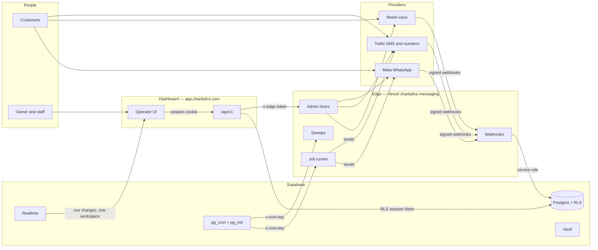
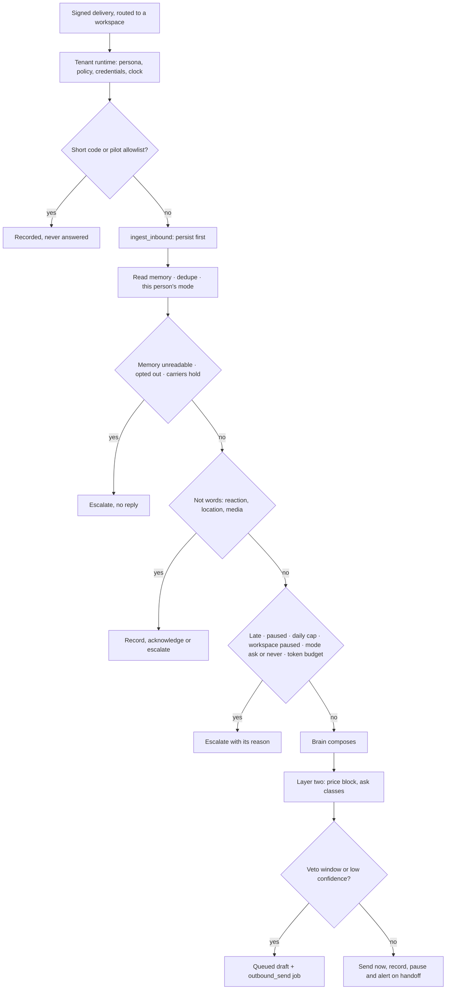
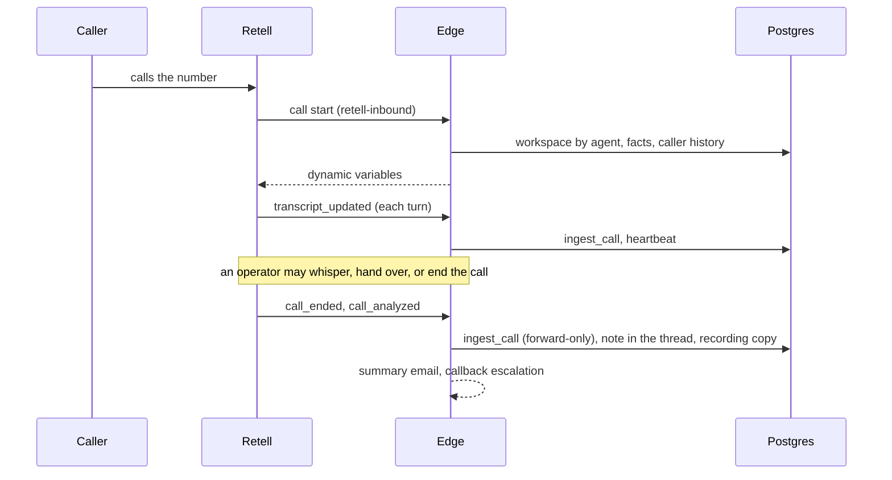
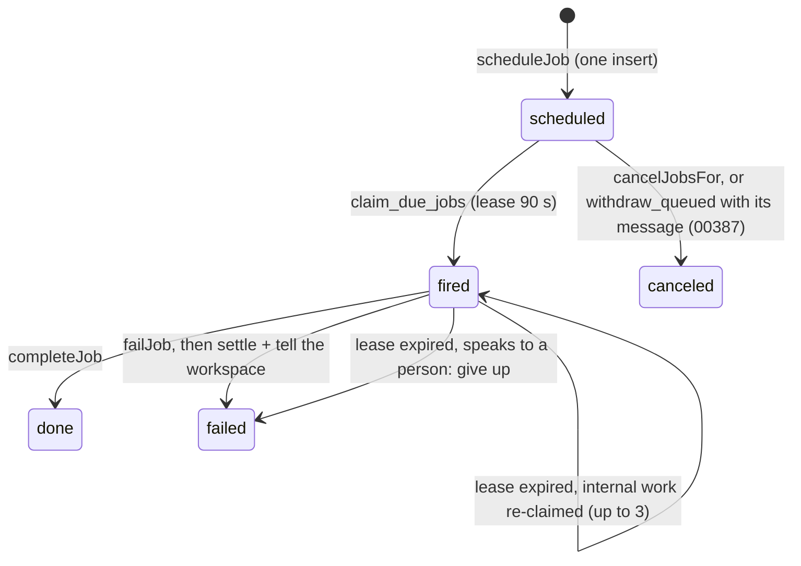

# Chanlytics OS As-Built

A system reference in PRD form: every system and subsystem of Chanlytics OS, the logic it runs, and what it is wired to. It is written from the code at commit `576891d2` (PR #580, 16 September 2026), not from the plans. The first edition was cut at `95f7a22` (PR #327, 10 September); 253 pull requests landed between the two, and every sheet below was re-read against the code. Where the built system departs from a plan, or a known gap stands, the note is marked **Δ** — a redline, in the drafting sense: the mark on a drawing that records what was actually built. They are collected in S-24, with the six the first edition carried that have since closed.

| Sheet | Covers                                                   |
| ----- | -------------------------------------------------------- |
| S-01  | Product and scope                                        |
| S-02  | The system map: deployables, providers, trust boundaries |
| S-03  | House rules                                              |
| S-04  | Tenancy, identity and access                             |
| S-05  | Channels: WhatsApp                                       |
| S-06  | Channels: voice                                          |
| S-07  | Channels: SMS, lines and carrier registration            |
| S-08  | The jobs ledger and row clocks                           |
| S-09  | Scheduled sweeps                                         |
| S-10  | The app plane (`/api/v1`) and core                       |
| S-11  | The UI and the legacy bridge                             |
| S-12  | Product surfaces                                         |
| S-13  | Control plane: config, facts and autonomy                |
| S-14  | Consent, broadcasts and playbooks                        |
| S-15  | Calendar and availability                                |
| S-16  | Google                                                   |
| S-17  | Billing                                                  |
| S-18  | Ask and the models                                       |
| S-19  | Alerts, notifications and the pager                      |
| S-20  | Data model                                               |
| S-21  | Observability                                            |
| S-22  | Quality system                                           |
| S-23  | Operations                                               |
| S-24  | Revision schedule                                        |
| A, B  | Glossary; environment                                    |

## S-01 · Product and scope

Chanlytics OS is a multi-tenant, omnichannel AI receptionist and lead engine for any business that turns a conversation into a booked appointment: local or online, a salon or a lender. Customers write on WhatsApp, text the business's number, phone its line or email it; the receptionist answers within seconds, says what is open, sends the booking link, and hands anything it should not decide to a person. A team works from a dashboard that shows what the receptionist did, takes a thread over and hands it back, finds new leads with the finder, and runs campaigns to the people who said yes. The first workspace was a salon and the code still uses it as the worked example; it is not the market.

It is live: real businesses, real customers, real numbers. Four workspaces are in production (launch-readiness plan, 9 September 2026), three of them on a direct billing arrangement.

The charter — what the receptionist never does:

- **Decide money.** No refunds, discounts or negotiation. The `money` policy class is locked to `never` by a database trigger (00102 proved the lock holds).
- **Quote a price the workspace does not allow.** A deterministic check after generation blocks the send ("layer two"), whatever the prompt said: any price while "Never quote a price" is on, and with it off any amount the owner did not write in a service or a note still in force (`priceAllowance`, decision 0051; S-13). On the phone, a price the agent nonetheless spoke is corrected in the same call and put in front of the owner (S-06).
- **Book an appointment.** It reads the calendar and sends the booking link; the booking tool behind the link does the booking.

This document covers the `expectmeout/chanlytics-os` repository: `apps/edge`, `apps/dashboard`, `packages/*`, `supabase/`, `tooling/`, `e2e/` and `.github/`. S-23 lists what sits outside it.

| Area                  | At this commit                                                                                                                                       |
| --------------------- | ---------------------------------------------------------------------------------------------------------------------------------------------------- |
| `apps/edge`           | 40 HTTP handlers, 54 libraries — about 14,600 lines                                                                                                  |
| `apps/dashboard`      | 105 `/api/v1` route files (123 declared routes), 35 server modules plus the `ask` set, 41 bridge modules; the legacy UI is about 30,000 lines of JSX |
| `packages/*`          | contracts ~17,700 lines, db ~4,700 (with generated types), channels ~4,400, core ~1,900 (new since the first edition), jobs ~900                     |
| `supabase/migrations` | 122 migrations, about 14,300 lines                                                                                                                   |
| Tests                 | 305 `node:test` files (~2,590 tests, 126 of them the database and integration suites that skip without credentials), 36 Playwright specs             |

## S-02 · The system map

<!-- fig:map -->

### Deployables

| Deployable | Code                                                   | Runs on                                                                 | Address                                                                                                                          | Holds                                                                                                               |
| ---------- | ------------------------------------------------------ | ----------------------------------------------------------------------- | -------------------------------------------------------------------------------------------------------------------------------- | ------------------------------------------------------------------------------------------------------------------- |
| Edge       | `apps/edge` — vanilla Vercel functions, no framework   | Vercel project `chanlytics-messaging`                                   | `chanlytics-messaging.vercel.app` (the dashboard reaches it through one variable, `EDGE_URL`)                                    | Every provider key, the service role, the webhooks, the job runner, the sweeps                                      |
| Dashboard  | `apps/dashboard` — Next.js 15                          | Vercel project `chanlytics-os`                                          | `app.chanlytics.com` (`CANONICAL_HOST`; in production any `*.vercel.app` host redirects there); a workspace lives at `/w/<slug>` | Auth, the `/api/v1` app plane, the public pages, the operator UI; the service role in six named modules only (S-04) |
| Database   | `supabase/`                                            | Supabase: Postgres 15+, Auth, Realtime, Storage, Vault, pg_cron, pg_net | —                                                                                                                                | All state, with RLS on every table                                                                                  |
| Packages   | `packages/contracts`, `core`, `db`, `channels`, `jobs` | bundled into both apps                                                  | —                                                                                                                                | Pure rules and view models; the use cases behind ports; repositories; provider adapters; the jobs ledger            |

The two apps deploy independently from `main`, so a change both must agree on ships in a shape that works in either order. `packages/*/dist` is committed and the edge imports it by relative path (`apps/edge/lib/packages/*.ts` re-export `../../../../packages/<pkg>/dist/index.js`), because Vercel's function bundler does not follow pnpm's workspace symlinks. CI fails when the committed `dist` differs from a fresh build, and the dashboard is built on every pull request the way Vercel builds it.

**What a deployment may do** is decided once (`server/env.ts`): production reaches the real providers; a preview or a laptop reaches them only when `EDGE_PROVIDERS=live` says its `EDGE_URL` points at an edge holding sandbox keys, and otherwise every such call — buying a number, filing a registration, connecting WhatsApp, syncing templates, Checkout, a word into a live call, the model — answers "not here". An unset `VERCEL_ENV` is a laptop, never production.

### Providers

| Provider                | Used for                                                                                                                                                                    | Credentials                                                                                                                                                                                                                                                                                                                                                                                                                                           |
| ----------------------- | --------------------------------------------------------------------------------------------------------------------------------------------------------------------------- | ----------------------------------------------------------------------------------------------------------------------------------------------------------------------------------------------------------------------------------------------------------------------------------------------------------------------------------------------------------------------------------------------------------------------------------------------------- |
| Meta WhatsApp Cloud API | Inbound messages, delivery statuses, owner echoes, account (WABA) events; text and template sends; Embedded Signup; templates                                               | `WHATSAPP_ACCESS_TOKEN` + `WHATSAPP_PHONE_ID` for the pilot line; each connected business's token in Vault. The environment pair sends for the environment's own number alone — a workspace that holds none gets a refusal, and a ledger send whose credentials could not be read just now waits for a fresh job or the next batch (the webhook's direct answer still refuses on a failed read; its resolver is a follow-up); never the pilot's token |
| Retell AI               | Hosted phone agents: calls, transcripts, recordings, live-call context, ending and handing over a call; agents, LLMs, numbers                                               | `RETELL_API_KEY`; `RETELL_WEBHOOK_KEY` (the badged key its webhook signs with); `RETELL_FN_SECRET` on its callbacks                                                                                                                                                                                                                                                                                                                                   |
| Twilio                  | A subaccount per workspace, numbers, SIP trunks to Retell, Messaging Services, SMS, A2P 10DLC through Trust Hub                                                             | Master SID and token in env; subaccount token and SIP credential in Vault (`line-creds-<line>`)                                                                                                                                                                                                                                                                                                                                                       |
| Anthropic               | The receptionist (`claude-opus-5`); Ask (`claude-opus-5-5` by default, `ASK_MODEL` names any other model); template drafts, lead drafts, review replies (`claude-sonnet-5`) | `ANTHROPIC_API_KEY`, on the edge — the dashboard's model calls pass through the edge gateway                                                                                                                                                                                                                                                                                                                                                          |
| Stripe                  | Checkout, customer portal, subscriptions, invoices, webhooks                                                                                                                | `STRIPE_SECRET_KEY`, `STRIPE_WEBHOOK_SECRET`, `STRIPE_PRICE_ID`                                                                                                                                                                                                                                                                                                                                                                                       |
| Google                  | Sign in with Google (OAuth, PKCE); Places API (New) for the public listing; Business Profile (OAuth) for reviews and replies                                                | The Supabase provider for sign-in; Places key and OAuth client in env; refresh tokens in Vault (`google-creds-<workspace>`)                                                                                                                                                                                                                                                                                                                           |
| Resend                  | Every email a person receives from the system, and the platform's pages                                                                                                     | `RESEND_API_KEY` (the hosted Supabase project sends through it too, which lifted the two-an-hour ceiling)                                                                                                                                                                                                                                                                                                                                             |

Every provider is reached from the edge and nowhere else. QStash, the job clock before #320, is gone entirely: the responder that answered its last retries and the `QSTASH_*` variables were removed on 16 September, since no QStash account exists to retry anything.

### The five doors

1. **Provider → edge.** Every webhook is verified before it is read: HMAC-SHA256 over the raw body (Meta, `x-hub-signature-256`), `X-Retell-Signature` keyed with `RETELL_WEBHOOK_KEY` (Retell's call webhook, and any voice door it is carried to; the scheme is proved by a test) or `RETELL_FN_SECRET` where a voice door still reads it (`?key=` on call start, `x-fn-secret` on the tool calls; `lib/voice/voice-door-auth.ts` lists which, and why), `X-Twilio-Signature` keyed with the line's own subaccount token (SMS), `Stripe-Signature` (billing).
2. **Browser → dashboard.** A Supabase session cookie, verified with `getUser()` on every request; same-origin required for every write.
3. **Dashboard → edge.** A token minted for the door it opens (`x-edge-token`, `packages/channels` edge-token): one door, one workspace, one person, one minute, signed with `EDGE_CALL_SECRET`. The shared `x-diag-key` (`DIAG_KEY`) is the platform's, compared in constant time: on an edge that holds the secret it opens only `/api/diag`, and every key-only knock there logs `admin_door_key_only`; an edge without the secret (a preview) lets the key decide. A bad token is refused, never fallen back from. The dashboard sends no key once it holds the secret, so the two projects hold it together or not at all. A door that acts on a workspace believes the token's workspace over the body. The dashboard proves who the person is and what they may do; the edge spends the key.
4. **Database → edge.** `x-cron-key` on `/api/cron/*` and `/api/jobs/tick`: one door (`lib/cron-auth.ts`, held to every cron route by a hygiene test) against the sweep key both sides read from Vault (`get_cron_sweep_key()`), so the value exists in exactly one place.
5. **Provider → dashboard.** The ElevenLabs agent's custom-LLM requests for a voice conversation with Ask (`/api/ask/voice/llm`, three exact paths in the proxy's public list; `docs/decisions/0026-a-provider-calls-the-dashboard.md`): the agent's static secret (`x-chanlytics-agent`, `ELEVENLABS_LLM_SECRET`) compared in constant time, then the session's id the browser gave the agent, a row of `ask_voice_sessions` the member wrote, whose sealed access token (`ASK_VOICE_SECRET`) runs the turn as that member under RLS. The provider's own key stays on the edge, which mints the agent's conversation token (`/api/admin/voice-session`).

And one door with no key at all: `GET /api/health` says only whether the platform's clocks are healthy and due work is draining — 200 or 503 — so a pinger outside the failure domain can page a person when the edge, the database or pg_cron is the thing that is down.

## S-03 · House rules

The invariants every subsystem obeys, and where each is enforced. When a change fights one of these, the change is wrong.

| Rule                                                                   | What it means                                                                                                                                                                                         | Enforced by                                                                                                                                                      |
| ---------------------------------------------------------------------- | ----------------------------------------------------------------------------------------------------------------------------------------------------------------------------------------------------- | ---------------------------------------------------------------------------------------------------------------------------------------------------------------- |
| Nothing states a fact the database cannot support                      | Invented numbers render only in a declared demo session; a zero is a measurement and is shown; a read that fails is never drawn as nothing there                                                      | `window.__DEMO_MODE` (false in the app); the surface registry (S-11); `EmptyState` and `FailedRead`; `e2e/shell/no-fabricated-data.spec.ts`                      |
| RLS is the floor, the role check is the door                           | RLS stops cross-tenant access; which member may act is decided in the route                                                                                                                           | RLS on every table, uniform (00120–00122); `route()`'s declared policy                                                                                           |
| Every route declares its policy                                        | Scope, role, rate, spend and input are said in the route's definition and enforced by one pipeline, in one order                                                                                      | `server/route.ts`; `route-policy.json` pins every route's declaration                                                                                            |
| A forbidden UPDATE does not raise                                      | RLS makes it match zero rows and return success                                                                                                                                                       | Permission-sensitive updates `.select()` and count the rows                                                                                                      |
| Persist, then process, then acknowledge                                | A customer's message is on record before anything can fail; a message the database did not accept is not acknowledged, so the provider retries                                                        | `ingest_inbound` runs before any decision; the WhatsApp webhook answers 503 on a failed write and 200 otherwise                                                  |
| A door's decisions are a function, apart from the wire                 | What a webhook, a health check or a call start decides is a pure function a test runs every way it can fall short                                                                                     | `core/inbound/steps.ts`, `core/inbound/reply-posture.ts`, `planSmsIngress`, `planCallStart`, `judgeHealth`, `callbackPlan`; the handlers run over a ports object |
| Nothing is assumed sent                                                | A message is recorded as sent only when the provider accepted it; a receipt that stops coming is watched                                                                                              | `outbound_send` and the reply route; `receipts-watch.ts`                                                                                                         |
| Time lives in the row                                                  | Every clock is a timestamp that a sweep or the heartbeat acts on, and every clock is registered as data                                                                                               | `jobs.due_at`, `conversations.paused_until` and `snooze_until` (S-08); the clock register (00107)                                                                |
| A state machine keeps its edges                                        | Every transition a row may make is a trigger's business, not each writer's                                                                                                                            | `jobs_guard`, `messages_guard`; broadcasts, escalations, a line's voice and texting, a broadcast's recipient (00106, 00116)                                      |
| One fact, one owner                                                    | What the platform provisioned or a third party verified is referenced, never retyped                                                                                                                  | `contracts/facts.ts` `resolveFacts`; conflicts shown in Settings                                                                                                 |
| One predicate per rule                                                 | Consent, standing, "may we send", the reply window, the service match, when a day is open — each exists once, and every path calls it                                                                 | `mayMessageFor`, `standingOf`, `outboundGate`, `replyWindow`, `serviceMatch`, `hoursReader`                                                                      |
| Fail closed at the wire                                                | "We could not check" is never "yes"                                                                                                                                                                   | The send job throws on an unreadable consent row; broadcasts skip a person they cannot read; the ports fail closed                                               |
| Silence over someone else's voice                                      | An unknown or unconfigured tenant never speaks; a control plane that cannot be read holds the thread for a person, in every workspace alike; a missing model key is a degraded state a person can see | `reply-posture.ts` truth table; `tenant-fallback.ts`; the pager                                                                                                  |
| Closed sets come from the database                                     | Every CHECK-constrained set is generated from the database and each hand-kept copy is held to it at compile time                                                                                      | `gen/schema-sets.mjs` → `schema-sets.generated.ts`; `gen/db-types.mjs`; the Database workflow                                                                    |
| Provider keys live on the edge                                         | The dashboard never holds a provider secret                                                                                                                                                           | The env manifests and `env-manifest.test.mjs`                                                                                                                    |
| Every sweep that changes something is watched                          | pg_cron's "succeeded" only means "enqueued"                                                                                                                                                           | `sweep_health()` over the clock register and `/api/cron/health` (S-09)                                                                                           |
| Every time is said by the business's clock                             | A minute, a day, a "tomorrow" is the workspace's, not the browser's                                                                                                                                   | `contracts/clock.ts` through `window.__clock`                                                                                                                    |
| The interface says each thing once, and the phone shows the work first | One tone vocabulary, one pill, one Confirm, one empty state, one toast; a page's numbers are one line, its rules behind a tap, no strip above the work on a phone                                     | `contracts/tone.ts`, `chrome.ts`, `refusal.ts`; `data-bits.jsx`; the interface plan's passes (S-11)                                                              |
| Production scripts meet the bar                                        | Dry run by default, a JSONL backup first, idempotent, `--apply` to mean it                                                                                                                            | Every writing script in `tooling/scripts`                                                                                                                        |
| Either deploy order works                                              | A shape both apps must agree on is compatible in both orders; where it cannot be (a campaign's trial and last day, which only the edge keeps), no such card is approved until the edge deploys (S-14) | Review rule; README                                                                                                                                              |

## S-04 · Tenancy, identity and access

### 4.1 The model

A workspace is a row in `tenants` (name, slug, timezone, status `active | paused | test`). People join it through `memberships` (user × workspace × role; the member's views of a page — People's sort and columns — ride on the row, so a view is the workspace's, not the device's, 00113; a save replaces the page's whole view, so a page sends every key it owns). `platform_admins` lists Chanlytics staff and is read only through `is_platform_admin()`. `profiles` holds the name a person goes by; `invitations` holds open invites, each expiring on its card.

What each role may do (`ROLE_PERMS` in `contracts/config.ts`, published to the UI and enforced by the routes):

| Role     | Approve | Autonomy | Settings | Team | Billing | Disconnect | Export |
| -------- | ------- | -------- | -------- | ---- | ------- | ---------- | ------ |
| owner    | yes     | yes      | yes      | yes  | yes     | yes        | yes    |
| operator | yes     | yes      | —        | —    | —       | —          | —      |
| viewer   | —       | —        | —        | —    | —       | —          | —      |

Viewers read everything and change nothing. A control a role may not press says who may, before the press (`roleGate`), and a refusal after one is in the owner's words (`refusalOf`): the title says what kind of no it is, the server's own sentence stays, the wait and a form's fields ride along.

### 4.2 Sign-in and the session gate

- **A password is the everyday credential.** Twelve characters at least, seventy-two bytes at most (the hash reads no more), no composition rules; the real strength check is the hosted breach list. The emailed one-time code is the way back in (`/reset-password`), and confirming the address is what makes the account. **Sign in with Google** runs the PKCE flow through `/auth/callback`, which exchanges the code through the same cookie-backed client every route uses and lands the browser on this site only (`callbackPlan`). The login page says one sentence per failure and never reveals whether an address has an account; an address that was never confirmed is told so and sent a fresh code rather than "wrong password".
- `middleware.ts` admits exactly these without a session: `/login`, `/auth/signout`, `/auth/callback`, `/api/version`, `/manifest.webmanifest`, `/signup`, `/api/v1/signup`, `/reset-password`, `/privacy`, `/terms`, `/data-deletion`, and anything under `/yes/` and `/b/`. Everything else requires a validated user; a signed-in visitor is kept off both auth doors.
- An outage at the auth server answers 503, not 401 (`isRetryableAuthError`). A 401 makes the client clear its cache and sign the person out; a blip must not.
- **The proxy is the OS's page gate** (decision 0053, step 5): it verifies the session's signature (`getClaims`) for every address of a workspace, whatever it ends in and in either case (`/(w|W)/:path*`), documents, moves and prefetches alike, and every read verifies it again (`withRoute`). The `(os)` layout reads no request, so the frame is one prerender for every person and workspace; it read the session too until 12 October 2026, as a guarantee should the proxy be bypassed, over a frame that holds no one's data. `auth-gate.test.mjs` runs the gate, and the lint refuses the `(os)` tree the session, a header and the database.
- **The product has one address.** A workspace is a page, `/w/<slug>`; the client names its workspace on every request, and a tab off a workspace page asks the server which workspace the account may open before any other read is issued.

### 4.3 `route()`, the one definition

Every `/api/v1` handler is declared with `route()` (`server/route.ts`), which says five things and does none of them:

|           |                                                                                                                                                                                                                                                                                                                                                             |
| --------- | ----------------------------------------------------------------------------------------------------------------------------------------------------------------------------------------------------------------------------------------------------------------------------------------------------------------------------------------------------------- |
| **scope** | which workspace it acts on: the one this tab named (`workspace`), the row's own (`row(load)` — read under RLS, so a row the caller cannot see is a 404 and the role is judged where the row lives), none (`account`: your name, your workspaces, a new one), or every one, for platform staff (`platform`, which the database decides through `backOffice`) |
| **role**  | who may do it; a read with none is open to every member                                                                                                                                                                                                                                                                                                     |
| **rate**  | the bucket it counts against (`RATE`, S-10), or `null` said out loud                                                                                                                                                                                                                                                                                        |
| **spend** | whether it may cost Chanlytics money (`requireSpend`, 402 with the fix named when `billing_accounts` says no)                                                                                                                                                                                                                                               |
| **input** | the zod schema its body — or, for a read, its query — must pass                                                                                                                                                                                                                                                                                             |

The order is the contract: a viewer is refused before a token is spent, so is a workspace that may not spend, and all of that before the body is judged — a 403 or a 402 never hides behind a 429. The exported handler carries its `policy`, which `route-policy.test.mjs` compares with `route-policy.json` (123 routes; a change there is a change to who may do what, reviewed as one), and `run(req, ctx)`, which a test calls with a database in memory. `withRoute` keeps the transport it always had: same-origin (`Sec-Fetch-Site`, then `Origin`), the verified session, the session-scoped Supabase client so RLS decides every read and write, the envelope `{ ok, data } | { ok, error: { code, message } }` with `private, no-store`, the log line, and `via: "ask"` when an Ask card sent the request.

**Which workspace.** `?workspace=` (an id or a slug) names it. An account in two workspaces that named neither is refused — reads and writes alike — with `choose_workspace`, and the client forgets the last workspace it used, drops the rows read under it, and goes home to be sent to the right address, once per tab. The first edition's redline (73 hand-read parameters, silent defaults on reads, a business record pre-filled from the wrong workspace) is closed.

### 4.4 The doors in the database

- **Reads**: members read their own workspace's rows.
- **Verb writes**: `is_acting_member()` (operator or owner) on conversations, messages, escalations and decisions (00014); UPDATE grants are scoped to the columns a verb may change (00037), and a column grant is a fence only because the table-wide grant is gone (00121); a new object in `public` starts closed to `anon` (00122); the four tables that are the service role's alone have RLS on and zero policies, uniformly (00120).
- **Privileged writes** go through `SECURITY DEFINER` functions with a pinned `search_path`; each is the one audited place its privilege exists.

| Door                                                                                                                                                                 | Called by                      | Does                                                                                                                                                                                                                                                                                                                                                                                                                                                                                                                                                                                                                                                                                                                                                                                                                                                               |
| -------------------------------------------------------------------------------------------------------------------------------------------------------------------- | ------------------------------ | ------------------------------------------------------------------------------------------------------------------------------------------------------------------------------------------------------------------------------------------------------------------------------------------------------------------------------------------------------------------------------------------------------------------------------------------------------------------------------------------------------------------------------------------------------------------------------------------------------------------------------------------------------------------------------------------------------------------------------------------------------------------------------------------------------------------------------------------------------------------ |
| `create_workspace`                                                                                                                                                   | a signed-in person             | Workspace and owner membership in one transaction, recorded where it is made (00104); at most ten per account                                                                                                                                                                                                                                                                                                                                                                                                                                                                                                                                                                                                                                                                                                                                                      |
| `provision_tenant` (trigger on insert)                                                                                                                               | automatic                      | Seeds the policy matrix, `tenant_config` and the billing row                                                                                                                                                                                                                                                                                                                                                                                                                                                                                                                                                                                                                                                                                                                                                                                                       |
| `set_contact_consent`, `set_marketing_consent`                                                                                                                       | operators and owners; the edge | The two consent answers, with an event that keeps the evidence — the channel, the provider's message id and the words of a texted answer (00110, S-14). A member recording an answer "in their own message" names the inbound message, and the door reads its evidence itself (00137). A member's own call is `record_consent` (00356), which runs the purpose's door and writes the `consent_change` decision as theirs in one transaction, so an answer never changes without the line that says who recorded it; a `run that waited` is approved the same way (`approve_broadcast`, 00353: its release, its send job and its decision together), a deal is recorded the same way (`record_deal`, 00357, over `deal_record`), and a playbook is started with its line on the member's own rights, so the table's policy judges the row (`start_playbook`, 00357) |
| `create_person`, `set_person_name`, `person_note_add`/`_edit`/`_remove`/`_decide` (0007; `set_person_notes` superseded), `set_person_email`, `set_person_reply_mode` | operators and owners           | People added and described by hand, their email address among it (00125: one per workspace, stored trimmed and lower-cased, cleared by a trigger when the person is erased, remembered afterwards only as a keyed digest); the receptionist's mode for one person, and for fifty at a time                                                                                                                                                                                                                                                                                                                                                                                                                                                                                                                                                                         |
| `set_template_hidden`, `set_template_title`                                                                                                                          | operators and owners           | How a template appears in the composers                                                                                                                                                                                                                                                                                                                                                                                                                                                                                                                                                                                                                                                                                                                                                                                                                            |
| `line_forwarding_set`, `line_forwarding_test`                                                                                                                        | owners                         | Keep-your-number rows (S-07)                                                                                                                                                                                                                                                                                                                                                                                                                                                                                                                                                                                                                                                                                                                                                                                                                                       |
| `create_mailbox`, `rename_mailbox`                                                                                                                                   | owners                         | The workspace's email address, once, and the name customers see beside it (00129). The reply route's token is minted inside the door and never returned; the address is changed by nobody; a session writes no column of `mailboxes`                                                                                                                                                                                                                                                                                                                                                                                                                                                                                                                                                                                                                               |
| `profile_set`                                                                                                                                                        | the person                     | Their display name                                                                                                                                                                                                                                                                                                                                                                                                                                                                                                                                                                                                                                                                                                                                                                                                                                                 |
| `notifications_seen`, `notification_mark`                                                                                                                            | the person                     | Their read state on the bell, keyed by the workspace and pruned with the feed                                                                                                                                                                                                                                                                                                                                                                                                                                                                                                                                                                                                                                                                                                                                                                                      |
| `setup_request`                                                                                                                                                      | operators and owners           | Ask a person at Chanlytics for something the product cannot provision yet                                                                                                                                                                                                                                                                                                                                                                                                                                                                                                                                                                                                                                                                                                                                                                                          |
| `team_roster`, `lookup_user_for_invite`                                                                                                                              | members; owners                | The roster, and an invitee, each in one indexed query                                                                                                                                                                                                                                                                                                                                                                                                                                                                                                                                                                                                                                                                                                                                                                                                              |
| `erase_contact`, `scrub_ask_for_contact`                                                                                                                             | owners, through the route      | A deletion request (S-10)                                                                                                                                                                                                                                                                                                                                                                                                                                                                                                                                                                                                                                                                                                                                                                                                                                          |
| `put_/get_channel_credentials`, `put_/get_line_credentials`, `put_/get_/drop_google_credentials`                                                                     | service role only              | Vault secrets                                                                                                                                                                                                                                                                                                                                                                                                                                                                                                                                                                                                                                                                                                                                                                                                                                                      |
| `ingest_inbound`, `ingest_call`, `mark_processed`, `claim_due_jobs`                                                                                                  | service role (the edge)        | The atomic gates                                                                                                                                                                                                                                                                                                                                                                                                                                                                                                                                                                                                                                                                                                                                                                                                                                                   |
| `take_rate`                                                                                                                                                          | the routes                     | Shared rate limiting                                                                                                                                                                                                                                                                                                                                                                                                                                                                                                                                                                                                                                                                                                                                                                                                                                               |
| `note_page_vitals`, `page_vitals_p75`                                                                                                                                | service role (the routes)      | Field data: a page load's timings, and their 75th percentile for the back office (4.8)                                                                                                                                                                                                                                                                                                                                                                                                                                                                                                                                                                                                                                                                                                                                                                             |
| `is_platform_admin`, `platform_overview`, `platform_health`                                                                                                          | any session; platform admins   | The back office (4.8)                                                                                                                                                                                                                                                                                                                                                                                                                                                                                                                                                                                                                                                                                                                                                                                                                                              |

### 4.5 Where the dashboard holds the service role

Seven modules, each for one reason: `server/service-db.ts` (scheduling jobs, signing media URLs, team administration, calling the edge), `server/platform/signup.ts` (the one door a stranger may use, and it writes no tenant data), `server/public/consent-page.ts` and `server/public/business-page.ts` (public pages with no session, which return exactly what they display), `server/platform/platform.ts` (the back office, reachable only through a `BackOffice` capability), `server/platform/vitals.ts` (a page load's timings, which name no person and no workspace), and `server/rate-limit.ts` (counting hits through `take_rate`). App-plane routes never import the service client.

### 4.6 Sign-up and new workspaces

`/signup` → `POST /api/v1/signup` (public; same-origin; limited per network and per address, and a stranger counts against the shared limit; an invite code compared in constant time when `SIGNUP_CODE` is set) → the service role creates the auth user with the password, keeps what the form said — the workspace's name and details — **on the auth user**, and sends the confirmation code. **The workspace waits for its owner**: the person who enters the code makes it, signed in, through `create_workspace`. Nothing exists for an address until its owner does; a stranger typing someone else's address gets that person nothing they did not ask for. The page says the same sentence whether or not the address was known; a code that could not be sent is said, not answered 500; and the platform mailbox is told through `/api/admin/signup-notify`. The front door has three postures: open, invite code, and waitlist (`waitlist`, 00088). The first-workspace screen joins the waitlist itself and offers a way out.

> **Δ1 · Closed (16 September)** Production sign-up runs on the waitlist posture: `SIGNUP_CODE` is `waitlist` on the dashboard project, redeployed and read back from outside (`posture: "waitlist"`). Opening the door, or handing out invite codes, is the same environment change in reverse.

A signed-in person with no workspace sees `CreateWorkspace` instead of the app, and the workspace menu offers another workspace the same way (`create_workspace`, five an hour). A new workspace opens at its slug on its first run (`#/start`), so the app boots once. A first workspace whose name sign-up kept is made as the screen opens, with the invite code sign-up checked (read again by the create route), so nothing is typed twice.

### 4.7 Team

Owners invite through `/api/v1/team/invite`, which sends Supabase's real invitation email, one address at a time and several from the card in turn; owners themselves are added by hand, never invited, and the card says so. An open invitation is sent again from its row (`/api/v1/team/invite/:id/resend`: seven more days and the email, taken back if the email cannot go); an address an earlier invitation made an account for and nobody confirmed is invited again, never seated without an email (00371). Any member leaves by their own hand (`/api/v1/team/leave`). Role changes, removals and leaving keep at least one owner, a promotion to Owner is asked on its row first, and a promotion says where it came from. Every change lands on the decisions ledger (`invite`, with `resent` for one sent again; `revoke_invite`, `change_role`, `remove_member`, with `left` for a member who left). Open invitations are honoured on every workspace read (`acceptOpenInvites`), so a person invited before they had an account still arrives in the workspace. The writes run in CI.

### 4.8 The back office

The one surface that crosses workspaces on purpose, and the pane that says whether the platform's own machinery is running.

- `is_platform_admin()` answers only about the caller, so every session may ask; the navigation needs that one bit.
- `platform_overview()` checks it as its first statement and is the only way into the cross-workspace join, `platform_overview_rows()` — a SQL-language function, so a mistyped column fails the deploy rather than the first support call, with execute granted to no role at all.
- In the dashboard, `backOffice(ctx)` returns a branded capability only when the database says yes; nothing else hands out the service client. The pane is classified `real` in the surface registry, so it draws for the people it exists for and never the Not-in-this-release card.
- Each workspace gets one of ten verdicts — broken · billing · rehearsal · stalled · waiting on them · quiet · new · live · paused · test — sorted so the ones needing a person come first. The detail pane runs the customer's own `setupDtoFor`, so support reads the rows the customer reads.
- Its actions — retry, refile, **replace** a refused campaign, and release a line — are recorded as `platform.acted` before they run, and refused when that record cannot be written.
- **How fast the pages are** (00255): the shell hears each page load's LCP, INP, CLS, FCP and TTFB from Next's web-vitals hook and sends them as one beacon when the page is hidden (`POST /api/v1/vitals`, sixty a minute); `page_vitals` keeps each under the browser's own id, so a grown INP replaces the one sent before, with the page the load landed on and nothing about a person or a workspace. The card says the 75th percentile of each over every page, in words and against web.dev's thresholds, and the slowest pages that took twenty loads or more. `page_vitals_p75()` reads the latest 25,000 reports of the last seven days, so its cost does not grow with the platform; the rows go after thirty days (`purge-page-vitals`).

## S-05 · Channels: WhatsApp

### 5.1 The webhook — `POST /api/whatsapp`

- Verifies `x-hub-signature-256`, an HMAC-SHA256 of the raw body keyed with `META_APP_SECRET`. A missing secret is a 401, never a skipped check. `GET` answers Meta's verification handshake.
- Answers **200 after processing** inside `maxDuration: 60` — the contract frozen during Meta App Review — and **503 when the database did not accept a message**, so Meta retries; Meta's retries and the dedupe make replays safe. The handler runs over a ports object (`whatsapp/ports.ts`: the database, the thread store, the runtime, the sink, the sender, the alerts, the pager, the model — the real modules by default), so a test runs it from the signature to the ack.
- For each change in the delivery:
  - **Account events** (quality rating, messaging limit, template status, account review) are keyed on the WABA, not a number: routed to the workspace by its WABA id, kept as events, and alerted when they change what the business can do (`lib/waba-events.ts`). A template's new status, category and quality land on its row. A notice is routed by the account it names (`value.waba_info.waba_id` where it holds one, else the entry's id): Meta addresses a partner's `account_update` to the partner's own business portfolio and puts the customer's account inside it, so routing by the entry alone dropped every sign-up's notices as `waba_unroutable`. A notice for an account no workspace holds is news, logged at info (`wa_signup_finished_unclaimed`), not a fault. A display name's decision (`phone_number_name_update`) is heard too: an approval is kept on the number's standing, a decline is told to the owner with Meta's reason.
  - **messages** are routed by `metadata.phone_number_id` through `tenant_channels` (`kind 'whatsapp'`, `external_id`). Found: that workspace. The lookup _failed_: an infrastructure blip; nothing is recorded, the door answers 503 so Meta redelivers once the read works, and the platform is told, the environment's own number included. The lookup _answered_ and the channel is not active: unroutable — nothing is persisted or answered, an `ingest.unroutable` event is kept, and a person is told, throttled. Each message runs in its own try/catch, so one failure cannot swallow the rest of the batch.
  - **statuses** (sent, delivered, read, failed) update the message found by its WhatsApp id, and each receipt keeps its time (00111). The `messages_guard` trigger keeps status moving forward and makes `failed` and `canceled` terminal. Receipts that stop coming are watched: a message Meta accepted with no delivered, read or failed receipt for six hours, in a workspace where nothing has been receipted since, pages the platform (`receipts-watch.ts`) — the webhook, not a phone that is off.
  - **SMS statuses** arrive the same way at `/api/sms-status`: every text names it as its `StatusCallback`, the door proves `X-Twilio-Signature` with the line's own subaccount token, and delivered, read or a carrier's refusal (with its code) move the row through the same forward-only writer (#579). Before it, a text was `sent` forever.
  - **smb_message_echoes** — the owner replied from the WhatsApp Business app — pause that thread for the workspace's own pause length, recorded on the conversation.

**Email** has its own door, `/api/resend-webhook`, which does not exist (404) on a deployment that names no `EMAIL_DOMAIN`; production has named one since 18 Sep 2026, so everything in this paragraph is live (`docs/plans/2026-09-17-email-channel.md`). The door proves Svix's signature over the raw body, which proves Resend sent the EVENT and nothing about who sent the email. A received email is a pointer: it is routed by the envelope (`received_for`) to the mailbox whose published address or reply route it names, and becomes one `email_ingest` job per mailbox, once however often it is redelivered (00127). A job that throws is tried again five minutes, then thirty minutes later (`RETRY_WAITS_MS`); one that fails all three tries no longer counts as the email's job (00135), so replaying its webhook from Resend once the cause is fixed takes the email in again. The job fetches it, reads what it claims to be (a delivery report, an automatic reply, automated mail, a person), keeps it through the same `ingest_inbound` gate every channel uses with the provider's id as the replay key, flags the thread `email_review`, and answers nothing: the receptionist does not draft email yet. It resumes where the WhatsApp road skips, because nothing is sent here and a lost customer email is the worse outcome. A receipt for an email we sent is applied in the request (`lib/email-receipts.ts`), found by the tags the request left with: every receipt teaches the row the provider's id and the Message-ID it left with in one statement (00128), `delivered` moves it forward, a bounce, a failure or a provider suppression flags the thread `send_failed` and then fails the row, and only a bounce the provider calls permanent, a complaint or the provider's own list stops the address (`contacts.email_suppressed_at`, 00126), while it is still the person's.

### 5.2 One message — `handleInbound`

`lib/whatsapp/inbound.ts` is the order; `steps.ts` holds its side-effect-free decisions as truth tables; `persist.ts` is the Postgres bookkeeping every branch reports through; `alerts.ts` is who gets told. SMS walks the same road (S-07).

<!-- fig:inbound -->

The gates, in the order they run. Each stop reports through the sink, and tells a person wherever one is needed. The dedupe gate sits above every branch that escalates, so a redelivery never opens a second escalation.

<!-- class:ladder -->

| #   | Gate                                                                                | When it stops the reply                                                                                                                                                                                     |
| --- | ----------------------------------------------------------------------------------- | ----------------------------------------------------------------------------------------------------------------------------------------------------------------------------------------------------------- |
| 1   | The sender is a short code                                                          | Recorded; `ingest.unreachable_sender`; never answered                                                                                                                                                       |
| 2   | The pilot allowlist (the environment's own number only)                             | Recorded; `ingest.allowlist_skip`                                                                                                                                                                           |
| 3   | `ingest_inbound` — persist first                                                    | — the message is now on record (or the webhook answers 503)                                                                                                                                                 |
| 4   | A duplicate delivery (`is_new` false)                                               | Skipped, before anything below                                                                                                                                                                              |
| 5   | This person's own receptionist mode                                                 | Changes the mode in force                                                                                                                                                                                   |
| 6   | Memory (Postgres): a thread it cannot produce                                       | Escalation `state_unavailable`, nothing answered                                                                                                                                                            |
| 7   | Consent: this message is STOP, or an opt-out on record                              | No reply; on the STOP itself, escalation `opt_out`. The carriers' opt-out words belong to the carriers' channel: a texting line honours them; WhatsApp keeps its own list                                   |
| 8   | An SMS line the carriers have not approved                                          | Escalation `carriers`                                                                                                                                                                                       |
| 9   | A reaction or a system notice                                                       | Recorded; nothing was asked                                                                                                                                                                                 |
| 10  | A location or a contact card                                                        | Escalation `non_text`, without an apology                                                                                                                                                                   |
| 11  | A photo, when `features.vision` is on                                               | Fetched and shown to the model                                                                                                                                                                              |
| 12  | Anything else that is not words                                                     | Acknowledged when the mode may speak; escalation `non_text`; thread paused                                                                                                                                  |
| 13  | More than two hours late                                                            | Escalation `stale` (ten minutes to two hours late is answered, and logged)                                                                                                                                  |
| 14  | The thread is paused for a person                                                   | Added to history; no reply. The pause is for the machine: a queued draft yields only to a person's words                                                                                                    |
| 15  | Twenty automatic replies on this thread today (the owner's dial)                    | Escalation `rate_cap`                                                                                                                                                                                       |
| 16  | The workspace is paused (billing)                                                   | Escalation `paused`                                                                                                                                                                                         |
| 17  | Reply mode `ask` or `never`, or no persona                                          | Escalation `policy_block`, or `person_hold` for a hold set on this person                                                                                                                                   |
| 18  | The day of model tokens is spent (`budget.ts`), asked of a reply bound for a model. | Escalation `budget`                                                                                                                                                                                         |
| 19  | No model key at all                                                                 | A degraded state a person can see: escalation, and the platform paged — never a canned receptionist                                                                                                         |
| 20  | The brain composes                                                                  | On error: the persona's fallback words and escalation `brain_error`                                                                                                                                         |
| 21  | Layer two                                                                           | A price in the draft blocks it; a booking or pricing question under "ask me first" escalates `policy_ask`                                                                                                   |
| 22  | The hold plan                                                                       | Veto window, or confidence below `min_confidence`: written as a `queued` draft with an `outbound_send` job (`draft-queue.ts`, the one writer, shared with steer)                                            |
| 23  | Send now                                                                            | Outbound row written `sent` only when the provider accepted it, and `usage.llm_tokens`; on a handoff, pause + escalation + an alert whose email tells the truth; on a failed send, escalation `send_failed` |

A veto-window draft that cannot be queued is sent at once and recorded (`vetoFallback`): an un-vetoed reply beats silence. A low-confidence hold that cannot be queued sends nothing: the floor is the owner's policy, so the thread is a person's for the pause window and the owner is told what the customer said (#577). The brain's plain retry, taken when the schema is refused, carries a record at confidence 0 so the dial still holds it (#577). At the wire, a draft on a thread a person has taken over is refused (`human_has_it`), the take-over's withdrawal kept for the case it failed (#577).

Every way out of the table marks the message processed and says what it became: `meta.handled` is `ai`, `held`, `handoff` (an escalation landed, whatever else went out) or `blocked`, chosen once by core's `handledOf`, and `meta.intent` is what the model read it as (`message_stamp_handled`, 00305, best-effort beside `mark_processed`). A reply the wire could not deliver is a handoff too once its `send_failed` escalation lands, and stays unprocessed for the deadman sweep.

**`ingest_inbound`** is the concurrency gate, one RPC in one transaction: an advisory lock per workspace, channel and identity; dedupe before any side effect; contact, identity and conversation upserts; the message insert; an archived or snoozed thread reopened (never overriding a person who has it); the WhatsApp 24-hour window from `last_wa_inbound_at`; metering; and the consent keywords — STOP, BAJA, UNSUBSCRIBE and ALTO opt out; START, UNSTOP, RESUME and ALTA opt back in to conversation; YES OFFERS and SÍ OFERTAS answer the separate marketing question (00095), with the words, the channel and the provider's id kept on the event (00110). It returns the consent it just wrote, so the gate needs no second query.

### 5.3 The brain

`lib/brain.ts` calls `claude-opus-5` with a structured output schema (`contracts/brain.ts`): the reply, the customer's intent, whether a person should take over and why, a confidence, the facts it leaned on, and the language. If the API refuses the schema, the same request runs unstructured and is read the old way; the words go out either way. The system prompt comes from `resolveSystemPrompt` — the workspace's structured profile, composed by the same function that fills the phone agent's facts — plus the clock and closures in the business's timezone, the open times from its calendar, and what is known about this person (`readLeadContext` and their visits). **The prompt preview is the prompt**: the Business pane shows it composed on the server with every input the edge has (`server/receptionist/prompt-preview.ts`), and the instructions box holds the prompt it came from, once.

### 5.4 Memory

Postgres is the receptionist's only memory: `packages/db/repositories/thread.ts` returns the history, the pause and today's replies, and `ingest_inbound`'s atomic `is_new` claim is the dedupe. There is no flag on it and no second copy to fall back to — a thread Postgres cannot produce is handed to a person (`state_unavailable`) rather than answered from an invented empty history. It used to be a Vercel Blob object per thread: Postgres was first written beside it (`PG_WRITES`), then made the memory (`PG_READS`) with Blob kept as a shadow; the flags and the store are gone (00151). `GET /api/diag` reports `memory`.

### 5.5 Credentials, and connecting a number

The receptionist answers on the workspace's own business token when its channel row carries a Vault reference, and on the environment pair only for the environment's own number: credentials refuse rather than fall back. A business connects its own number through Embedded Signup:

browser (Meta's SDK, `whatsapp-connect.ts`) → `POST /api/v1/channels/whatsapp/connect` (owner) → edge `/api/admin/whatsapp/connect`: exchange the one-time code for the business token → read the number back and prove it belongs to the WABA → subscribe the app to the WABA's webhooks → register the number for Cloud API with a two-step PIN → write the channel row (which repaints Setup and Connections through realtime, 00117) → `put_channel_credentials` → ledger `connect_channel` → what Meta holds about the number, read and kept (best effort).

What Meta holds about a connected number is read by one function, `numberStanding` (`apps/edge/lib/whatsapp/meta-graph.ts`): whether it may send (`can_send_message`: AVAILABLE, LIMITED or BLOCKED, with each entity's errors and what Meta says to do about them), its display name and the review of it, whether the business is verified and its messaging tier, and, from the account, whether a payment method is on file and which business owns the account. It is read as a number is connected (it never fails the connection), by the channel-quality sweep beside the rating, and when an owner opens Connections with nothing kept or a standing that is not AVAILABLE and more than ten minutes old (`POST /api/v1/channels/whatsapp/standing`, owner). `readAndKeepStanding` keeps it in the channel's config as `standing` and `standing_read_at` through `channel_keep_standing` (00338), which writes a `channel.standing { from, to }` event when the word for whether it may send changes (no `from` on the first read), and tells the owner once, by notice, when the number turns BLOCKED. The Connections row says what is kept in contracts' words, from the fields and never Meta's prose (`standingRow`, `standingNotes`): a payment method missing or failing is "Waiting on you", with Meta's billing page for the account as the row's one act; a number Meta has stopped for anything else is "Needs attention", with Meta's first problem about messaging and WhatsApp Manager; a calling (SIP) problem is never shown, since Chanlytics does not use WhatsApp calling. Under the row, at most two notes, each with Meta's page after it: a declined or lapsed display name, and an unverified business (customers see the number, the day's cap, "Verify when you need more"; verification is asked of nobody). What WhatsApp costs and who bills it (Meta, to the card on the WhatsApp account, never Chanlytics: `WHATSAPP_COST_WORDS`) is said under the row before it is connected, and on Settings › Billing with Meta's prices linked. A campaign's readiness reads the same standing (`numberHealthWithStanding`): a number whose row says "Waiting on you" or "Needs attention" carries no campaign, refused in the row's sentence. Offers on WhatsApp from a US number are held while Meta's pause on marketing messages to US numbers holds (`broadcasts/whatsapp-offers.ts`, since April 2025): the tick says so, the Broadcasts page's note says offers go by email, and appointment messages are unaffected. A sign-up that Meta finishes after the page that began it was loaded again never reaches Chanlytics (the one-time code rides the SDK's callback in that page): the page keeps a mark of a sign-up in `sessionStorage` and, finding one with no number connected, says what to do.

### 5.6 Templates

`templates` rows hold Meta's truth: status (`approved | pending | rejected | paused | disabled`), category (utility or marketing — which decides the consent a send needs), components, quality score and origin. Only the edge writes them: sync from Meta (`templates-sync`, which never deletes a row Meta did not return), create (submit for review) and delete; status, category and quality changes arrive on the webhook (a quality is one of Meta's four words, `mapQuality`, whether the sync or the webhook says it). The starter library (`contracts/templates/starter-templates.ts`) offers seven — win-back, welcome, save our number, the month's offer, visit reminder, after the visit, a quick note — in English and Spanish, each passing the same checks a hand-written template passes. The assistant drafts templates (`claude-sonnet-5`, validated by the submission checks) and returns a draft, never a submission. Hiding a template and giving it a title are the workspace's own presentation (definer doors). A template goes out with the values its own slots ask for, and the Inbox offers only the templates that can send. A row is one version of a campaign's message, on one channel and language, and contracts `campaignMessageOf` reads the message from its rows: WhatsApp's version is Meta's, and an email's or a text's is written in the Library and approved the moment it is saved (`save_template_version` beside a row of its name, `create_message_version` for the first), so a message needs no WhatsApp row and is sent on the channels it holds.

## S-06 · Channels: voice

### 6.1 How a workspace gets a phone receptionist

Two roads to one agent:

- **A Retell-owned number** — `/api/admin/voice-provision`: create the Retell LLM (the shell) and the agent over it, publish the first version, bind an existing or newly bought number with the call-start webhook, and write the voice channel row **last**, so a row that exists is a line that works. A dry run by default; resumable with the ids a failed run returns.
- **A Chanlytics line** — a Twilio number over SIP: the lines saga (S-07) creates the same agent through `lib/voice-agent.ts`.

Routing is always `agent_id → tenant_channels (kind 'voice', external_id)`. One Retell account hosts many agents, so a call that routes nowhere is dead-lettered, never guessed into a workspace. A line's voice state is a guarded state machine (00106).

### 6.2 The shell

`packages/channels/src/voice/voice-shell.ts` is the one definition of everything the phone agent is told that is not a fact: the prompt and its placeholders (`{{business_facts}}`, `{{caller_context}}`, `{{greeting}}`, `{{handoff_number}}`), a spoken default for any variable that cannot be filled (Retell reads an unfilled placeholder aloud, braces and all), four tools, the webhook events (`call_started`, `transcript_updated`, `call_ended`, `call_analyzed`) on a 20-second budget, and the post-call analysis fields (`caller_wanted`, `outcome`, `follow_up`, `caller_name`, `caller_email`, `topic`, `language`). Three readers use it: provisioning; the converger (`/api/admin/voice-converge` and `voice-converge.mjs` — a published version cannot change, so it drafts a new one, patches it, and publishes only when told); and the diagnostic that reports drift.

| Tool                 | Answered by                | Does                                                                                                                                                                                |
| -------------------- | -------------------------- | ----------------------------------------------------------------------------------------------------------------------------------------------------------------------------------- |
| `check_availability` | `/api/retell-availability` | Reads the calendar feed and rules the WhatsApp receptionist reads; books nothing. A service that needs a consultation first is offered as a consultation                            |
| `send_booking_link`  | `/api/retell-fn`           | Texts the booking link as an approved WhatsApp template, through the same consent and pause gates as every send (`outboundGate` → `mayMessageFor`), recorded in the caller's thread |
| `transfer_to_staff`  | Retell                     | A warm transfer to `{{handoff_number}}`                                                                                                                                             |
| `end_call`           | Retell                     | Ends the call                                                                                                                                                                       |

The tool endpoints answer 200 with a sentence even when they refuse — the agent speaks whatever comes back.

### 6.3 A call, from start to finish

<!-- fig:voice -->

1. **Arrives.** `/api/retell-inbound` runs `planCallStart` — a function apart from the wire, tested every way it can fall short — which resolves the workspace from the agent and returns the dynamic variables: the business facts (from the same profile the WhatsApp receptionist reads), the caller's cross-channel context, the greeting and the handoff number. No workspace, no context: a caller treated as new beats a caller read someone else's conversation.
2. **During.** With `transcript_updated` on, each turn refreshes the `calls` row's transcript and heartbeat, and the Live page shows calls under the heartbeat rule, with what the caller wanted and the line it rang. **A standing rule broken out loud** — a price the guardrails forbid — is caught on the transcript, corrected in the call by an injected turn, and put in front of the owner as an escalation. A price the owner wrote, in a service, a note or their own greeting, is not one (decision 0051). Three controls, each a ledger verb through the per-call token: **whisper** (`POST /api/v1/calls/:id/whisper` → `/api/admin/whisper` → `update-live-call`; the words are framed as context the receptionist works in when it fits, never a script, never past its guardrails, `contracts/whisper.ts`); **hand over** (`/hand-over` → `/api/admin/hand-over`: the agent is told the owner is picking up and transfers the caller to the business's own line with `transfer_to_staff`, the line riding as an override for a call that began before there was one); **end** (`/end` → `/api/admin/stop-call`, ledger `end_call`, 00118). Listening in and speaking from a browser microphone are what the provider's dashboard offers and its API does not, so Live does not offer them.
3. **Ends, and is analyzed.** `/api/retell-webhook` verifies the signature with the badged key, its only credential (the agent's `webhook_url` carries no `?key=`; a key left on an older agent is drift the converger patches away), and calls `ingest_call`: forward-only by rank (registered < ongoing < ended, error or not connected — an older event is `skipped`), idempotent per `retell_call_id`, metering voice seconds once, and the first touch of the person a call made, once it has connected (ongoing or ended, or an error after it had a length), on its first row or on the update that first makes it so (00306). Then: a `call_summary` note in the caller's one thread; the recording copied into the private `media` bucket (bounded, at most three attempts, and typed as the audio its first bytes say it is: the provider's CDN calls a WAV `binary/octet-stream`, which a browser will not play); the post-call email, claimed once; keep-your-number verification; and, when the analysis says `callback_needed`, an escalation `callback` with the thread paused. A caller who rang and hung up within fifteen seconds is not lost: they have a name, a row and a door on Today.
4. **Reconciled.** `/api/cron/calls` asks Retell every five minutes about calls still marked ongoing — it never infers from elapsed time — retries recording copies still pending (a provider with no link to give, or no record of the call, counts as a try, so such a copy ends failed instead of processing for ever; a provider that could not answer — an outage, a rate limit, a read that never returns — counts nothing and the row waits, as does a recordings CDN or a bucket that is down (a copy deferred is written with its count unchanged, so the trigger moves it to the back of the queue rather than first every tick; two days after the call ended a deferral counts again, so a file that can never be fetched still ends failed), and a key it refuses answers 503 `provider_unauthorized`, judged like any other sweep's answer), and removes audio past its ninety days (`contracts/retention.ts`). pg_cron wakes it only when the calls table owes it one of these, audio past its days included (00148), and a purged recording is final: neither a re-ingest nor a late delivery copies it back. A purge that fails answers 500 once the other legs have run, and since 00149 that answer is judged like any other sweep's, so the ninety days are watched as well as promised.

A recording reaches a browser only through `/api/v1/calls/:id/recording`, which answers every request with a redirect to a link signed for five minutes, so the player's seeks and a long listen always meet a fresh one. The signer holds the service role, so it signs only a path under the asking workspace's own id (`signedMediaUrl`); any other is a 404, and a member may not write a message that carries media at all (00260). The provider's unsigned URL is never stored on a row, because `calls` is in the realtime publication and every column reaches every member's browser.

> **Δ2 · Closed (17 September)** PR #479 merged: an empty Retell function secret opens none of the three doors (the tool calls, the call start, the availability tool), each probed from outside and refusing with 401. The call webhook's `?key=` fallback followed in PR #573, in the order the door's own comment prescribed: the badged key was set, 142 of 143 deliveries then verified by signature, both live agents were converged onto a bare `webhook_url` (dry run, then apply and publish; the salon's line went v6 → v7), and only then did the door stop reading a key. Probed from outside after the deploy: an unsigned delivery and one carrying `?key=` alike refuse with 401.

## S-07 · Channels: SMS, lines and carrier registration

### 7.1 Lines — the numbers the platform owns

`lines` is the asset: one row per number the platform bought or forwards, and the whole story of getting it working. `tenant_channels` is the routing derived from it (`config.line_id` points back). A channel row can exist with no line — a number bought inside Retell, like the live salon's — and `number_drift()` reports where the two disagree (00087).

The saga (`packages/channels/src/lines/lines-saga.ts`, pure over its ports; `apps/edge/lib/lines/lines.ts` wires the real ones):

subaccount → number → trunk → agent → import → channel, with the Messaging Service for texting (00074)

Each step records its receipt on the row before the next runs, so a retry resumes where it stopped and buys nothing twice. Secrets go to Vault (`line-creds-<line>`), never onto the row. The provider is Twilio when the master credentials exist, `dry` on previews (`LINES_DRY_RUN=1`, fake ids, no network), and none on production without credentials — Setup then offers "we set it up with you" through `setup_request`.

- **A line is provisioned on the ledger** (00109). `buy` (owner, and `requireSpend`) schedules a `line_provision` job; the heartbeat runs it under a lease, resumes a worker that died, and bounds the retries (`line-provision-job.ts`). The saga used to run inside the request that asked for it — about 180 seconds against a 60-second ceiling — and could be killed before reaching its own failure handler.
- `retry` resumes a line that failed. Which lines may be resumed, and taking one so that nobody else resumes it too, is decided in `line-resume.ts`: a compare-and-swap, so the quarter-hourly **lines sweep**, an owner pressing Retry and support can never run the saga twice on one row; after `MAX_AUTOMATIC_RESUMES` a person is told (00097).
- A failure leaves the step and the provider's words on the row, rings the workspace's bell and emails the platform, all from `lib/provision.ts` — the one place that tells everybody.
- **Keep your number**: a line of kind `forwarded` (provider `carrier`) carries the carrier's forwarding codes as `tel:` links and a 30-minute test window; a call that reaches the receptionist's line inside the window marks it verified — the call webhook does that.
- **An owner's activation is a record** (00108): a capability — voice, WhatsApp, texting — is available when its records allow it; readiness is computed from what the workspace holds, the owner's switch is its own row (`POST /api/v1/capabilities/:kind`), and evidence is a call answered or a message replied to, never a claim the product makes about itself. Texting is not sold until the carriers approve a real registration, and says so.

### 7.2 Texting

- **Inbound** — `/api/inbound-sms`: `X-Twilio-Signature` over the exact URL and every field, keyed with the subaccount token from Vault. Everything the door decides — whether Twilio is told to redeliver, whether and how the platform is alerted, whether the receptionist may speak — is `planSmsIngress`, a function a test runs every way (`sms-ingress.ts`). A text on a line the platform cannot handle is said out loud, never dropped in silence. A text that is a one-time code (`oneTimeCodeOf` in `@chanlytics/channels`, which reads its words and never its sender) is a verdict of its own, reached once the line and the signature are proven: no person, no conversation, no reply, and `sms_code_skipped` names the service it read and never the code. The owner reads the codes sent to the line from Twilio's own record of its texts (`GET /api/admin/lines/codes`: the last fifteen minutes, three at most, behind the owner's route); Chanlytics stores none. The text becomes the WhatsApp handler's message (`smsAsWaMessage`) and walks the same gates with an `InboundCarrier`: the first reply to a person carries the SMS footer, the carriers' own opt-out words are honoured on this channel, and a line the carriers have not approved yet holds every text for a person (`carriers`). Twilio gets an empty `<Response/>`; the reply goes out through the line's Messaging Service.
- **Outbound** — the same `outbound_send` job with the `sms` sender (S-08). A workspace with no line is a loud failure, never a send on the other wire. **The texting line carries no promotions**: the campaign is filed as informational, offers go by WhatsApp, and the door enforces it.
- A line's texting state is a guarded state machine (00116).

### 7.3 Registering with the carriers (A2P 10DLC)

- **The business on record** (`business_records`, one per workspace) is one form (`contracts/business-record.ts`). Its first question picks the path: **standard**, with a tax ID, or **sole proprietor**, without one — one number, one campaign, about one message a second, and around a thousand a day on T-Mobile. A field appears on a path only if something that path files reads it. The editor shows each problem at its field and asks before discarding changes; an empty record guesses no website, and the filing names the workspace's own page. Each box the business's own page shows is marked public (contracts `published-facts.ts`: the names, the address, the email, the website, what it does and its industry; never the tax ID, the owner's mobile or their names), the form says the page is open to anyone and listed by search engines, and links to it once the record names the business and where it is; the sign-in email is not filled into the published box. A save says what moved and what the carriers hold: the save door compares the row with what was on record, reads where the workspace's filing stands across its lines (a rehearsal is none; a line whose brand exists is filed, whatever its state), and the filing that sends the brand's name keeps it on the line (`a2p_filed_name`, channels `brandNameOf`: the business profile carries it until submitted, the sole proprietor's with the messaging profile), so the owner reads, say, that the carriers still hold “Harbor Moving LLC” as filed. While the carriers are reviewing a filing, a change to a published box asks first (`RECORD_REVIEW_CONFIRM`), since they check the registration against the page and a campaign waiting on the brand is filed from the record as it then stands; `business.recorded` names the columns that moved, never their values. The services sheet says the business's own page lists them.
- **Pre-flight.** The hosted business page (`/b/<slug>`) and consent page (`/yes/<slug>`) exist because the carriers refused Chanlytics' own campaign for reasons about pages (30919, 30907) and for bundled consent (30913). A paused workspace's pages stay up for the carriers' re-vet and ask nobody for a yes (no way to answer, no code, no paper form in use, no desk sign); an ended one's are Not found (contracts `openToCustomersOf`, 13 October 2026).
- **The filing that a reviewer passes** — `POST /api/v1/lines/register` (owner, and `requireSpend`) → edge `registerLine` → the A2P saga, run in the workspace's own subaccount and referencing Chanlytics' approved primary Trust Hub profile: customer (or starter) profile, end users, address, documents, evaluation and submission, A2P messaging profile, brand, then the campaign on the line's Messaging Service — the campaign in the reviewers' own register, the business's own terms, a confirmation on every yes, the message flow saying what the product does with every way in numbered, the spoken script and the auto-reply quoted (the fifth refusal, 30896, is what taught the form). Every receipt is recorded, so a resumed filing pays nothing twice. `mock` files against the provider's free test registry: a rehearsal, where nothing routes. A refused campaign has a door to be replaced (`platform/lines/replace`).
- **The registration sweep** (hourly) asks the carriers where each filing stands, files the campaign once the brand is through (not for a workspace paused, ended or on a plan that may not spend on texting: `sweepFilingHold`, the owner's press's own rules), and keeps the carriers' own refusal reasons with their codes. What was filed is remembered (`lines.reg_sole_prop`, 00090), because the record can change after the brand cannot.

> **Δ3 · Open** The sole-proprietor verification code: nothing sets `otp_waiting` yet, and the shape of the resend call is unconfirmed. Both need one real sole-proprietor filing to observe — a few dollars, and irreversible — which is Ruben's decision. Until then the row tells the owner to reply from the handset and offers no button.

> **Δ4 · Open** The live campaign's opt-in confirmation still names the workspace's old name. The campaign's editable fields cannot change it (refused three times); the replace door files a new campaign at a second vetting fee (about $15), and paying it is Ruben's decision.

> **Δ5 · Closed (16 September)** PR #530 merged once migration 00123 reached production: an owner asking for their number to be brought over, and for a broken configuration to be repaired, are two more setup-request kinds (S8, S14 of the launch audit).

## S-08 · The jobs ledger and row clocks

The product has one way to do work later: a row.

<!-- fig:ledger -->

**The ledger.** `jobs` carries every kind `JOB_KINDS` names — a send, a broadcast's batch, a line's provisioning, an email's intake, the lead finder's three, a phone told and its receipts, a reach-out's reply read — through `scheduled → fired → done | failed`, or `scheduled → canceled`. The `jobs_guard` trigger refuses every other transition inside the database. Scheduling is one insert (`scheduleJob`, service role only); `cancelJobsFor` withdraws them. An approval of an ask-mode run moves its send to the next open moment, and the row says so (00119).

**The heartbeat.** pg_cron's `jobs-tick` runs every ten seconds; `trigger_jobs_tick()` checks for due rows and only then posts to the edge through `pg_net` with the sweep key. `/api/jobs/tick` binds the database and each job's own workspace credentials into ports and hands them to `runTick` (`packages/jobs/src/tick.ts`, tested against fakes):

- It runs up to three jobs side by side (`CLAIM_SLOTS`, decision 0018 step 4). Each slot claims **one** job at a time with `claim_due_jobs()` (`FOR UPDATE SKIP LOCKED`, a 90-second lease) just before it runs it, for the first 20 seconds of the run, so "claimed" always means "started"; a second slot opens only once a claim found work.
- The claim takes a reply first (a send that is not outreach, an email's intake, a phone told), then someone waiting who is not a customer (a line being bought, a lead's reply read), then bulk work; within bulk, a workspace with none of its bulk work running before one with some; then the earliest due (decision 0018, 00281). Each row's `lane` is generated from its kind and payload, so every writer writes what it did, and a kind arrives with its lane. The order never leaves a runner idle: a workspace's second bulk job runs when nothing else is due.
- A handler that loops yields at 45 seconds and schedules its own follow-up.
- A row whose lease ran out is claimed again, and `verdictFor` decides: work that speaks to a person (`outbound_send`, `broadcast_send`) **gives up** rather than risk a second message; internal work retries up to three times. There has been no re-claiming sweep since 00098: a lease that expires is settled by the tick itself. What the ledger cannot see — a queued reply with no job to send it, a customer's message the handler never finished with — the deadman tick finds (S-09, `lib/unfinished.ts`, #578) and puts in front of a person, never answering on its own.
- `completeJob` and `failJob` are compare-and-swaps on the state _and_ the attempt. A failed job is **settled** by kind (a message stops saying "Sending…", a broadcast closes) and its workspace is told (`alertFor`, addressed from the workspace's own settings, naming the channel the reply failed on). A run that fails many jobs at once pages the platform (S-19).
- Each heartbeat's `jobs_tick` line says how late each kind's first claim came, at worst, as `late_ms_<kind>` (decision 0018, step 1), so a reply waiting behind bulk work shows in the logs before anyone misses it, and the reply lane's worst as `reply_late_ms`, read from the claimed row's `lane`. A reply claimed more than a minute late pages the platform (`jobs_replies_late`, once per window). A row claimed again (a retry, a lease that ran out) is not counted.
- A job that throws and is written to be run again is kept, and its wait is drawn up to a fifth longer at random (`jittered`), so the jobs one outage failed are not all claimed in one heartbeat. A row whose **kind this runner does not know** is kept too, its claim given back, and looked at again in five minutes: a newer deploy wrote it, and the edge and the database may deploy in either order. It fails as never run only after a day, and its owner is told.
- A failed job is final. Support runs one again from the back office (`POST /api/v1/platform/jobs/requeue`, the platform scope): a fresh row of its kind and payload, due now, with who asked written first as `platform.acted`. Work that speaks to a person is refused, and so is a job that has not failed.

**The handlers** (`packages/jobs/src/handlers.ts`) are thin: each runs a `packages/core` use case over the runtime's ports.

| Kind             | Payload                                           | What it does                                                                                                                                                                                                                                                                                                                                                                                                                                                                                                                                                                                                                                                                                                                                                                                                                                                                                                                                                                                                                                                                                                                                                                                                                                                                                                              |
| ---------------- | ------------------------------------------------- | ------------------------------------------------------------------------------------------------------------------------------------------------------------------------------------------------------------------------------------------------------------------------------------------------------------------------------------------------------------------------------------------------------------------------------------------------------------------------------------------------------------------------------------------------------------------------------------------------------------------------------------------------------------------------------------------------------------------------------------------------------------------------------------------------------------------------------------------------------------------------------------------------------------------------------------------------------------------------------------------------------------------------------------------------------------------------------------------------------------------------------------------------------------------------------------------------------------------------------------------------------------------------------------------------------------------------- |
| `outbound_send`  | message, conversation, phone, body or template    | core `sendQueued`: still `queued`? Otherwise nothing to do → the row claimed for this run before anything reaches a wire (`messages.sending_at`, 00352: a second job naming the same message finds it claimed and sends nothing; the claim is given back only when the provider provably did not take the message) → consent read through the conversation; an unreadable row **throws** (fail closed, and the owner hears) → opted out: canceled, `message.send_blocked` → the channel's sender (WhatsApp strips the "+"; SMS goes through the line); a WhatsApp or SMS wire that could not be BOUND — the credentials read failed, not credentials absent — throws before anything is written, the row stays `queued`, and the same send is handed to a fresh `outbound_send` a while on (`SEND_RETRY_WAITS_MS`: 1, 3, 10, 30 min; `resumes` on the payload), the platform paged; past the last wait the job fails by name and is settled like any run that did not finish → marked `sent` only if the provider accepted it and the row is still `queued`; a cancel that raced the send is recorded as `message.send_raced_cancel`; `message.sent` names the real sender. A provider refusing with 401 or 403 — credentials, not content — pages the platform. On failure: `failed`, escalation `send_failed`, an alert |
| `broadcast_send` | broadcast                                         | core `sendBroadcastBatch`: only `scheduled` or `sending` → a paused workspace fails it → a wire that could not be bound (the credentials read failed) claims nobody: everyone stays `queued`, the run stays as it was, the batch is scheduled again in a minute (up to thirty in a row, then the run fails as stalled and its owner is told; a run that waited looks at the day's sending hours again before it sends) → the template must still be approved, and its category decides which consent → up to 25 people, 300 ms apart, each re-checked (erased, no phone, `mayMessageFor(…, { proactive: true })`, a person has the thread) → values resolved per person → sent as the template and recorded in their thread → a send that never reached WhatsApp (a connection that never opened) gives the person back to the queue and the run waits, its waits counted and capped, and the platform is paged → more left: schedule the next batch; none: close, record, tell the workspace how many of how many got it (a run that reached nobody is not "sent"). One read per batch; a send says what it is                                                                                                                                                                                                           |
| `line_provision` | line                                              | core `provisionLine` over the edge's ports (S-07): a fresh buy, a person's retry, or a worker that died; receipts per step                                                                                                                                                                                                                                                                                                                                                                                                                                                                                                                                                                                                                                                                                                                                                                                                                                                                                                                                                                                                                                                                                                                                                                                                |
| `email_ingest`   | mailbox, the provider's id for one received email | core `ingestEmail` over the edge's ports (00127, 00135: one live job per received email per mailbox, by a unique index a failed job does not count; a throw is tried again after five minutes, then thirty): fetch it → drop our own email coming back, and one received before its sender asked to be forgotten → read what it claims to be → a delivery report is not a conversation; an automatic reply is kept and nobody is paged → kept through `ingest_inbound` with the provider's id as the replay key → the thread flagged `email_review`, the workspace told once per hold → marked handled LAST, so a run that died after the row was stored finishes it on the next try. On an `outbound_send` whose row is an email, the job carries `to_email` and the row the request it leaves as, frozen when it was queued                                                                                                                                                                                                                                                                                                                                                                                                                                                                                             |
| `reply_read`     | message; its stage (none, `reread-<n>`, `draft`)  | core `readReply` over the edge's reader (00222, Reach out Part 5, S-14.4; one live job per message and stage, `jobs_reply_read_once`; a throw is tried again after two minutes, then ten): whose reply it is (`reach_out_reply_of`) → the reading already kept? carry on from its stage → may the workspace read (the key, may it spend, 200 a UTC day) → Haiku reads it → `reach_out_reply_apply` applies its plan in one transaction → the draft, when the plan asks one → the notice, claimed, told once, then marked. A reply not read is `other` and is read again later, at most three times within seven days                                                                                                                                                                                                                                                                                                                                                                                                                                                                                                                                                                                                                                                                                                      |

**The row clocks.** Two more ten-second pg_cron jobs, pure SQL, each on its own schedule so neither can stop the other: `expire-stale-pauses` hands paused threads back to the receptionist — never one with an open escalation, because a person's request stays with a person — and `wake-stale-snoozes` wakes snoozed threads. A pause and a snooze are timestamps on the conversation, not jobs.

The timings a reader will meet:

|                                                 |                                                                                        |
| ----------------------------------------------- | -------------------------------------------------------------------------------------- |
| A person's reply: undo window                   | 15 s; the message lands 15–25 s after Send                                             |
| Veto window (reply mode `veto`)                 | 30 s by default, 5 s to 10 min                                                         |
| Thread pause after a handoff or an owner's echo | 24 h by default (`pause_hours`, the owner's dial)                                      |
| Automatic replies per thread per day            | 20 by default (`max_replies_day`, the owner's dial)                                    |
| WhatsApp free-form window                       | 24 h from the customer's last message                                                  |
| A late message                                  | answered up to 2 h late; escalated beyond                                              |
| An abandoned call                               | hung up within 15 s of connecting                                                      |
| Live calls                                      | drop off the Live page after 5 min without a heartbeat; stop counting as live after 10 |
| Job lease · claim window · yield                | 90 s · 20 s · 45 s                                                                     |
| Broadcast batches                               | 25 people, 300 ms apart; at most 2,000 per broadcast                                   |
| Campaign breath                                 | one message per person a week, a week either side of each send (S-14)                  |
| A page to the platform                          | once per condition per 6 h, stamped only after delivery                                |

## S-09 · Scheduled sweeps

Every clock in the product is a pg_cron job, and **every clock is registered as data** (00107): one row per clock with the cron job it is, how long it may go silent, and whether it is judged on its runs or its answers. `sweep_health()` reads the register, so a clock nobody typed in — the monthly partition precreate, the five purges — is judged too, and an unregistered clock is reported unhealthy. A sweep that needs the edge posts to it through `pg_net` with the Vault-held key; a sweep that is pure SQL runs inside the database.

| Job                          | Schedule (UTC)          | Runs                                                                                                                                                                                                                                         | Does                                                                                                                                                                                                                                                                                                                                                                                                                                                                                                                                                                                                                                                                                                                                                                                                                                                                                                                                                                                                                                                |
| ---------------------------- | ----------------------- | -------------------------------------------------------------------------------------------------------------------------------------------------------------------------------------------------------------------------------------------- | --------------------------------------------------------------------------------------------------------------------------------------------------------------------------------------------------------------------------------------------------------------------------------------------------------------------------------------------------------------------------------------------------------------------------------------------------------------------------------------------------------------------------------------------------------------------------------------------------------------------------------------------------------------------------------------------------------------------------------------------------------------------------------------------------------------------------------------------------------------------------------------------------------------------------------------------------------------------------------------------------------------------------------------------------- |
| `jobs-tick`                  | every 10 s              | edge `/api/jobs/tick`, only when a job is due                                                                                                                                                                                                | The ledger's heartbeat (S-08)                                                                                                                                                                                                                                                                                                                                                                                                                                                                                                                                                                                                                                                                                                                                                                                                                                                                                                                                                                                                                       |
| `expire-stale-pauses`        | every 10 s              | SQL                                                                                                                                                                                                                                          | Pause expiry                                                                                                                                                                                                                                                                                                                                                                                                                                                                                                                                                                                                                                                                                                                                                                                                                                                                                                                                                                                                                                        |
| `wake-stale-snoozes`         | every 10 s              | SQL                                                                                                                                                                                                                                          | Snooze expiry                                                                                                                                                                                                                                                                                                                                                                                                                                                                                                                                                                                                                                                                                                                                                                                                                                                                                                                                                                                                                                       |
| `call-reconcile`             | every 5 min             | edge `/api/cron/calls`, only when the calls table owes it work                                                                                                                                                                               | Close calls the webhook never ended; retry recording copies; remove audio past retention                                                                                                                                                                                                                                                                                                                                                                                                                                                                                                                                                                                                                                                                                                                                                                                                                                                                                                                                                            |
| `deadman-sweep`              | every 10 min            | edge `/api/cron/deadman`                                                                                                                                                                                                                     | An escalation nobody picked up: found in SQL (`deadman_candidates()`), alerted by the edge, once (`deadman_alerted_at`); a workspace with nobody on file to tell pages the platform; and two more questions each tick (`lib/unfinished.ts`, #578): a customer's message older than three minutes with no handled stamp is flagged for a person with their words, and a queued reply older than ten minutes with no scheduled or fired job is failed and flagged                                                                                                                                                                                                                                                                                                                                                                                                                                                                                                                                                                                     |
| `notes-sweep`                | every 30 min            | edge `/api/cron/notes`                                                                                                                                                                                                                       | The receptionist's note suggestions (0007 phase 2, 00159): asks the edge only when a call's analysis is in or a conversation has been quiet six hours; each is looked at once (`note_candidates` stamps it), most end with nothing, and what passes three gates (`note-suggest.ts`) waits on the person's page for Keep. `NOTE_SUGGESTIONS=off` stops it                                                                                                                                                                                                                                                                                                                                                                                                                                                                                                                                                                                                                                                                                            |
| `mailboxes-sweep`            | every five minutes, :02 | edge `/api/cron/mailboxes`, only while a connected mailbox is connected, paused or held (00423 `trigger_mailboxes_sweep`)                                                                                                                    | The mailboxes a business connected (decision 0056): each one's watch kept (Gmail's `users.watch`, Graph's subscription), what arrived since its cursor read (Gmail's history, Graph's delta) and only the messages in a thread a reach-out started fetched (`mailbox_threads_known`), a delivery report applied as the bounce it reports and a reply handed to the intake as an `email_ingest` job; its health judged once an hour (00424 `mailbox_connection_counts`, contracts `mailboxHoldOf`: any complaint, or permanent bounces or noes past 3% of at least 150 sent, holds it until its owner's Resume, said in the Activity log and told once), a provider's rest lifted once its day turned, its ramp's days kept, its DNS read daily. A mailbox its provider signed out is set to reconnect and its owner told once. Pages `email_unsubscribe_links_broken` when the dashboard's `/u/` page will not open the edge's links. The domains clocks of the retired cold lane (`domains-sweep`, `sending-domain-days`) are unscheduled by 00423 |
| `reach-out-sweep`            | every minute            | edge `/api/cron/reach-out`, only when a checked send is due in a run that goes ahead, one is claimed or queued, a hold is two weeks old, a closed run keeps open sends, or a run is ready to finish (00186, 00197 `trigger_reach_out_sweep`) | The reach-out clock (S-14.4, Parts 3–4). Reads what became of each email it wrote (sent, and its lead written to; a wait planned again; a refusal skipped with its reason), frees a claim a writer left, withdraws a closed run's queued emails, finishes a run with nothing open, plans again a send left stale, gives up a hold its owner never answered fourteen days from its planning. Then drafts what is due of a reach-out its owner sends (00428 `reach_out_claim_drafts`: written, checked and handed to them, no seal needed), and claims what is due and checked of the mailboxes (00424's due mailboxes, and its claim under each mailbox's lock, within the mailbox's day and the workspace's month, a step after the first before a first email) and writes each email and its `outbound_send` job. Without the unsubscribe's seal it claims no mailbox's send, and answers 503 `lane_unset` naming it while one is due                                                                                                              |
| `reach-out-check-sweep`      | every minute            | edge `/api/cron/reach-out-check`, only when a send waits to be checked within two hours (or in a run waiting for its owner), or a `check_unavailable` hold is an hour old (00197 `trigger_reach_out_check_sweep`)                            | The check before each cold email (S-14.4, Part 4), its own clock so a slow model never takes the claim's minute. Leases a few sends of each workspace (00197 `reach_out_unchecked`), asks each workspace's gates first (may spend, room in the month, 400 model attempts a UTC day), writes and reads each opening (Haiku, 8 s a call, none started past 40 s), and marks each send checked or held. A failed try backs off; an hour of them holds the send `check_unavailable`, put back an hour on. Without `ANTHROPIC_API_KEY` it touches nothing and answers 503 `check_unset` while a send waits; a tick where every call failed, 503 `model_unavailable`. It checks without the unsubscribe's seal (00428: a draft its owner sends needs none)                                                                                                                                                                                                                                                                                                |
| `lines-sweep`                | :08 :23 :38 :53         | edge `/api/cron/lines`                                                                                                                                                                                                                       | Resume line sagas that were cut off                                                                                                                                                                                                                                                                                                                                                                                                                                                                                                                                                                                                                                                                                                                                                                                                                                                                                                                                                                                                                 |
| `playbooks-sweep`            | hourly at :05           | edge `/api/cron/playbooks`                                                                                                                                                                                                                   | Run the playbooks whose hour it is (S-14)                                                                                                                                                                                                                                                                                                                                                                                                                                                                                                                                                                                                                                                                                                                                                                                                                                                                                                                                                                                                           |
| `calendar-people-sweep`      | hourly at :23           | edge `/api/cron/calendar`                                                                                                                                                                                                                    | People from calendar appointments (S-15); and a lead a reach-out wrote to that booked converts (00227 `reach_out_booked`, S-14.4)                                                                                                                                                                                                                                                                                                                                                                                                                                                                                                                                                                                                                                                                                                                                                                                                                                                                                                                   |
| `registration-sweep`         | hourly at :23           | edge `/api/cron/registrations`                                                                                                                                                                                                               | Carrier registration status; file the campaign                                                                                                                                                                                                                                                                                                                                                                                                                                                                                                                                                                                                                                                                                                                                                                                                                                                                                                                                                                                                      |
| `google-listings-sweep`      | hourly at :37           | edge `/api/cron/google`                                                                                                                                                                                                                      | Listings and profiles not read for 20 h (S-16)                                                                                                                                                                                                                                                                                                                                                                                                                                                                                                                                                                                                                                                                                                                                                                                                                                                                                                                                                                                                      |
| `channel-quality-sweep`      | :41, every sixth hour   | edge `/api/cron/channel-quality`, only when a WhatsApp number is connected                                                                                                                                                                   | Reads the rating Meta holds for each connected WhatsApp number (K9) into the channel's config as `quality_read`, beside the connect-time `quality_rating` that broadcasts are gated on, and says a change as a `channel.quality_rating` event (00315); beside it, reads what Meta holds about the number (`numberStanding`), keeps it as `standing` through `channel_keep_standing` (00338), and tells the owner once when it turns BLOCKED                                                                                                                                                                                                                                                                                                                                                                                                                                                                                                                                                                                                         |
| `sweep-health`               | :13 and :43             | edge `/api/cron/health`                                                                                                                                                                                                                      | The watcher — alerts on any sweep in trouble; pages for due jobs nobody claims and receipts that stopped                                                                                                                                                                                                                                                                                                                                                                                                                                                                                                                                                                                                                                                                                                                                                                                                                                                                                                                                            |
| `events-partition-precreate` | the 25th, 12:00         | SQL                                                                                                                                                                                                                                          | Next months' `events` partitions (a default partition catches the rest)                                                                                                                                                                                                                                                                                                                                                                                                                                                                                                                                                                                                                                                                                                                                                                                                                                                                                                                                                                             |
| `platform-metrics-roll`      | nightly, 00:17          | SQL                                                                                                                                                                                                                                          | Rolls the day that ended into `platform_metrics`, one row per workspace (00277; widened in 00316 with how its messages ended, what they asked about, the model's tokens and dollars and what its calls cost)                                                                                                                                                                                                                                                                                                                                                                                                                                                                                                                                                                                                                                                                                                                                                                                                                                        |
| `purge-*`                    | nightly, 04:13–04:51    | SQL                                                                                                                                                                                                                                          | Rate-limit hits (two hours old); cron history (a day for the ten-second jobs, fourteen otherwise); the events ledger's **evidence** kinds after thirty days (00115 — the record kinds are kept); Ask threads and notifications after 90 days; finished jobs after a week and failed ones after 90 days (00215); page timings after thirty days (00255)                                                                                                                                                                                                                                                                                                                                                                                                                                                                                                                                                                                                                                                                                              |

**How a sweep is watched.** pg_cron marks a run "succeeded" the moment `net.http_post` is _enqueued_, whatever the edge then answers. So each trigger records its pg_net request id in `sweep_status` (`request_sweep()`, 00086), and `sweep_health()` joins those ids to the responses pg_net actually received; the SQL-only sweeps are judged on their runs. The calls sweep asks only when there is work, so it has no silence to break: each ask is judged for the hour after it, and pg_net waits 65 s, past the edge's own 60, so a slow tick that finished never reads as a timeout (00149). `/api/cron/health` — offset to :13 and :43 so it never judges a request seconds old — decides when to shout (`chooseSweepAlerts`, with suppression) and reaches a person through `notify()`; `/api/health` is the same judgement read from outside, with no key.

**Fair sweeps.** Sweeps that visit every workspace (`sweep-rotation.ts`: the calendar and the playbooks, as the Google sweep already did) take the least recently served first, capped per tick, and record what they could not reach; three ticks in a row with a backlog answer 503, because the queue is growing faster than it drains (`note_sweep_backlog`, 00089). Each page is only what is due, judged in the database by the workspace's own clock (`playbooks_due`, `calendars_due`, 00245, through `packages/db`), and what it records as left behind is exactly the due rows beyond the page: a playbook that ran today, one whose hour has not come, a paused workspace's, and a calendar row without an address, are neither served nor counted, so a paused workspace's playbooks never hold a place another workspace's are waiting for. What was on a page and did not run (a moment whose run failed, a step whose context could not be read, a row the edge's clock does not call due, a feed that could not be read) is stamped as tried and goes to the back, its day still open: nothing that is not run keeps the first places.

On a local or CI database, `supabase/seed.sql` removes the production edge address from Vault, so no sweep there can post to production.

## S-10 · The app plane (`/api/v1`) and core

The routes, grouped here by domain (`route-policy.json` lists every one). The write column names the role each route declares; RLS is always the floor beneath it, and every route's full policy is in `route-policy.json`.

| Domain              | Routes                                                                                                                                                                                                                                                                                                                                                                                                                     | Read                     | Write                              |
| ------------------- | -------------------------------------------------------------------------------------------------------------------------------------------------------------------------------------------------------------------------------------------------------------------------------------------------------------------------------------------------------------------------------------------------------------------------- | ------------------------ | ---------------------------------- |
| Conversations       | `conversations` (with `/:id`, `/export`); the verbs `reply`, `take-over`, `hand-back`, `snooze`, `wake`, `archive`; `escalations` and `/:id/resolve`; `messages/:id/cancel-send`, `/steer`, `/media`                                                                                                                                                                                                                       | members                  | operator                           |
| People              | `contacts` (list — paged and searched on the server, 00112 — and add); `/:id` (profile; delete: owner); `/consent`, `/marketing-consent`, `/details`, `/notes`, `/notes/remove`, `/notes/decide` (operator); `/receptionist` (owner); the batch doors `contacts/consent`, `/marketing-consent`, `/notes`, `/receptionist` (fifty at a time); `contacts/export` (owner); `segments` and `/:id`; `consent/qr`; `views/:page` | members                  | operator, or owner where noted     |
| Calls               | `calls`, `/:id/recording`, `/:id/export`, `/:id/whisper`, `/:id/hand-over`, `/:id/end`                                                                                                                                                                                                                                                                                                                                     | members                  | operator                           |
| Campaigns           | `templates` (with `/:id`, `/draft`, `/starter`, `/sync`); `broadcasts` (with `/:id`, `/approve`, `/cancel`); `playbooks` (with `/:id`, `/run`)                                                                                                                                                                                                                                                                             | members                  | operator                           |
| Reach out           | `reach-outs` (the chains; POST saves a new one and starts it), `/:id` (its report and its search's reach; edit; remove), `/preview` (one business's email as it would read: spend), `/reach`; `reach-out-sends/:id/decide` (include, rewrite, skip, not a fit); `broadcasts/:id/recheck`; `reach-out-replies` (the readings of replies, 00222), `/:id/undo` ("read as no · undo")                                          | members                  | operator                           |
| Numbers and reports | `metrics`, `reports`, `reports/campaigns`, `reports/campaigns/ledger`, `reports/reach-outs`, `reports/headline`, `reports/people`, `reports/receptionist`, `reports/reviews`, `calendar`, `calendar/preview`, `activity` (both ledgers)                                                                                                                                                                                    | members; activity: owner | preview: operator                  |
| Workspace           | `settings` (owner, versioned), `policies` (operator), `team`, `/invite`, `/invite/:id/resend`, `/:id` (owner), `/leave` (members), `me`, `workspaces` and `/create`, `notifications`, `export` (everything, owner), `vitals` (a page load's timings, from the shell)                                                                                                                                                       | members                  | as noted                           |
| Setup and lines     | `setup`, `setup/request`, `capabilities/:kind`, `lines` with `search`, `buy`, `retry`, `register`, `forwarding`, `forwarding/test`, `codes`; `business-record`                                                                                                                                                                                                                                                             | members; codes: owner    | owner; spend where it costs        |
| Channels            | `channels`, `channels/whatsapp/signup`, `channels/whatsapp/connect`, `channels/whatsapp/standing`                                                                                                                                                                                                                                                                                                                          | members                  | owner                              |
| Google              | `google` with `search`, `link`, `refresh`, `connect`, `callback`, `locations`, `connection`, `reviews/:id/draft`, `reviews/:id/reply`                                                                                                                                                                                                                                                                                      | members                  | owner; refresh and reply: operator |
| Billing             | `billing` with `checkout`, `portal`, `invoices`, `resume`, `sync`                                                                                                                                                                                                                                                                                                                                                          | members                  | owner; sync: operator              |
| Ask                 | `ask` (a streamed turn), `ask/threads` and `/:id`, `ask/openings`, `ask/messages/:id/proposals/:pid`                                                                                                                                                                                                                                                                                                                       | the person's own         | the person's own                   |
| Back office         | `platform/overview`, `platform/tenants/:id`, `platform/lines/retry`, `/refile`, `/replace`, `/release`                                                                                                                                                                                                                                                                                                                     | platform admin           | platform admin                     |
| Public              | `signup`                                                                                                                                                                                                                                                                                                                                                                                                                   | anyone                   | anyone, rate-limited               |

### 10.1 Core, and a committing verb

The rules a route or a job runs live in **`packages/core`**, as use cases behind ports; the route and the job handler are adapters. Four groups: **conversations** (reply, cancel-send, take over, hand back, snooze, wake, resolve, archive), **messages** (the queued send, the broadcast batch, email intake, line provisioning — and `deliver`, the one sender both apps use), **campaigns** (create, approve and cancel a broadcast; assemble an audience; a playbook's run and its check; template values) and **leads** (the finder's runner, its judge, the cleaning of what an actor returns, and a round's endings). Every branch is run by a test calling the use case with fakes; the source-reading pins that held the routes' text were deleted with each extraction. What stays on the edge is the WhatsApp handler itself, over its ports object.

Every verb is **a decision row plus a change to its subject**, both on the session client so RLS enforces them (`server/verbs.ts`). Side effects that need the service role — scheduling a job, removing a Storage object, calling the edge — go through `server/service-db.ts`. The ledger's verbs are a closed set: approve, edit, decline, snooze, wake, take_over, hand_back, resolve, archive, reply, cancel_send, pause_agent, resume_agent, invite, revoke_invite, change_role, remove_member, erase, whisper, connect_channel, consent_change, send_broadcast, cancel_broadcast, start_playbook, pause_playbook, reply_review, workspace, export, end_call. Every event kind declared is written and every kind written is declared (`EVENT_KINDS`, held by a test).

### 10.2 A reply, and its honest undo

`POST /conversations/:id/reply` (operator; 30 a minute) is core's `reply` over the route's ports:

1. The WhatsApp window decides the shape (`replyWindow`, one rule in contracts): within 24 hours of the customer's last message, free text; outside it, an approved template or nothing.
2. An idempotency key, scoped to the caller and a hash of the request, claimed on its table's unique row before anything else is written: a replay inside 30 seconds gets the stored receipt; a second call while the first is still on its way is refused as in progress, for up to two minutes (`HOLD_EXPIRY_MS`, above the route's 60-second `maxDuration`) when the first died before its receipt, after which the next call takes the key over. The receipt is written on the claim's own stamp, so a caller taken over cannot complete: its row is canceled before any job exists to send it.
3. Any receptionist reply still waiting is withdrawn, and the conversation pauses: a person replying takes the thread from the receptionist (decision D10 of the blueprint).
4. The message is written `queued` and an `outbound_send` job is scheduled 15 seconds out; the response carries `cancelable_until`.
5. `cancel-send` inside that window cancels the message and the job; after it, the route says the message has gone.

**A conversation a member begins.** `POST /people/:id/message` (operator; the reply's bucket) is core's `beginConversation`, behind the Inbox's one act, New conversation (its three tabs' head, and N). It reads People's row for the person and asks one rule which wire can carry a message to them now, and why not (contracts `writeWaysOf`, which `GET /people/:id/reach` answers the sheet from): refused in words before a thread is opened or a row written. What the reply verb would refuse (the words and their length on the wire, an approved message's standing and purpose, a first email's subject) is asked next, so a refusal opens no thread. It opens their one thread through `conversation_open` (00351), on the member's own session, and hands the message to the reply verb with the wire it judged, so it is queued, held fifteen seconds and sent through the one door as a reply is. A message that would be the first thing the person hears on that wire says `starts` in its job: the door asks the yes a start asks, and the send is held as the member's own words, not as a campaign's. A first text carries the line that says how to stop, and a first email names its subject. Where the member says the receptionist answers, the plan is kept as a note it reads once the message is queued, and the thread is handed back after it. The send is keyed once for each press of Send (the client's own key, api.ts `once`), so a retry is answered with the first receipt and the same words sent again later go. `POST /people/:id/draft` writes the words, or a call's brief, from what the person's page knows (a model call, `person_draft`); it stores nothing. The thread's own reply box on a thread nothing has come to (a campaign's recipient, a business a reach-out wrote to, a person a member wrote to first) goes the same way: `POST /conversations/:id/reply` hands it to the same verb when the thread's `last_inbound_at` is null, so what is written there is judged as the start it is, where it used to go as a reply and be asked nothing a start is asked. Ask's reply card on such a thread asks the verb's own question before it is drawn (core `mayBegin`, which writes nothing), so what the start would be refused for is said at the draft and not when the card is approved; WhatsApp's shut window stays the card's own mark, as on any thread. A start by email is not sent to someone who pressed Unsubscribe on the business's email; a reply to them still is. The receptionist places no call: a call is the member's own phone (decision 0038, proposed).

The other thread verbs: **take over** pauses the receptionist and claims the thread, leaving the escalation open; **hand back** resumes the receptionist and resolves it; **snooze** hides the thread until it wakes while the receptionist keeps answering; **wake** ends the snooze and nothing else — whatever the thread was, it is again; **archive** is a state, never a deletion; **resolve** records "no change was needed"; **steer** has the edge rewrite a held draft to one instruction — the new draft is queued before the old one is retired, and a rewrite that quotes a price the workspace does not allow (beyond any the owner typed into the instruction) is refused.

### 10.3 Guards on every route

- Same-origin writes, validated ids and parsed bodies, and the declared input schema (`server/request-guards.ts`, `route()`).
- Limits per signed-in person, counted in Postgres so a burst across serverless instances is limited in total (`take_rate`), falling back to memory when the database is slow — and the memory limiter announces itself; money fails closed. The buckets (`RATE`): replies 30 a minute, conversation changes 120, whispers and call controls 20, settings 30, broadcasts 10, playbook changes 30, consent, list and receptionist changes 60, profile edits 60, notification marks 120, page timings 60, report reads 240; an hour holds 10 invitations, 30 team changes, 5 erasures, 5 new workspaces, 60 people added, 5 setup requests, 20 number searches, 3 lines bought, 10 line retries, 10 forwarding changes, 20 business-record changes, 3 registrations; the back office 30 retries, 20 refiles and 5 releases for other workspaces. A refusal is the envelope's `rate_limited` (429) with a retry hint, said in the owner's words.
- Response headers deny framing (`frame-ancestors`): the app has Send and Approve buttons bound to a session.
- A Content-Security-Policy, enforced since 17 September (`proxy.ts`, `src/csp.ts`; #569 report-only, #588 the policy as it ships, #595 the flip): `script-src 'self' 'unsafe-inline' https://connect.facebook.net`, so no foreign script origin and no eval; the Supabase project and Meta's origins named for connections, images, media and frames; `object-src 'none'`, `base-uri 'self'`, `form-action 'self'`, `frame-ancestors 'none'`, `upgrade-insecure-requests`. Not a nonce, though a nonce is what a policy exists to carry: Next takes the nonce from the request's policy header, and on Vercel that header, set by the proxy, does not reach the render, while a custom header set beside it does (proved on the login page, #587); the same build started on a laptop nonces every script. So inline is allowed by name, and the one thing the policy would have caught beyond that, code from strings, is closed at the source: zod runs jitless before the first schema is built (#590, #592). The nightly walks every public and signed-in page and fails on the first violation the console reports (`e2e/shell/csp.spec.ts`); run 35170328083 walked clean, and the flip followed. The road back to a nonce is Vercel's self-fetch pattern, the day it is worth its cost.

> **Δ6 · Closed for the policy (17 September), open for CAPTCHA** The policy enforces (#595) after a clean nightly, in the by-name form above. No CAPTCHA on the auth endpoints yet, so the public anon key can still ask Supabase whether an address has an account.

### 10.4 Erasure, export and retention

`DELETE /contacts/:id` (owner; five an hour) runs in a fixed order so that a crash leaves a request that can be retried:

1. The keys are read while the rows still exist (reads only; a failed read is a retry with nothing to undo).
2. The block (#581, held for migration 00124): `erasing_since` on the row, so the wire refuses the person from that moment, and `erased_phone_hash` (the erasure digest of the number, tenant-keyed, no column grant; made by the database alone since 00263 — the legacy sha256 of the tenant id and the number until the re-key runs, keyed after it with a pepper only Vault holds, so a dump of the tables no longer names the forgotten; once keyed, a legacy digest a writer still hands in is keyed where it lands), so the calendar import and a call that began before the request leave the person erased instead of making them again. A new message or a new call from the number is the person coming back.
3. Storage objects go next; a Storage failure stops there, with the person blocked, not live.
4. `erase_contact` tombstones the person (every identifier removed, the id kept so the ledger still resolves; no answer about offers survives, 00101) and deletes their messages, calls, identities, policies and events in one transaction.
5. Ask turns about them are scrubbed for every member (`scrub_ask_for_contact`, 00238), once before anything is destroyed and again after `erase_contact`: everywhere, a turn whose words hold their id, an id of one of their conversations or calls, or a spelling of their number or address (the route's `erasureKeys`) goes, and one whose stored turn alone does loses that; in the threads those make theirs, every turn naming them (their name, their WhatsApp name, a caller's name, or a word of their name) goes, with the thread's title and scope. A name alone in a thread that is not theirs survives. The function refuses a person nobody is erasing.

The ledger records the owner's `erase` decision, and a second row for a leg that finished after the rows were gone. The other half of the privacy promise is access, and every export leaves a ledger row too (00114): a thread or a call as a text file (members), everyone as a CSV (owner), and **the workspace's records** — people, conversations with their messages, calls with their transcripts, and the consent history with who recorded each answer and how — as one JSON file written a section at a time (`export-bundle.ts`, owner). Recordings are not in it: audio is removed on its own schedule. Nor yet is the rest of what it holds (notes, bookings, leads, reviews, business details, team, campaigns; each person's row carries only their newest deal and next step): the card names what is not in it, and the privacy page and the Terms offer the rest on request (12 October 2026; it was called "everything" until the wiring's second audit, X1). **How long the product keeps what** is stated once (`contracts/retention.ts`) and enforced where stated: call recordings 90 days, the events ledger's evidence kinds 30, Ask threads 90, the bell 90, cron history 14, finished jobs 7 and failed ones 90, a lead batch's judgment 180, a Google review not seen 90 (a complete read drops one Google no longer lists at once), a team invitation accepted or taken back 30 (00392, decision 0036); the privacy page reads the same file.

## S-11 · The UI and the legacy bridge

The operator UI is a ported HTML mockup — about 30,000 lines of hand-written React in classic-script style, with its state on `window` and no imports — running inside the Next app rather than rewritten. A surface becomes real by branching inside the existing components (`XReal` / `XSeed`), never by redesigning them. The mockup-only surfaces stay in the tree and stay hidden from every real workspace; by Ruben's decision (#403, #405) they are revisited when the product is at 100%, and none is built before then. Ruben lifted the rule for the lead finder on 18 September 2026 (the table first): the mockup's Leads page is retired, release A of the finder (00140) is the engine with no screen, and Leads becomes a scope of People in release B.

```mermaid
flowchart LR
  P["proxy: the page gate"] --> L["(os) layout: prerendered, reads nothing"] --> H["LegacyHost (client only)"]
  H --> S[seed-globals] --> M[manifest: 68 files in order]
  M --> C[hydrate the surface cache]
  C --> I["one typed client, the couriers on window"]
  I --> R[startSurfaces: 22 overrides]
  R -->|"api(key) → /api/v1 ?workspace="| API[(app plane)]
  API -->|DTOs| VM[contracts view models]
  VM -->|write| G[window globals the mockup reads]
  G -->|"surface:* events"| UI[mockup components re-render]
  RT[Realtime, this workspace's topic] -->|a table changed| R
  UI -->|verbs| I
```

<!-- fig:seam -->

### 11.1 Boot

The proxy (the page gate) → `app/(os)/layout.tsx` (prerendered: it reads nothing of the request) → `page.tsx`, or `w/[workspace]/layout.tsx` for a workspace's own address (its route the catch-all `[[...route]]/page.tsx`'s) → `LegacyHost` (client only, `ssr: false`, because the mockup touches `window` at module scope) → `LegacyApp`:

1. `seed-globals.ts` makes the bundle's React the `window.React` (one hook dispatcher), sets `__DEMO_MODE = false`, and publishes the contracts helpers the pages call (`ROLE_PERMS`, `__FACT_WORDS`, the phone checks, the clock, the tone map, the gate).
2. `manifest.ts` imports the 68 legacy files in the exact order the mockup's own script tags use; data files seed globals that pages read at module scope. The standalone harness loads the same list (11.5).
3. `hydrateSurfaceCache()` runs at module scope, before React's first render, restoring each surface's last real data from `sessionStorage` — per tab, dying with it, keyed by the build's commit and the workspace, capped at 2 MB, cleared on sign-out, on a 401 and on a workspace change. A refresh paints real, seconds-old data and never the mockup's seeds.
4. **One typed client** (`src/client/api.ts`, pure, over `routes.generated.ts` from `gen/route-types.mjs`): every request names a route key, and the compiler knows what the route takes and answers, so a courier that hand-typed the server's answer stops compiling. It owns the envelope, the 401, the timeout and the refusal once (`refusalOf`), and **the refresh map** (`refresh-map.ts`): after a write lands, which surfaces could now be stale — one table keyed by route, replacing the list each of eleven couriers carried. The couriers on `window` — `__inboxVerb`, `__personDetail`, `__lists`, `__ask`, `__waConnect`, `__templates`, `__broadcasts`, `__playbooks`, `__calendar`, `__setup`, `__google`, `__billing`, `__connections`, `__businessRecord`, `__platform`, `__activity`, `__identity`, `__tz`, `__clock`, `__me`, `__workspace`, `__shell`, `__chrome`, `__notifs`, `__listRoute` and the `POLICY` store — are the only way a page, which cannot import, reaches the server, and each refreshes through the map, never a row the page invented while it waited.
5. The route gate: a real route waits for its surface (`__surfaceGate`, with an eight-second escape hatch) instead of painting seeds.
6. `startSurfaces(SURFACES, joinLiveFeed)` starts the overrides of `SURFACES` (twenty-two in `LegacyApp.tsx` on 10 October 2026, with Campaigns' own `campaign_results`; nineteen of them typed for a TSX surface in `surface-values.ts`). On a workspace page they fire at once with the name riding on every request; off one, the workspace surface goes first and the rest wait, so no read is issued the server would have to guess at. Once they are in, the runner joins the live feed it was handed; it never builds a Supabase client itself, so a node test mounts real surfaces over a feed of its own.

### 11.2 The SurfaceData seam

An override fetches from `/api/v1` through the client, maps the rows through a contracts view model, writes the **same window globals** the mockup already reads, and dispatches the mockup's own events so mounted components re-render. The runner owns retry, one shared realtime subscription, per-surface debounce, refetch on focus and reconnect, the 401 redirect, and three honest states: `seeded` (never loaded; the route shows an empty reading pane, never seeds), `live`, and `degraded` (real data, and the latest refresh failed); the shell says which, in one status line, with when the tab last read and whether a newer build is out.

| Override             | Reads                                                                           | Writes                                                                                             | Repaints on changes to                                                                                                                                                                                                                                                                                                                                                                                                                                                                                                      |
| -------------------- | ------------------------------------------------------------------------------- | -------------------------------------------------------------------------------------------------- | --------------------------------------------------------------------------------------------------------------------------------------------------------------------------------------------------------------------------------------------------------------------------------------------------------------------------------------------------------------------------------------------------------------------------------------------------------------------------------------------------------------------------- |
| workspace            | `/workspaces`                                                                   | `__WORKSPACES`, `__ME`, `__ACTIVE_WORKSPACE`                                                       | —                                                                                                                                                                                                                                                                                                                                                                                                                                                                                                                           |
| inbox                | `/conversations`, `/escalations?state=open`, `/templates`                       | `INBOX_DATA`, `__TEMPLATES`                                                                        | messages, conversations, escalations                                                                                                                                                                                                                                                                                                                                                                                                                                                                                        |
| today                | `/metrics?days=1`, `/conversations`, `/escalations`, `/calls`                   | `TODAY_DATA`                                                                                       | the same, plus calls                                                                                                                                                                                                                                                                                                                                                                                                                                                                                                        |
| conversations        | `/conversations`, `/calls`                                                      | `CONVERSATIONS_DATA`                                                                               | messages, conversations, escalations                                                                                                                                                                                                                                                                                                                                                                                                                                                                                        |
| settings             | `/settings`, `/team`, `/policies`, `/channels`, `/templates?all=1`              | `__SETTINGS`, `__FACTS`, `__TEAM`, `__TEAM_INVITES`, `__POLICIES`, `__CHANNELS`, `__TEMPLATES_ALL` | tenant channels                                                                                                                                                                                                                                                                                                                                                                                                                                                                                                             |
| people               | `/contacts` (every page, up to fifty), `/segments`, `/views/people`             | `__PEOPLE`                                                                                         | messages, conversations, escalations                                                                                                                                                                                                                                                                                                                                                                                                                                                                                        |
| broadcasts           | `/broadcasts`, `/contacts`, `/segments`, `/templates`, `/channels`, `/settings` | `__BROADCASTS`                                                                                     | messages, conversations, escalations                                                                                                                                                                                                                                                                                                                                                                                                                                                                                        |
| playbooks            | `/playbooks`, `/contacts`, `/templates`, `/channels`, `/settings`               | `__PLAYBOOKS`                                                                                      | messages, conversations, escalations                                                                                                                                                                                                                                                                                                                                                                                                                                                                                        |
| campaign_results     | `/reports/campaigns`, `/reports/reach-outs` (`CAMPAIGNS_RESULTS_PERIOD`)        | — (read through `useSurface("campaign_results")`: Campaigns' 30 days, whatever Reports shows)      | messages, conversations, escalations and broadcasts, while Campaigns is on screen; on-demand: read where Campaigns is drawn (as it comes on screen, and again once it has aged), as `periodSurface` reads Reports' lenses; `campaign_series` and `reach_out_report` with `reach_out_chain_totals`, each read failing alone                                                                                                                                                                                                  |
| calendar             | `/calendar?from=&days=`                                                         | `__CALENDAR`                                                                                       | —                                                                                                                                                                                                                                                                                                                                                                                                                                                                                                                           |
| reports              | `/reports`                                                                      | — (read through `useSurface("reports")`; no window name since 6 Oct 2026)                          | messages, conversations, escalations, while its page is on screen; on-demand: read where Reports is drawn (as it comes on screen, the first time and after it missed an event or a pass left it), and elsewhere only when asked by name (a write's refresh, Retry of a failed read)                                                                                                                                                                                                                                         |
| reports_headline     | `/reports/headline`                                                             | — (read through `useSurface("reports_headline")`: Today's period line and Worth a look)            | none: on-demand: read where Today is drawn (at boot, and as Today comes on screen when it was never read, a pass left it, or it is five minutes old; a return to the tab reads it only while Today is on screen), by Retry when its read failed, when the zone is saved, and on a period pick that holds none or an old one                                                                                                                                                                                                 |
| reports_reviews      | `/reports/reviews`                                                              | — (read through `useSurface("reports_reviews")`: the Reviews lens, and the head over it)           | the three Google tables, while the lens is on screen; on-demand: read where `reports/reviews` is drawn (as it comes on screen if never read, a pass left it, or five minutes old), on a pick holding none or an old one, by Retry and after a reply or a saved reply mode; Settings' Google verbs and the zone forget it                                                                                                                                                                                                    |
| reports_receptionist | `/reports/receptionist`                                                         | — (read through `useFollower("reports_receptionist")`: the Receptionist lens's new parts)          | messages, escalations, calls (not a transcript turn of a call in progress), while the lens is on screen, 800 ms after the last change; on-demand: read where `reports/receptionist` is drawn (as it comes on screen if never read, a pass left it, or five minutes old), on a pick holding none or an old one, by Retry; a verb on a conversation, a saved zone, and saved hours or closures forget it, and it is read again at once only where the lens is on screen                                                       |
| reports_people       | `/reports/people`                                                               | — (read through `useFollower("reports_people")`: the People lens's own read)                       | messages, calls (not a transcript turn of a call in progress), person_notes, while the lens is on screen, a burst read once, 3 s later; on-demand as the Receptionist's: read where `reports/people` is drawn (as it comes on screen if never read, a pass left it, or five minutes old), on a pick holding none or an old one, by Retry; a yes or a stop recorded, a merge, an erasure, a step, an address, a person added, a channel or the zone forget it, and it is read again at once only where the lens is on screen |
| reports_campaigns    | `/reports/campaigns`, `/reports/campaigns/ledger`, `/reports/reach-outs`        | — (read through `useFollower("reports_campaigns")`: the Campaigns lens's own three reads)          | messages, conversations, escalations, broadcasts, while the lens is on screen, a burst read once, 5 s after the last change (3 s past the first at most); on-demand as the People lens's, and read by the Overview once for its campaign fact; `campaign_series`, `campaign_ledger` (00405) and `campaign_stuck` (00406) with the reach-outs' report, each read failing alone; a yes or a stop, a merge, a run made, approved or skipped, a reply or a resolved escalation, a channel or the zone forget it                 |
| live                 | `/calls`, `/channels`                                                           | `__LIVE`                                                                                           | calls                                                                                                                                                                                                                                                                                                                                                                                                                                                                                                                       |
| notifications        | `/notifications`                                                                | `__NOTIFICATIONS`                                                                                  | notifications                                                                                                                                                                                                                                                                                                                                                                                                                                                                                                               |
| setup                | `/setup`                                                                        | `__SETUP`                                                                                          | lines, tenant channels, capability activations, notifications                                                                                                                                                                                                                                                                                                                                                                                                                                                               |
| google               | `/google`                                                                       | — (read through `useSurface("google")`: Today and Connections; no window name since 4 Oct 2026)    | the three Google tables, but not while the Reviews lens is on screen (its read carries Google's and publishes it here); on-demand: read where Today and Connections are drawn (as either comes on screen if never read or five minutes old), by name after a write                                                                                                                                                                                                                                                          |
| billing              | `/billing`                                                                      | `__BILLING_ACCOUNT`                                                                                | billing accounts                                                                                                                                                                                                                                                                                                                                                                                                                                                                                                            |

Realtime goes through one wrapper, `packages/db/src/realtime.ts`. The database tells each workspace what changed (decision 0019, 00265): a statement trigger on each watched table sends a notice on the private topic `workspace:<id>:changes`, naming the table and the operation, and a call's statuses, never a row, once per transaction for each workspace, table and event. The wrapper pushes the session's token to Realtime **before** the channel joins (a private channel that joins as `anon` is refused), joins **the topic of the workspace the tab shows**, and hands each notice to the runner as a change of its table; one policy on `realtime.messages` admits a member to their workspaces' topics, and nobody may send on one. The runners in a tab share the topic's channel, and the last to leave closes it. A change in another workspace a person belongs to never reaches this tab.

### 11.3 Real or demo — the surface registry

`surface-registry.ts` classifies every route the shell knows, a test fails CI when a route is added without a classification, and the tab strip offers only what the registry says is real.

- **Real**: today, inbox, conversations, clients (People — and its lists, which since #563 are a view of it rather than a page), calendar, live, reports, broadcasts, outbound (Playbooks), messages, and the Settings panes profile, setup, workspace (Business), team, autonomy, notifications, integrations (Connections), billing, memory, activity, and platform (the back office). `segments` stays classified real because the route is: `#/segments/<id>` lands on People with that list picked.
- **Demo** — the honest Not-in-this-release pane outside a demo session: tasks, fleet, store, studio, content, shared.
- **Retired**: leads and pipeline redirect to People, because the booked appointment is the conversion. Ruben lifted that for leads on 18 September 2026 (S-11's opening note, and `docs/plans/2026-09-17-people-table-and-lead-finder.md`): Leads comes back as a scope of People, `clients/leads`, drawn on the table lifted out of `clients-a.jsx` into `pages/people-table.jsx`, and arrives with release B of the finder. Pipeline stays retired.

### 11.4 Chrome, and how the interface speaks

The sidebar carries the workspace menu, the navigation (Today · Inbox · People · Calendar · Campaigns · Reports · Settings — Agents only in a demo), the shell's one status line and the account menu. Merged surfaces are tabs above the page (`SurfaceTabs`), drawn only when a group has two real tabs: Inbox — Needs you, Conversations, Live (they read the same `GET conversations`, so one door with three views rather than two nav items, #655); People has one real tab, so no strip, and Campaigns has none since 3 Oct 2026: its home is one page, and Sent (the route `broadcasts`) and the Library (`messages`, the path's `templates`) are rooms reached from it (#658). A call in progress is a bar across the top of the shell, above the status line, that opens Live (#660). The top bar holds Ask and the bell and cycles three themes; ⌘K opens Ask, ⌘B the rail, `?` the shortcuts sheet, which is the one place a key is written: no button, tip, foot or legend names one (23 Sep 2026). At phone width a tab bar replaces the sidebar — Today · Inbox · Calendar · People · More (#660; Live gave its slot to Calendar) — with ✦ for Ask, the top bar says each thing once, and the app installs to a home screen (`app/manifest.ts`).

The words and states come from one place each: **tones** (`contracts/tone.ts`: accent is live, warn needs a person, info is on its way, ok is done, danger failed, plain neutral) drawn by one `StatePill`; **one Confirm** for every act that asks, with one danger button; **one `EmptyState`** for nothing here and **one `FailedRead`** for could not read, which are never confused; **one toast**, with tones decided in contracts and an Undo that lives as long as the undo does; **refusals** in the owner's words and **gates** that say who may before the press; **every time by the business's clock**; and, on a phone, **the work first** — no title, sub-headline, stat cards or control rows above the content; counts as one line; rules behind a tap. Those rules were applied surface by surface in the interface plan of 12 September and the passes that followed (S-12).

### 11.5 The standalone harness

`src/legacy/Chanlytics.html` opens the same files without Next, for design review (`node tooling/scripts/serve-legacy.mjs`, which sends `no-store`). `data/bridge-stubs.jsx` loads first and stands in for the bridge's globals only where they are absent, turning demo mode on. `legacy-harness.test.mjs` holds the harness's script list to the bridge manifest — a file on disk is a file the harness loads, nothing loaded is gone, and the order matches — because seventeen files had gone into the manifest alone and the harness booted to a blank page for as long as that took to notice (PR #564).

## S-12 · Product surfaces

Every real surface went through the interface plan (12 September; A1–A8 the conventions, B1–B6 the surfaces) and then a "to 100" pass each, whose rule was: say what is true, say it once, and on a phone show the work first.

| Surface       | Route                                                                                                      | Shows, and from where                                                                                                                                                                                                                                                                                                                                                                                                                                                                                                                                                                                                                                                                                                                                                                                                                                                                                                                                                                                                                                                                                                                                                                                                                                                                                                                                                                                                                                                                                                                                                                                                                                                                                                                                                                                                                                                                                                                                                                                                                                                                                                                                                                                                                                                                                                                                                                                                                                                                                                                                                                                                                                                                                                                                                                                                                                                                                                                                                                                                                                                                                                                                                                                                                                                                                                                                                                                                                                                                                                                                                                                                                                                                                                                                                                                                                                                                                                                                                                                                                                                                                                                                                                                   | What a person can do                                                                                                                                                                                                                                                                                                                                                                                                                                                                                                                                                                                                                                                                                                                      |
| ------------- | ---------------------------------------------------------------------------------------------------------- | ------------------------------------------------------------------------------------------------------------------------------------------------------------------------------------------------------------------------------------------------------------------------------------------------------------------------------------------------------------------------------------------------------------------------------------------------------------------------------------------------------------------------------------------------------------------------------------------------------------------------------------------------------------------------------------------------------------------------------------------------------------------------------------------------------------------------------------------------------------------------------------------------------------------------------------------------------------------------------------------------------------------------------------------------------------------------------------------------------------------------------------------------------------------------------------------------------------------------------------------------------------------------------------------------------------------------------------------------------------------------------------------------------------------------------------------------------------------------------------------------------------------------------------------------------------------------------------------------------------------------------------------------------------------------------------------------------------------------------------------------------------------------------------------------------------------------------------------------------------------------------------------------------------------------------------------------------------------------------------------------------------------------------------------------------------------------------------------------------------------------------------------------------------------------------------------------------------------------------------------------------------------------------------------------------------------------------------------------------------------------------------------------------------------------------------------------------------------------------------------------------------------------------------------------------------------------------------------------------------------------------------------------------------------------------------------------------------------------------------------------------------------------------------------------------------------------------------------------------------------------------------------------------------------------------------------------------------------------------------------------------------------------------------------------------------------------------------------------------------------------------------------------------------------------------------------------------------------------------------------------------------------------------------------------------------------------------------------------------------------------------------------------------------------------------------------------------------------------------------------------------------------------------------------------------------------------------------------------------------------------------------------------------------------------------------------------------------------------------------------------------------------------------------------------------------------------------------------------------------------------------------------------------------------------------------------------------------------------------------------------------------------------------------------------------------------------------------------------------------------------------------------------------------------------------------------------------- | ----------------------------------------------------------------------------------------------------------------------------------------------------------------------------------------------------------------------------------------------------------------------------------------------------------------------------------------------------------------------------------------------------------------------------------------------------------------------------------------------------------------------------------------------------------------------------------------------------------------------------------------------------------------------------------------------------------------------------------------- |
| Today         | `#/today`                                                                                                  | One line above the work; the queue (handoffs, call-backs, reply windows closing, calls worth a listen, runs waiting; a reply to a reach-out in place of its handoff, with what it was read as, their summary and "Read the draft" or "Open and reply", `withReplies`; a reach-out's run in its own words, in businesses) beside the day from the calendar, five rows and a line to the Calendar; the day's card: four figures (customer messages, answered by the receptionist, calls, new people) each with the clause under it and its receipt on hover, the lines that are not numbers, the last seven days in one line; Worth a look (Reports and People read together, with who is waiting and an Ask door) and what happened while away, deduped against the queue. `metrics_summary` in the business's own timezone; open escalations read once for Ask and the page                                                                                                                                                                                                                                                                                                                                                                                                                                                                                                                                                                                                                                                                                                                                                                                                                                                                                                                                                                                                                                                                                                                                                                                                                                                                                                                                                                                                                                                                                                                                                                                                                                                                                                                                                                                                                                                                                                                                                                                                                                                                                                                                                                                                                                                                                                                                                                                                                                                                                                                                                                                                                                                                                                                                                                                                                                                                                                                                                                                                                                                                                                                                                                                                                                                                                                                             | Open or snooze a queue row, resolve, approve a held playbook run, ask why; every door opens the record                                                                                                                                                                                                                                                                                                                                                                                                                                                                                                                                                                                                                                    |
| Inbox         | `#/inbox`                                                                                                  | The conversation first on a phone; conversations with their open escalations and held drafts (`toInboxThreadVM`, `standingOf`); a reply about to send at the top of Needs you; buckets in one row; texts read as texts, every thread's messages paged, older escalations, a reply that never left flagged; the owner's own words; only the templates that can send, with the values their slots ask for; a reply to a reach-out, read (S-14.4): one strip above the composer with what it was read as and what was done, the receptionist's draft in the reply box, the address the answer goes from (the reach-out's own, or the mailbox and why), a sent reply that left from the mailbox said on its bubble, and the reading as a chip on the list (`__REPLIES`, `GET reach-out-replies`)                                                                                                                                                                                                                                                                                                                                                                                                                                                                                                                                                                                                                                                                                                                                                                                                                                                                                                                                                                                                                                                                                                                                                                                                                                                                                                                                                                                                                                                                                                                                                                                                                                                                                                                                                                                                                                                                                                                                                                                                                                                                                                                                                                                                                                                                                                                                                                                                                                                                                                                                                                                                                                                                                                                                                                                                                                                                                                                                                                                                                                                                                                                                                                                                                                                                                                                                                                                                            | Reply within the window rules, undo for 15 s, take over, hand back, snooze, wake, resolve, archive, steer a held draft; a keyboard and a screen reader can follow the decision; on a reach-out's reply, use the draft, and "read as no · undo" for seven days                                                                                                                                                                                                                                                                                                                                                                                                                                                                             |
| Conversations | `#/conversations`                                                                                          | Every thread and every call, one row per person (their newest says the time, the words and the wire, the calls are counted, and a thread that needs you says so over a later call; a link to one call opens it on its person's row), with transcripts and recordings, and who answered                                                                                                                                                                                                                                                                                                                                                                                                                                                                                                                                                                                                                                                                                                                                                                                                                                                                                                                                                                                                                                                                                                                                                                                                                                                                                                                                                                                                                                                                                                                                                                                                                                                                                                                                                                                                                                                                                                                                                                                                                                                                                                                                                                                                                                                                                                                                                                                                                                                                                                                                                                                                                                                                                                                                                                                                                                                                                                                                                                                                                                                                                                                                                                                                                                                                                                                                                                                                                                                                                                                                                                                                                                                                                                                                                                                                                                                                                                                  | Read, play (a recording that failed once replays), export                                                                                                                                                                                                                                                                                                                                                                                                                                                                                                                                                                                                                                                                                 |
| People        | `#/clients`                                                                                                | `people_list`, paged (just past each page's last row, 00276) and searched on the server past the first thousand — one row per person: last contact, consent, standing, visits, what their last call was about, and where they came from (`came_from`, decided once in SQL, 00138, S-20), in contracts' words (`PERSON_CAME_FROM_WORDS`: WhatsApp, Text, Email, Phone, Your calendar, Added by hand, Imported, A lead you found), not sortable, and in no CSV; the smart lists in their three groups (twelve with a calendar, eight without) and the lists kept by hand, in the rail (a sheet on a phone); a picked list is the page's title with its rename, its delete and its one door. The table is drawn from its column definitions (`PL_COLUMNS`) by one `PeopleTable`: Person always shows; until a member chooses, Receptionist shows without a calendar and Visits in its place with one, and Email and Lists stay hidden; the receptionist's word sits beside the state while it does anything but answer, except where the Receptionist column shows. The controls wrap at every width, and a selected row is an ink tint, not the accent. On a desktop, wider than 900px, the table scrolls in its own box: its header holds at the top (39px, `--pl-head`) and a row the keyboard moves to stops below it; the checkbox and Person hold at the left, with a hairline once it scrolls sideways; and a short table leaves no gap (the box keeps 240px only from the fourth row). At 900px and under (a phone or a tablet) the page is one bar shared with Leads (the People                                                                                                                                                                                                                                                                                                                                                                                                                                                                                                                                                                                                                                                                                                                                                                                                                                                                                                                                                                                                                                                                                                                                                                                                                                                                                                                                                                                                                                                                                                                                                                                                                                                                                                                                                                                                                                                                                                                                                                                                                                                                                                                                                                                                                                                                                                                                                                                                                                                                                                                                                                                                                  | Leads switch, the list shown, search behind a button that opens a 16px field, and a more-menu with Add a person, the sorts, the export and the open list's own acts, each small job in a sheet from the bottom), the standing line, and one cell per person in the Inbox's shape: face, name and state; why they need a person, else their own words; the next visit and the last contact. The face is the checkbox, and while anyone is selected a tap on a row selects it (More › Select people starts one with nobody picked); a selection is one row standing on the tab bar (✕, the count, Add to list, ⋯), and ⋯ is a sheet with the rest, where what asks something first asks it as a step; the answer to offers is on their page | Add a person by hand; select people and add them to a list or export them, or, fifty at a time, take them off the open list, record which yes and how, set the receptionist or add a note — the bar is drawn only while someone shown is selected, and counts, exports and writes the people shown and selected, in the order shown; per person: name and notes, receptionist mode, both consent answers, delete; on a desktop, show or hide the other columns from the Columns menu, which stays open while they switch; walk the rows from the keyboard (J/K or ↑/↓, x or Space selects, Enter opens, / searches, Esc closes the Columns menu or the lists sheet, then clears the selection); a view — the sort and the columns — remembered as the workspace's, and kept through Back, a reload and a read already in flight |
| A person      | `#/clients/<id>`                                                                                           | Who they are, once, with where they stand (the standing's own word and the reason) and the acts beside them (the thread, a Send for the booking link and the proposal, the owner's ⋯); Coming up, their visits ahead; History, a timeline whose linked rows are the doors, folded past twenty; About; Notes, a log (0007): each signed and dated, for one teammate or for the team only, the receptionist's suggestions waiting for Keep or Dismiss; the receptionist's mode for them, the two consent asks with how each answer was given, their lists                                                                                                                                                                                                                                                                                                                                                                                                                                                                                                                                                                                                                                                                                                                                                                                                                                                                                                                                                                                                                                                                                                                                                                                                                                                                                                                                                                                                                                                                                                                                                                                                                                                                                                                                                                                                                                                                                                                                                                                                                                                                                                                                                                                                                                                                                                                                                                                                                                                                                                                                                                                                                                                                                                                                                                                                                                                                                                                                                                                                                                                                                                                                                                                                                                                                                                                                                                                                                                                                                                                                                                                                                                                 | Rename, add, change or delete a note, keep or dismiss a suggestion, set the mode, record a yes or a no with its source, add to or leave a list, delete                                                                                                                                                                                                                                                                                                                                                                                                                                                                                                                                                                                    |
| Leads         | `#/clients/leads`                                                                                          | The finder's searches and the businesses each found, a search's changes arriving live (00212), and a peek that opens a lead past the loaded page (`GET leads/:id`); on a search, the reach-out door: _Write to the N ready_ (the search's reach, `reach_out_reach`), or _Open its reach-out_ once it has one (S-14.4)                                                                                                                                                                                                                                                                                                                                                                                                                                                                                                                                                                                                                                                                                                                                                                                                                                                                                                                                                                                                                                                                                                                                                                                                                                                                                                                                                                                                                                                                                                                                                                                                                                                                                                                                                                                                                                                                                                                                                                                                                                                                                                                                                                                                                                                                                                                                                                                                                                                                                                                                                                                                                                                                                                                                                                                                                                                                                                                                                                                                                                                                                                                                                                                                                                                                                                                                                                                                                                                                                                                                                                                                                                                                                                                                                                                                                                                                                   | Find leads; keep or exclude; erase a lead (owner); make a reach-out over a search in its sheet: who gets it, the words with their slots, the nudge, the pace, the domains, and a preview as the first business reads it; Start plans its first run, which waits on Broadcasts                                                                                                                                                                                                                                                                                                                                                                                                                                                             |
| Calendar      | `#/calendar`                                                                                               | The calendar first: one bar, counts as one line, the rules behind "Hours and rules"; the owner's iCal feed under the receptionist's rules, a moved appointment drawn once, overlapping blocks in lanes, the board following the clock; a read on its way or failed, said                                                                                                                                                                                                                                                                                                                                                                                                                                                                                                                                                                                                                                                                                                                                                                                                                                                                                                                                                                                                                                                                                                                                                                                                                                                                                                                                                                                                                                                                                                                                                                                                                                                                                                                                                                                                                                                                                                                                                                                                                                                                                                                                                                                                                                                                                                                                                                                                                                                                                                                                                                                                                                                                                                                                                                                                                                                                                                                                                                                                                                                                                                                                                                                                                                                                                                                                                                                                                                                                                                                                                                                                                                                                                                                                                                                                                                                                                                                                | Week, day, month, agenda: taken, open and closed; an appointment opens as a dialog with the booking link; preview a feed before saving it; the keyboard, a screen reader and a thumb reach it. Books nothing                                                                                                                                                                                                                                                                                                                                                                                                                                                                                                                              |
| Live          | `#/live`                                                                                                   | Calls under the heartbeat rule, transcripts as they arrive, what the caller wanted, the line it rang, the calls that just ended                                                                                                                                                                                                                                                                                                                                                                                                                                                                                                                                                                                                                                                                                                                                                                                                                                                                                                                                                                                                                                                                                                                                                                                                                                                                                                                                                                                                                                                                                                                                                                                                                                                                                                                                                                                                                                                                                                                                                                                                                                                                                                                                                                                                                                                                                                                                                                                                                                                                                                                                                                                                                                                                                                                                                                                                                                                                                                                                                                                                                                                                                                                                                                                                                                                                                                                                                                                                                                                                                                                                                                                                                                                                                                                                                                                                                                                                                                                                                                                                                                                                         | Whisper, hand over to the business, end the call                                                                                                                                                                                                                                                                                                                                                                                                                                                                                                                                                                                                                                                                                          |
| Reports       | `/w/<slug>/reports[/<lens>][:<from>~<to>]`                                                                 | A date range that says what it is on (7, 30 or 90 days, the month so far, or the days a member picks on its month: a first and a last day, 90 at most, none to come, which the address says after the lens and a link opens on), over one page of six lenses, each at its own address (`/w/<slug>/reports/<lens>`, the Overview at `/w/<slug>/reports`; contracts `REPORT_LENSES`): Overview (the receptionist's share beside Worth knowing, five figures in counts against the period before), Receptionist (who answered and how fast against the hold, why it stopped, what people asked about and in which language, calls and how they ended, asked then booked, the time between steps and what is stuck now; a ratio says how many it is of and greys under five), People (people and not messages: who reached the business, which way and when, how they first came, the yeses and the stops, how fresh the book is, the steps set and the email that stopped working; a quiet period hides none of it), Pipeline (deals, only where they are on), Campaigns (how many messages went to how many people and how many wrote back, the funnel from sent to answered, who was held back and why, which runs stopped and why sends failed, which message drew answers, how long a first reply took and how long your OK was waited for, what is stuck now, and the reach-outs in the businesses they wrote to; a ratio says how many it is of and greys under five, and a quiet period no longer hides the reach-outs) and Reviews (Google: five figures from the reviews on record, or four from the listing alone, the mix of stars, the weeks, who waits for a reply and the latest). The frame's strip draws the lenses and reads the report on every lens; Reviews draws from a read of its own beside them (`GET reports/reviews`, folded once by `toReviewsReportVM`, whose sentence is the head over it and Ask's), and so does Receptionist (`GET reports/receptionist`, `receptionist_series` (00380) called from `packages/db`, folded once by `toReceptionistReportVM`, which the page imports from the page-only entry `@chanlytics/contracts/report-lens`, so its words never ride the route every page loads; every sentence of its five parts is that fold's, and Ask's `report` tool says the same ones; the head over the lens is `toReportVM`'s), and so does People (`GET reports/people`, `people_series` (00395) called from `packages/db`, with the book counted in the reader over the people pool (`peopleNowOf`), folded once by `toPeopleReportVM` from the same page-only entry; every sentence of its parts is that fold's, and Ask's `report` tool says the same ones; its head is that fold's sentence, and the frame's own count of new people stands until its read lands), and so does Campaigns (three reads that fail alone, `reports_campaigns`: `GET reports/campaigns`, the sends' `campaign_series`; `GET reports/campaigns/ledger`, the window beyond the sends' counts from `campaign_ledger` (00405) and what is stuck now from `campaign_stuck` (00406), the run, the reply and the number's health judged in the reader by the rules they already have; and `GET reports/reach-outs`, whose `reach_out_report` counts the businesses written to (00404); folded once by `toCampaignLensVM` and `toReachOutLensVM` from the same page-only entry, and Ask's `report` tool says the same ones; a yes or a stop is an answer to a campaign, once for each person and period, by the one rule `answersToRuns` and its SQL twin `campaign_answers` (00403), also on the Campaigns home; the Overview reads it once for its campaign fact). A new person is one who reached the business in their own words, or on a call they placed to it (`contact_first_moments`, 00394), on the Overview, Today and Ask as here. `report_series` v5 (00304), `campaign_series` and `reviews_ledger` (00350), called from `packages/db`, over `period` (`7d`, `30d`, `90d` or `month`) or `from` and `to` together, the window's last day named to the functions where it was before today (`p_end`, 00360; `reach_out_report` too); every sentence from the view model | Change the period; move between lenses; ask about the period; every fact and row a door; a table and a CSV on each chart; answer reviews                                                                                                                                                                                                                                                                                                                                                                                                                                                                                                                                                                                                  |
| Campaigns     | `/w/<slug>/campaigns[/in:<group>\|moment:<id>\|message:<name>\|new…]`                                      | The journey the business follows (contracts `journeyOf`, ids free of the word: `first_contact`, `before`, `after`, `proposal`, `quiet`): First contact, the day before the appointment, the day after it, Proposal waiting where deals are on or a follow-up is held, Quiet or lapsed, each moment a card with who is at it now and what its campaigns are ("3 campaigns · 2 on · 1 paused", with a bar, where it holds two or more); under the moments, in the same pane, every campaign in one ledger (contracts `LifecycleLedger`): the receptionist and the call's text, each moment's campaigns, Lists & offers (the lists and the month's offer), Reach-outs by their root, and what was sent once (a footer under seven campaigns, a group of its own from seven), grouped by moment in the journey's order, each row with what it goes by, who is at it now, its last 30 days (the `campaign_results` surface: `campaign_series`' sources, a chain's from `reach_out_chain_totals`), its next run and its one act; Who can hear you, Coming up (its time and "Waiting on you", its door to Sent) and What came back. On a phone the moments are the one list's spine, each moment's head its node on the line and its campaigns under it                                                                                                                                                                                                                                                                                                                                                                                                                                                                                                                                                                                                                                                                                                                                                                                                                                                                                                                                                                                                                                                                                                                                                                                                                                                                                                                                                                                                                                                                                                                                                                                                                                                                                                                                                                                                                                                                                                                                                                                                                                                                                                                                                                                                                                                                                                                                                                                                                                                                                                                                                                                                                                                                                                                                                                                                                                                                                                                                                        | Narrow by a card (the address's group, `in:<group>`: a stage's id, `lists`, `reach_out` or `sent_once`, replaced, never pushed), a status tab (All, Needs you, Paused), a search or People's list keys (`/`, J/K or the arrows, Enter, Escape); from seven campaigns, sort (Next, Name, People now, Replied) and group; approve ("Approve · 7 people") or skip a waiting run on its row; resume a paused campaign, asked in place with when and to about how many; open any in its drawer (Pause, Resume, Edit, Run now, Delete, which closes it; on a phone its foot holds Pause and Edit; its hour, cap and gap change in place, with Undo); a message in its own (`message:<name>`); Turn on a moment; New message; the Library        |
| Broadcasts    | `#/broadcasts`                                                                                             | Broadcasts and every recipient; audiences crossed with consent; each state in words; a live reach-out run's block (its sends, not recipients): today's share and the rest, who is still being checked (read again every 15 s while any are), the held with their reasons, the skipped by reason, the first ready email as it reads, and the domains it goes from with their days sent                                                                                                                                                                                                                                                                                                                                                                                                                                                                                                                                                                                                                                                                                                                                                                                                                                                                                                                                                                                                                                                                                                                                                                                                                                                                                                                                                                                                                                                                                                                                                                                                                                                                                                                                                                                                                                                                                                                                                                                                                                                                                                                                                                                                                                                                                                                                                                                                                                                                                                                                                                                                                                                                                                                                                                                                                                                                                                                                                                                                                                                                                                                                                                                                                                                                                                                                                                                                                                                                                                                                                                                                                                                                                                                                                                                                                   | Send now or schedule; cancel; get their yes (the phrase and the QR); a reach-out run's Approve (checked sends only), Skip, each held email's Include, Rewrite, Skip or Not a fit, and Check the held again                                                                                                                                                                                                                                                                                                                                                                                                                                                                                                                                |
| Templates     | `#/messages`                                                                                               | Templates as the customer will see them, naming this business; each reach-out step's words as an email row, with What sends it and "a reach-out sends email only", counted from the chain's report as it opens                                                                                                                                                                                                                                                                                                                                                                                                                                                                                                                                                                                                                                                                                                                                                                                                                                                                                                                                                                                                                                                                                                                                                                                                                                                                                                                                                                                                                                                                                                                                                                                                                                                                                                                                                                                                                                                                                                                                                                                                                                                                                                                                                                                                                                                                                                                                                                                                                                                                                                                                                                                                                                                                                                                                                                                                                                                                                                                                                                                                                                                                                                                                                                                                                                                                                                                                                                                                                                                                                                                                                                                                                                                                                                                                                                                                                                                                                                                                                                                          | Sync, draft with the assistant, submit, add starters, hide, rename, delete; an email row's words are edited in its reach-out's sheet                                                                                                                                                                                                                                                                                                                                                                                                                                                                                                                                                                                                      |
| Setting up    | `#/start`                                                                                                  | `setupDtoFor` → `setupSteps`: every row a fact the workspace holds and repaints when its facts change; nothing stores "done"; a failed read has a retry; the sole proprietor's deadline is said                                                                                                                                                                                                                                                                                                                                                                                                                                                                                                                                                                                                                                                                                                                                                                                                                                                                                                                                                                                                                                                                                                                                                                                                                                                                                                                                                                                                                                                                                                                                                                                                                                                                                                                                                                                                                                                                                                                                                                                                                                                                                                                                                                                                                                                                                                                                                                                                                                                                                                                                                                                                                                                                                                                                                                                                                                                                                                                                                                                                                                                                                                                                                                                                                                                                                                                                                                                                                                                                                                                                                                                                                                                                                                                                                                                                                                                                                                                                                                                                         | One verb per row; switch a capability on or off; ask for what the product cannot provision (`setup_request`). Four steps over Setup's rows, full screen; what is left after is one card on Today. An owner whose receptionist answers nowhere lands here once per session; Ask opens over the step, on the first run's own questions (S-18)                                                                                                                                                                                                                                                                                                                                                                                               |
| Settings      | `#/admin/<pane>`                                                                                           | Profile, Business (by that name; the prompt preview; the messages sent in the business's name), Team, Autonomy (the owner's dials), Connections, Notifications (what is sent, grouped: Customers, Reach-outs, To Chanlytics; rows, never switches), Billing (and whether Stripe runs on its test keys), AI memory, Activity (both ledgers, owners), Back office (platform admins)                                                                                                                                                                                                                                                                                                                                                                                                                                                                                                                                                                                                                                                                                                                                                                                                                                                                                                                                                                                                                                                                                                                                                                                                                                                                                                                                                                                                                                                                                                                                                                                                                                                                                                                                                                                                                                                                                                                                                                                                                                                                                                                                                                                                                                                                                                                                                                                                                                                                                                                                                                                                                                                                                                                                                                                                                                                                                                                                                                                                                                                                                                                                                                                                                                                                                                                                                                                                                                                                                                                                                                                                                                                                                                                                                                                                                       | S-04, S-13, S-17; the owner panes gate as one; the editor shows each problem at its field and asks before discarding                                                                                                                                                                                                                                                                                                                                                                                                                                                                                                                                                                                                                      |
| Ask           | ⌘K, ✦                                                                                                      | The palette: jumps to every shipped page and to people, three fixed questions, open times; a streamed turn (S-18)                                                                                                                                                                                                                                                                                                                                                                                                                                                                                                                                                                                                                                                                                                                                                                                                                                                                                                                                                                                                                                                                                                                                                                                                                                                                                                                                                                                                                                                                                                                                                                                                                                                                                                                                                                                                                                                                                                                                                                                                                                                                                                                                                                                                                                                                                                                                                                                                                                                                                                                                                                                                                                                                                                                                                                                                                                                                                                                                                                                                                                                                                                                                                                                                                                                                                                                                                                                                                                                                                                                                                                                                                                                                                                                                                                                                                                                                                                                                                                                                                                                                                       | Ask, jump, approve a card; delete a conversation after being asked                                                                                                                                                                                                                                                                                                                                                                                                                                                                                                                                                                                                                                                                        |
| The bell      | top bar                                                                                                    | `notifications` rows the edge writes, with each person's read marks, agreeing across devices                                                                                                                                                                                                                                                                                                                                                                                                                                                                                                                                                                                                                                                                                                                                                                                                                                                                                                                                                                                                                                                                                                                                                                                                                                                                                                                                                                                                                                                                                                                                                                                                                                                                                                                                                                                                                                                                                                                                                                                                                                                                                                                                                                                                                                                                                                                                                                                                                                                                                                                                                                                                                                                                                                                                                                                                                                                                                                                                                                                                                                                                                                                                                                                                                                                                                                                                                                                                                                                                                                                                                                                                                                                                                                                                                                                                                                                                                                                                                                                                                                                                                                            | Open the thing it points at ("Read the draft" for a reply to a reach-out with one); mark read                                                                                                                                                                                                                                                                                                                                                                                                                                                                                                                                                                                                                                             |
| Public pages  | `/b/<slug>`, `/yes/<slug>`, `/privacy`, `/terms`, `/data-deletion`, `/signup`, `/login`, `/reset-password` | Service-role reads that return exactly what the page shows; each says where it is and how to go on, and names its tab Not found when it shows it                                                                                                                                                                                                                                                                                                                                                                                                                                                                                                                                                                                                                                                                                                                                                                                                                                                                                                                                                                                                                                                                                                                                                                                                                                                                                                                                                                                                                                                                                                                                                                                                                                                                                                                                                                                                                                                                                                                                                                                                                                                                                                                                                                                                                                                                                                                                                                                                                                                                                                                                                                                                                                                                                                                                                                                                                                                                                                                                                                                                                                                                                                                                                                                                                                                                                                                                                                                                                                                                                                                                                                                                                                                                                                                                                                                                                                                                                                                                                                                                                                                        | Read; say yes by sending a message from their own phone; sign up, sign in, get back in                                                                                                                                                                                                                                                                                                                                                                                                                                                                                                                                                                                                                                                    |

## S-13 · Control plane: config, facts and autonomy

### 13.1 `tenant_config`

One JSON document per workspace, parsed by the same zod schema (`TenantConfigSchema`, zod 4) in the Settings form, the routes and the edge — so an option in the UI exists in the runtime by construction.

- `brain` — the business name and booking link; the profile: hours (up to four intervals a day, read by one reader wherever a day's openness is asked), closures, services with their durations and whether a consultation comes first, booking rules, guardrails, notes, the handoff number, the tone, and the instructions box, which holds the prompt it came from and stays empty when emptied; and the fallbacks the receptionist says when it cannot answer.
- `notifications` — who is alerted, and what the business is not emailed (`email_off`).
- `calendar` — the calendar link's address (an iCal feed).
- `bookings` — what the owner books with: the booking tool whose emails become appointments, or their own word that they book by hand. A section of its own, so a build from before it leaves it out and reads on.
- `features` — `vision`, off by default.

Writes are owner-only and a versioned compare-and-swap (`PUT /settings` echoes the version it read; a conflict recovers without a reload; Settings › Activity says who changed it). Each stamps `updated_by` and records an event naming the fields that moved — never their values (00085). Every section is audited.

**A note may end** (12 October 2026, decision 0055): a note for the receptionist may carry its last day (`until`,
YYYY-MM-DD, in the profile; no migration), set in its Until box under Settings › Business or by Ask's note card. Which
notes hold is one rule on the business's day, contracts `notesInForce`: the composer tells only those, so the phone
and chat stop stating an offer the day after it ends; Ask's facts and its plans read the same; and the price
allowance counts a note's amounts only while it holds (`priceAllowance`, decision 0051). Nothing deletes an ended note:
Settings › Business marks it ended (`noteEndedWords`).

### 13.2 One fact, one owner

`contracts/facts.ts` resolves every fact the receptionist states from its owner: **provisioned** (the channel rows — what the line actually answers), **verified** (the Google listing), **workspace**, **typed** (only what only a person can know) and **absent**. Settings names any conflict. The defect it exists for: the live salon's published number was its transfer number, so customers were told to ring a person's mobile instead of the receptionist standing by. The messages sent in the business's name fill in its details as they go out, and a new workspace's name fills its details.

### 13.3 Autonomy

`policies` rows are a class, a mode and limits.

| Class       | Modes                     | Enforced by                                                                                |
| ----------- | ------------------------- | ------------------------------------------------------------------------------------------ |
| `reply`     | auto · veto · ask · never | The edge, on every inbound message                                                         |
| `booking`   | auto · ask                | Layer two (a booking question under ask escalates `policy_ask`); the visit playbooks' runs |
| `faq`       | auto · ask                | Layer two (a service or pricing question under ask escalates `policy_ask`)                 |
| `reengage`  | auto · veto · ask · never | Playbook runs: win-back, save our number                                                   |
| `campaign`  | auto · veto · ask · never | Playbook runs: welcome, the month's offer                                                  |
| `reviews`   | auto · ask · never        | Google: auto answers within the hour; ask drafts; never leaves reviews to people           |
| `follow_up` | auto · ask · never        | Playbook runs: the proposal follow-up, a row only where deals are on (0006)                |
| `money`     | never                     | Locked by the `enforce_money_lock` trigger (proved to hold, 00102)                         |

A per-person row (`subject_type 'contact'`) overrides the workspace's reply mode for one customer; the edge reads it on every message and never caches it. The reply row's limits are **the owner's dials** on the Autonomy pane: `max_replies_day`, `pause_hours`, `max_llm_tokens_day` (the day's budget has its handle), `min_confidence`, and the veto delay. Every switch on the pane is one something honours, and the copy says what the dial does.

### 13.4 The tenant runtime

`apps/edge/lib/tenant-runtime.ts` is the one door between the runtime and the control plane: the persona, notifications, calendar and features; the policy matrix; the workspace's WhatsApp credentials from Vault; its timezone; whether billing has paused it; and the facts the platform knows. One batched read, cached per function instance and checked against `runtime_stamp()` on every message, so a setting saved in the dashboard reaches the next message.

The posture rules (`lib/reply-posture.ts`): absence configures — no persona means the receptionist never speaks — and a read failure holds: a workspace whose control plane cannot be read is handed to a person, the environment's own number included. There is no fallback profile; a profile is read from the database or not at all.

## S-14 · Consent, broadcasts and playbooks

### 14.1 Two answers

Since 00095 each person carries two consent answers, because the carriers require marketing consent to be collected separately (error 30913).

| Answer         | Columns                                             | Given by                                                                                                                                                                 | Spent on                                                                                  |
| -------------- | --------------------------------------------------- | ------------------------------------------------------------------------------------------------------------------------------------------------------------------------ | ----------------------------------------------------------------------------------------- |
| Conversational | `consent` (`unknown · opted_in · opted_out`), `dnc` | The customer's own STOP or START; a person recording it (`set_contact_consent`)                                                                                          | The receptionist's replies, a person's replies, utility templates such as visit reminders |
| Marketing      | `marketing_consent`                                 | YES OFFERS or SÍ OFERTAS from their own phone; a person recording a signed form (`set_marketing_consent`) — **a yes to offers is written or it is not recorded** (00100) | Promotional templates and campaigns, by WhatsApp only                                     |

**Consent as evidence and as history** (00110): a texted answer keeps its message — the channel, the provider's id and the words — on the event that records it; a person's page shows every change to either answer, with who recorded it and how; a bulk yes is one request for fifty. An erased row holds no answer (00101).

**Their own message is one they sent** (00137, Ruben's decision of 18 Sep 2026): at the desk, "in their own message" names the inbound message it was given in, chosen on the person's page from what they wrote. Each door refuses a member's answer that names none, and a message that is not an inbound one from that person in that workspace or has no words. It copies the message's id, wire, provider id and words into the event, and a member can no longer hand in evidence of their own. An answer given somewhere Chanlytics does not see is a sign-up form, with a note saying where; the desk asks for that note wherever a form is recorded. A batch never names a message, so it cannot record "their own message". The edge's texted answer is unchanged.

**A stop ends the yes to offers** (00323, the 4 Oct wiring review's decision D3): when a no to every message is recorded, by whichever door (the customer's own STOP, the unsubscribe page's stop for everything, a member's record, the carrier's report), a yes to offers on the row, and email's own yes to offers, go back to not asked, with the source `stop` and an entry in the ledger for each. A START restores messages about their visit and nothing more: offers start again only on a new yes of their own. A no to offers and an unsubscribe stay as they are. A YES OFFERS from a person who is stopped is not recorded: START is the way back, and a START on WhatsApp from a person whose yes ended that way says so after the filed confirmation, with the phrase that turns offers on again (`offersAfterStart`); a text's confirmation is the filed words alone.

**WhatsApp's report is a no to offers**: a message Meta refuses because the person chose, in WhatsApp, to stop marketing messages from the business (Cloud API error 131050 in a failed receipt) is recorded as their no to offers, with the source `whatsapp`. Messages about their own visit still reach them.

One predicate decides: `mayMessageFor(contact, purpose, { proactive })`. A message's purpose comes from Meta's category on its WhatsApp version where it has one, else from the category its email and text versions were filed with (`purposeOfTemplate`, which fails closed to marketing when the category is unknown; only a starter of the registry is filed utility); a playbook's comes from its class. It is asked at the inbound gate, in the reply route, in the `outbound_send` job (the last gate, failing closed), at broadcast enrolment and again at every send, in playbook eligibility, and before the voice booking link.

The yes is always the customer's own message. `/yes/<slug>` asks twice, each with its own keyword and disclosures, and collects no number; `/api/v1/consent/qr` encodes WhatsApp opened on the workspace's number with the phrase ready to send, and hands out none while the workspace is paused or ended (contracts `takesSignUps`); the People page and every list say how many said yes to offers, which is the number a broadcast reaches, and where to get the rest.

### 14.2 Broadcasts — send this once

`POST /api/v1/broadcasts` (operator; ten a minute) is core's `createBroadcast`: it reads the message the template id names (any one of its versions' ids), checks that its values fit and that each channel ticked can carry it (WhatsApp needs an approved WhatsApp version, an email or a text its own version), crosses the audience — one of People's lists, a list kept by hand, or everyone — with who may receive it (`assemble`), **enrols** the recipients so the owner sees who and how many (at most 2,000; a number's daily limit is said when the audience exceeds it), records `send_broadcast`, and schedules `broadcast_send` now or at the chosen time. States: `pending_approval → scheduled → sending → sent | canceled | failed`, kept by a trigger (00106); a recipient's state too (00116; the send's claim settles, 00182). Every number is a row's: sent, skipped and failed from the recipients; delivered and read from the status webhook; replied means an inbound message within 72 hours.

### 14.3 Playbooks — keep doing this

A standing rule that sends one message, on the channels it holds, to people who newly qualify.

| Trigger            | Who                                                                       | Class     |
| ------------------ | ------------------------------------------------------------------------- | --------- |
| Win-back           | Nothing heard in 30 days                                                  | reengage  |
| Welcome            | First contact in the last 7 days                                          | campaign  |
| Save our number    | Only ever phoned                                                          | reengage  |
| The month's offer  | Everyone who said yes, on a cadence                                       | campaign  |
| Visit reminder     | The day before an appointment on the calendar                             | booking   |
| After the visit    | The day after a visit, with nothing booked next                           | booking   |
| Proposal follow-up | A proposal waiting past the workspace's pace, with its link, nothing back | follow_up |

A run (core `runPlaybook`, shared by the hourly sweep and Run now, every branch tested) is a broadcast: the trigger's people who said yes, minus anyone this playbook reached within its gap (90 days by default), minus anyone who hears from the workspace within a week of the run, before or after it, by a message sent or one due (the week's breath, below; a run stopped after it sent still reached whoever it sent to, and a run left waiting past its day reached nobody), longest-unheard first, up to the cap (25 by default); one run per local day, at the playbook's hour (between 9 and 20). The class's mode decides what the run does: **auto** sends now, **veto** schedules it 30 minutes out with a Stop, **ask** leaves it waiting as `pending_approval` on Today and on Playbooks — and an approval moves the send to the next open moment (00119) — **never** does nothing. A person who presses Run now has decided: it sends unless the class is never. A visit run keeps the visit's own words ("tomorrow at 2:00 PM", the service) on each recipient row. A playbook's card says what it sends, and a run has a page of its own. A playbook is made and changed in one sheet beside the page: its moment and who that reaches today, its message as a customer reads it, and its clock as one sentence. Each slot takes only what keeps the message true (contracts `slotChoices`): a starter's first name is each person's own and a visit's time each visit's, the business name and the booking link may be typed over, a slot on a template written elsewhere may take any source (its guess first), and a message with a slot the moment cannot fill is not offered on it. A playbook stored with a slot filled by something it cannot take says so on its card, and the next change puts it right. A visit run is different in three ways (#580): it reminds everyone with a visit, the cap being a fatigue limit for offers (the number's own daily limit is the one ceiling left, and the run's record says when it cut); its words are relative to the moment the send goes, so a run asked for at eleven at night and moved to nine says "today"; and a day's run approved on a later day is refused, and the next sweep reads the calendar again. The proposal
follow-up (0006, 00167) is offered only where deals are on: it names whoever is waiting on a proposal by Today's own
rule and the workspace's pace, with a link to carry, and reaches each once per proposal (no gap), whichever
playbook sent the follow-up; one per workspace. It is conversational, as a reminder is, carries the proposal's link
in a slot or is not made, and keeps that link on each recipient row as a visit run keeps its words. Where one runs,
each proposal waiting it will reach says so on the Pipeline and on its deal card, by the day its run goes
("Follow-up tomorrow"; "Follow-up to approve tomorrow" under ask), and the card then offers no follow-up of its
own. It says so only where its run would send: its WhatsApp version approved where WhatsApp is all it goes by, its
number not flagged where it ticks WhatsApp, the workspace not paused, and a yes to offers where its message is filed as
marketing. Today's proposals-waiting
row counts only the ones it will not reach, never naming someone who asked to stop, and Ask lists and proposes it.

**A campaign says where it goes** (8 October 2026, `docs/superpowers/specs/2026-10-08-a-campaign-says-where-it-goes-design.md`):
Campaigns' home says once, at the rail's head on a desk and in the Moments head on a phone, which channels the workspace can
send on now and why each closed one is closed (contracts `channelsStandingParts`, from the readiness the playbooks and
broadcasts reads carry), each closed reason a door to Settings › Connections where a setting mends it; a workspace paused
for billing says that alone, with its door to Billing. The line is drawn where it is seen: the frame's head, a screen
reader's under Glass, holds no copy of it. A playbook's channels have one reading (contracts `playbookChannelsRead`: its
purpose, what its message holds, what the workspace can send on), which the marks, its drawer and its composer all ask.
Each running moment and each line under the rail carries a mark per channel: on, waits (it keeps the channel and cannot
go by it yet: no line, no version, offers closed, the workspace paused), or could (it may go by it now and does not tick
it: what one more tick opens); a moment that is off, or that runs nothing here, carries none. The playbook's drawer draws
the composer's Send by row as **Goes by**, switched in place: a press sends the channels it keeps, alone
(`PUT playbooks/[id]` with `{ channels }`), which the server judges against the playbook as it stands and writes alone,
and the page says so; a press starts from what it keeps, so a channel that waits is never let go by a press on another.
A new playbook ticks every channel its message can go by (a person is reached once, on their best channel, so a tick
widens reach and never doubles a message), following the message in view until a switch is pressed; a broadcast keeps the
first alone. Who can hear you's "Can get your messages" rung is cut by channel, each person once, on the channel a send
would reach them by (contracts `reachedOn` on each person's row, counted by `reachCountsOf`), What came back says what
each channel sent where more than one did (0030), and a run's row in Sent says its split. No migration: every fact was
already on the wire.

**A moment holds many campaigns** (9 October 2026, `docs/superpowers/specs/2026-10-09-a-moment-holds-many-campaigns-design.md`):
Campaigns' home draws every campaign in one ledger under the rail, grouped by moment in the journey's order (contracts
`journeyOf`, decision 0041), then Lists & offers, Reach-outs and, from seven campaigns, Sent once (under seven, one line
to Sent). A moment's card summarises its group ("3 campaigns · 2 on · 1 paused", with a bar, where it holds two or more);
its body narrows the ledger to it and writes `campaigns/in:<group>` (the stage's id, free of the word: `before`; replaced,
never pushed, kept while a sheet stands over the page), and its lead's name opens the drawer. From seven campaigns a
sticky tool line: a search, the status tabs (All, then Needs you, the one amber, and Paused, each above zero), how many
are shown, Sort (Next, Name, People now, Replied) and Group; the column heads once (Campaign, Goes by, People now, Last 30
days, Next), the sorted one in the ink. A row says its last 30 days ("212 sent · 48 replied", a chain's "25 businesses · 6
wrote back", in the businesses it wrote to and not the emails, which it says as "40 written · 6 wrote back" only on a
database that does not count them yet (00404), "Nothing sent", or "—" where nothing was counted; the `campaign_results`
surface, 11.2) and its next run,
and carries one act: "Approve · 7 people" and Skip where a run waits (one decision per run per screen: Coming up keeps
the time and "Waiting on you", its acts moved to the row, and its door goes to Sent), Resume asked in place with when and
to about how many, and in full where the campaign sends without asking. People's list keys walk it (`/`, J/K or the
arrows, Enter, Escape), and focus comes back to the row a sheet was opened from. A decided row keeps its place and
settles; a campaign just made or changed is scrolled to and washed once. Under 1100px of page the rail keeps one line and
scrolls across. On a phone the moments are the list's spine: each moment's head is its node on the line, its campaigns
under it as list rows wearing their kind as a mark, a strip of chips from seven campaigns (one choice, no swipe), and
the drawer docks Pause or Resume in its foot. Delete and Remove close the drawer before the toast says so. The doors
land on what they name: a campaign's drawer, a run, the bell's reach-out day on `campaigns/in:reach_out`, Ask's new
campaign on its drawer, Today's card (after the first run, with the calendar in) on the appointment reminder's composer.
What a person reads, Ask's words aside, says "campaign", never "playbook" (the spec's decision 19), and the page says the workspace's
word for an appointment; what customers read says "appointment" ("cita") on the consent and unsubscribe pages and in the
email's foot, whatever the trade (decision 0041).

**A run is approved where it waits** (8 October 2026): a playbook's run waiting on a person is a line in Coming up that
carries its own acts. It says what Today's row says of it ("7 people. Nothing sends until you say so.", contracts
`todayRunWords`), Approve sends it through the broadcast's own door and says how many and when (the server moves an
approval outside the sending hours to the next nine o'clock), and Skip asks on the line before it closes the run. What
a waiting run's row may offer is one reading, contracts `waitingRunOffer`, asked by the business's clock and read by
Coming up's line and a playbook's card alike: approve it; skip it alone, with the verb's own sentence across the line,
where an approval would be refused (`runApprovalRefusal`: the run's day has passed, or a visit's run would go a day late;
or the workspace is paused for billing, `CAMPAIGNS_PAUSED_WORDS`); or open it, for a run that is decided on its sheet
and never from a row: a reach-out's run (decision D6: its sheet counts and names each first cold email) and a run whose
playbook the page does not hold. A role that may not approve sees Approve with its reason and no Skip. Each act names
its run to a screen reader ("Approve this run of Win-back"), a No on the question hands the keyboard back to the Skip
that asked it, and while one row's press is with the server another row's Yes waits in sight and its question stays
open. The line's name stays the door to the run's sheet, for who and what. A moment whose playbook has a run waiting
wears a clock on its node, in the warning's colour, where the check stood. The receipts are one each for the home, the
card and Sent: `LIFECYCLE_TOAST.approved`, and a skip's by what the server stopped (`runStoppedWords` of the cancel
door's `was`: "skipped — nothing will send" for a run that waited, "stops after this batch" for one a teammate had
approved a moment before). Sent's own row still offers Approve on every waiting run, as before this change; the server
and the run's sheet say the pause and a reach-out's count there.

**Send by stands under To** (8 October 2026): in both composers the rows are To, Send by, Says, When (and Under for a
playbook). The count under To is counted over the channels ticked, and stood two rows and a whole preview away from the
switches that change it. Before a message is picked a switch is closed only by what the workspace cannot send on, never
by a version no message has yet, nor by what an offer may not go by ("Texts carry no offers" over no message). Where the
workspace can send on nothing at all, the row says so once under its switches ("Nothing can send yet", then each channel
with its reason, a door to Settings › Connections where a setting mends it: the home's own standing line,
`channelsStandingParts`), in place of three dimmed switches whose reasons waited for a hover; a channel a playbook keeps
all the same keeps its promise under the row on a touch screen ("It goes by it once it can."), and neither composer
says the missing number a second time. A workspace paused for billing is not "nothing can send": each composer says the
pause where its Send would be. On a touch screen each part of the standing line is a line of its own and a door is a box
44px tall, on the home and in a composer alike.

**One name per thing on Campaigns** (8 October 2026): a playbook's hour is said by the product's clock, as every other
time is (contracts `clockHour`: "On · daily 9:00 AM", "Daily 6:00 PM · up to 25", "next run tomorrow 10:00 AM"), read by
its schedule line, its clock in a line, its next run, the rail, Coming up, the composer's hour picker and Sent's week
strip; it said "09:00" and "18:00" beside a broadcast's "6:00 PM" in one tile. `clockHour` is Campaigns' hour and is
total (any number is read round the day); the Calendar's hour labels are its own shorter ones ("10 AM", `clockLabel`).
A running playbook's next run is a fact, `nextRunOf` (its day, its hour, or due within the hour, from its hour and the
day it last ran for): the card's label and Coming up's line are both said from it, where the line parsed the label's
words back into a time and a label it could not read dropped the moment from the week. A run waiting on its owner says
"Waiting on you" on its row in Sent too (`BROADCAST_STATE_LABELS`), on the pill of a playbook or a reach-out that has one
waiting (`stateOf("playbook", "approval")` reads the same label) and in the sentence that tells Ask which state that is,
where each said the Inbox's "Needs you". The day-after-a-visit playbook keeps its label, "After the visit": the label is
also the name a playbook made on that moment was given and keeps, so a new label would say one thing on the moment and
another on every playbook already made (a rename is a product decision with a migration of the stored names). Today's
line reads the label instead of spelling it. Not changed here: the sending hours' own words ("9:00–20:59"), which
core's refusals and Ask's receipts read too, and the Library's order of channels.

**The phone opens on the moments** (8 October 2026): who can hear the workspace is a line in the Moments head on a phone
("24 of 29 can hear you", the yes to offers beside it, the door to how that yes is got, "Get their yes", where the
desk's tile has one, and the channels' standing under it), where it was a tile of its own over the moments with a
figure, a bar and a note that pressed nothing. A read still out, or one that failed, is said in the count's place, at
the line's own gutter; the channels' standing is the readiness's to say and stands either way. The desk's tile, its
ladder and its doors to the yes are as they were.

**Ask and a playbook's channels** (8 October 2026): the channels a new playbook goes by until its owner says otherwise
are one reading in contracts (`playbookChannelsRead` with "new", over `newCampaignChannels` and its one switch,
`NEW_PLAYBOOK_TICKS_EVERY_CHANNEL`), made by the composer and by Ask. A playbook Ask proposes with no channel named
goes by what the composer would open it on: every channel a playbook of its kind may go by now for that message (the
workspace can send on it, the message holds a version there, its purpose is carried there, and by email an offer only
once offers by email are open), said on the card and committed; where that is WhatsApp alone it says and commits what it
always did, and a message written for email alone is proposed by email where it was refused in WhatsApp's words. The
tool's words to the model follow the switch. A broadcast still names its channels. And Ask changes the channels a
playbook that exists goes by (`propose_campaign`, action `channels`; the card kind `playbook_channels`). The act reads
the one playbook as far as its channels need (`playbookChannelsRow`: its row, the channels it keeps, whether a run of it
waits), never the Playbooks page, and judges the channels asked by the check its Approve runs (`PUT playbooks/[id]` with
`{ channels }` alone: core `checkPlaybookChannels`, against the playbook as it stands). The card carries the channels
and nothing else of the playbook, so Approve, and Undo, the same PUT with the channels it had, write the channels and
put nothing of an older copy back; its class is not re-derived. What the card says of each channel is the one reading
the drawer and the rail make: one it keeps and cannot go by yet waits, with the reason (no line, no version of its
message there, offers by email not open), its runs holding those people until it can; and where a run of it already
waits for approval, the card and the receipt say that run keeps the channels it was made with. The receipt is the
drawer's own sentence (`LIFECYCLE_TOAST.channels`). `campaigns` with action `playbooks` says the channels each playbook
goes by now, since a change must name them whole. A playbook that already goes by those channels gets no card, and a
reach-out's step is changed on its own sheet. Not recorded as a decision, as the drawer's change is not.

**Ask on Campaigns** (9 October 2026, the same spec as "A moment holds many campaigns" above, §4.9): Ask says
"campaign" to a person, on its cards, its chips and its lines; the tools' names, actions, card kinds and fields keep
"playbook". It changes a campaign that exists in place through `propose_campaign`'s action `change` (no new tool; the
card kind `playbook_change`): its state, name, hour, cap, gap or cadence, read for the one campaign
(`playbookForChange`: its row, and a run of it that waits) and judged by the PUT's own core `checkPlaybookPatch`
against the campaign as it stands, so a value its Approve would refuse is refused at the card in the same words; a
change of nothing is said in words with no card, and a reach-out's step is changed on its own sheet. Approve sends
`PUT playbooks/[id]` with what changes alone, which writes it with its line in the ledger in one transaction (the
`change_playbook` door, recorded as a decision, unlike a change of channels) and answers what each field held: the
card's Undo. A pause leaves a run that waits waiting and says so (Skip is a second card); a resume says its class's
mode, in full under auto. A new campaign on a moment whose starter is not on file carries the starter's key
(`starter_key`) and is judged whole before anything is filed (`checkStarterPlaybook`, the judgement `POST playbooks`
runs before its Approve files the starter): it goes by a channel the starter's message holds at once, an email or text
version filed with it or a WhatsApp version already approved, and by WhatsApp beside them where the workspace has a
number, its people there held until WhatsApp approves; a card that would go by none it holds at once is refused in
words, with nothing filed and Meta never called. A running twin on the same moment, list and message is refused
unless named apart, and a card going by email or text says what the month's allowance holds back. Ask's doors on
Campaigns: Ask in the head between the Library and New message from 721px up (`cmh-ask`; under it the shell's ✦),
"Set up my campaigns" beside the first day's hinted Turn on for a role that may approve, sent as Ask opens so no field
takes the focus, and "Ask about this campaign" in a drawer's More, which closes the drawer and opens Ask over the home
on that campaign. A campaign open in its drawer (`campaigns/moment:<id>`) is the scope Ask is asked about, kind
`playbook`, read by `campaigns` with action `playbooks`; a reach-out open there is the page at that address, named for
it. What Ask is told is on screen is the ledger's rows: those it counts as campaigns, in its order, forty at most,
reach-outs and one-off sends among them, under the view they are under (`playbooks:<status>[:in:<group>][:search]`, on
which the kept context is keyed), each read again by the server under the person's RLS, a campaign with its last 30
days; before the ledger draws, the campaigns the surface read. On Campaigns the turn's words say what a sentence there
is; a request to set campaigns up has `campaigns` with actions `playbooks` and `audiences` ride into the first round,
on any page; after an approval the next turn reads the campaigns again; and a headline claiming a write beside cards is
said as the cards' own sentence (`claimsWrite`, contracts), and logged. Ask's twelve setup and change cases are written
and not run, and the eval workspace's paused Win-back is seeded only by hand (`e2e-workspace.mjs --seed-win-back`),
never by the nightly.

**A campaign's last day, and a new one on trial** (12 October 2026, decision 0055, 00416): `playbooks.until` is the
last day a campaign runs, by the business's calendar. A run on that day goes; a run on a day after it sends nothing and
records `ended` (contracts `campaignEnded`), and the campaign stays running and says "Ended Oct 1".
`playbooks.trial_until` ends a new campaign's trial: before it, a run its class would send by itself (auto) goes as
veto, 30 minutes with a Stop, and its notice says so (contracts `effectiveMode`); under ask, veto and never it changes
nothing. While it lasts the campaign's state says "On trial until Oct 9". Only Ask sets either. Its card for a new
campaign under an auto class carries `trial: true`, and `POST playbooks` counts the week from its own clock at Approve
(`newCampaignTrialUntil`); a past instant from any caller is refused. Its card for a new campaign may name a last day
(`until`), and a plan's paced campaign carries the offer's, each judged by core `untilOf` (today or later). Ask's change card sets, moves or clears both, and a campaign's
words (`params`), through `PUT playbooks/[id]` and the `change_playbook` door, which takes nine keys; an undo puts back
the dates the door recorded, past or not. The composer's own campaigns start with neither. Both are kept only by the
edge (core `runPlaybook`), which deploys about three minutes after the dashboard.

**The week's breath, both sides, and a one-off send** (12 October 2026, decision 0055): one predicate, contracts
`heardWithin`. A message sent, or due on a run on its way, within a week of a send, before or after it, counts
against it, for a moment's run and a one-off send alike. A broadcast leaves those people out: each is marked on their
row in the run's own transaction (`facts.breath`, 00381) and set `skipped` with the reason `heard_this_week` as the run
is made, and the send's check at the wire skips a row that write did not reach (`LEFT_OUT_FACTS`). Before the send the
composer and Ask's card say "N left out: they hear from you within a week of it", every count after the breath; the
run report says "not sent: they hear from you within a week of it". The composer's switch ("Also send to the N who
hear from you within a week of it") sends to them too, and Ask's card never sets it. A send set ahead is judged by its
own time. The appointment moments (the day before and the day after) are exempt from the week and from the gap, and
their cards say so.

**The review ask, and a twin at Approve** (12 October 2026, decision 0055): the day after an appointment has a second
starter, `after_visit_review`, filed utility as How did it go is (about the appointment they had, with no offer), its
third value the review link the Google listing keeps (`google_listings.new_review_uri`, 00415, S-16). It is offered
only where the listing keeps one, and a `review_link` slot is filled from nothing else; How did it go stays the
moment's own message. And a card of Ask's that starts a campaign meets the running-twin rule again at its Approve
(`POST playbooks` with `x-via: ask`: 409 in the owner's words, contracts `twinRunsWords`), so a plan's card pressed
again after its key's day starts no second campaign. The composer's own start does not meet it.

### 14.4 Reach out — cold email, built (nothing sends until a reach-out exists and its secrets are set)

Reach out is cold email to the businesses a workspace's searches found, from a mailbox the business connected: its own
Google Workspace or Microsoft 365 mailbox, on its own domain (`docs/superpowers/specs/2026-09-25-reach-out-design.md`;
decision 0056, 13 Oct 2026, which retired the second Resend account and its sending domains). Parts 1, 2, 2.5 and 2.6 built the wire and its guards (00174–00181);
Part 3 built the engine that sends one (00183–00188), and Part 4 the check before each send (00197), the doors that save
and answer a chain (00211) and its pages. A reach-out is made only on Part 4's sheet (#1178, merged 27 Sep 2026).
Part 5 (27–28 Sep 2026; 00220, 00222, 00226–00228) reads each reply for what it means, drafts the answer, and lets a
chain end with a call or a note for the team.

- **The unsubscribe link, `/u/<token>`** (the dashboard, public, `src/server/public/unsubscribe.ts`). GET asks, with one
  button, and changes nothing, since link scanners open every URL in an email. POST is the mail client's one click
  (RFC 8058) or that button, and records the stop in the same response, never through a redirect. The token is 87
  characters: the workspace, the person and the email, sealed with HMAC under `UNSUBSCRIBE_SECRET`, or under
  `UNSUBSCRIBE_SECRET_PREVIOUS` while a rotation settles. It never expires. Without the secret the page says it cannot
  record anything.
- **The person's answer to marketing email, `contacts.email_marketing`** (00174), written by
  `set_email_marketing(p_tenant_id, p_contact_id, p_state, p_source, p_message_id, p_evidence)` (service role, sources
  `unsubscribe` and `complaint`, and since 00220 a reply read as no, `reply`, and its undo, `reply_undone`, which puts
  back only the answer that no found). Opted out is said once: it puts the person's address and the email's To on the
  never-again list (`lead_suppressions`) and closes their `ready` and `nurture` leads as said no. An erasure clears it (00177's trigger, its one other
  writer), so the tombstone keeps no answer, and the never-again row says erased (00177). The foot of every cold email says why they are
  hearing from the business, "This is a marketing email.", the business and its address, and to reply "no thanks" to
  stop; the one-click unsubscribe is in its header, never a link in its words (contracts `emailFoot`, its `cold` kind).
  A first email carries no link at all (contracts `validateReachOutChain`, `first_has_a_link`).
- **Connected mailboxes** (`mailbox_connections`, 00423, 00424; decision 0056). Up to ten per workspace and three on one
  domain, connected from Connections › Email with OAuth: the dashboard's `/api/v1/mailbox-connections` routes sign the
  round trip and hand the code to the edge's `/api/admin/mailboxes` (ops `readiness | connect | remove | pause | unpause
| resume | settings | test | check`), which holds both providers' clients, refuses a free mailbox (Gmail.com,
  Outlook.com and the like) and one without the scopes to send and read, and keeps the token in Vault
  (`put_mailbox_credentials`, refreshed only over the grant it read). Its day is its ramp (10, 20, 30, 40 a day at 0, 7,
  14 and 21 days it actually sent since it was clean, within the last 90; D15), 20 at most when it is the business's
  customer domain, never past its owner's cap (at most 50), and nothing while its provider has rested it until its own day
  turns (00424 `mailbox_capacity`, which the claim, the timetable, the door and Connections read). Each owner names its
  signature and the name it sends as; a chain writes from the mailboxes its owner chose, or every live one.
- **The `outreach` purpose at the door** (core `deliver.ts`, 00424's `outreach_mailbox_facts` in one call; spec §4.8). A
  cold email is always a broadcast. It is refused, in words, unless it goes to a lead still `ready` or `nurture`, off the
  never-again list, who has never written back or phoned (00181: a message of their own on any channel, an email
  from any address that answers or cites one sent to them, or a call they made; an out-of-office is not one), with its
  unsubscribe link, from a mailbox the business connected that sends now, by its whole From, and inside that mailbox's
  day. It never moves its thread, and a failure is recorded on its row, not flagged. Email leaves by one of three lanes
  (`emailSender`): hosted (the workspace's address, on the platform's account) for what a person or the receptionist
  answers, campaigns for the offers a customer asked for, and own (a connected mailbox, through its own provider's send)
  for outreach, and for a person's reply to a reach-out that carries its mailbox's twin (Part 5, below). What a send
  learns about its mailbox is applied at once: a provider's day used up rests it until the next UTC midnight, a grant
  gone sets it to reconnect; the send comes back as a wait. A sent email is stamped with the Message-ID and thread the
  mailbox kept (00424 `stamp_email_from_mailbox`).
- **One account, one webhook.** `/api/resend-webhook` verifies the platform account's signature alone; a secret a
  variable once named for the cold account proves nothing. A complaint on any email is the person's no (source
  `complaint`). A send that timed out stays `failed` with outcome `unknown` until its receipt settles it.
- **A mailbox, read back.** The `mailboxes` clock (every five minutes) and the providers' pushes (`/api/mailbox/gmail`,
  a Pub/Sub OIDC token for `GMAIL_PUSH_AUDIENCE`; `/api/mailbox/graph`, its clientState `GRAPH_NOTIFY_SECRET`, the
  validation token echoed) sync a mailbox under one lease: from its cursor, only the messages in a thread a reach-out
  started (`mailbox_threads_known`, its index 00425's) and any delivery report. A report is the bounce it reports
  (`applyEmailReceipt`; permanent when the receiving server said so); a reply is an `email_ingest` job with
  `source: mailbox`, read by the same intake verb over the mailbox's own fetch; nothing else the business receives is
  read. The cursor moves only when every message it read was applied. `/api/diag` reports each provider's client and
  push as booleans.
- **The probe of the unsubscribe links.** With `UNSUBSCRIBE_SECRET` on the edge, the `mailboxes` clock seals a link that
  names nobody and opens it on the dashboard's `/u/` page (edge `lib/email/unsubscribe-probe.ts`). The page names
  the view it drew (`x-unsubscribe-page`). Its own 404 (the two projects hold different keys), its own 503 (it holds
  none, or has no database) or any redirect pages the platform (`email_unsubscribe_links_broken`); anything else is
  asked once more and pages as unreachable if it stays so. The page logs a link no key of its own made as
  `unsubscribe_bad_link`, at once and then once a minute at most per instance, with how many since its last line.
- **The chain** (Part 3, 00183). A reach-out is a chain of `playbooks` rows of `kind = 'reach_out'`: its root
  (`trigger = 'lead_first'`, over a lead search, `lead_search_id`) and its steps (`after_step`, `after_playbook_id`,
  `after_days`), each with its email template (HEADER the subject, BODY the words), `gap_minutes` and `mailbox_ids` (00424; none is
  every live one). The root says who sends it (`owner_sends`, 00428): its mailboxes, or its owner from their own inbox,
  each email handed to them as a draft (`drafted`) and said sent or not on the run's To send (`reach_out_send_said`);
  what the business wrote back is the owner's to say on the lead (`reach_out_reply_said`, claim `owner`). Decision 0059.
  Policy class `outreach` (veto by default): a chain's first run waits for its owner, a later one goes ahead.
- **The sends** (`reach_out_sends`, 00183): one lead in one step's run, `planned → claimed → queued → sent`, or
  `skipped`/`failed` with a reason; `attempts` counts the emails written for it. A step's run is a `broadcasts`
  row (`audience.kind = 'reach_out'`, id v5(step, day)), written whole with its sends (00185 `reach_out_plan_run`);
  the audience and a step's followers are 00184's SQL, and the timetable (contracts) places each send in its lead's
  own hours and zone, 9 to 5 (00428, call 10), spaced on its mailbox, within the mailbox's day. Each send names its mailbox (`mailbox_id`, 00424),
  and a lead keeps the one its first email left from for the whole chain, so a nudge answers in that thread.
- **The check before each send** (Part 4, 00197; `reach-out-check-sweep`, S-09; edge `lib/reach-out/check.ts`). A send is
  claimed only once it is checked (the guard refuses any other). The check writes the opening for a step whose words name
  `{{opening}}` (Haiku: the writer, then the reader, over the business's record, `reach_out_record`), reads it by code
  (contracts `checkOpening`, `openingVerdict`), asks one rewrite, then holds; a business whose domain a person in People
  writes from, or that reads like a chain, is held first. A held send (`held`, with its reason and detail) waits for its
  owner and keeps its run open; fourteen days from its planning it is given up (`kept_waiting`). A send its owner
  included past a hold carries `included_for`, and neither it nor a later step's send to the same lead is held for that
  again. Each send is stamped with the words it was checked against (`checked_words`, a hash) and their version
  (`check_gen`); the sender sends a send back to be checked when its words changed since, or its opening is missing.
  The model's spend is bounded where it is spent: a workspace that may not spend, has no room in its month, or spent
  its 400 model attempts of the UTC day (contracts `REACH_OUT_CHECKS_PER_DAY`, counted in `reach_out_check_spend`,
  where no reset gives one back) is asked again an hour on. The preview door
  (`/api/admin/reach-out-preview`) writes, reads and assembles one business's email the same way, and stores nothing.
- **The sheet and its doors** (Part 4, 00211; `server/campaigns/reach-outs.ts`, the `reach-outs` routes, S-10). The
  Leads door opens the sheet over a search's ready businesses. The route checks the member's role and every word
  (contracts `validateReachOutChain`), then `reach_out_save` (the service role's, with the member's id) writes the chain
  whole: its email templates and its playbook rows (`cap_per_run` 200, `run_hour` 9). New words or a new name to sign
  with send the step's planned and held sends back to be checked; a step that wrote is never dropped. Start then asks
  the edge's run-now door (`/api/admin/playbooks-run`, which runs a chain's root through `lib/reach-out/run-step.ts`,
  the playbooks sweep's own code), so the first run waits for its owner within a minute, and says why when it did not
  (billing, never, no mailbox, no room, nobody). Only an edge it could not reach is said as "within the hour". The
  preview route (`spend`, ten a minute) asks the edge's preview door for one business at a time, counted in Ask's daily
  budget. A chain is removed only through `reach_out_remove`, before its first email leaves; after that it is paused,
  and a session deletes moments only (00211 `playbooks_acting_delete`).
- **The approval block** (Part 4). `GET broadcasts/:id` carries a live reach-out run's `reach_out` block, read from its
  sends (`reachOutRunOf`): today's share of the checked, ready sends and the rest, how many are still being checked, the
  held with their reasons and doors, the skipped by reason, the first ready email as it reads, and the mailboxes the run's
  sends go from, with what each one's day is made of. A held email's four answers are `reach_out_send_decide` (a session door; Not a fit archives the lead in
  the same transaction), and "Check the held again" is `reach_out_run_recheck`. The check tells the owner once, the
  first time it holds a send in a run not waiting for them (edge `lib/reach-out/held-notice.ts`, the run's
  `audience.held_notice`).
- **The chain's rows** (Part 4; the `reach_outs` surface, `__REACH_OUTS`). Playbooks lists a chain as one row, and its
  open row reads `reach_out_chain_report`: per step, what the database holds (written, delivered, wrote back, said no,
  bounced; wrote back and said no count each lead once, and bounced is the provider's bounce). Templates lists each step's words as an email row.
  Autonomy offers the `outreach` class.
- **The clock and the sender** (`reach-out-sweep`, S-09; edge `lib/reach-out/clock.ts`, `sender.ts`). Each minute: the
  outcomes read, then the claim. A claimed send is written rows first: the person made (`reach_out_person`, never a
  customer's address), the request frozen (from the lead's mailbox and answered at it, the owner's signature, plain
  words and the foot, the one-click unsubscribe sealed for that person and email, no Auto-Submitted mark; a step answers
  the lead's email before it, "Re:" and threaded), the email row under its own id, its `outbound_send` job, then the send
  queued. It leaves through the one door, keyed by its lead. A lead's own refusal skips it; the step's or the
  workspace's (no template, no address for the foot, no name to sign with, no booking link) holds the send and keeps
  the lead's place. A mailbox removed since: a first email is planned again on another of the step's, a later one is
  skipped (`mailbox_gone`); one that does not send now waits an hour. A wait is planned again, never an end; two weeks, or ten emails, and it is given
  up (`kept_waiting`).
- **The allowance:** 2,000 cold emails per workspace per calendar month in its zone (contracts
  `REACH_OUT_MONTH_EMAILS`, 00187 `reach_out_month_sent`); a workspace at it claims nothing until the month turns.
- **The holds** (00424). A permanent bounce marks its lead's address invalid (C11). A mailbox is held by its own
  mail: any complaint, or permanent bounces or noes (an unsubscribe, or a reply read as no until it is undone, D18) past
  3% of at least 150 sent. Only its owner's Resume lifts it, and its count starts again from then.
- **A links domain, when it is set** (D17): `UNSUBSCRIBE_ORIGIN` moves the one-click links off the app's domain; the
  dashboard answers only `/u/` on the link host. A reply needs no domain of its own: it lands in the mailbox the email
  left from.
- **Who checks each lead's country** (decision 0056). The check holds a lead outside the United States, Canada and the
  United Kingdom (`abroad`) for its owner to include, and refuses one in Germany or Austria (`outreach_country`).
- **The reading of a reply** (Part 5, 00222; the `reply_read` job, S-08; core `readReply`, edge
  `lib/reach-out/reply-read.ts`). The email intake asks `reach_out_reply_of` of every email it keeps: a reply that
  answers or cites a reach-out's email of the last 30 days, or whose person is a lead's a reach-out wrote to in those
  days, is scheduled for reading once per message, and the intake tells nobody itself. Haiku 4.5 reads it as
  `interested`, `question`, `not_now`, `no`, `wrong_person`, `away` or `other`, with a summary of at most 12 words, a day
  and whom to write to; a workspace reads at most 200 a UTC day, only while it may spend. The reading is kept in
  `reach_out_replies`, one row per message, and applied through one door, `reach_out_reply_apply`, which executes
  contracts' `readingPlan` in one transaction: Talking (`lead_convert_by`) for interested and a question; for not now,
  `leads.resume_at` and a dated step; for a no, Said no through `set_email_marketing` (`reply`), the exact addresses on
  the never-again list and the business's own domain when the address is at its website's host (N6,
  `lead_addresses_suppressed`, which the door, the audience and the finder ask); a step naming whom to write to for a
  wrong person; a step for the day they are back for a person away. Any human reply keeps stopping the chain through
  `outreach_wrote_back`, which also counts an automatic reply read as no or wrong person. An automatic out-of-office
  read as away pauses it instead (00226, the door's `away` fact, the refusal `outreach_away`), until the day it names or
  seven days. A reply that could not be read is `other`, with why (`unread`), and is read again up to three times in
  seven days. The workspace is told once (`reach_out_replied`: the bell, a push, an email), and the reading writes
  `reach_out.replied`.
- **The draft** (Part 5, decision 0017; edge `lib/reach-out/reply-draft.ts`). For interested and a question the
  receptionist's brain drafts the answer, and for not now a line of thanks, over the workspace's own prompt and a note
  about the reach-out. It is text on the reading (`draft`, `draft_state`, `draft_why`), never a message row, so nothing
  sends it: the Inbox puts it in the reply box, and the owner's Send is their own reply. It asks the receptionist's
  gates again (a receptionist that can speak, a reply mode that is not never, the day's token budget,
  `tokenBudgetSpent`, a workspace that may spend) and spends the receptionist's day of tokens.
- **The owner's answer** (Part 5, C15, N5). The reply route freezes the hosted address's request, as for every reply,
  and, when the reach-out's email it answers left a mailbox the business connected that still sends, a twin from that
  mailbox (`meta.email.own_request`, dashboard `replyIdentityOf`). The wire sends the twin by its own route, in the
  mailbox's own thread, when it can, else the hosted request, and stamps which left (`meta.email.left_as`, 00226
  `stamp_email_left_as`). The composer says the address it goes from; a reply that left as the hosted address says so
  on the thread.
- **The undo** (Part 5, 00222 `reach_out_reply_undo`, `reach_out_reply_undoable`; `POST reach-out-replies/:id/undo`,
  S-10). "Read as no · undo" is a no only, for seven days from the reading, by an owner, an operator or a partner, and
  is refused once the person unsubscribed or complained since. It puts back the answer (`reply_undone`), each row on the
  list that nothing else now holds, and each lead to its stage before; a person's reply keeps the chain stopped. The
  readings a page reads are `GET reach-out-replies` (every member, RLS deciding), with whether this member may undo
  each one and the address an answer goes from.
- **Booked and a deal** (Part 5, 00227). The calendar sweep hands `reach_out_booked` its appointments' addresses and
  numbers; a lead a reach-out wrote to that is on one starting after its first email converts (`how: 'booking'`). A
  deal opened for a person converts that person's `ready` and `nurture` leads (`deals_convert_leads`). The door's lead
  stage then stops them.
- **A call or a note for you** (Part 5, 00228). A chain's last step may be a hand step (`playbooks.hand`, a call or a
  note, its words at most 280 characters, no template), added on the sheet. Its run (`reach_out_hand_run`, from
  `lib/reach-out/run-step.ts` through core `runHandStep`) reaches an email step's followers, less any lead the door
  would refuse, and writes the day's run, one send per lead in state `handed`, and one dated step per lead through
  `person_step_from_playbook` (00220, the service role's; a `person_notes` step from `reach_out`, once per source),
  which Today's Steps due and People show. It sends nothing and waits for no approval. The chain's report counts
  `handed` per step and run, and Playbooks' open row says "N handed to you".

## S-15 · Calendar and availability

The receptionist never books; it may **see** the calendar. The owner's appointments arrive two ways, set in one row of Settings › Business (Booking tool): a calendar link, an iCal feed that tools like Calendly and Square write into Google or Apple calendars, read from its private address, which the address rule guards on every fetch; and the booking tool's own emails, each of which becomes an appointment on the record (a tool such as Booksy offers no calendar at all). Open times are read from the link alone. What the calendar is fed by is said once for every page (contracts `calendarSourceOf`).

- `apps/edge/lib/calendar/availability.ts` fetches the feed with a five-minute cache and never lets it block a reply; `contracts/calendar/feed.ts` parses it (a moved appointment draws once; extra dates are read) and `contracts/calendar/availability.ts` computes the open windows against the hours, closures, lead time and buffers, in the business's timezone, under **one horizon rule, one clock and one byte ceiling**. The first open time is on the slot grid, not the minute it was asked (`onTheGrid`). A service that needs a consultation first is sized by its own length on the board and in Ask, while the receptionist offers a consultation (`offerFor`, `needsConsultation`, `offerLead`).
- Four readers compute the same windows: the WhatsApp prompt (open times, and this person's visits), the phone tool `check_availability`, the dashboard's Calendar (`server/calendar/calendar-week.ts`; the feed's address never reaches the browser), and Ask's openings fast path (`openingsFor`, pinned equal to the board's `fit`).
- **People from the calendar**: an appointment that carries a phone number puts its person in People — get-or-create by phone through `create_person`; a name fills only an empty one; consent stays unknown, because a booking is not a yes to offers; a `contact.added` event says where they came from. It happens when the owner opens the Calendar and every hour by the sweep, rotated across workspaces so none starves.
- Visits feed People's lists (booked, lapsed, asked but never booked), the visit playbooks (whose chips count everyone), and Reports' count of people who booked after asking.

## S-16 · Google

Switched on by its keys, end to end: without them there is no Setup row, the two Google rows on Connections say Later and offer nothing, and the Reviews lens (shown to every workspace) says Google reviews are not available here yet, with no door. (Sign in with Google is the auth provider's, S-04.)

- **The public listing** (Places API New). Setup searches from the name and address on record; the owner links the right place; the edge reads it — the rating, the count, and the five reviews Google shows — at link time, on Check now, and hourly for anything unread for 20 hours (40 a tick, never-read first). A review is news only when it is not on record and was written since the previous check; the first read is history and raises nothing. Tables: `google_listings`, `google_reviews`, `google_listing_days`.
- **The Business Profile** (OAuth). `/api/v1/google/connect` signs a state (workspace, person, nonce) with `GOOGLE_OAUTH_STATE_SECRET` → Google's consent screen, asked offline so a refresh token comes back → `/api/v1/google/callback` proves the state before trusting anything (`callbackPlan`, decided without a network) → the edge exchanges the code and keeps the refresh token in Vault → the owner chooses a location → every review syncs, with the right to answer. An answer is a ledger verb (`reply_review`). Under the reviews class the receptionist drafts replies (`claude-sonnet-5`), or under auto answers a handful each sync.
- **The review link** (00415, decision 0055). `google_listings.new_review_uri` keeps where a customer leaves the business a review: the bound location's `newReviewUri`, written when the location is bound, and on every sync of the profile after the first (the sweep's, for a profile unsynced for twenty hours, or Sync now) read again from that location alone (`readLocation`, one call) and written where it differs, null where Google gives none. It is written only onto the listing of that location's own place, so a listing the public read linked elsewhere is left as it is, and the read runs last in the sync, after the bells and the event (`apps/edge/lib/google/profile-sync.ts`, `keepReviewLink`). A listing linked by the public read has none. A message's `review_link` slot and the review ask are filled from it (S-14).
- **Reviews on Reports** (the lens `reports/reviews`, one read, `GET reports/reviews`). Google's own read — the listing, the newest twenty reviews and ninety-two days of readings, once a turn for the page and for Ask — and, once a Business Profile has synced, the ledger of the reviews on record, which one SECURITY INVOKER function, `reviews_ledger` (00350), counts in the workspace's own zone under the caller's RLS: each profile review on its day, whether it has a reply and how long the reply took, who wrote it (the receptionist's own `google.replied` event, `by`, within six hours of the reply on the row: an owner rewriting it on Google moves `replied_at`), the counts of each origin, and the oldest five that wait with why a reply written for one was held (`google.reply_held`). `google_connections.reviews_complete` is the sync's word that Google's list ended on a full pass; where it is not set the history reaches from the day the connection began, never from Google's count or the oldest review's date. Contracts' `toReviewsReportVM` folds it once into the five figures (four from the listing alone), the mix of stars, the weeks, who waits and the sentence at the head, and every sentence the lens, its head and Ask's `report` tool say is that fold's.

## S-17 · Billing

- `billing_accounts`, one per workspace: `mode` is `direct` (the workspaces that predate Stripe — never gated and never touched by Stripe) or `stripe` (everyone who signs up), with Stripe's own status copied verbatim: `none · incomplete · incomplete_expired · trialing · active · past_due · canceled · unpaid · paused`. `billing_events` keeps each webhook delivery by its event id and outlives the workspace, so a redelivery changes nothing; the claim is a two-minute lease (`claimed` → `applied`, 00194), so a delivery that died between its claim and its apply is retried instead of read as done; a customer Stripe deleted is forgotten. A workspace its last member leaves (deleting their account, 00262) is ended: paused at once and marked (`tenants.left_empty_at`), its open team and partner invitations revoked, its plan ended through the billing door's `end` (DELETE /me asks it; the plan's next event ends it if that failed), and billing never resumes it nor buys, resumes or starts a plan for it (`platform_hold`); it is kept for the platform to erase.
- The edge is the only place the Stripe key lives and the only writer of billing rows (`apps/edge/lib/billing.ts`). `/api/admin/billing` runs status, checkout (a card and the 14-day trial, inside the deployment gate), portal, invoices (off the Checkout bucket), sync and resume. `/api/stripe-webhook` verifies the signature on the raw body, keeps the delivery once, applies subscription events through the same routine (`planBilling`), and answers 500 on a failed write so Stripe tries again; the webhook is exercised by a machine in CI.
- Two questions, kept apart (launch PRD 1). **May the receptionist answer** — `receptionistOn` drives `tenants.status` for Stripe workspaces, and `paused` holds every message for a person and stops campaigns; a workspace whose last payment failed keeps answering. **May this workspace spend the platform's money** — `maySpend`, behind `requireSpend`, on buying a number and filing a registration; that workspace buys nothing.
- Without the three Stripe variables, nothing that charges is drawn; when Stripe runs on its test keys, Billing and Setup say so.

## S-18 · Ask and the models

| Model                                                                       | Where it runs                                                  | For                                        | Budget                                                                                                                                                     |
| --------------------------------------------------------------------------- | -------------------------------------------------------------- | ------------------------------------------ | ---------------------------------------------------------------------------------------------------------------------------------------------------------- |
| `claude-opus-5`                                                             | edge `lib/brain.ts`                                            | The receptionist's replies                 | Optional `max_llm_tokens_day` per workspace, counted from `usage.llm_tokens` events                                                                        |
| `claude-opus-5-5` (the profile `ASK_MODEL` names; contracts `ask-model.ts`) | dashboard `server/ask/loop.ts`, through the edge gateway       | Ask                                        | 3 million tokens a day per workspace, cache writes counted, on its own event kind (`usage.ask_tokens`), so questions never spend the receptionist's budget |
| `claude-sonnet-5`                                                           | dashboard `server/campaigns/templates.ts`, through the gateway | Template drafts                            | Ask's budget                                                                                                                                               |
| `claude-sonnet-5` (`JSON_MODEL`)                                            | dashboard `server/model-json.ts`, through the gateway          | Lead drafts, lead suggestions, list drafts | Ask's budget (`usage.ask_tokens`, by purpose)                                                                                                              |
| `claude-sonnet-5`                                                           | edge `lib/review-reply.ts`                                     | Replies to Google reviews                  | The sync's cap                                                                                                                                             |

The gateway (`/api/admin/llm`) weighs each Ask round against the day's budget with one sum (`ask_tokens_day`, 00240 and 00368: input, cache writes and output of the workspace's `usage.ask_tokens` events of the last 24 hours, a cache read not counted, kept a minute per instance; a read that fails is a 503, never a day counted as empty). Every round carries the cache diagnostics: the message it follows on (the round before it, or on a live follow-up's first round the previous turn's last, kept on the raw turn), and the API's answer on `message_start` says why the round missed the cache, kept on the turn's shape per round with its message id. The edge answers with `server-timing` (its own time before the model call and the model's time to its headers), and the dashboard takes both from its own wait: the hop, kept as the shape's `hop_ms`. The gateway accepts only the models it lists — Ask's profiles (contracts `ASK_MODELS`, the one list the loop and the gateway share) and `claude-opus-5` — checks the request's size, spends the key, streams the API's own events back as they arrive, and writes the usage row. The dashboard never holds the key. The turn runs in CI against a scripted model.

### 18.1 One Ask turn

1. The palette (`ask-real.jsx`, through `window.__ask`) opens on every page, the first run's included, on the page's own surface, and answers what needs no model: jumping to every page the workspace has (contracts `askPages`: every workspace's, the Pipeline where deals are on, the back office for Chanlytics staff) or to a person, a thread or a call, three fixed questions, and open times (`/api/v1/ask/openings`). What the shell sends as it opens seeds the box.
2. Anything else is `POST /api/v1/ask`, which streams JSON lines: `thread`, `trace` while a read runs, `delta` as words arrive, `final`. The turn (`server/ask/loop.ts`) starts from the **page the person is on** — the rows on screen and the page's own figures, which the palette sends as identities and the server reads again through the page's readers (`server/ask/context.ts`, warmed by `POST /api/v1/ask/warm` as the palette opens) — plus the row the scope names and a **cross-page read** when the question names another page's rows (`server/ask/cross-page.ts`). The page rides in the question's message as `search_result` blocks behind a cache breakpoint; `system` holds the rules and facts and the shape of the workspace.
3. Up to three model rounds within 45 seconds, the last forced to answer, each capped at 4,000 output tokens (`ASK_MAX_TOKENS`, the one number the edge clamps Ask to), over at most twenty tools sorted by name — nine reads, each family under an `action`, twenty-eight in all (counted 12 Oct 2026) (`today`; `inbox`, whose `search` finds words in every message and call transcript through a text index read as the member, 00219; `people`, with the lists and the Pipeline; `calls`; `report`; `calendar`, with the room ahead; `campaigns`, with the broadcasts, every message of the Library and the journey; `leads`, with one lead and one search; `workspace`, with the connections, the person's notifications and an owner's activity log, never money), and eleven acts, one per card family (`propose_*`, nineteen card kinds) (`server/ask/tools/`; `tooling/evals/tool-names.json` maps the twenty-six before them) — offered per action (`tools/offer.ts`), so a role's tool holds only the actions it may use and an action above it is refused in words: a viewer the reads, an operator the acts an operator may approve (a reply, a note on a person or their name and email, a deal, a list, a broadcast, a playbook, a waiting run), a partner the settings and the lead search too, an owner all twenty (how the receptionist treats one person, the invite, the activity log). Each has a description at the documented length and, where its input has a shape and on every action, `input_examples`; a tool with actions is one object schema, and its zod checks each action's own fields before it runs; a request the API refuses for the examples is asked once more without them. A turn records each call as `name.action`. Read tools run as the signed-in person, under RLS, through the same view models the pages use, and every row they return joins the **read set** — the only rows an answer may cite, under thirteen names (the page and twelve kinds of row: thread, conversation, call, person, lead, search, deal, list, broadcast, playbook, template, domain), each opening where its reader said. Act tools never act: they validate the request and return a **proposal**, a card.
4. The finish tool is the answer, streamed as it is written; a citation outside the read set is dropped.
5. A card the person approves commits through the verb's own route with `x-via: ask`, where the role and the state are checked again; every card leaves a mark, an undo names what it undid, and its outcome is recorded on the turn, so the thread reads "Sent" rather than offering Approve twice. A card says when it was made and is approved while it is fresh: past a day nothing is sent and it is asked for again (`askCardLapsed`, `ASK_CARD_FRESH_MS`); a plan's card has a week (18.2). An undo puts back what was there when the route wrote, which the route's answer says (`was`: a person's mode, a policy's row, a name and an address, a playbook's channels), never what the card read when it was proposed.
6. A thread belongs to one person, who reads it only while they belong to its workspace (`ask_threads`, `ask_messages`, RLS to their own rows, 00236). Each answer keeps its turn as the model was sent it (`content.raw`, never sent to the browser). A follow-up asked while the thread is warm (the previous turn's last round began under 4½ minutes ago, on the same model, `system` and tools) replays the earlier turns byte for byte, read from the prompt cache; any other follow-up reads each earlier answer as one line (its headline, its cards and what became of them, the rows it named), at most twelve turns (`server/ask/memory.ts`). Cards acted on since the last answer are told once in the new question's words; "approve that one" names the card and never presses it; "open the second" is the last answer's second item. A thread is purged after 90 days, scrubbed when someone it mentions is erased (10.4), and deleted only after asking.

Each night (`nightly-e2e.yml`), `ask-day.mjs --check` weighs the last 24 hours against its lines (at least ten answered turns, a median cache hit of 50% or more, a median first text of 6 s or less) and, when one is crossed, opens an issue naming the numbers and the most-given cache miss reason; its step never turns the suite red.

Evaluation: `eval-brain.mjs` runs `tooling/evals/whatsapp-cases.json` against the deployed edge, knocking with a token it mints for the door and the workspace from `EDGE_CALL_SECRET` (`/api/admin/eval` composes the real prompt, sends nothing and writes nothing) and judges the answers locally (`eval-judge.mjs`); `eval-ask.mjs` runs `ask-cases.json` as a real signed-in member, skipping a case whose `needs` the run's `EVAL_WORKSPACE_HAS` does not name (docs/runbook.md, "Turn on Ask, spoken").

### 18.2 A plan

(12 October 2026, decision 0055, `docs/superpowers/specs/2026-10-10-ask-the-marketing-manager-design.md`.) Ask acts
as the owner's marketing manager through `propose_campaign`'s actions and three reads:

- **The reads.** `campaigns` with action `journey` (the stages in order, each covered or not, and a guide of what a
  business of this kind sends at each, contracts `journeyGuide`), action `messages` (every message of the Library with
  each channel's version and its state, one in WhatsApp's review included, and the campaigns that send it), and
  `calendar` with action `room` (open slots in the days ahead, by day, up to the booking window's fourteen). `campaigns`
  with action `playbooks` says each campaign's last day and its trial, and reads a campaign on trial under auto as veto.
- **A message** (action `message`, card `message`): a name, a language, a category and a version per channel, each
  quoted whole on the card, judged before Approve as the door judges it (texts carry no offers; WhatsApp needs a number;
  email a mailbox; a message of the same name and language is refused), and filed by one door,
  `POST templates/message`, which files every version and submits WhatsApp's. Undo removes the email and text versions
  it filed and leaves a WhatsApp version.
- **A change** (action `change`) takes a campaign's words (`params`), its last day (`until`) and its trial's end
  (`trial_until`), beside its state, name, hour, cap, gap and cadence (S-14).
- **A plan** (action `plan`): the model states an intent, an offer in the owner's words with its first and last day,
  or the journey to cover, and the server expands it with no model (contracts `planOf`) against the workspace as Ask's
  own reads see it: it reuses a message that carries an offer on every channel it goes by or writes one, tells the
  receptionist in a note until the offer's last day, pauses a running month's offer, and sends at ten on the first day
  (paced as a capped campaign where the calendar is tight and the offer starts today). Each step is built by its own
  action into an ordinary card. Where a step sends nothing, the cards are stamped as one plan (`AskProposal.plan`: its
  id, the step, of how many, whether it is silent, and the steps a send waits for): the silent steps are approved in
  one press, in order, each through its own route under the key `plan:<id>:<n>`; each send is its own press once the
  steps it names are done; a stamped card can be approved for a week. A setup with no silent step is plain cards. A
  plan that cannot be made (nothing can carry the offer, a read failed) is refused in words, and no card is made.
- **Its answer.** The round that makes a plan answers with the plan's words, what no card carries first (a channel left
  out and why, the note left out, the pause to resume, the room, the reminder to ask for), cut at 700 characters, under
  the headline "A plan of N steps to review" (`answerForCards`); a setup's plain cards are "N cards to review".

## S-19 · Alerts, notifications and the pager

`apps/edge/lib/ops/notify.ts` is the one way the system reaches a person.

- `chooseAddressing` picks the recipients from the workspace's own settings. A workspace that cannot be addressed produces a **redacted** notice to the platform — never someone else's mailbox with a customer's words in it. An owner's alert names the channel the reply failed on.
- Resend is called with a timeout and its response is checked; an expired key once silenced every alert at once.
- `recordNotification` writes the same alert to `notifications`, which the bell reads in real time. Each person keeps their own read marks across devices — the seen moment is the server's, the marks are keyed by the workspace's id and pruned with the feed — and the browser can raise a system notification while the app is in the background.
- Where each alert goes is chosen (decision 0040): the business turns a kind off by email (`notifications.email_off`, asked by `emailsFor` before every mail; a customer who needs a person and still waiting are always emailed), and each member turns kinds off for their own phones (`memberships.push_off`, 00372, read by the `push_send` job). `keepAndPush` keeps a bell row and queues its push where no mail follows (a review, a card declined). Settings › Notifications draws the topics (contracts `ALERT_TOPICS`) and sends a test to the addresses (`/api/admin/email/alert-test`).

- **A row closes when what it asked for ends** (decision 0048, amended 13 October 2026; 00421). The server closes it for everyone (`notifications.closed_at`): a hold that resolves closes its handoff, deadman and call rows (`escalation_closes_its_notices`), a lead round that leaves `waiting_on_owner` closes its question, `resume_email_offers` closes the pause notice, and kept good news closes the warning it mends (contracts `NOTICE_MENDS`, `mendWarnings` in `recordNotification`, billing's paid invoice and a sending domain's resume or release). A closed row reads as read and wears no warning on every device, on the phone's icon and in a push (`push_send` sends nothing for a row closed before it ran). The browser also reads a row as read where a surface it holds says its subject is settled now (contracts `NOTICE_ENDS`, `noticeStillWaits`): a run approved, skipped or past its day (Sent), a booking email dismissed (the Calendar), a review answered (Google), a hold answered, snoozed or a teammate's (the Inbox, from a read that took every waiting hold with its thread), a question answered (Leads). Every kind the edge keeps says how its row ends: news, mended, or judged by its source.
- **The bell lists its newest sixty rows** (`BELL_LIST_ROWS`) of its thirty days; GET notifications counts the unread rows past them (`unread`, by `unreadOfReaders`, the push job's count too), and the badge, the bell and Today's away card say them, with Mark all read as the act that clears them.

**What needs you is one count** (decision 0048, contracts `waitsOf` and `needsYouCount`): the holds nobody has taken (with the holds whose thread a page could not read), the replies counting down to send in the owner's name, and the campaign runs waiting for approval that an approval can still send (`runsThatWait`, by the business's days, `runDaysAt`). The sidebar's badge, the phone's tab, the browser tab's title, the phone app's badge and home-screen widget, Today's head, the Inbox's head and Ask's Right now say it, each from its parts; a reply window closing, a search waiting for an answer, a call worth a listen, a step due and a visit to mark are said beside it in their own words, never as a person who needs you. A playbook's run still waiting once its day has passed waits on nobody: the playbooks sweep skips it as a system decision (`cancel_broadcast`, `reason: day_passed`), and Today says it as too late to approve until then. A reach-out run's emails held by the check are said on its Campaigns row ("2 emails wait for your say") and on their notice, and are not in the count.

Kinds: needs_you, held_draft, missed_call, invite, handoff, deadman, call, number, sweep, job_failed, playbook, calendar_people, alert, review, billing, note_for_you (addressed to one member, 00158). The platform mailbox (`LEAD_TO`) hears about new sign-ups, setup requests, lines that failed and traffic nobody routes.

**The pager** (`page-operator.ts`, `operator_pages`, 00105) is for a condition that is the platform's, not a workspace's: one page per condition key per six hours, stamped only after delivery, so a page that did not send earns no quiet. Among the conditions that call it: the heartbeat failing many jobs in one run; a provider refusing a send with 401 or 403 — credentials, not content; due jobs nobody is claiming; WhatsApp messages Meta accepted with no receipt for six hours; a text's delivery report the database would not take (`sms_status_unrecorded:<tenant_id>`, so once per workspace per six hours), naming the `provider_event_id` that `POST /api/admin/intake/replay` replays it by, since Twilio never sends a status callback again; a customer waiting in a workspace with nobody on file to tell; and the receptionist having no model key. Two people can be paged; the alarm channel runs in CI; and a condition whose last page failed or went unaddressed is readable on `/api/diag`, so a broken alarm is at least visible from the one door that does not depend on it.

## S-20 · Data model

Every table has RLS. Writers: **E** the edge (service role), **S** the dashboard's session client under RLS, **D** a definer function, **J** the job runner.

| Domain        | Table                                                                            | Holds                                                                                                                          | Written by                          |
| ------------- | -------------------------------------------------------------------------------- | ------------------------------------------------------------------------------------------------------------------------------ | ----------------------------------- |
| Tenancy       | `tenants`                                                                        | The workspace: name, slug, timezone, status                                                                                    | D; an owner may change the timezone |
|               | `memberships`                                                                    | Person × workspace × role; the member's views of a page (00113); what reaches their phones (00372)                             | D; team routes; `views/:page`       |
|               | `platform_admins`                                                                | Chanlytics staff                                                                                                               | D (`platform_admin_add`)            |
|               | `profiles`                                                                       | The name a person goes by                                                                                                      | D (`profile_set`)                   |
|               | `invitations`                                                                    | Open invites, each with its expiry                                                                                             | team routes                         |
| Routing       | `tenant_channels`                                                                | Kind × provider id → workspace; status; Vault reference                                                                        | E, D                                |
|               | `lines`                                                                          | Numbers the platform owns; saga and registration receipts; voice and texting states, guarded                                   | E, J; D (forwarding)                |
|               | `business_records`                                                               | The business as the carriers are told it                                                                                       | E, through the route                |
|               | `capability_activations`                                                         | An owner's switch for voice, WhatsApp, texting (00108)                                                                         | S (owner)                           |
| Conversation  | `contacts`                                                                       | A person: phone, names, both consent answers, `dnc`, notes, erased or merged                                                   | E (`ingest_*`), D                   |
|               | `person_notes`                                                                   | A person's notes (0007, 00157): words, author (member or receptionist), when, for whom, team only, kept or suggested           | D                                   |
|               | `person_moments`                                                                 | Each person's moments, kept as they are written (0021, 00259): last and first word and call; People's order, who is new        | D (triggers on its three tables)    |
|               | `contact_identities`                                                             | Channel identities (a WhatsApp id, a phone)                                                                                    | E                                   |
|               | `conversations`                                                                  | One thread per person: state, paused and snooze deadlines, assignee, WhatsApp window                                           | E; S (verbs)                        |
|               | `messages`                                                                       | Append-only content; status only moves forward (`messages_guard`), and each receipt keeps its time (00111)                     | E; S (reply); J                     |
|               | `calls`                                                                          | One row per call: status rank, transcript, analysis, recording state                                                           | E (`ingest_call`)                   |
|               | `escalations`                                                                    | What needs a person — one open per conversation; its states guarded (00106)                                                    | E, S, J                             |
|               | `decisions`                                                                      | Every committing verb: who, how, and through which door                                                                        | S, J, E                             |
|               | `events`                                                                         | The append-only ledger, partitioned by month with a default partition; evidence kinds purged at thirty days, record kinds kept | E, D, J                             |
|               | `idempotency_keys`                                                               | Reply dedupe                                                                                                                   | S                                   |
| Control       | `tenant_config`                                                                  | The receptionist's profile and the workspace's settings, versioned                                                             | S (owner)                           |
|               | `policies`                                                                       | Class × mode × limits; per-person rows                                                                                         | D (provisioning); S                 |
| Work          | `jobs`                                                                           | The ledger (S-08): each row's kind, and its lane (0018)                                                                        | service role; J                     |
|               | `sweep_status`, the clock register                                               | Each sweep's pg_net request and backlog; every clock and what it is judged on (00107)                                          | D                                   |
|               | `rate_hits`                                                                      | Shared rate limiting                                                                                                           | D (`take_rate`)                     |
|               | `operator_pages`                                                                 | The pager's memory: when each condition last paged, and how many times (00105)                                                 | E                                   |
| Campaigns     | `templates`                                                                      | A message's versions, one a channel and language: WhatsApp's as Meta holds them, an email's and a text's as written here       | E; D (email and text)               |
|               | `broadcasts`, `broadcast_recipients`                                             | What was sent, and who got it; states guarded (00106, 00116; a claim settles, 00182)                                           | S, J                                |
|               | `playbooks`                                                                      | Standing rules                                                                                                                 | S                                   |
|               | `segments`, `segment_members`                                                    | Lists kept by hand                                                                                                             | S                                   |
| Integrations  | `google_listings`, `google_reviews`, `google_listing_days`, `google_connections` | Google                                                                                                                         | E                                   |
|               | `billing_accounts`, `billing_events`                                             | Billing                                                                                                                        | E                                   |
| People-facing | `notifications`, `notification_reads`, `notification_marks`                      | The bell                                                                                                                       | E, D                                |
|               | `ask_threads`, `ask_messages`                                                    | Ask                                                                                                                            | S                                   |
|               | `waitlist`                                                                       | The front door's third posture                                                                                                 | sign-up route                       |

What the rows keep for the Reports (00305–00319), each written once and never by a page:

- a message: `meta.handled` (`ai`, `held`, `handoff` or `blocked`) and `meta.intent`, the first answer standing (`message_stamp_handled`, 00305);
- a person: `contacts.acquired_via` and `acquired_ref`, how they first reached the workspace, by the message or connected call that made them or by the door that added them (`person_set_first_touch`, 00306–00307), and kept when they are erased;
- an escalation: `resolved_at`, when it ended, and an `escalation.changed` event when its reason was replaced (00308);
- a lead: `leads.stage_at` and `stage_from`, when it entered its stage and the stage it left (`leads_stamp_stage`, 00309), `from` on its `lead.stage` events (`events_complete_lead_stage`, 00310), and a `lead.set_aside { stage, reason, from }` event when it is set aside as stale, by the nightly purge or by hand (`leads_note_set_aside`, 00309): `from` is the stage it left to be set aside, and null when only the reason changed. The purge writes only the `lead.set_aside`; by hand (`lead_set_stage` to `archived` with the reason `stale`) the move also writes its `lead.stage`, completed with `from`, so a reader that counts exits takes one per lead and moment and never adds the two kinds;
- a deal: `amount_cents` and, for a pass, `lost_reason` on each `deal.*` event, as the deal held them at the move (`events_complete_deal`, 00311): only where the deal has them (a stored 0 is an amount; none is never written as 0), with no `per` and no `currency`, so cents of a once, a month and a year are not one sum and a reader joins `deals` for `per` (which a later edit may have changed), and an edit that moves nothing writes no event, so the amount is the one held at the last move;
- a call: a `call.transferred { answered }` event when it ended in a transfer to a person, written by the triggers `calls_note_transfer` and `calls_note_transfer_on_update` (00312, the mapping is `call_transfer_answered`), once per call: `answered` is true for `call_transfer` and `transfer_bridged`, and false where the provider reports a cancelled transfer (`transfer_cancelled`, not yet seen in production, so no answered rate is read from it until a false row exists), and a transfer that did not connect and went on with the receptionist ends with another reason and says nothing;
- a message: a `booking_link.sent { channel, sender }` event when an outbound chat message, not an automated send, left carrying the workspace's booking link, written by the triggers `messages_note_booking_link` and `messages_note_booking_link_on_send` (00313, the rule is `message_carries_link`), once, when its row became sent: the words hold the link without its scheme, in the same case, as the receptionist's own check reads it and as the voice tool and the Inbox template spell it;
- a template: its quality follows Meta's `message_template_quality_update` the moment it arrives (`mapQuality`, the sync's word too), where it waited for the next sync; the history is the kept `channel.message_template_quality_update` events;
- a WhatsApp number: the rating Meta holds, read every six hours by the channel-quality sweep (`/api/cron/channel-quality`, 00315) and kept in the channel's config as `quality_read` and `quality_read_at` **beside** the connect-time `quality_rating` that broadcasts are gated on, and a `channel.quality_rating { from, to }` event when it changes (no `from` on the first read);
- a sending domain: its state and counters, once a night for the day that ended, in `sending_domain_days` (00314), until decision 0056 retired the cold lane's domains (00423 unschedules it; the rows are kept);
- a workspace's day, in `platform_metrics` (`platform_metrics_roll`, 00316): `handled` (how its customers' messages ended), `topics` (what they asked about, texts and connected calls), `ai_tokens` and `ai_usd` (the model's tokens and list-price dollars by purpose, the workspace's own calls), `voice_usd` (what its calls cost, from Retell's `call_cost`, `call_cost_usd`), and `tokens` from the ledger where it holds the day (so `tokens` rises on the first night after 00316, and a day rolled before it reads null in the five new columns: nothing is backfilled); a member reads the owner's part of it through `workspace_days` (00317), never the dollars.
- an invoice event: what it moved, `amount_cents` and `currency` on its own `billing_events` row (Stripe's `amount_paid` for a paid invoice, `amount_due` for a failed one), written once after the claim, and after the statements that were already there, by `billing_event_keep_amount` (00318) and best-effort (`noteInvoiceAmount` in `apps/edge/lib/billing/invoice-amount.ts` logs `stripe_amount_unkept` and carries on): a replay of the event never touches it, a real zero is kept as a zero, and an event from before reads absent. A row is one event, not one invoice (a failed payment Stripe retries is a row per attempt), an event about no workspace keeps its amount too, and a sum groups by `currency`;
- a model call of the lead judge: the round (`lead_rounds.id`) as the `subject_id` of its `ai_usage` rows, the second model's included, so the cost of a search is a sum by round over `purpose = 'lead_judge'`. There is no migration: the column was there and no lead code wrote it, so a call that names no round, and every call from before, reads null. `subject_id` has no foreign key (a round deleted with its search leaves its rows, so a join to `lead_rounds` is a left join), and the second model's rows carry the same purpose with `shadow = true`, so a reader says whether its cost counts;
- a WhatsApp message: Meta's `pricing` (`billable`, `pricing_model`, `category`, `type`) in `messages.meta.pricing`, kept once by `message_keep_cost` (00319) from the first receipt that carries a valid `category` (each key is checked on its own, what fails is dropped and no other key is kept), called best-effort by the receipt door (`apps/edge/lib/whatsapp/receipts.ts` logs `pg_cost_failed`, or `wa_pricing_dropped` for a pricing with nothing valid in it). Meta sends no amount and no currency, so a cost is the operator's rate card read against this category at report time. `meta.pricing` is untrusted input for any future reader: a member can plant one on a message they insert, and the first answer stands, so a reader casts defensively (`jsonb_typeof` before any cast) and takes nothing from it unchecked;
- none of these is a member's, and no page reads them yet. `billing_events` has no member policy and no member grant. `memberMetaOf` (`packages/contracts/src/conversations/thread-dto.ts`) drops `pricing` from every thread the dashboard sends and Ask reads (the Inbox, a person's page, the thread route, Ask's `conversation` reader). The floor: the member-facing guarantee for message cost is the dashboard's and Ask's, while a member's own session can still read `messages.meta` through `messages_member_select`, as it reads `ai_usage` through `ai_usage_member_select`. The owner's workspace export keeps `meta` whole, by ruling: it is their own data, and `pricing` holds Meta's category words and no amount.

The four new kinds (`lead.set_aside`, `call.transferred`, `booking_link.sent`, `channel.quality_rating`) are hidden from the Activity log by name, and nothing is backfilled: a lead, deal event, call or message from before reads null or has no key, and a tile treats it as absent. The first three are each written by a trigger on the live write they follow, which traps its own failure and never blocks that write; `channel.quality_rating` follows no live write, and is written by the channel-quality sweep's own door (`channel_keep_quality`, 00315), which raises rather than keep a rating without its event, so a number whose event could not be written keeps nothing and is read again on the next tick.

Settings › Activity reads both ledgers as lines (`packages/contracts/src/activity/`, 8 October 2026). Rows of one kind by one hand on one day are said once, where the newest stood, and open with a press, by the rule the bell folds its notes with (`activityLines`); a kind with no words for several never folds, and no failure or stop has any. A line says who or what it was about by name (`activitySubjectNames`, `packages/db/src/events.ts`) and who did it, an event included where its data names the member (`by`). The log is narrowed by a kind in its rows' own words, a family of kinds (`activityFamily`), what went wrong, who did it, a day or a span of days, and a person; Ask's `workspace.activity` says the same lines. A page is a hundred rows, and reads on (five reads at most) while those fold to fewer than twenty-five lines. The kinds that joined the ledger with it, each written from TypeScript and naming the member in its data (`by`) where a member did it: a thread handed to the team (`escalation.opened`, by the one writer of an escalation); a member joining or leaving (`member.joined`, `member.left`); a playbook or a reach-out's chain edited (`playbook.changed`); a message sent to WhatsApp or deleted (`template.submitted`, `template.removed`); what the workspace answers switched on or off (`capability.activated`, `capability.deactivated`); a reach-out stopped on a lead and a held email decided (`reach_out.lead_stopped`, `reach_out.send_decided`); a place in Needs review kept, left out or put back, and a search renamed or removed (`lead.kept`, `lead.excluded`, `lead.put_back`, `lead.search_renamed`, `lead.search_removed`); two records kept as two people (`contact.kept_apart`); forwarding set (`line.forwarding_set`); a booking tool's email read into the calendar (`appointment.booked`, `appointment.moved`, `appointment.cancelled`); the owner answering from the WhatsApp Business app (`conversation.owner_replied`); and Stripe's news of a payment or a trial's end (`billing.payment_failed`, `billing.paid`, `billing.trial_ending`). A change of the workspace's zone or of how its customers buy is a `settings.changed`; a call that never connected is said as missed from `call.recorded`'s own status; and the business on record, a mailbox connected, paused, resumed or removed (`mailbox_connection.*`, with its hold and its provider's sign-out), a listing unlinked, a profile disconnected and a subscription resumed or started now say who (`by`). Each of the page's lists (the part of the product, the kind, who, when) is the kit's box over the house's menu (`MoreMenu`, `solid`: on the pop's near-opaque ground, so the log's coloured lines do not show through it), as Autonomy's dials are; one day is the browser's date box in the kit's box, and a person is found by a search box whose matches, the workspace's answer, are listed in the menu's rows. Settings loads no Base UI popup, and these add none: the kit's Select, Combobox and date picker put 76 KB gzipped on every Settings tab when imported with the pane, and when asked for on demand made Sent, Campaigns, Templates and People each download 40 KB a second time (CI's builds of #1516). Its card is the kit's record card, and a read dims the rows in place.

Beside the tables: the private `media` bucket (inbound attachments and call recordings, served only as five-minute signed URLs, audio removed at ninety days); Vault (`cron_sweep_key`, `edge_base_url`, `erasure_pepper` (00263), and every per-workspace credential); and the realtime publication (conversations, messages, escalations, decisions, calls, notifications, lines, tenant_channels, capability_activations, business_records, the Google tables, billing_accounts).

**The read functions** are `SECURITY INVOKER`, so RLS scopes every inner select to the caller: `metrics_summary` (Today), `report_series` and `campaign_series` (Reports, two periods in one call), `receptionist_series` (the Receptionist lens's own read, 00380: what became of the replies held, the topics and languages, how calls ended, the handovers, the calls nobody took, the messages that came while the business was closed and what is stuck now, over the window and, for the parts set against before, the one before it), `people_series` (the People lens's own read, 00395: people and not messages, the distinct people who reached the business and how many were new, by which way, how the new ones first came, the yeses and stops recorded, the email addresses that stopped working and the steps done on time, over the window and the one before it; a person's first moment is `contact_first_moments`, which 00394 made a person's first inbound message in their own words or first inbound call that connected, one rule for `report_series`, `metrics_summary` and `people_series`), `first_replies` (one definition of who answered and how fast, timed from when the reply actually left, with the hold each reply waited as `ai_hold_s` and an automated send, `automated_send`, no one's answer, 00303; and mail that arrives from an automatic reply, a list or a delivery report is no customer message in `first_replies`, `report_series` or `metrics_summary`, `message_is_a_persons_words`, 00379), `people_list` (People — a query, a limit, and an offset or a cursor, 00112, 00276). They share the evidence rules: a row imported without a provider timestamp sits on no calendar day and never proves a person is new, and a canceled or failed send never counts as sent. `people_list` also says where each person came from (00138), in this order: the door that added them (its `contact.added` event: calendar, lead, anything else by hand); else a history moved in from before the database (the receptionist's pre-Postgres WhatsApp threads, `meta.backfill`), by how it began — a call's note is a call, anything else its wire, and imported only when it names no known wire; else their first connected call, which wins a tie, or the wire of their first message; else nothing. People come back in the order `person_moments` keeps (0021): latest contact first, then the newest added, then by id, falling; people alike in both come back the same way every time. The page is chosen from that order by its index before anyone's rows are read (`people_page`, which walks the index to the end of the page and looks each person up by their key, whatever the planner's statistics say), so a page costs its own people (00276), and each row carries its place (`in_touch_at`, `added_at`): the next page starts just past the last row's, so someone who writes between two pages is read once, on the next pass, never twice in one. Each person's own reads, and each question's replies in `first_replies`, are looked up for that row through an index (`messages_contact_created`, `messages_conversation_created`, or whichever the planner prefers): the CTEs they look in are not materialised (00250, as `metrics_summary` and `report_series` said of theirs in 00037), because a materialised one made every row's look scan the whole of it, so People cost its people times its messages, and Today and Reports the period's questions times every reply ever sent. The door that added a person is looked up for them too (`events_tenant_subject`): read once and joined, it ran as a loop through every door for each person, since Postgres 17 plans a SQL function without the values it is called with and expected one person (00250). `report_series` and `campaign_series` draw each day of their two periods from one pass over each source, grouped by the day (00251): a scalar subquery per day scanned every source again for every day, and ran the contacts pass once a day. A read of something no member's session may read is `SECURITY DEFINER` instead of invoker: it pins its `search_path`, checks the caller's membership itself (a partner's seat counting only on a session that showed its second factor), and returns only the columns it names. `team_roster` reads `auth.users`; `workspace_days` (00317) reads `platform_metrics`, which has no member policy, and returns the owner's eight columns (`day`, `messages_in`, `messages_out`, `asks`, `answered`, `handled`, `topics`, `ai_tokens`) and none of the operator's, for at most 800 days at a time. Reach out's reads (`reach_out_report`, `reach_out_search_lines`, `reach_out_lead_timeline`, `reach_out_reach`, `reach_out_chain_report`, 00241) also run as definer and check membership the same way.

**Closed sets** are text with a CHECK, never native enums. `gen/schema-sets.mjs` regenerates `schema-sets.generated.ts` from a database built from every migration, `gen/db-types.mjs` guards the generated types, and the compiler holds each hand-kept copy to it.

**Migrations by slice**: 00001 foundation · 00002–00003 conversations and hardening · 00004–00006 the Inbox · 00007–00008 calls · 00009–00011 metrics · 00012–00017 control plane, opt-out, roles, message lifecycle, provisioning · 00018–00026 watchdogs, workspace creation, team, sweep health · 00027–00039 erasure, People, reports, the call pipeline, metrics truth, budget · 00040–00041 Ask · 00042–00051 channel connect, consent, lists, templates, broadcasts, playbooks, campaign reports · 00052–00064 people and the calendar, notifications, call outcomes, visit playbooks · 00065–00077 setup, lines, forwarding, profiles, Google, sign-up, billing, texting, registration · 00078–00083 job recovery · 00084–00090 timezone, config audit, watched sweeps, number ownership, waitlist, rotation, the registration path · 00091–00094 the back office · 00095–00096 marketing consent · 00097 stuck lines · 00098–00099 the outbox · 00100–00104 a written yes, an erased row's silence, the money lock proved, a stranger's limit, a workspace recorded where made · 00105–00109 the pager, guarded state machines, the clock register, activations, lines on the ledger · 00110–00115 consent evidence, receipt times, People paged, the workspace's views, exports on the ledger, the evidence purge · 00116–00119 two more state machines, Setup repainting, a call ended by hand, an approval moving the send · 00120–00122 the uniform floor and the grants.

## S-21 · Observability

| Question                              | Where the answer is                                                                                                                                                                                                                                   |
| ------------------------------------- | ----------------------------------------------------------------------------------------------------------------------------------------------------------------------------------------------------------------------------------------------------- |
| What did the system do?               | `events` — `message.sent`, `escalation.opened`, `usage.llm_tokens`, `ingest.unroutable`, `line.failed`, `platform.acted`, `contact.consent_changed` with its evidence, and the rest, every kind declared                                              |
| Who decided what?                     | `decisions` — every operator verb with its actor, marked when an Ask card committed it; an owner reads both ledgers on Settings › Activity, in their own words                                                                                        |
| What needed a person, and why?        | `escalations` and their reasons                                                                                                                                                                                                                       |
| Is every sweep running?               | `sweep_health()` over the clock register; `/api/cron/health` alerts and pages; `/api/health` for a monitor outside                                                                                                                                    |
| Did the platform's own alarm work?    | `/api/diag` lists each pager condition's last outcome                                                                                                                                                                                                 |
| How is the edge configured right now? | `GET /api/diag` (`x-diag-key`): memory source and store with a live probe, which variables are present, whether the Meta token is permanent, sweep health, number drift, voice-shell drift, the pager, and the last day of the receptionist's quality |
| What happened to one message?         | Structured logs: one JSON object per line with level, event, workspace, a correlation id and a phone tail on the message path (`lib/log.ts`); event names never change                                                                                |
| Which build is this tab on?           | `/api/version`; the shell's status line says when a newer build is out, and when the tab last read                                                                                                                                                    |

## S-22 · Quality system

| Layer                     | What                                                                                                                                                                                                                                                                                                                          | When                                                                                                                                                                           |
| ------------------------- | ----------------------------------------------------------------------------------------------------------------------------------------------------------------------------------------------------------------------------------------------------------------------------------------------------------------------------- | ------------------------------------------------------------------------------------------------------------------------------------------------------------------------------ |
| Unit and integration      | 305 `node:test` files (about 2,590 tests) under `tsx`, with `--conditions=react-server`. The database and integration suites (27 files) need Supabase credentials and **skip** without them                                                                                                                                   | Every CI run (credential-free); nightly with credentials                                                                                                                       |
| The doors, executed       | The WhatsApp handler from the signature to the ack, the SMS door and the ledger's heartbeat, the call-start door and the function bridge — each over a ports object or a pure plan; the route policies by running `run()` with a database in memory; every use case in core; every tenant table's tenancy under real sessions | CI                                                                                                                                                                             |
| SQL rules                 | `*.db.test.mjs` against a local Supabase built from every migration                                                                                                                                                                                                                                                           | The Database workflow: a required check on every pull request, replaying only when the database could have changed (`db-paths-changed.mjs`); a superseded push cancels its run |
| Schema and type agreement | `gen/schema-sets.mjs --check`, `gen/db-types.mjs`, `gen/route-types.mjs`, `route-policy.json`                                                                                                                                                                                                                                 | CI and the Database workflow                                                                                                                                                   |
| Static                    | Typecheck, ESLint across the workspace, gitleaks on every pull-request commit, committed-`dist` drift, the dashboard built as Vercel builds it                                                                                                                                                                                | CI                                                                                                                                                                             |
| Browser                   | 36 Playwright specs against production. The signed-in ones sign in to the nightly's **own workspace** (`e2e-workspace.mjs`, made with `--apply`), spend nothing, and either only read or intercept their own writes                                                                                                           | Nightly at 09:00 UTC; a failure opens an issue                                                                                                                                 |
| An honest green           | `REQUIRE_SERVICE_CREDENTIALS=1` turns a skipped signed-in suite into a failure; a skip ceiling catches a hollow run                                                                                                                                                                                                           | Nightly                                                                                                                                                                        |
| The edge's contract       | `golden-edge.mjs` against a deployed URL: signatures, the frozen public pages                                                                                                                                                                                                                                                 | Before an edge release                                                                                                                                                         |
| The receptionist and Ask  | `eval-brain.mjs`, `eval-ask.mjs` with their judges; the Ask turn in CI against a scripted model                                                                                                                                                                                                                               | On a prompt or model change; CI                                                                                                                                                |
| The ratchet               | Assertions that read source text may only get fewer (`source-scan-baseline.json`); a behaviour test replaces each one that goes                                                                                                                                                                                               | CI                                                                                                                                                                             |
| Dependencies              | Dependabot, weekly and grouped; every workflow action on Node 24, the code on Node 22. Majors are decided one at a time: TypeScript 7 is ignored until tsup's declaration build runs on it; eslint-plugin-react-hooks 7 is in, by its two rules, the compiler lints kept off the mockup (PR #568)                             | Weekly                                                                                                                                                                         |

## S-23 · Operations

### 23.1 Levers

| To                                            | Do                                                                                                                                                                                                                                                                                                                                                                                                                                                                                                                                                                                                                                                  |
| --------------------------------------------- | --------------------------------------------------------------------------------------------------------------------------------------------------------------------------------------------------------------------------------------------------------------------------------------------------------------------------------------------------------------------------------------------------------------------------------------------------------------------------------------------------------------------------------------------------------------------------------------------------------------------------------------------------- |
| Silence one business's receptionist           | Set its `tenant_channels.status` to `disabled` (inbound becomes unroutable and a person is emailed), or its reply policy to `never`                                                                                                                                                                                                                                                                                                                                                                                                                                                                                                                 |
| Stop one queued reply                         | The cancel window in the Inbox, or `messages.status = 'canceled'` while it is still `queued`                                                                                                                                                                                                                                                                                                                                                                                                                                                                                                                                                        |
| Hold one customer for a person                | People → the person → Receptionist → Ask me first, or Never                                                                                                                                                                                                                                                                                                                                                                                                                                                                                                                                                                                         |
| Cap or pause the receptionist for a workspace | Settings › Autonomy: the replies per day, the pause length, the day's tokens                                                                                                                                                                                                                                                                                                                                                                                                                                                                                                                                                                        |
| Let a preview reach the providers             | `EDGE_PROVIDERS=live` with `EDGE_URL` at an edge holding sandbox keys; `LINES_DRY_RUN=1` for fake lines                                                                                                                                                                                                                                                                                                                                                                                                                                                                                                                                             |
| Roll the edge's credential                    | Set `EDGE_CALL_SECRET` on both projects, together (a dashboard holding it signs and sends no key, which an edge without it refuses); keep `DIAG_KEY` on the edge even then: it alone opens `/api/diag` and the lift of a domain held twice (S-14.4, D16); the eval harness mints a token                                                                                                                                                                                                                                                                                                                                                            |
| Close the front door, or queue it             | `SIGNUP_CODE` (invite code), or the waitlist posture                                                                                                                                                                                                                                                                                                                                                                                                                                                                                                                                                                                                |
| Switch on Google, Stripe or Embedded Signup   | Their variables on the edge; absent means nothing is drawn                                                                                                                                                                                                                                                                                                                                                                                                                                                                                                                                                                                          |
| Switch on email                               | `EMAIL_DOMAIN` on the edge AND the dashboard, the same value (the subdomain that sends and receives: the edge binds the wire and opens the webhook door; the dashboard freezes the request a reply is queued with, and draws Setup's and Connections' rows), and `RESEND_WEBHOOK_SECRET` on the edge. Absent, the door is a 404, the wire is not bound, nothing is drawn, and a reply by email is refused in words. A workspace's own switch is its `mailboxes` row, which its owner makes from Connections (00129); the wire sends only as that mailbox                                                                                            |
| Switch on cold email                          | A mailbox's providers' clients on the edge (`GOOGLE_MAIL_CLIENT_ID` and `_SECRET`, `MICROSOFT_MAIL_CLIENT_ID` and `_SECRET`, `MAILBOX_OAUTH_REDIRECT`; a provider without its client is not offered), their pushes if wanted (`GMAIL_PUSH_TOPIC`, `GMAIL_PUSH_AUDIENCE`, `GRAPH_NOTIFY_SECRET`), and `UNSUBSCRIBE_SECRET` on both projects, the same value (the `mailboxes` clock pages when they differ); `UNSUBSCRIBE_SECRET_PREVIOUS` on the dashboard while a rotation settles. The edge's `/api/diag` says which of its own are set. `docs/runbook.md`, "Connect a mailbox", has the steps, Google's review and security assessment among them |

A Vercel variable reaches a running deployment only after a redeploy.

### 23.2 Scripts

Every script that writes is a dry run by default, writes a JSONL backup first, is idempotent, and needs `--apply`: `ops/delete-tenant.mjs` (which refuses while the workspace still owns a number, a Google grant or Vault secrets), `ops/filler.mjs` (every scenario on a live workspace, with fictional 555-01xx numbers), `ops/optout-probe.mjs`, `ops/voice-converge.mjs`, `ops/seed-memberships.mjs` and `ops/e2e-workspace.mjs` (the nightly's workspace). Beside them: `gen/schema-sets.mjs`, `gen/route-types.mjs`, `gen/db-types.mjs`, `checks/dist.mjs`, `checks/db-paths-changed.mjs`, `ops/golden-edge.mjs`, `eval-brain.mjs`, `eval-ask.mjs`, `eval-judge.mjs` and `serve-legacy.mjs`.

### 23.3 Secrets

Each Vercel project's variables are listed in its `.env.example`, and `env-manifest.test.mjs` fails when code reads a variable the manifest does not list. Vault holds `cron_sweep_key`, `edge_base_url` and every per-workspace credential, each written and read only through its own definer functions.

### 23.4 Outside the OS

Nothing in this repository calls another Chanlytics codebase at runtime. The marketing site at `www.chanlytics.com`, in a separate repository, is linked from the privacy and terms pages and carries the SMS terms Chanlytics' own campaign was filed against. No code here references the other Chanlytics folders in the workspace: the earlier v2 assistant, the legacy `ai.chanlytics.com` portal, the agency site and the outreach tooling. The plans the code was built from are under `docs/plans`, each saying where it stands.

## S-24 · Revision schedule

The redlines in one place: where the built system departs from a plan, or where a known gap stands.

| Δ   | Sheet | Note                                                                                                                                                                                                                | Decision with |
| --- | ----- | ------------------------------------------------------------------------------------------------------------------------------------------------------------------------------------------------------------------- | ------------- |
| 1   | S-04  | Closed: production sign-up runs on the waitlist posture (`SIGNUP_CODE`)                                                                                                                                             | Done          |
| 2   | S-06  | Closed: PR #479 merged, the three Retell doors refuse an empty secret; PR #573 (17 September) retired the call webhook's `?key=` fallback after 142 signed deliveries and a converge of both agents onto a bare URL | Engineering   |
| 3   | S-07  | The sole-proprietor verification-code leg waits on one real filing                                                                                                                                                  | Ruben         |
| 4   | S-07  | The live campaign's opt-in message names the old workspace; the replace door files a new one at a second vetting fee                                                                                                | Ruben         |
| 5   | S-07  | Closed: PR #530 merged after migration 00123 reached production                                                                                                                                                     | Done          |
| 6   | S-10  | Policy closed: a Content-Security-Policy enforces since 17 September (#588 the policy, #595 the flip), inline by name because Vercel keeps the nonce from the render; no CAPTCHA on sign-in                         | Engineering   |
| 7   | S-22  | Closed: TypeScript 7 ignored until the toolchain runs on it, eslint-plugin-react-hooks 7 taken (PR #568). Three new majors (next 16, eslint 10, globals 17) are under CI and get the same one-at-a-time decision    | Engineering   |
| 8   | S-05  | Closed: a low-confidence hold that could not be queued sent the reply anyway; the brain's plain retry left the confidence dial off; a taken-over thread could take a draft the withdrawal missed (PR #577)          | Done          |
| 9   | S-08  | Closed: a message the handler never finished with, and a queued reply with no job, were noticed by nothing; the deadman tick finds both (PR #578)                                                                   | Done          |
| 10  | S-07  | Closed: SMS delivery statuses were never requested or received, so a filtered text looked delivered (PR #579)                                                                                                       | Done          |
| 11  | S-14  | Closed: visit reminders past the cap were dropped, worded for the wrong day, approvable a day late (PR #580)                                                                                                        | Done          |
| 12  | S-10  | Erasure deleted Storage before the tombstone, and the erased were brought back by their own appointment or a late call; PR #581 fixes both and waits on the push of migration 00124                                 | Ruben         |

Rows 8 to 12 come from the 16 September architecture review, a design audit of this document, checked finding by finding against the code before anything was changed. Of its eleven P0s, five were already handled in the code or wrong about it (Stripe ordering, consent scoping, the final dispatch gate, reminders sharing the promotional cap, stale data after a workspace switch), four were real and are closed above, and two things the review had not seen (SMS statuses, the reminder cap) were found by checking. What it recommended beyond these — a three-record send model, a consent ledger, usage reservations, execution lanes, tracing objectives, a strangler rewrite of the bridge — is deliberately not taken at this volume; a delivery outcome that stays unknown after a worker's death is the one open thread, kept honest by the settle path's note and the owner's alert until a late receipt can rescue it.

Closed since the first edition: QStash (Δ1 then — the responder and its variables removed, there being no account to retry from); tenancy by convention (Δ2 then — `route()` scopes, `choose_workspace`, the workspace in the URL); rules in two apps (Δ7 — three groups of `packages/core`); realtime unfiltered by workspace (Δ8 — #351); the legacy frontend's future and the demo surfaces (Δ9, Δ10 — decided and written where the code is: hidden, revisited at 100%; Leads lifted 18 Sep 2026 for the lead finder, 00140 being its engine); nothing paging the operator (Δ11 — the pager, six conditions).

## Appendix A · Glossary

| Term                      | Meaning                                                                                                    |
| ------------------------- | ---------------------------------------------------------------------------------------------------------- |
| Workspace                 | One business: a `tenants` row, at `/w/<slug>`                                                              |
| Receptionist              | The AI that answers — the WhatsApp and SMS brain, and the phone agent                                      |
| Escalation                | A thread flagged for a person, with a reason; one open per conversation                                    |
| Standing                  | Who has a thread: needs you · yours · theirs · snoozed · quiet (`standingOf`); the word a pill wears       |
| Handoff                   | The receptionist deciding a person should answer                                                           |
| Held draft                | A reply written and waiting: a veto window, or low confidence                                              |
| Veto window               | The delay before a receptionist reply sends, in which a person can stop or steer it                        |
| Steer                     | Rewriting a held draft to one instruction                                                                  |
| Whisper · hand over · end | The three things a person can do to a live call                                                            |
| The window                | WhatsApp's 24 hours after a customer's last message, when free text is allowed; outside it, templates only |
| Template                  | A version of a message on one channel: Meta approves WhatsApp's; the message's category sets the consent   |
| Campaign message          | What a broadcast or playbook sends: a name with a version on each channel it holds                         |
| Broadcast · playbook      | Send this once · keep doing this                                                                           |
| Line                      | A phone number the platform bought or forwards                                                             |
| Channel                   | A routing row: which workspace a provider's delivery belongs to                                            |
| Capability                | Voice, WhatsApp or texting, available when the records allow it and switched on by the owner               |
| Surface · override · seam | An area of the UI · the bridge module that feeds it real data · the mechanism between them                 |
| Seed · demo mode          | The mockup's invented data · the session flag that allows it on screen                                     |
| Sweep · clock             | A scheduled pg_cron job · any of them, registered as data                                                  |
| The ledger                | The jobs table — and, in "the decisions ledger", every operator verb                                       |
| Core                      | `packages/core`: the use cases behind ports that routes and jobs adapt                                     |
| Δ                         | A redline in this document                                                                                 |

## Appendix B · Environment

Names only; values live in each Vercel project.

| Deployable | Group           | Variables                                                                                                                                                                                                                                                                                                                                                               |
| ---------- | --------------- | ----------------------------------------------------------------------------------------------------------------------------------------------------------------------------------------------------------------------------------------------------------------------------------------------------------------------------------------------------------------------- |
| Edge       | WhatsApp        | `WHATSAPP_VERIFY_TOKEN`, `WHATSAPP_ACCESS_TOKEN`, `WHATSAPP_PHONE_ID`, `META_APP_SECRET`, `META_APP_ID`, `META_ES_CONFIG_ID`, `WHATSAPP_TEST_ALLOWLIST`, `WHATSAPP_ANSWERS_AS_JOBS`                                                                                                                                                                                     |
|            | Voice and lines | `RETELL_API_KEY`, `RETELL_WEBHOOK_KEY`, `RETELL_FN_SECRET`, `TWILIO_ACCOUNT_SID`, `TWILIO_AUTH_TOKEN`, `TWILIO_PRIMARY_PROFILE_SID`, `LINES_DRY_RUN`                                                                                                                                                                                                                    |
|            | Model and email | `ANTHROPIC_API_KEY`, `RESEND_API_KEY`, `LEAD_TO`, `LEAD_FROM`, `EMAIL_DOMAIN`, `RESEND_WEBHOOK_SECRET`, `UNSUBSCRIBE_SECRET`, `UNSUBSCRIBE_ORIGIN`                                                                                                                                                                                                                      |
|            | Mailboxes       | `GOOGLE_MAIL_CLIENT_ID`, `GOOGLE_MAIL_CLIENT_SECRET`, `MICROSOFT_MAIL_CLIENT_ID`, `MICROSOFT_MAIL_CLIENT_SECRET`, `MAILBOX_OAUTH_REDIRECT`, `GMAIL_PUSH_TOPIC`, `GMAIL_PUSH_AUDIENCE`, `GRAPH_NOTIFY_SECRET`                                                                                                                                                            |
|            | Memory          | `SUPABASE_URL`, `SUPABASE_SERVICE_ROLE_KEY`                                                                                                                                                                                                                                                                                                                             |
|            | Google          | `GOOGLE_PLACES_API_KEY`, `GOOGLE_OAUTH_CLIENT_ID`, `GOOGLE_OAUTH_CLIENT_SECRET`, `GOOGLE_OAUTH_REDIRECT_URI`, `GOOGLE_OAUTH_AUDIENCE`                                                                                                                                                                                                                                   |
|            | Billing         | `STRIPE_SECRET_KEY`, `STRIPE_WEBHOOK_SECRET`, `STRIPE_PRICE_ID`, `BILLING_TRIAL_DAYS`, `DASHBOARD_ORIGIN`                                                                                                                                                                                                                                                               |
|            | Operations      | `DIAG_KEY`, `EDGE_CALL_SECRET`, `EDGE_ORIGIN`                                                                                                                                                                                                                                                                                                                           |
| Dashboard  |                 | `NEXT_PUBLIC_SUPABASE_URL`, `NEXT_PUBLIC_SUPABASE_ANON_KEY`, `SUPABASE_SERVICE_ROLE_KEY`, `DIAG_KEY`, `EDGE_URL`, `EDGE_CALL_SECRET`, `EDGE_PROVIDERS`, `GOOGLE_OAUTH_STATE_SECRET`, `CANONICAL_HOST`, `NEXT_PUBLIC_BUILD_SHA` (from `VERCEL_GIT_COMMIT_SHA`), `SIGNUP_CODE`, `EMAIL_DOMAIN`, `UNSUBSCRIBE_SECRET`, `UNSUBSCRIBE_SECRET_PREVIOUS`, `UNSUBSCRIBE_ORIGIN` |
